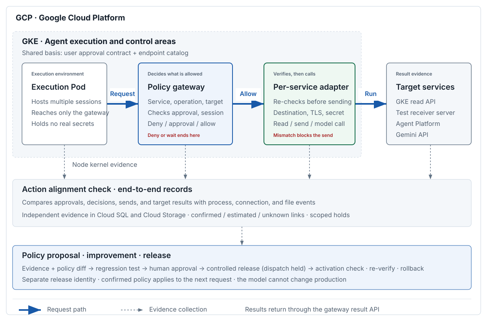

# Agentarium

BeaverDam Community 4Q Project

## Project Documents

- [Final Plan](docs/plan.md): GCP/GKE design, request control · execution evidence · policy improvement MVP, AI assistance features (approval intent comparison · call path discovery), start guarantee as an independent gate and 16 Tasks.
- [Overall Architecture Diagram and Flow Description](docs/architecture.md): Execution Pod → Policy Gateway → Service-Specific Adapter → Target Service.
- [16 Tech Specs by Task](docs/tech-specs/README.md): Technical implementation, API/data, security/failure handling, required resources, verification · result recording.
- [Shared Tech Spec](docs/tech-specs/COMMON.md): Single source of truth (SSOT) for field · enum · API · event names. Normalization · approval · reservation · audit · status · health · result storage conventions.
- [Implementation Plan and Division of Work](docs/implementation-plan.md): Task assignments · schedules · owned paths for two people, shared files and separate PR rules. AI agent work rules are in [AGENTS.md](AGENTS.md).

Documents are maintained in Markdown source. This is the target design as of 2026-10-11; new GCP features are planned for implementation and functional testing has not been run.
