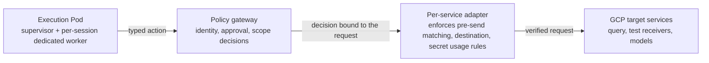
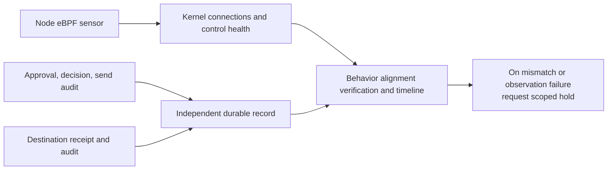
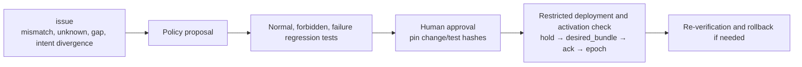

# Agentarium · Overall Architecture

2026-10-11 · GCP/GKE target design · actual implementation and deployment not verified

[Final plan](plan.md) · [Per-task Tech Specs](tech-specs/README.md) · [Shared Spec](tech-specs/COMMON.md)

## Request Flow

| Location | What is checked/enforced | Detailed implementation |
| --- | --- | --- |
| Execution Pod | Least privilege, restricted direct egress, no real service secrets stored. Per-session dedicated workers inside the Pod; file isolation between processes with the same UID is not guaranteed | [Placement](tech-specs/TASK-01-gke-platform.md), [egress and credentials](tech-specs/TASK-06-egress-credentials.md), [runtime](tech-specs/TASK-15-runtime-integration.md) |
| Policy gateway | Decides with Rego who may use which service, action, target, environment, and data scope. Checks user approval, standing rules, session budget, expiry, and policy epoch/health. Uses approval intent check results only to make a decision stricter. On allow, it calls the adapter asynchronously, and the runtime receives the result through the result query API | [Identity and approval](tech-specs/TASK-03-identity-approval.md), [gateway](tech-specs/TASK-04-policy-gateway.md) |
| Per-service adapter | Deterministically matches the approved request against the actual outbound send (second line of defense behind the gateway decision). Enforces route, DNS/peer IP, TLS, body, secret, and retries. The adapter transport recorder leaves an AdapterObservation for matching against kernel connections | [Catalog](tech-specs/TASK-02-catalog-contracts.md), [adapter](tech-specs/TASK-05-service-adapters.md) |
| Target service | Provides evidence of actual receipt, acceptance, and effect. Kept separate from the adapter's own records | [Destination receipt](tech-specs/TASK-08-destination-evidence.md) |

**Implementation languages:** Services that require deterministic enforcement, such as the gateway, dispatch coordinator, adapters, recording, and node components, are implemented in Go. The ADK runtime, policy proposals, intent check, discovery, timeline, and regression harness are implemented in Python 3.12. The console is implemented in TypeScript/React. OPA is embedded in the gateway process as a Go library, with no sidecar. The gateway and adapters fetch from GCS the signed bundle referenced by the `desired_bundle` row written by the deployer, verify its signature with the OPA bundle reader, and record the bundle revision used for evaluation. For every decision they record the decision basis (`decision_basis`: one of user approval, standing rule, service session profile, or activation probe), the basis rule IDs (`matched_rule_ids`), the evaluated rule IDs (`evaluated_rule_ids`), and a sanitized snapshot of the decision input. Service callers (policy proposals, intent check, discovery, deployer) are allowed only within the profile scope set by the server and cannot receive user approval.

**Identity and installation values:** Only the identity service issues service and workload mTLS certificates, through a Certificate Authority Service CA pool (SAN `ns/<namespace>/sa/<KSA>`, 24-hour lifetime). Installation values such as the node image, release channel, and key IDs are pinned in a single file, `deploy/gcp/environment.lock.json`. The source of truth is [the implementation stack in the Shared Spec](tech-specs/COMMON.md#implementation-stack-and-decision-status).

The execution Pod goes only through the gateway. The policy proposal service also goes through the gateway with a service session to call the model adapter and the evidence query adapter. The DNS/internet restriction does not mean that external work is forbidden; it means that an allowed adapter connects on the Pod's behalf. TASK-06 tests both the actual blocking and the success of the normal routed path together.

**Mandatory work-start guarantee (2026-10-12):** The [COMMON work-start contract](tech-specs/COMMON.md#agent-work-startup-contract) enforces this sequence: trusted supervisor initialization → actual node observation/policy/collection readiness → identification/filtering/durable record of the Pod → per-session dedicated worker bootstrap → independent observation of the worker exec and COMMIT of the session binding → session permissions/budget → start of work on that worker. Multiple sessions are maintained, and the checks are repeated at new work/turn, resume, and model/tool control points. The startup_guard_gate before the container's first program is an optional hardening and does not replace the default gate. Implementation and functional verification are planned/not_run.

## Evidence and Behavior Alignment Verification

[Audit storage](tech-specs/TASK-07-audit-store.md) keeps a durable record before each attempt and the evidence after it. The [sensor](tech-specs/TASK-09-node-sensor.md) collects selected behavior on the node, and [correlation/health verification](tech-specs/TASK-10-correlation-health.md) marks links as confirmed, workload-inferred, or unknown. The [timeline](tech-specs/TASK-11-alignment-timeline.md) matches approvals against actual send, receipt, and effect.

**Hold model:** A hold is a durable record with a scope (global, node, workload, target, session) and a reason. The verifier, audit storage, sensor, and deployer only request holds; the control-health service (TASK-10) decides them, and each reason can be released only by its owning component. A transient failure with a clear cause is released automatically after the probe passes, while security reasons (drift, bypass, sensor tampering, alignment mismatch) are released only with operator approval. Holds during policy activation are also kept in the same model, with the reason `policy_activation`. If a COMMIT to the independent DB is not possible, a hold is placed; external export delay is marked `degraded`, and a hold is placed once it exceeds the limit.

Multiple sessions in one Pod are not linked with certainty from PID, IP, and time alone. Strong session isolation of shared files/memory is not guaranteed. API acceptance, actual effect, and insufficient evidence are distinguished, as are host/guest observation gaps and the limits posed by administrator/node compromise.

Short-lived Pods are handled by the [common startup contract](tech-specs/COMMON.md#short-lived-pod-start-lifecycle-and-loss-contract). The mandatory MVP scope is filter readiness at the create stage, runtime/API lifecycle recording, ObservationGap, and 30-day retention. Raw lifecycle facts and deletion tombstones are stored independently for the retention period of the kernel source data, and late events are linked to past UIDs. The exporter's WAL fsync → DB COMMIT ack → GCS outbox boundaries are kept distinct. Unrecoverable sequence ranges, unexported events from forced node loss, and expired watch history are recorded as gap/unknown. Planned maintenance follows the order cordon → hold → spool/ack check → drain. Implementation and functional verification of the [sensor](tech-specs/TASK-09-node-sensor.md), [lifecycle/health](tech-specs/TASK-10-correlation-health.md), and [short Pod tests](tech-specs/TASK-13-regression-harness.md) are planned.

The startup guarantee before the first code execution is the independent gate `startup_guard_gate` and follows the [startup guarantee contract](tech-specs/COMMON.md#execution-start-guarantee-contract). It is enabled only on node/runtime combinations that passed Q0. Under this gate, the node runtime bridge checks node/boot, sensor generation, required hooks, Pod/container filter mapping, WAL, and the lifecycle durable record before the first container code runs, and consumes a start permit. The steps are ordered as permit consumption → start intent in the independent DB → local journal fsync → final check → return of allow (followed by containerd `task.Start`). If an exec is observed without a consumed permit, it is recorded as a bypass and the workload is held. Admission/Ready/heartbeat alone do not substitute for this. Whether this enforcement point can be installed and maintained on GKE has not been verified in Q0. If Q0 fails, `startup_capture=unsupported` is recorded and short Pods are reported in observable-scope and gap-reporting mode; this result does not block the completion decision of other features. No claim of losslessness is made for unplanned sensor failures after the final check.

## Policy Improvement Flow

The [proposal](tech-specs/TASK-12-policy-proposals.md) model has no permission to make operational changes. A deterministic builder produces the patch and diff of the least-privilege draft, and the model only proposes builder parameters, explanations, and evidence links. Sensor rule changes are proposed only as patches written by an operator. [Regression tests](tech-specs/TASK-13-regression-harness.md) run in a test environment in a separate GCP project and exchange data with the production project only through GCS buckets (`regression-requests`, `regression-reports`, and `decision-input-exports` for decision replay input), with no network connection. The tests compare baseline and candidate with the same `fixture_set_digest`. The first stage of the regression tests is decision replay (`decision_replay`), which re-evaluates stored decision inputs with the baseline and candidate bundles; the requests whose decisions changed and the differences in basis rules are shown on the approval screen as evidence of normal-traffic impact. For every policy change, a deterministic permission widening check (`permission_widening`) runs, and if there are widened items, the approver must confirm each item. Only the exact change that passed is approved by a human and applied by the [deployer](tech-specs/TASK-14-policy-release.md). Here, "restricted deployment" does not mean canary; it means that a deployment identity with restricted permissions applies the change only to registered targets, holds new dispatches during activation, and then switches the epoch atomically. During periods of mixed versions or observation failure, new executions are held, and only registered activation probes run during this hold.

## AI assist features

In addition to policy suggestions, Gemini (Gemini Enterprise Agent Platform, formerly Vertex AI) handles approval intent matching and call path discovery. AI output can only make a decision stricter or produce warnings and candidates; it never produces an allow or a confirmed state. If a call fails, it is recorded as `not_run` and the deterministic decision is used as is. Every AI call goes through the model adapter.

- **Approval intent matching:** Compares the task description the user entered in the session with the contract rendered by the server and attaches a warning to the approval screen. If a mismatch is found in a request that a standing rule would allow, the request is escalated to approval_required, and the result can become a policy improvement issue.
- **Call path discovery:** Compares static call candidates from version-pinned libraries with dynamic observations taken with controls on/off in the regression test project. Only candidates that have been reproduced and reviewed by a human are promoted to a catalog entry or a deny fixture.

The detailed design is in [Plan 8.3](plan.md#ai-assist) and the [Shared Spec](tech-specs/COMMON.md#google-technology-usage-design).

## Node and Namespace layout

The GKE Standard cluster is created with Dataplane V2, the execution node pool and the control node pool are separated, and per-role Namespace/RBAC/NetworkPolicy/admission are applied together. Nodes are created with a startup taint, and the taint is removed only from nodes that pass the Q0 probe. Regression tests and the dynamic observations of call path discovery run in a cluster in a separate GCP project. Sensors are deployed as DaemonSets on the nodes that need them. Isolation is not considered complete on the basis of Namespace names and taints alone; the actual supported/blocked scope is confirmed with the Q0 and the permission/connection matrix in [TASK-01](tech-specs/TASK-01-gke-platform.md).
