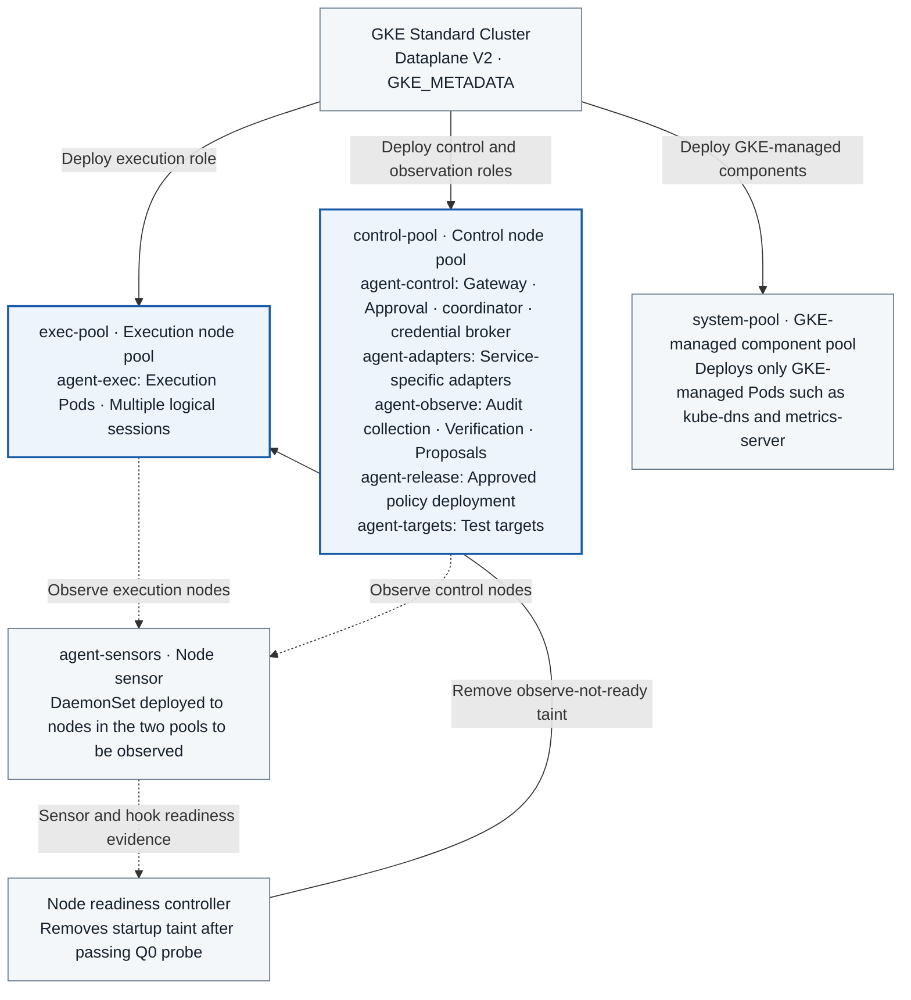

# TASK-01 · GKE Deployment and Platform Verification

> This document specifies the feature to be implemented. Configuration, check items, APIs, storage constraints, and failure handling are implementation contracts; implementation and deployment have not yet been performed. Values generated in the deployment environment are managed as installation inputs.

## Structure at a Glance

> Target design · Implementation, deployment, and functional effects are not yet verified. Solid lines indicate deployment, processing, and invocations; dashed lines indicate reference and observation evidence, distinguished by the labels on the arrows.



**How to read:** A node pool is a group of servers where Pods run, and `agent-*` denotes Namespaces divided by role. Sensors in `agent-sensors` are deployed to the nodes of the two pools to be observed, respectively. New nodes register with a startup taint, which is removed by the node readiness controller only after verifying the Q0 probe. `system-pool` is a small pool that hosts only GKE-managed components such as kube-dns; since it is not an observation target, neither sensors nor operational Pods are deployed there (3.5). Separately from the groupings in this diagram, RBAC, NetworkPolicy, and admission are applied, and deployment, permissions, and actual observation are tested in Q0. Deployment details for other targets of change, such as adapters and sensors, are covered in TASK-14.

| Item | Details |
| --- | --- |
| Plan | [Final Plan](../plan.md#task-01) |
| Development Prerequisites | None |
| Integration Dependencies (runtime) | The Q0 harness runs with prototype components from [TASK-07](TASK-07-audit-store.md), [TASK-09](TASK-09-node-sensor.md), and [TASK-10](TASK-10-correlation-health.md), and is re-run once the corresponding Tasks are completed (circular dependency). Egress policy is owned by [TASK-06](TASK-06-egress-credentials.md). |
| Assigned Role | Platform Engineer · Assignee/Target Date TBD |
| Common Conventions | [Shared Tech Spec](COMMON.md) |
| Baseline | Working tree after efe8dce (revised 2026-10-11) |

## 1. Goals and Scope

Separate execution, control, and observation domains in GKE. Verify with Q0 whether Linux/containerd and node sensors actually observe the required behaviors. A Pod serves as the workload authorization boundary, and creating a Pod per logical session is not required.

The completion scope consists of the deployment/IAM/network matrix and runtime compatibility results. Successful GKE installation alone does not determine the success of security controls or observation.

"Startup guarantee before first code execution" (start permit consumption, runtime guard, native start wrapping) is evaluated by an independent gate, `startup_guard_gate`. This gate is activated only on node/runtime combinations that have passed Q0. If it fails, it is recorded as `startup_capture=unsupported`, and short-lived Pods are included in the MVP report under the "observable scope and gap reporting" mode (create-stage filter preparation, lifecycle recording, ObservationGap). Even if this gate fails, it does not block the installation, testing, and completion determination of deployment, permissions, and kernel observation (process exec/exit and lineage of long-running Pods, selective connections, selective protected paths).

**MVP Mandatory Task Initiation Conditions:** Trust initialization → Preparation of actual node sensor/policy/log collection → Identification/filtering/durable record for the corresponding Pod → Session authorization/budget → Start session runner task. TASK-15 enforces the COMMON contract. Taint removal is an initial deployment condition, not an operational authorization for Pods/sessions. New nodes, Pod replacements, container/runtime restarts, and sensor reloads are also verified. Lack of support for startup_guard_gate is not an opt-out from the basic task gate.

## 2. Required Environment, Inputs, and Resources

- A team-owned GCP project, a test VPC, subnets, a GKE Standard environment, a billing owner, and per-service IAM roles are required. The GKE mode is finalized as Standard, and Autopilot is out of scope.
- The regression test environment is created as a **separate cluster in a separate GCP project**. This is because clusters in the same project share the same workload identity pool (`PROJECT_ID.svc.id.goog`), and IAM treats them as the same principal if the namespace and KSA names match. This environment is created by reusing the same Terraform module with `env = regression`. If the same project must be used, an alternative of changing namespace names is used, but the limitation that permissions may mix if naming conventions are violated must be documented in the report. [GKE WIF Concepts](https://docs.cloud.google.com/kubernetes-engine/docs/concepts/workload-identity)
- Pin versions for Terraform, kubectl, Kustomize, as well as GKE, Kubernetes, node OS, kernel, container runtime, and sensor. Do not deploy latest tags as-is.
- Apply the initial resource configurations from 3.3 and adjust based on load testing results. Execution Pods are configured with limits for CPU, memory, and ephemeral storage, as well as Namespace quotas.
- Prepare fixed ground-truth probes for process execution, TCP connections, and protected path access. Separate file access failure and success respectively.
## 3. Technical implementation design

1. Declare the VPC, GKE, execution/control node pools, and service accounts in `platform/gcp/`. The cluster is pinned to Dataplane V2 (`datapath_provider = ADVANCED_DATAPATH`) at creation time. Dataplane V2 can be enabled only when a new cluster is created, and it has built-in NetworkPolicy enforcement. [GKE Dataplane V2](https://docs.cloud.google.com/kubernetes-engine/docs/how-to/dataplane-v2)
2. Set `workload_metadata_config.mode = GKE_METADATA` on all node pools. In node pools with the GKE metadata server enabled, Pods cannot access the Compute Engine metadata server. However, hostNetwork Pods do not use Workload Identity Federation for GKE and connect to the Compute Engine metadata server, so the node service account is a dedicated account that has only `roles/container.defaultNodeServiceAccount` and image repository read permission. [GKE WIF concepts](https://docs.cloud.google.com/kubernetes-engine/docs/concepts/workload-identity), [Node service accounts](https://docs.cloud.google.com/kubernetes-engine/security/configure-node-service-accounts)
3. The execution pool has a dedicated taint `agentarium-role=exec:NoSchedule`, and the execution Deployment sets both a toleration and a protected nodeSelector. Both pools have the start taint `agentarium.io/observe-not-ready=true:NoSchedule` set in the node pool configuration (3.5). To prevent a deadlock in which control services cannot start because of the control-pool start taint, Pods of the bootstrap roles (`agent-control`, `agent-observe`, `agent-release`, `agent-targets`, `agent-sensors`), which are the side that judges observation readiness, tolerate the start taint. Work Pods of `agent-adapters` and `agent-exec`, which are observation targets, cannot tolerate this taint (3.2 VAP). Therefore adapters are not scheduled before the control-pool nodes are ready. If both pools have the start taint, GKE managed components such as kube-dns and metrics-server cannot be scheduled either, because these components do not have a matching toleration. Then the bootstrap roles cannot use cluster DNS either, and the condition for removing the taint is never met. To prevent this deadlock, a separate `system-pool` dedicated to GKE managed components is created, with the taint `components.gke.io/gke-managed-components=true:NoSchedule` set in the node pool configuration (3.5). [GKE node taints](https://docs.cloud.google.com/kubernetes-engine/docs/how-to/node-taints)
4. The node image is pinned to `COS_CONTAINERD`, the nodes to private nodes (no external IP), the network to IPv4 only, and the release channel to `REGULAR`. The values and the rationale for the decisions are in the lock table in chapter 4.
5. Create the `agent-exec`, `agent-control`, `agent-adapters`, `agent-observe`, `agent-sensors`, `agent-release`, and `agent-targets` Namespaces per role. Namespaces themselves are not regarded as a control enforcement mechanism; RBAC, NetworkPolicy, and admission are applied together.
6. The execution Namespace is based on Restricted Pod Security. The exception for privileged sensors is limited to the sensor Namespace, approved SAs, and pinned images. Execution principals cannot change other Namespaces/node labels or workload specs.
7. Verify whether the admission that restricts node pool selection and the protected labels actually provide protection. It is not claimed that taints alone prevent placement by administrators or privileged schedulers.
8. In the Q0 compatibility test, record per-runtime host/guest kernel differences, hook support, event loss, and cgroup/container identification. It is not assumed that all behavior inside gVisor can be seen with host eBPF.
9. If a required kernel observation behavior is not observed, the MVP platform gate fails. No fallback that silently lowers the isolation strength is created. The judgment of `startup_guard_gate` is separate from this platform gate.
10. Enable the GKE Secret Manager add-on (managed Secrets Store CSI) on the cluster. In Terraform google provider 8.6.0 this is `secret_manager_config { enabled = true }` of `google_container_cluster`, and automatic rotation (`rotation_config`) is not enabled. This add-on requires GKE 1.27.14-gke.1042001 or later and Workload Identity Federation for GKE, and Pods in a Standard cluster must have the nodeSelector `iam.gke.io/gke-metadata-server-enabled: "true"`. The add-on's CSI volume (driver `secrets-store-gke.csi.k8s.io`, `readOnly: true`) is a `csi` volume type that Restricted Pod Security allows. In the MVP, this volume is used only to deliver the identity service's claim key ([TASK-06 3.3](TASK-06-egress-credentials.md#33-secrets-and-wif-permissions-ref)). [Secret Manager add-on](https://docs.cloud.google.com/secret-manager/docs/secret-manager-managed-csi-component)

### 3.1 Placement and Admission implementation decisions

Start on Linux/containerd nodes of GKE Standard. Create `exec-pool` and `control-pool` separately, and add a `system-pool` for GKE managed components. Execution Pods are forced to have a protected `nodeSelector` and a dedicated toleration. Multiple logical sessions in the same Pod are allowed. A rule that limits the number of containers to one is not a rule that limits the number of sessions. Adoption of gVisor is handled as a separate change that passes Q0 again.

The protected label key uses `node-restriction.kubernetes.io/agentarium-role`, in the format of the GKE documentation. The GKE documentation explains that if this prefix is used for node isolation labels, the label cannot be set or changed with node credentials. Node pool level labels are also attached automatically to nodes newly created by autoscaling and the like. This prefix only blocks the kubelet from changing its own labels, so a principal with `nodes` patch permission can still change the label. [GKE dedicated node placement](https://docs.cloud.google.com/kubernetes-engine/docs/how-to/isolate-workloads-dedicated-nodes)

Pod Admission is the stage in which the API server inspects the spec after receiving a Pod create or update request and before storing it. The following policies are applied **together**.

| Check item | Enforcement mechanism | Implementation values and rejection conditions |
| --- | --- | --- |
| Host privileges | Pod Security Admission `restricted` | Rejects `privileged`, `hostNetwork`, `hostPID`, `hostIPC`, `hostPath`, and capabilities outside the allowed set. |
| Linux security settings | Pod Security Admission + container spec | Uses `runAsNonRoot: true`, UID 10001, `allowPrivilegeEscalation: false`, `seccompProfile: RuntimeDefault`, `capabilities.drop: [ALL]`. |
| Identity and token | ValidatingAdmissionPolicy | Allows only the SA `agent-runtime` and requires `automountServiceAccountToken: false`. |
| Execution node | ValidatingAdmissionPolicy + protected label | Allows only `exec` as the value of `node-restriction.kubernetes.io/agentarium-role`. Rejects direct `nodeName` assignment and other schedulers. Does not allow a toleration that tolerates the start taint. |
| Image and process | ValidatingAdmissionPolicy | Allows only approved image digests and the fixed entrypoint. Rejects adding init/ephemeral containers. |
| Files and secrets | ValidatingAdmissionPolicy | The rootfs is read-only. Only one `emptyDir` is allowed as a writable volume. Only the projected token dedicated to mTLS bootstrap is allowed, read-only, and general API tokens, Secrets, PVCs, and envFrom are rejected. |
| runtime | ValidatingAdmissionPolicy | runtimeClass is rejected by default. Only `agentarium-guarded` is allowed, and only when `startup_guard_gate` has passed Q0. Annotations that bypass the NRI required-plugin (such as the configured `tolerate_missing_plugins_annotation` key) are rejected. |
| Resources | ValidatingAdmissionPolicy + LimitRange, ResourceQuota | Requires requests/limits for all of CPU, memory, and ephemeral-storage and enforces upper limits. |
| Spec change permission | RBAC | The execution SA is not granted permission to create or modify Pods, Deployments, Namespaces, policies, or bindings. |

`restricted` alone cannot restrict all of approved images, service accounts, read-only rootfs, and Secret usage. The additional checks are implemented with the following ValidatingAdmissionPolicy. This API became GA in Kubernetes 1.30, so 1.30 or later is a usage condition, and API support and the CEL `typeChecking` results are checked during installation. The execution Deployment is not installed until both the policy and the Binding are registered and the negative tests pass. [Kubernetes Admission documentation](https://kubernetes.io/docs/reference/access-authn-authz/validating-admission-policy/), [Pod Security Standards](https://kubernetes.io/docs/concepts/security/pod-security-standards/)

### Platform conditions for session-dedicated processes

In one Pod/single runtime container, the UID 10001 supervisor fresh-execs a dedicated worker with the same UID. The fixed entrypoint check applies to the container start command and is not a rule that forbids creating approved child worker processes. drop ALL, no privilege escalation, read-only rootfs, and volume restrictions are kept. No SETUID/SETGID permission to switch to an arbitrary other UID is added.

TASK-15's additional process_baseline seccomp/dumpable settings are applied after the final worker exec and before user work, and are verified as a core gate together with TASK-09/10 independent worker observation and session linkage. Resolution of the host /proc PID namespace/start ticks by node-sensors and host PID metadata support are also added to Q0. Inability to install or a failure of normal ADK operation is a failure of the default worker profile. It is independent of NRI being unsupported.

Landlock for file hardening is measured separately for node kernel/LSM/ABI and RuntimeDefault syscall compatibility. Unverified nodes are not marked as supported, and no UID/capability relaxation fallback is made. A distinct UID/container/sandbox is a separate design that requires changing the existing single container/Restricted contract. The actual results are recorded in the TASK-16 lock with process_baseline and the file hardening profile kept separate.
### 3.2 Execution Namespace Policy File

Store the Policy and Binding below in `deploy/gcp/base/admission/agent-exec.yaml`. Populate `runtimeImage` in the `agent-exec-constraints` ConfigMap with the actual `LOCATION-docker.pkg.dev/PROJECT/agentarium/runtime@sha256:DIGEST` built by CI. If this value is absent, rendering fails and is not substituted with `latest` or an arbitrary image. Fix `runtimeCommand` to `/app/bin/agent-runtime`. `probeImages` and `fixtureImages` are comma-separated digest lists of images for the TASK-10 probe runner and short Pod fixtures. Render `guardedRuntimeEnabled` as `"true"` only when there is a record of passing `startup_guard_gate`, and populate `forbiddenAnnotationKeys` with the comma-separated list of NRI-related annotation keys recorded in the Q0 runtime profile. The ConfigMap can only be modified by platform deployers.

```yaml
apiVersion: admissionregistration.k8s.io/v1
kind: ValidatingAdmissionPolicy
metadata:
  name: agent-exec-contract
spec:
  failurePolicy: Fail
  paramKind:
    apiVersion: v1
    kind: ConfigMap
  matchConstraints:
    resourceRules:
      - apiGroups: [""]
        apiVersions: ["v1"]
        operations: [CREATE, UPDATE]
        resources: [pods, pods/ephemeralcontainers]
  matchConditions:
    - name: runtime-profile
      expression: >-
        has(object.metadata.labels) &&
        'app.kubernetes.io/name' in object.metadata.labels &&
        object.metadata.labels['app.kubernetes.io/name'] == 'agent-runtime'
  variables:
    - name: c
      expression: object.spec.containers[0]
  validations:
    - expression: >-
        !has(object.metadata.annotations) ||
        params.data.forbiddenAnnotationKeys.split(',').all(k, !(k in object.metadata.annotations))
      message: EXEC_ANNOTATION_FORBIDDEN
    - expression: >-
        object.spec.serviceAccountName == 'agent-runtime' &&
        has(object.spec.automountServiceAccountToken) &&
        object.spec.automountServiceAccountToken == false
      message: EXEC_IDENTITY_INVALID
    - expression: >-
        has(object.spec.priorityClassName) &&
        object.spec.priorityClassName == 'agentarium-runtime'
      message: EXEC_PRIORITY_CLASS_INVALID
    - expression: >-
        has(object.spec.nodeSelector) &&
        'node-restriction.kubernetes.io/agentarium-role' in object.spec.nodeSelector &&
        object.spec.nodeSelector['node-restriction.kubernetes.io/agentarium-role'] == 'exec' &&
        (!has(object.spec.nodeName) || object.spec.nodeName == '') &&
        object.spec.schedulerName == 'default-scheduler'
      message: EXEC_PLACEMENT_INVALID
    - expression: >-
        object.spec.containers.size() == 1 &&
        variables.c.name == 'agent-runtime' &&
        (!has(object.spec.initContainers) || object.spec.initContainers.size() == 0) &&
        (!has(object.spec.ephemeralContainers) || object.spec.ephemeralContainers.size() == 0)
      message: EXEC_CONTAINER_SET_INVALID
    - expression: >-
        variables.c.image == params.data.runtimeImage &&
        variables.c.command == [params.data.runtimeCommand] &&
        (!has(variables.c.args) || variables.c.args.size() == 0)
      message: EXEC_IMAGE_OR_ENTRYPOINT_INVALID
    - expression: >-
        has(variables.c.securityContext) &&
        has(variables.c.securityContext.readOnlyRootFilesystem) &&
        variables.c.securityContext.readOnlyRootFilesystem == true &&
        has(variables.c.securityContext.runAsUser) &&
        variables.c.securityContext.runAsUser == 10001
      message: EXEC_FILESYSTEM_INVALID
    - expression: >-
        (!has(variables.c.envFrom) || variables.c.envFrom.size() == 0) &&
        (!has(variables.c.env) || variables.c.env.all(e, !has(e.valueFrom))) &&
        (!has(object.spec.imagePullSecrets) || object.spec.imagePullSecrets.size() == 0) &&
        has(object.spec.volumes) && object.spec.volumes.size() == 2 &&
        object.spec.volumes.exists(v, v.name == 'work' && has(v.emptyDir) &&
          has(dyn(v.emptyDir).sizeLimit) && quantity(string(dyn(v.emptyDir).sizeLimit)).compareTo(quantity('512Mi')) <= 0) &&
        object.spec.volumes.exists(v, v.name == 'identity' && has(v.projected) &&
          v.projected.sources.size() == 1 && v.projected.sources.all(s,
            has(s.serviceAccountToken) && s.serviceAccountToken.audience == 'agentarium-identity' &&
            s.serviceAccountToken.expirationSeconds == 600 && s.serviceAccountToken.path == 'token')) &&
        variables.c.volumeMounts.size() == 2 &&
        variables.c.volumeMounts.exists(m, m.name == 'work' && m.mountPath == '/work') &&
        variables.c.volumeMounts.exists(m, m.name == 'identity' &&
          m.mountPath == '/run/agentarium/identity' && m.readOnly == true)
      message: EXEC_SECRET_OR_VOLUME_INVALID
    - expression: >-
        (!has(object.spec.runtimeClassName) ||
          (params.data.guardedRuntimeEnabled == 'true' &&
           object.spec.runtimeClassName == 'agentarium-guarded')) &&
        (!has(object.spec.os) || object.spec.os.name == 'linux')
      message: EXEC_RUNTIME_INVALID
    - expression: >-
        has(variables.c.resources) && has(variables.c.resources.requests) &&
        has(variables.c.resources.limits) &&
        ['cpu', 'memory', 'ephemeral-storage'].all(k,
          k in variables.c.resources.requests && k in variables.c.resources.limits)
      message: EXEC_RESOURCES_REQUIRED
    - expression: >-
        has(object.spec.tolerations) &&
        object.spec.tolerations.exists(t, t.key == 'agentarium-role' &&
          t.operator == 'Equal' && t.value == 'exec' && t.effect == 'NoSchedule') &&
        object.spec.tolerations.all(t,
          (t.key == 'agentarium-role' && t.operator == 'Equal' && t.value == 'exec' && t.effect == 'NoSchedule') ||
          (t.key in ['node.kubernetes.io/not-ready', 'node.kubernetes.io/unreachable'] &&
           t.operator == 'Exists' && t.effect == 'NoExecute' &&
           has(t.tolerationSeconds) && t.tolerationSeconds <= 300))
      message: EXEC_TOLERATION_INVALID
---
apiVersion: admissionregistration.k8s.io/v1
kind: ValidatingAdmissionPolicyBinding
metadata:
  name: agent-exec-contract
spec:
  policyName: agent-exec-contract
  validationActions: [Deny]
  paramRef:
    name: agent-exec-constraints
    namespace: agent-control
    parameterNotFoundAction: Deny
  matchResources:
    namespaceSelector:
      matchLabels:
        kubernetes.io/metadata.name: agent-exec
```

In addition to the runtime, the TASK-10 probe runner (long-running per node, executing ground-truth stimuli) and short Pod fixture Jobs from TASK-09/13 are also deployed in `agent-exec`. The three profiles are divided in the following manner. The `agent-exec-profile` policy applies to all Pods without matchConditions, verifying whether `app.kubernetes.io/name` is one of `agent-runtime`, `probe-runner`, or `start-fixture`, and whether the SA per label (`agent-runtime`, `probe-runner`, `start-fixture`) matches. The above `agent-exec-contract` applies only to the runtime label. `agent-exec-probe-contract` applies to the remaining two labels, enforcing the same host privilege, token, volume, resource, runtimeClass, and annotation rules as the runtime contract, while restricting images to the `probeImages` and `fixtureImages` digest lists in `agent-exec-constraints` and entrypoints to fixed values per image. Only the probe runner needs to execute ground-truth probes before node readiness, so the `agentarium.io/observe-not-ready` toleration is allowed. Note the limitation in the Q0 report that the probe runner is an observation target without API, secret, or DB permissions, and that starting on unready nodes is not covered by startup guarantees. Require `restartPolicy: Never` for fixture Pods. Since `backoffLimit: 0` is a Job field, it is not checked by the Pod policy, but is configured by the TASK-13 runner that creates the Job and verified by the drift probe. Bypassing to another profile by altering labels is prevented by inspecting labels, SAs, and image digests together.
```yaml
apiVersion: admissionregistration.k8s.io/v1
kind: ValidatingAdmissionPolicy
metadata:
  name: agent-exec-profile
spec:
  failurePolicy: Fail
  matchConstraints:
    resourceRules:
      - apiGroups: [""]
        apiVersions: ["v1"]
        operations: [CREATE, UPDATE]
        resources: [pods, pods/ephemeralcontainers, pods/status, pods/resize]
  validations:
    - expression: >-
        has(object.metadata.labels) &&
        'app.kubernetes.io/name' in object.metadata.labels &&
        object.metadata.labels['app.kubernetes.io/name'] in ['agent-runtime', 'probe-runner', 'start-fixture'] &&
        object.spec.serviceAccountName == object.metadata.labels['app.kubernetes.io/name']
      message: EXEC_ROLE_LABEL_INVALID
    - expression: >-
        !has(request.subResource) || request.subResource != 'status' ||
        ((has(object.metadata.labels) ? object.metadata.labels : {}) ==
           (has(oldObject.metadata.labels) ? oldObject.metadata.labels : {}) &&
         (has(object.metadata.annotations) ? object.metadata.annotations : {}) ==
           (has(oldObject.metadata.annotations) ? oldObject.metadata.annotations : {}))
      message: EXEC_STATUS_METADATA_IMMUTABLE
    - expression: >-
        !has(request.subResource) || request.subResource != 'resize'
      message: EXEC_RESIZE_FORBIDDEN
```

A `pods/status` UPDATE reverts the spec and ownerReferences, but saves metadata changes as is. Therefore, a subject with `pods/status` permissions can change Pod labels to another profile (a different KSA identity and NetworkPolicy podSelector, TASK-06) or attach forbidden annotations without policy checks. `agent-exec-profile` also intercepts `pods/status`, requiring that labels and annotations in status requests match their previous values. The two contracts are not applied to `pods/status`. This is because checks that depend on params (`runtimeImage`, `probeImages`) would reject even kubelet status updates for Pods admitted with a previous digest. `pods/resize` reverts labels and annotations to their previous values, but accepts container resources with new values. Because the two contracts are not applied to `pods/resize`, resources changed via resize do not undergo the resource limit checks of the contracts. Therefore, `agent-exec-profile` rejects resize itself in the execution Namespace (`EXEC_RESIZE_FORBIDDEN`).

The same rule is also placed in role Namespaces (`agent-control`, `agent-adapters`, `agent-observe`, `agent-release`, `agent-targets`) and `agent-sensors` as a separate policy, `agent-role-status-metadata`. This policy does not read params.

```yaml
apiVersion: admissionregistration.k8s.io/v1
kind: ValidatingAdmissionPolicy
metadata:
  name: agent-role-status-metadata
spec:
  failurePolicy: Fail
  matchConstraints:
    resourceRules:
      - apiGroups: [""]
        apiVersions: ["v1"]
        operations: [UPDATE]
        resources: [pods/status]
  validations:
    - expression: >-
        (has(object.metadata.labels) ? object.metadata.labels : {}) ==
          (has(oldObject.metadata.labels) ? oldObject.metadata.labels : {}) &&
        (has(object.metadata.annotations) ? object.metadata.annotations : {}) ==
          (has(oldObject.metadata.annotations) ? oldObject.metadata.annotations : {})
      message: ROLE_STATUS_METADATA_IMMUTABLE
---
apiVersion: admissionregistration.k8s.io/v1
kind: ValidatingAdmissionPolicyBinding
metadata:
  name: agent-role-status-metadata
spec:
  policyName: agent-role-status-metadata
  validationActions: [Deny]
  matchResources:
    namespaceSelector:
      matchExpressions:
        - key: kubernetes.io/metadata.name
          operator: In
          values: [agent-control, agent-adapters, agent-observe, agent-release, agent-targets, agent-sensors]
```

The binding for `agent-exec-profile` uses the same namespaceSelector as `agent-exec-contract` and does not set a paramRef. `agent-exec-probe-contract` is placed in the same file with the full text below. The `probeEntrypoints` param is a comma-separated string of `<image digest reference>=<entrypoint path>` pairs, and allows an image and entrypoint only as a pair. Since probe runner is a DaemonSet, it must allow tolerations automatically attached by the DaemonSet controller. The automatic tolerations documented by Kubernetes are `not-ready` and `unreachable` (NoExecute, no `tolerationSeconds`), and `disk-pressure`, `memory-pressure`, `pid-pressure`, and `unschedulable` (NoSchedule); `network-unavailable` is attached only to hostNetwork Pods. [DaemonSet automatic tolerations](https://kubernetes.io/docs/concepts/workloads/controllers/daemonset/#taints-and-tolerations) Whether this list is attached as is in the pinned GKE version and whether VAP does not reject it are Q0 verification items.

```yaml
apiVersion: admissionregistration.k8s.io/v1
kind: ValidatingAdmissionPolicy
metadata:
  name: agent-exec-probe-contract
spec:
  failurePolicy: Fail
  paramKind:
    apiVersion: v1
    kind: ConfigMap
  matchConstraints:
    resourceRules:
      - apiGroups: [""]
        apiVersions: ["v1"]
        operations: [CREATE, UPDATE]
        resources: [pods, pods/ephemeralcontainers]
  matchConditions:
    - name: probe-or-fixture
      expression: >-
        has(object.metadata.labels) &&
        'app.kubernetes.io/name' in object.metadata.labels &&
        object.metadata.labels['app.kubernetes.io/name'] in ['probe-runner', 'start-fixture']
  variables:
    - name: c
      expression: object.spec.containers[0]
    - name: profile
      expression: object.metadata.labels['app.kubernetes.io/name']
    - name: daemonsetTolerations
      expression: >-
        ['node.kubernetes.io/disk-pressure', 'node.kubernetes.io/memory-pressure',
         'node.kubernetes.io/pid-pressure', 'node.kubernetes.io/unschedulable']
  validations:
    - expression: >-
        object.spec.serviceAccountName == variables.profile &&
        has(object.spec.automountServiceAccountToken) &&
        object.spec.automountServiceAccountToken == false &&
        (!has(object.spec.priorityClassName) || object.spec.priorityClassName != 'agentarium-runtime')
      message: PROBE_IDENTITY_INVALID
    - expression: >-
        object.spec.containers.size() == 1 &&
        (!has(object.spec.initContainers) || object.spec.initContainers.size() == 0) &&
        (!has(object.spec.ephemeralContainers) || object.spec.ephemeralContainers.size() == 0) &&
        variables.c.image.contains('@sha256:') &&
        variables.c.image in (variables.profile == 'probe-runner' ?
          params.data.probeImages : params.data.fixtureImages).split(',') &&
        has(variables.c.command) && variables.c.command.size() == 1 &&
        (variables.c.image + '=' + variables.c.command[0]) in params.data.probeEntrypoints.split(',') &&
        (!has(variables.c.args) || variables.c.args.size() == 0)
      message: PROBE_IMAGE_OR_ENTRYPOINT_INVALID
    - expression: >-
        has(variables.c.securityContext) &&
        variables.c.securityContext.readOnlyRootFilesystem == true &&
        variables.c.securityContext.runAsUser == 10001 &&
        (!has(variables.c.envFrom) || variables.c.envFrom.size() == 0) &&
        (!has(variables.c.env) || variables.c.env.all(e, !has(e.valueFrom))) &&
        (!has(object.spec.volumes) || object.spec.volumes.all(v,
          (has(v.emptyDir) && has(dyn(v.emptyDir).sizeLimit)) ||
          (has(v.projected) && v.projected.sources.all(s, has(s.serviceAccountToken) &&
             s.serviceAccountToken.audience == 'agentarium-identity'))))
      message: PROBE_VOLUME_INVALID
    - expression: >-
        has(object.spec.nodeSelector) &&
        'node-restriction.kubernetes.io/agentarium-role' in object.spec.nodeSelector &&
        object.spec.nodeSelector['node-restriction.kubernetes.io/agentarium-role'] == 'exec' &&
        (!has(object.spec.nodeName) || object.spec.nodeName == '') &&
        object.spec.schedulerName == 'default-scheduler'
      message: PROBE_PLACEMENT_INVALID
    - expression: >-
        (!has(object.spec.runtimeClassName) ||
          (params.data.guardedRuntimeEnabled == 'true' &&
           object.spec.runtimeClassName == 'agentarium-guarded')) &&
        (!has(object.metadata.annotations) ||
          params.data.forbiddenAnnotationKeys.split(',').all(k, !(k in object.metadata.annotations)))
      message: PROBE_RUNTIME_INVALID
    - expression: >-
        variables.profile != 'start-fixture' || object.spec.restartPolicy == 'Never'
      message: FIXTURE_RESTART_POLICY_INVALID
    - expression: >-
        !has(object.spec.tolerations) || object.spec.tolerations.all(t,
          (t.key == 'agentarium-role' && t.operator == 'Equal' && t.value == 'exec' && t.effect == 'NoSchedule') ||
          (variables.profile == 'probe-runner' && (
            (t.key == 'agentarium.io/observe-not-ready' && t.effect == 'NoSchedule') ||
            (t.key in ['node.kubernetes.io/not-ready', 'node.kubernetes.io/unreachable'] &&
             t.operator == 'Exists' && t.effect == 'NoExecute') ||
            (t.key in variables.daemonsetTolerations && t.operator == 'Exists' && t.effect == 'NoSchedule'))) ||
          (variables.profile == 'start-fixture' &&
            t.key in ['node.kubernetes.io/not-ready', 'node.kubernetes.io/unreachable'] &&
            t.operator == 'Exists' && t.effect == 'NoExecute' &&
            has(t.tolerationSeconds) && t.tolerationSeconds <= 300))
      message: PROBE_TOLERATION_INVALID
```
Because the DaemonSet controller leaves placement to the default scheduler via per-node `nodeAffinity` (`metadata.name` in `matchFields`) instead of directly writing `nodeName` to Pods, the same prohibition rule on `nodeName` is applied to the probe runner as well. The probe runner in `agent-adapters` is checked via the probe exception of `agent-role-contract` below.

For CEL checks including `quantity()` and `split()`, verify that there are no `expressionWarnings` on the target API server. The type check of the GKE 1.36.4 API server emits an `undefined field` warning because it fails to find the `resource.Quantity` field in the type information. This is true for `emptyDir.sizeLimit`, and reading `resources.limits` directly via the `object` path, such as `object.spec.containers[0].resources.limits`, also emits the same warning. Therefore, these fields are read by wrapping them in `dyn()` (`has(dyn(v.emptyDir).sizeLimit)`), and converted to `quantity(string(...))` when compared. `EXEC_RESOURCES_REQUIRED` checks only the existence of keys for `resources.requests` and `resources.limits` via the variable `variables.c`, and the target API server passed this check without warnings in an unmodified state (both contract policies have 0 `expressionWarnings` at `observedGeneration` 2). It was verified on the target API server that this format passes without warnings, and during execution allows `256Mi` while rejecting `1Gi` and a missing `sizeLimit`. Because the toleration rules do not include `agentarium.io/observe-not-ready` in the allowlist, execution Pods are not placed on nodes where bootstrap taints remain. The default-added `not-ready` and `unreachable` tolerations are allowed only up to a maximum of 300 seconds. If another mutating webhook inserts a container, volume, or toleration, it is rejected according to this contract. To allow it, first modify this specification and test.

A separate policy `agent-role-contract` is also placed in `deploy/gcp/base/admission/agent-roles.yaml` for role Namespaces in the control plane. This policy binds to `agent-control`, `agent-adapters`, `agent-observe`, `agent-release`, and `agent-targets`, and allows a broader specification than the execution Namespace policy, but enforces placement and image provenance in the same manner.

```yaml
apiVersion: admissionregistration.k8s.io/v1
kind: ValidatingAdmissionPolicy
metadata:
  name: agent-role-contract
spec:
  failurePolicy: Fail
  paramKind:
    apiVersion: v1
    kind: ConfigMap
  matchConstraints:
    resourceRules:
      - apiGroups: [""]
        apiVersions: ["v1"]
        operations: [CREATE, UPDATE]
        resources: [pods, pods/ephemeralcontainers]
  variables:
    - name: allowedImages
      expression: params.data[request.namespace + '.images'].split(',')
  validations:
    - expression: >-
        has(object.spec.nodeSelector) &&
        'node-restriction.kubernetes.io/agentarium-role' in object.spec.nodeSelector &&
        object.spec.nodeSelector['node-restriction.kubernetes.io/agentarium-role'] == 'control' &&
        (!has(object.spec.nodeName) || object.spec.nodeName == '') &&
        object.spec.schedulerName == 'default-scheduler'
      message: ROLE_PLACEMENT_INVALID
    - expression: >-
        object.spec.containers.all(c, c.image.contains('@sha256:') && c.image in variables.allowedImages) &&
        (!has(object.spec.initContainers) ||
          object.spec.initContainers.all(c, c.image.contains('@sha256:') && c.image in variables.allowedImages))
      message: ROLE_IMAGE_NOT_ALLOWED
    - expression: >-
        !has(object.spec.ephemeralContainers) || object.spec.ephemeralContainers.size() == 0
      message: ROLE_EPHEMERAL_FORBIDDEN
    - expression: >-
        has(object.metadata.labels) &&
        'app.kubernetes.io/name' in object.metadata.labels &&
        object.metadata.labels['app.kubernetes.io/name'] == object.spec.serviceAccountName &&
        (!has(object.spec.priorityClassName) || object.spec.priorityClassName != 'agentarium-runtime')
      message: ROLE_LABEL_OR_PRIORITY_INVALID
    - expression: >-
        request.namespace != 'agent-adapters' ||
        object.spec.serviceAccountName == 'probe-runner' ||
        !has(object.spec.tolerations) ||
        object.spec.tolerations.all(t, !has(t.key) || t.key != 'agentarium.io/observe-not-ready')
      message: ROLE_ADAPTER_BOOTSTRAP_TOLERATION_FORBIDDEN
    - expression: >-
        !has(object.spec.runtimeClassName) &&
        (!has(object.metadata.annotations) ||
          params.data.forbiddenAnnotationKeys.split(',').all(k, !(k in object.metadata.annotations)))
      message: ROLE_RUNTIME_INVALID
---
apiVersion: admissionregistration.k8s.io/v1
kind: ValidatingAdmissionPolicyBinding
metadata:
  name: agent-role-contract
spec:
  policyName: agent-role-contract
  validationActions: [Deny]
  paramRef:
    name: agent-role-constraints
    namespace: agent-control
    parameterNotFoundAction: Deny
  matchResources:
    namespaceSelector:
      matchExpressions:
        - key: kubernetes.io/metadata.name
          operator: In
          values: [agent-control, agent-adapters, agent-observe, agent-release, agent-targets]
```

The keys of `agent-role-constraints` are as follows. If a key for the corresponding Namespace does not exist, CEL evaluation fails and is rejected according to `failurePolicy: Fail`. The image list must include all service images of that Namespace and the Cloud SQL Auth Proxy native sidecar image. Because gateway embeds OPA as a Go library (TASK-04), gateway Pods do not have an OPA sidecar container or a loopback policy port, and the OPA image digest is not included in the list. The OPA version is locked via the Go dependency lock of the gateway image.

| key | Value (comma-separated list of digest references) |
| --- | --- |
| `agent-control.images` | gateway, identity, coordinator, credential-broker, intent-checker, node-readiness, cloud-sql-proxy |
| `agent-adapters.images` | 4 adapter types (kubernetes-reader, receiver-sender, model, evidence-reader), probe-runner, cloud-sql-proxy |
| `agent-observe.images` | audit, evidence-collector, timeline, correlation, start-coordinator, control-health (including drift-probe), pod-watcher, proposer, discovery, cloud-sql-proxy |
| `agent-release.images` | releaser, cloud-sql-proxy |
| `agent-targets.images` | receiver, probe-sink, start-marker, cloud-sql-proxy |
| `forbiddenAnnotationKeys` | List of NRI-related annotation keys recorded in the Q0 runtime profile |

`agent-sensors` is handled by the sensor exception policy `agent-sensors-contract` (3.2.1).
#### 3.2.1 agent-sensors exception and node change restrictions

`agent-sensors` is the only Namespace that uses PSA `privileged`. In exchange, the `agent-sensors-contract` VAP narrows the scope of the exception. The allowed images are only the `agent-sensors.images` digest list (tetragon, sensors/exporter, lifecycle-recorder, runtime-guard, sensors/netpol-collector). Only the following hostPaths are allowed; other hostPaths and host namespaces other than hostPID are rejected.

| Component (SA) | Allowed hostPath | Purpose |
| --- | --- | --- |
| `tetragon` | `/sys/fs/bpf`, `/proc`, `/sys/fs/cgroup`, `/var/run/cilium`, `/var/run/tetragon`, `/var/run/cilium/tetragon` (export directory), `/var/lib/agentarium/sensor-spool` (owner-only). The hostPath set that a worker observation deployment must satisfy is these seven paths. The existing deployment has six paths without `/sys/fs/cgroup`, so host mounts are not extended until all the deployment preconditions below are verified. The installation input `TETRAGON_HOST_PATHS` is updated only after the actual rendering result matches this set. In this Pod, every container except the regular container named `tetragon` (including init and ephemeral containers, regardless of name or image) mounts the export directory only with `readOnly: true`, the spool only read-write, and `/proc` and `/sys/fs/cgroup` with all of `readOnly: true`, `recursiveReadOnly: Enabled`, and `mountPropagation: None` stated explicitly, and mounts no other hostPath. The exporter reads `/proc` and `/sys/fs/cgroup` only for the TASK-09 independent session worker observation (checking host PID, NSpid, start ticks, and cgroup inode). Because no capabilities are added, it cannot read `/proc/<pid>/ns` of processes with other UIDs, and the PID namespace inode is obtained from Tetragon `process.ns.pid`. The exporter is not given the Tetragon gRPC socket (`/var/run/tetragon`). The reason is that the socket also provides the TracingPolicy add/delete API, which conflicts with TASK-09 3.1's "the export account is not given policy deployment permission". Because the Tetragon container writes sockets and state files in `/var/run/cilium` and `/var/run/tetragon`, the chart mounts them read-write and they cannot be changed to read-only. Because a privileged container can remount a read-only mount as writable, every container except `tetragon` is not `privileged`, states `allowPrivilegeEscalation: false` explicitly, and adds no capabilities. The `tetragon` container uses only the digest of the installation input `TETRAGON_IMAGE` (param `agent-sensors.tetragon.image`, which must also be in `agent-sensors.images`), and other containers do not use that image | eBPF attachment, Tetragon state directory, export files, exporter WAL. The permission record is TASK-09 `deploy/gcp/sensors/sensor-permissions.json` |
| `lifecycle-recorder` | `/run/containerd/containerd.sock`, `/sys/fs/cgroup` (`readOnly: true`), `/var/lib/agentarium/lifecycle-spool` (owner-only). Only the regular container named `containerd-proxy` mounts the containerd socket, and that container mounts no hostPath other than the socket. Other containers (including init and ephemeral containers, regardless of name or image) do not mount the socket. This Pod does not use `hostNetwork`, `hostPID`, or `shareProcessNamespace`. No container is `privileged`, every container states `allowPrivilegeEscalation: false` explicitly, and the only added capability is `CHOWN` on the init container `spool-owner`. Containers other than `containerd-proxy` and `spool-owner` state `runAsNonRoot: true` explicitly. `containerd-proxy` mounts no volumes other than the socket and emptyDir (including projected tokens) | containerd event subscription (through a proxy that forwards only allowed methods), cgroup inode check, recorder WAL (TASK-09 3.6 containerd access boundary) |
| `runtime-guard` | `/var/run/nri` (NRI socket directory) | NRI plugin connection (`startup_guard_gate`) |
| `netpol-collector` | `/var/log/network` (`readOnly: true`), `/var/lib/agentarium/netpol-spool` (owner-only) | Reading network policy log node files and the collector WAL ([TASK-06 3.4](TASK-06-egress-credentials.md#34-network-policy-logging-configuration)) |

**Deployment preconditions for exporter host procfs:** The following are required conditions for extending the `/proc` mount, and document approval alone does not mean the existing deployment satisfies them.

- The exporter states UID 0 and GID 0 explicitly, drops all capabilities, and does not use hostPID, hostIPC, or shareProcessNamespace. The allowed process lookups are only enumerating PID directories and reading `status`, `stat`, and `cgroup`. It does not open or follow `environ`, `fd`, `mem`, `ns`, or `root`. We do not claim that this code rule alone stops a compromised exporter.
- Unprivileged containers that mount a node management socket (`containerd-proxy`, NRI `runtime-guard`, and future sidecars of the same kind) apply `PR_SET_DUMPABLE(0)` at startup after finishing UID/GID and capability setup, and use the socket only after confirming success. On failure they exit, and afterwards they do not set dumpable back to 1 or `exec`. The GID 65532 of `containerd-proxy` is also kept, but a GID difference alone is not treated as a security boundary. Socket bypass access through `/proc/<pid>/root` must be denied even for processes with the same UID as the exporter. [Linux proc_pid_root](https://man7.org/linux/man-pages/man5/proc_pid_root.5.html), [ptrace access check](https://man7.org/linux/man-pages/man2/ptrace.2.html).
- The VAP does not look only at hostPath volume names; it checks each container/initContainer/ephemeralContainer mount by linking it to the corresponding volume. The existing `/procRoot` read-write exception for the regular `tetragon` container is kept. A host `/proc` or `/sys/fs/cgroup` mount by another container is rejected if any of the three options above is missing or if `recursiveReadOnly = IfPossible`.
- Recursive read-only support is not inferred from the Kubernetes version alone. The supported kernel, CRI, and OCI runtime are checked, and it is verified that `status.containerStatuses[].volumeMounts[].recursiveReadOnly` of the actual Pod is `Enabled`. If it is not supported or cannot be confirmed, host mounts are not extended and the worker gate stays not ready. [Kubernetes recursive read-only mounts](https://kubernetes.io/docs/concepts/storage/volumes/#recursive-read-only-mounts).
- The deployment PR aligns `TETRAGON_HOST_PATHS` in `deploy/gcp/base/render.py`, `tetragon-values.yaml`, the sensor renderer/config, `sensor-permissions.json`, the README mount list, the VAP, and the equivalence tests together. Along with allowed fixtures, it checks rejection of a missing recursive flag, IfPossible, HostToContainer propagation, and ephemeral bypass. Linux runtime tests confirm that reading allowed proc files succeeds, that access to `/proc/<pid>/root`, `fd`, and `environ` of the socket-holding process is denied, and that writes to procfs submounts are denied. Actual GKE/COS verification leaves separate Q0 evidence, and if not run, it is `not_run`.

Whether these paths are the actual locations on GKE COS nodes and are accessible with the given permissions, and whether NRI settings persist under the COS read-only root filesystem (`/etc` is writable but reset on reboot), are Q0 verification items. [COS security overview](https://docs.cloud.google.com/container-optimized-os/docs/concepts/security)

The `node-readiness` KSA needs `get`, `list`, `watch`, and `patch` on `nodes` to fix node taints. Because RBAC alone cannot narrow the patch scope to taints, the VAP `node-readiness-scope` is placed on nodes UPDATE. This policy applies only when the requester is `system:serviceaccount:agent-control:node-readiness`, and the taint list excluding `agentarium.io/observe-not-ready`, the labels, and the annotations must be the same before and after the change. Target nodes are limited to nodes whose protected label `node-restriction.kubernetes.io/agentarium-role` is `exec` or `control`. System-pool nodes do not have the startup taint, so, separately from the informer selector in the controller code, the API server also prevents this SA from changing system nodes. The reason is that if the controller has a defect or the token leaks and a startup taint is put on a system node, the deadlock in which kube-dns loses a place to be rescheduled recurs.

```yaml
apiVersion: admissionregistration.k8s.io/v1
kind: ValidatingAdmissionPolicy
metadata:
  name: node-readiness-scope
spec:
  failurePolicy: Fail
  matchConstraints:
    resourceRules:
      - apiGroups: [""]
        apiVersions: ["v1"]
        operations: [UPDATE]
        resources: [nodes]
  matchConditions:
    - name: node-readiness-only
      expression: request.userInfo.username == 'system:serviceaccount:agent-control:node-readiness'
  variables:
    - name: newTaints
      expression: >-
        has(object.spec.taints) ?
          object.spec.taints.filter(t, t.key != 'agentarium.io/observe-not-ready') : []
    - name: oldTaints
      expression: >-
        has(oldObject.spec.taints) ?
          oldObject.spec.taints.filter(t, t.key != 'agentarium.io/observe-not-ready') : []
  validations:
    - expression: >-
        variables.newTaints == variables.oldTaints &&
        (has(object.metadata.labels) ? object.metadata.labels : {}) ==
          (has(oldObject.metadata.labels) ? oldObject.metadata.labels : {}) &&
        (has(object.metadata.annotations) ? object.metadata.annotations : {}) ==
          (has(oldObject.metadata.annotations) ? oldObject.metadata.annotations : {}) &&
        (has(object.spec.unschedulable) ? object.spec.unschedulable : false) ==
          (has(oldObject.spec.unschedulable) ? oldObject.spec.unschedulable : false)
      message: NODE_READINESS_SCOPE_INVALID
    - expression: >-
        has(oldObject.metadata.labels) &&
        'node-restriction.kubernetes.io/agentarium-role' in oldObject.metadata.labels &&
        oldObject.metadata.labels['node-restriction.kubernetes.io/agentarium-role'] in ['exec', 'control']
      message: NODE_READINESS_SCOPE_INVALID
---
apiVersion: admissionregistration.k8s.io/v1
kind: ValidatingAdmissionPolicyBinding
metadata:
  name: node-readiness-scope
spec:
  policyName: node-readiness-scope
  validationActions: [Deny]
```

`nodes/status` is not granted to node-readiness. Because a taint list comparison in CEL requires the same order as well, the controller sends only JSON patches that do not reorder other taints.

The Namespace's `pod-security.kubernetes.io/enforce`, `audit`, and `warn` are all set to `restricted`, and each `*-version` is pinned to the minor version of the installation target. These values are rendered from `environment.lock.json`. Only `agent-sensors` applies a separate exception policy because of the sensors' host permissions, and RBAC is restricted so that execution Pods cannot use that Namespace.

### 3.3 Execution Pod and resource limits

The metadata label of the Pod template in `deploy/gcp/base/runtime/deployment.yaml` is fixed to `app.kubernetes.io/name: agent-runtime`, and the spec uses the fields below. The renderer fills the `image` field with the actual digest registered earlier. The gateway Service declares `spec.clusterIP` as a fixed value (TASK-06), and that IP and the certificate DNS name are passed to the runtime as environment variables, not secrets. The CA bundle that verifies the gateway is included in the runtime image. The runtime receives the session credential by claiming it with workload mTLS (TASK-03). No kubeconfig or service secret is mounted as a file. Only an audience-restricted token for obtaining the workload identity is mounted at a separate read-only path.

```yaml
serviceAccountName: agent-runtime
automountServiceAccountToken: false
priorityClassName: agentarium-runtime
schedulerName: default-scheduler
nodeSelector:
  node-restriction.kubernetes.io/agentarium-role: exec
tolerations:
  - key: agentarium-role
    operator: Equal
    value: exec
    effect: NoSchedule
securityContext:
  runAsNonRoot: true
  seccompProfile:
    type: RuntimeDefault
containers:
  - name: agent-runtime
    command: [/app/bin/agent-runtime]
    securityContext:
      runAsUser: 10001
      runAsNonRoot: true
      readOnlyRootFilesystem: true
      allowPrivilegeEscalation: false
      capabilities:
        drop: [ALL]
    resources:
      requests:
        cpu: 500m
        memory: 512Mi
        ephemeral-storage: 256Mi
      limits:
        cpu: "2"
        memory: 2Gi
        ephemeral-storage: 2Gi
    volumeMounts:
      - name: work
        mountPath: /work
      - name: identity
        mountPath: /run/agentarium/identity
        readOnly: true
volumes:
  - name: work
    emptyDir:
      sizeLimit: 512Mi
  - name: identity
    projected:
      sources:
        - serviceAccountToken:
            audience: agentarium-identity
            expirationSeconds: 600
            path: token
```

The `image` of this Pod template is not an arbitrary omitted value; it is a deployment input that must be inserted at render time. The renderer rejects missing required values and malformed digests. The Deployment starts with `replicas: 4`, `strategy.rollingUpdate.maxSurge: 1`, and `maxUnavailable: 0`. The LimitRange sets the container maximums for CPU, memory, and ephemeral-storage to `2`, `2Gi`, and `2Gi` respectively. Runtime Pods get the PriorityClass `agentarium-runtime` (value 1000, `preemptionPolicy: Never`), and Admission allows this value only for the runtime. ResourceQuota is split by PriorityClass scope. The runtime quota `agent-runtime-quota` counts only runtime Pods through `PriorityClass In [agentarium-runtime]` in `scopeSelector`, and starts with 5 Pods, requests CPU `2500m`/memory `2560Mi`, and limits CPU `10`/memory `10Gi`. These values are 4 replicas plus 1 rollout surge, so when the replica count increases, the quota must be increased as well. The PriorityClass scope section of the Kubernetes documentation lists ephemeral-storage as a trackable resource, but the API server's validation code allows only the Pod count and CPU/memory items for the PriorityClass scope ([`IsResourceQuotaScopeValidForResource`, release-1.36](https://github.com/kubernetes/kubernetes/blob/a5f728b0d390216087cb65c7eed517ec947bf8e2/pkg/apis/core/helper/helpers.go#L133-L167)). Therefore, adding an ephemeral-storage item to this quota is rejected with `unsupported scope applied to resource` (confirmed with a server dry-run against the GKE 1.36.4 API server). So ephemeral-storage is not put into this quota. Instead, Admission requires requests/limits (`EXEC_RESOURCES_REQUIRED`), the LimitRange caps each container at `2Gi`, and because a runtime Pod is allowed only one container, the total for 5 Pods is bounded at `10Gi` or less. The probe runner and fixtures are counted separately in `agent-probe-quota` with the `PriorityClass NotIn [agentarium-runtime]` scope (Pods = number of exec nodes + fixture concurrency limit of 20, initial value). Therefore probes and fixtures do not block a runtime rollout. When changing the [ResourceQuota PriorityClass scope](https://kubernetes.io/docs/concepts/policy/resource-quotas/#resource-quota-per-priorityclass) values, load results and the approved change are recorded.

The permissions of the platform deployer that submits execution Pods differ from the permissions of the SA inside the execution Pod. The deployer can create only allowed Pods, and the execution SA cannot access the creation API at all. Therefore negative tests are divided into two kinds.

- **Admission verification:** A normal Pod and each of the variants below are submitted with the platform test account. The variants are `privileged=true`, selecting a control node, a Secret volume, a different image digest, adding an ephemeral container, automatic token mount, a different projected token audience, a runtimeClass outside the allowed set, an NRI bypass annotation, toleration of the startup taint, and removal of resources. Both the rejection message and the absence of the Pod are checked. Even if creating the Deployment itself succeeds, if Admission rejects the child Pod, the ReplicaSet's `FailedCreate` is recorded as a failure.
- **RBAC verification:** The test harness obtains a short-lived token for the `agent-runtime` SA from outside the cluster, calls changes to Pods, Deployments, Namespaces, NetworkPolicies, RBAC, and node labels, and confirms 403. It is separately confirmed that API server egress itself is blocked inside the execution Pod (TASK-06).

Whether protected labels are actually protected in the cluster is confirmed by Q0 tests. `pods/binding`, node label changes, deletion of Admission policies, and changes to Namespace PSS labels are not allowed for general service SAs, not just the execution SA. Only the node readiness controller has permission to remove node taints. Cluster administrator permissions are the trust ceiling of this boundary.

### 3.4 Starting containers after observation readiness

All containers of observed exec/adapters follow the [COMMON startup contract](COMMON.md#short-lived-pod-start-lifecycle-and-loss-contract). New nodes are not ready for observation by default because of the startup taint. The node readiness controller removes the taint and makes a node an execution candidate only after checking the sensor, required hooks/rules, exporter/WAL, lifecycle recorder, and Q0 probe for each node/boot (3.5). Protected node labels/taints and Admission restrict incorrect placement and opt-out, and final enforcement of the dynamically changing readiness state is performed in the runtime start path when `startup_guard_gate` has passed.

Q0 checks whether an OCI/NRI runtime bridge can be installed on the pinned GKE containerd, whether namespace/label mapping is applied before the first code, and whether the hook persists across init/main/sidecar containers, restarts, and node upgrades. It checks start permit issuance and single consumption through the DB lifecycle COMMIT, and an independent runner verifies zero first-code executions when the sensor/DB is not ready or the hook connection fails. The evidence that the first code did not run combines the marker method defined by COMMON and TASK-13 (the first action of the fixture entrypoint records to an external marker server) with the guard journal and CRI `StartedAt`. If unsupported, `startup_capture=unsupported` fails only `startup_guard_gate`. It is not assumed that GKE provides this integration by default. [Tetragon Runtime Hooks](https://tetragon.io/docs/concepts/runtime-hooks/)

Pod readiness/startup probes, Pod Scheduling Gates, and Admission alone are not taken as proof that execution of the first container code was prevented. Waiting in the entrypoint is effective only for work execution after a trusted launcher has started, and is not a substitute for observing the entire container. Unapproved ephemeral containers and specifications that bypass runtime hooks are rejected. Bootstrap exceptions for the sensor, recorder, and coordinator are managed with a fixed list of identities/images/roles, and observed targets are not included in it.

On node reboot or sensor reload, the generation is updated to invalidate old start permits. Planned maintenance follows the manual procedure in 3.5 and the hold/exit/export/ack order in TASK-10. Forced node loss leaves an unrecoverable gap. A failure race between the startup readiness check and subsequent health detection is not interpreted as a lossless guarantee.

#### 3.4.1 Required runtime guard and Q0 support decision

The [COMMON execution start guarantee contract](COMMON.md#execution-start-guarantee-contract) is the support condition for `startup_guard_gate`. Separately from NRI hook injection, a trusted runtime handler/guard verifies that the required guard has been applied to the actual OCI spec and the starting instance. No path is allowed in which a container with no hook at all starts because a plugin stopped or was not registered. Admission and the node readiness taint are auxiliary controls, and a guard failure that occurs after the taint has been removed must also be rejected at runtime.

Vendor facts taken as design assumptions are distinguished from Q0 verification items.

| Category | Content | Basis/status |
| --- | --- | --- |
| GKE user configuration scope | The GKE containerd user configuration document allows three items: `privateRegistryAccessConfig`, `registryHosts`, and `writableCgroups`. Enabling NRI or adding a runtime handler is not among these supported settings. | Confirmed: [GKE containerd configuration](https://docs.cloud.google.com/kubernetes-engine/docs/how-to/customize-containerd-configuration) |
| Risk of unsupported changes | Changing the node's containerd configuration or runc with a privileged DaemonSet is outside the GKE support scope. The changes can be lost on node recreation, upgrade, or auto-repair. | The document above does not include this method. Whether it persists is Q0 |
| containerd NRI default | Starting with containerd 2.0, NRI is enabled by default. With `required_plugins` and `tolerate_missing_plugins_annotation` of `default_validator`, required plugins can be demanded or their absence tolerated. | Confirmed: [containerd NRI](https://github.com/containerd/containerd/blob/main/docs/NRI.md) |
| NRI fail-open | In `startContainer`, if a plugin error is `isFatalError` (ttrpc `ErrClosed`, `ErrServerClosed`, `ErrProtocol`, `context.DeadlineExceeded`), the plugin is closed and `nil, nil` is returned, so the container start proceeds. The default `plugin_request_timeout` is 2 seconds. | Source confirmed: [containerd/nri plugin.go](https://github.com/containerd/nri/blob/main/pkg/adaptation/plugin.go), [COMMON confirmed vendor facts](COMMON.md#confirmed-vendor-facts-and-their-consequences) |
| NRI on GKE node images | Whether GKE node images enable NRI and expose the socket, and whether they allow external plugin connections | Q0 verification item |
| When required_plugins is checked | In the source, it is checked during validation of the container adjustment in the create stage. The actual timing in the pinned version is confirmed in Q0 with the same wording as TASK-09 | Q0 verification item (the containerd document does not state the stage) |

Based on these facts, the following are set as implementation conditions.

- The guard's internal check deadline is set shorter than the `plugin_request_timeout` configured on the node (initial value 1.5 seconds with the default 2-second setting), and a `STARTUP_GUARD_UNAVAILABLE` non-fatal error is returned before the time is exceeded. This is because a fatal error caused by a timeout leads to fail-open. The start permit TTL (10 seconds) and this deadline are different values.
- Paths where fail-open cannot be prevented, such as a guard crash, are handled by after-the-fact detection. If an exec is observed without a consumed start permit, TASK-10 emits `start_guard_bypass_detected` and holds the workload with a `bypass_detected` hold.
- The path where the plugin closes between create and start is a required Q0 failure injection item.
- Required-plugin bypass annotations are rejected in Admission (`forbiddenAnnotationKeys` in 3.2).
- Because NRI serializes plugin calls with a global lock, the number of concurrent starts per node and the p95 start latency are Q0 metrics. p95 is computed only when there are 100 or more samples.
- runtimeClass `agentarium-guarded` is allowed only when there is a Q0 pass record. If Q0 fails, the runtimeClass remains rejected.

The Q0 deliverables are `runtime_profile_digest`, the measured Node `status.nodeInfo` (`osImage`, `kernelVersion`, `containerRuntimeVersion`, `kubeletVersion`), the containerd/OCI runtime version, the actual handler name, path, and binary/config digest, the NRI settings (`plugin_request_timeout`, `required_plugins`, annotation key), the hook injection stage, the final check stage and namespace, the bridge access method and permissions, failure/timeout handling, the bootstrap allowlist digest, the method for persisting across upgrades, and the method for matching the `image_manifest_digest` checked by Admission against the `image_id` exposed by CRI/OCI. The container namespace constraints of OCI startContainer are taken into account, and management credentials/sockets are not exposed to the workload. No manifest is generated that assumes arbitrary handler/NRI entries can be added to the GKE runtime configuration. If there is no evidence that the installation method is supported and actually enforced, the input is undetermined and the profile is unsupported. [OCI hook specification](https://github.com/opencontainers/runtime-spec/blob/main/config.md#startcontainer-hooks)

**Linking current nodes to Q0 results:** For each pool, the installer records one currently applied profile in `startup_capture` of the TASK-16 lock. control-health selects the row by the Node's `cloud.google.com/gke-nodepool` label. A `measured` row's `value` is used only when its `node_runtime` equals the current Node `status.nodeInfo`; if they differ, the node's profile has changed through an upgrade or replacement, so the new boot registration is rejected. A `not_measured` row, which has no measured Node, is registered as `unsupported` without comparison. `runtime_profile_digest` comes only from the Q0 deliverables and is not computed from the Node object. The decision rules follow [TASK-16 3.1](TASK-16-delivery-runbooks.md#31-installation-order-and-the-environment-lock).

| Q0 failure injection | Required decision |
| --- | --- |
| Hook exists but the sensor/bridge/socket fails to respond | Zero first-code witnesses for the observed target, grounds for runtime rejection |
| NRI/plugin not registered, hook missing, guard binary/config removed | The required guard path rejects, zero first-code witnesses. If it starts in this case, the profile fails |
| Plugin connection closed after create and before start | Confirm that start is rejected. If it starts, the profile fails as fail-open |
| Guard response exceeds `plugin_request_timeout` | Confirm that the guard deadline returns a non-fatal error first and the start is rejected |
| Guard killed, socket disconnected | If the start is allowed, record it as a fail-open path and confirm that `start_guard_bypass_detected` and a workload hold are produced |
| tolerate-missing annotation, different runtimeClass, removal of a stale readiness taint, node recreation | Compare both Admission and the actual runtime path; zero bypass executions |
| Rule/sensor generation changes during a delay between create and start | Reuse of the readiness result from create is forbidden; recheck just before start |
| Node pool upgrade, auto-repair, containerd restart | No return to execution candidacy before the required guard and fail-closed behavior are revalidated (startup taint kept) |

If independent ground-truth confirmation is impossible, the value is not filled with 0 but left as unknown/failure. If this enforcement point cannot be secured in Q0, the first-code start guarantee items of TASK-09/13/15 are not judged complete. This failure applies only to `startup_guard_gate` and does not affect the completion decisions of other features. An environment that can only wait at a trusted entrypoint is not automatically switched to a passing profile for the full container start guarantee.
### 3.5 Node Lifecycle and the Observation Readiness taint

When node auto-upgrade or auto-repair recreates a node without notice, the sensor readiness state and runtime settings change. To reduce this, the following settings are used.

| Item | Implementation value | Basis |
| --- | --- | --- |
| Upgrades | The cluster is enrolled in a release channel, and node pool maintenance exclusions are set on exec-pool, control-pool, and system-pool. system-pool is not an observation target, but the same exclusion is used so that the node versions of the three pools are managed together. A release channel cluster can block node auto-upgrades with a cluster exclusion or node pool exclusion in the "No minor or node upgrades" scope. The node pool `--no-enable-autoupgrade` is a legacy setting that GKE does not recommend, so it is not used. | [Auto-upgrade](https://docs.cloud.google.com/kubernetes-engine/docs/how-to/node-auto-upgrades), [maintenance exclusion](https://docs.cloud.google.com/kubernetes-engine/docs/concepts/maintenance-windows-and-exclusions) |
| Exclusion limits | Compute Engine host maintenance, urgent security patches, and most control plane repairs cannot be blocked by an exclusion. | The maintenance document above |
| Auto-repair | Standard node pools can turn off auto-repair. Auto-repair drains a node and recreates it with the same name in cases such as about 10 consecutive minutes of `NotReady`. The MVP turns off auto-repair for exec-pool, and operators replace nodes with a manual procedure. control-pool and system-pool keep auto-repair on. The cost of leaving a failed node in place while auto-repair is off is described in the operations runbook (TASK-16). | [Auto-repair](https://docs.cloud.google.com/kubernetes-engine/docs/how-to/node-auto-repair) |
| Startup taint | `agentarium.io/observe-not-ready=true:NoSchedule` is set in the node pool settings of the two pools. A node-pool-level taint is also attached automatically to new nodes. Only the sensor DaemonSet, the probe runner, and Pods in the bootstrap role Namespaces (`agent-control`, `agent-observe`, `agent-release`, `agent-targets`) tolerate this taint. Work Pods and the runtime in `agent-adapters` cannot tolerate it (3.2). | [GKE dedicated node placement](https://docs.cloud.google.com/kubernetes-engine/docs/how-to/isolate-workloads-dedicated-nodes) |
| GKE-managed components pool | `components.gke.io/gke-managed-components=true:NoSchedule` is set in the node pool settings of `system-pool`. GKE can place managed components such as kube-dns and metrics-server on a pool with this taint. No startup taint is set. Pods in role Namespaces do not tolerate this taint. This taint works together with the protected-label nodeSelector enforced by the exec and control placement policy (3.2), so work Pods and control services are not placed on this pool. The sensor DaemonSet also does not include this taint in its toleration list, so this pool is not an observation target. | [GKE node taints](https://docs.cloud.google.com/kubernetes-engine/docs/how-to/node-taints) |
| Readiness controller | `services/node-readiness/` (Go, client-go informer, owned by the platform) watches, through an informer label selector, only nodes whose protected label `node-restriction.kubernetes.io/agentarium-role` is `exec` or `control`. For each such node it queries `GET /internal/control-health?scope=node&scope_id=<node_uid>` and removes the taint only when all TASK-10 conditions are met. The conditions are: valid `node-sensors`, exporter, and lifecycle recorder leases for that node/boot (including the runtime guard lease for a `guarded` node), two consecutive passes of the ground-truth probe, and no unreleased node-scope hold. When a lease expires, a node hold appears, or the boot ID changes, the taint is attached again. `system` nodes are not targets, so no startup taint is attached to them. The controller reports its own `component = node-readiness` lease, and when this lease expires, TASK-10 places a global `lease_expired` hold. The controller does not receive its client certificate as a file; at startup it obtains one from workload-identity using `--identity-url` and `--bootstrap-token` and keeps it only in memory. This connection matches `agent-control/node-readiness` → `agent-control/workload-identity` TCP/8443, which the allow-matrix permits. The sensor DaemonSet (TASK-09) and the probe runner must declare the `agentarium.io/observe-not-ready` toleration explicitly. | [TASK-10 node readiness integration](TASK-10-correlation-health.md) |

Planned maintenance is operated with a manual procedure. The order is cordon → hold request → spool/ack confirmation → drain. `kubectl drain` does not evict DaemonSet Pods, so the sensors and the network policy log collector stay until the node disappears and export the last records. The spool/ack confirmation also includes the ack of the collector WAL ([TASK-10 3.7](TASK-10-correlation-health.md#37-network-policy-records-and-composite-decisions)). GKE's node upgrade drain respects PodDisruptionBudgets and termination grace only up to 1 hour, and after that forcibly evicts the remaining Pods. Therefore, for forced maintenance that exclusions do not cover, or for forced node loss, everything after the last ack is treated as an unrecoverable gap/unknown. [Node pool upgrade strategies](https://docs.cloud.google.com/kubernetes-engine/docs/concepts/node-pool-upgrade-strategies)

<a id="4-api-data-and-connection-contract-ref"></a>

## 4. API, data, and connection contract

The platform manifest records `project_id, project_number, workload_pool, cluster_uid, location, kubernetes_version, datapath_provider, release_channel, maintenance_exclusions, node_pool, auto_repair, workload_metadata_mode, node_service_account, node_os, kernel, runtime_class, sensor_image_digest, tetragon_helm_values_digest, tetragon_enable_process_ns, enabled_hooks, baseline_digests`. `tetragon_enable_process_ns` must be `true`. The default of the Tetragon Helm value `tetragon.enableProcessNs` is `false`, and this value turns on namespace reporting for exec and kprobe events ([Tetragon Helm chart](https://tetragon.io/docs/reference/helm-chart/)). If it is not turned on, events lack the netns inode, which makes connection matching (TASK-10) impossible. If the value is false or the Helm values digest differs from the lock, the installation fails.

**Environment lock values:** The values below go into `deploy/gcp/environment.lock.json`. TASK-16 owns the file schema and COMMON references it; this Task supplies the keys and defaults. Terraform is not applied with values outside the lock.

| key | Default | Rationale |
| --- | --- | --- |
| `gke.mode` | `standard` | Confirmed (Autopilot is out of scope) |
| `gke.release_channel` | `REGULAR` | A node pool maintenance exclusion requires release channel enrollment |
| `gke.kubernetes_minor` | The default minor of `REGULAR` at install time (1.33 or later) | native sidecar stable (1.33), VAP GA (1.30) |
| `gke.datapath_provider` | `ADVANCED_DATAPATH` | Dataplane V2; cannot be changed after creation |
| `gke.private_nodes` | `true` | No external node IPs, no Cloud NAT (TASK-06 second line of defense) |
| `gke.ip_family` | `IPV4` | IPv4 only; the DNS zone has only A records |
| `network.node_cidr` | `10.10.0.0/20` | Node subnet |
| `network.pods_range` | `10.20.0.0/16` | Pod secondary range |
| `network.services_range` | `10.30.0.0/20` | Service secondary range |
| `network.gateway_cluster_ip` | `10.30.0.20` | A fixed ClusterIP inside `services_range`. GKE assigns the first address of the services range (`.1`) to the `kubernetes` Service and `.10` to kube-dns, so those two addresses are not used (Q0 `20261014-task01-q0-min` confirmed that kube-dns is `10.30.0.10`). To avoid overlapping with dynamic allocation, pick from a fixed block at the front of the range (the first 256 addresses for a `/20`) |
| `node_pools.exec` | `e2-standard-4` × 2, taint `agentarium-role=exec:NoSchedule` and startup taint, label `node-restriction.kubernetes.io/agentarium-role=exec` | Changed in the lock after load testing |
| `node_pools.control` | `e2-standard-4` × 3, startup taint, label `node-restriction.kubernetes.io/agentarium-role=control` | Starting value based on the number of control/observation services |
| `node_pools.system` | `e2-standard-2` × 1, taint `components.gke.io/gke-managed-components=true:NoSchedule`, label `node-restriction.kubernetes.io/agentarium-role=system` | Starting value that accepts only GKE-managed components |
| `node_pools.<pool>.disk_size_gb` | Example for a new install: exec 50, control 50, system 30 (GB) | Integer of 10 or more. If omitted in an existing lock, the existing behavior of 100GB is kept, and it is not shrunk automatically without an apply |
| `node_pools.<pool>.disk_type` | `pd-balanced` | `pd-balanced` or `pd-standard`. If omitted, the existing `pd-balanced` is kept. The disk type is not changed automatically just to avoid quota |
| `node_pools.image_type` | `COS_CONTAINERD` | Record the image version, containerd version, and NRI socket path together |
| `node_pools.auto_repair` | exec `false`, control `true`, system `true` | 3.5 |
| `node_pools.workload_metadata` | `GKE_METADATA` | Chapter 3 |
| `tetragon.enable_process_ns` | `true` | Below |

**Component principals and operator groups:** The initial values of TASK-10's `health.component_principals` and TASK-03's `registered_workloads` are built per KSA from the certificate SAN `spiffe://agentarium.internal/ns/<namespace>/sa/<ksa>`. For example, the gateway is `spiffe://agentarium.internal/ns/agent-control/sa/policy-gateway`, and for the node runtime bridge the whole `spiffe://agentarium.internal/node-bridge/<node_uid>/<boot_id>` form is mapped to the `node-sensors` component. The TASK-06 KSA table is the source of truth for the KSA list. The operator groups are the four Google groups in the install input (corresponding to the `operator`, `approver`, `release_operator`, and `viewer` roles respectively), and they are created so as not to overlap with the cluster administrator group. Cluster administration permission (`roles/container.admin`) is given only to a separate break-glass group.

**Baseline digests:** The digests that the TASK-10 baseline drift probe compares are computed at install time and placed in `baseline_digests`. Each digest is computed by sorting the resource list below, removing `metadata.resourceVersion`, `uid`, `creationTimestamp`, `managedFields`, `generation`, the annotation `kubectl.kubernetes.io/last-applied-configuration`, and `status`, and then applying the JCS and SHA-256 of `packages/canonical/` (Go). Other annotations (for example the NetworkPolicy logging annotation) are kept.

| `baseline_kind` | Targets |
| --- | --- |
| `admission` | All ValidatingAdmissionPolicies and bindings from 3.2 and 3.2.1, and the `agent-exec-constraints` and `agent-role-constraints` ConfigMaps |
| `exec_rbac` | Roles and RoleBindings related to `agent-exec` and `agent-sensors`, and ClusterRoleBindings that reference SAs in these Namespaces |
| `network_policy` | NetworkPolicies in all role Namespaces (TASK-06, including the logging annotation `policy.network.gke.io/enable-logging`) and the cluster-scoped `NetworkLogging` object `default` ([TASK-06 3.4](TASK-06-egress-credentials.md#34-network-policy-logging-configuration)) |
| `node_pool_config` | From the GKE API node pool configuration: taints, labels, `workload_metadata_config`, auto-upgrade, auto-repair, and maintenance exclusions |
| `sensor_policy` | All Tetragon `TracingPolicy` and `TracingPolicyNamespaced` objects, the `tetragon-config` ConfigMap in `agent-sensors`, and the Pod template of the Tetragon DaemonSet (image digest, arguments, tolerations, affinity, volumes). If sensor rules or export settings change, the TASK-10 drift probe reports `control_drift_detected` |

**Baseline input location and shared normalization:** After all install steps that create or change the target objects of these five kinds are finished, the installer reads the cluster to which the reviewed manifests were applied and the GKE API, computes the digests of the five kinds and the `sensor_release_policies` digest, and writes them to the six `baseline_digests` keys in the environment lock. In the production project this happens after step 7, and in the regression test project after step 7r ([TASK-16 3.1](TASK-16-delivery-runbooks.md#31-installation-order-and-the-environment-lock)); the drift probe starts comparing only after the ConfigMap rendered from this lock exists. The computation tool is `tools/baseline-digests/`, and it uses the same `packages/baseline/` functions as the drift probe. The lock values are rendered into the ConfigMap `drift-probe-baselines` in `agent-observe` (key `baseline_digests.json`, value `{"admission": "<sha256>", ...}`; `sensor_policy` is the digest of the install part, and a separate key `sensor_release_policies` holds the digest of the release-managed part at install time) and mounted read-only into the drift probe. The runtime does not create or update these values, and does not adopt the observed state as the expected value. To change the baseline, apply the reviewed manifests, then have the installer regenerate the lock and re-render the ConfigMap. A GKE control plane upgrade can change server-side defaults, so the upgrade runbook checks the drift report right after the upgrade, and after the operator confirms that only defaults changed, the baseline is regenerated with the same procedure. A `control_drift` hold before this confirmation is released only with operator approval, following the security-reason rule.

The scope collected by `packages/baseline/` and its projection rules are as follows. From each object in the collection result, `metadata.resourceVersion`, `uid`, `creationTimestamp`, `managedFields`, `generation`, the annotation `kubectl.kubernetes.io/last-applied-configuration`, and `status` are removed, and the JCS and SHA-256 of the array sorted by `(apiVersion, kind, metadata.namespace, metadata.name)` is used as the digest. If an item received via LIST lacks `apiVersion` or `kind`, they are filled in from the list's group/version and kind.

| `baseline_kind` | Read (all `get` and `list`, no WATCH) | Projection |
| --- | --- | --- |
| `admission` | LIST of all `validatingadmissionpolicies` and `validatingadmissionpolicybindings`, GET by name of the two constraints ConfigMaps in `agent-control` | Entire object |
| `exec_rbac` | LIST of all RoleBindings (all Namespaces), ClusterRoleBindings, Roles (all Namespaces), and ClusterRoles. From these, select all Roles and RoleBindings in `agent-exec` and `agent-sensors`, the RoleBindings in other Namespaces and the ClusterRoleBindings whose subject is an execution principal of the two Namespaces, and the Roles and ClusterRoles that the selected bindings point to via `roleRef`. Execution principals are the `ServiceAccount`s of the two Namespaces, User `system:serviceaccount:<ns>:<name>`, and Groups `system:serviceaccounts`, `system:serviceaccounts:<ns>`, `system:authenticated`, and `system:unauthenticated`. If the object that `roleRef` points to does not exist, only the binding is kept | Entire object |
| `network_policy` | LIST of NetworkPolicies in the 7 role Namespaces (`agent-exec`, `agent-control`, `agent-adapters`, `agent-observe`, `agent-release`, `agent-targets`, `agent-sensors`), GET of `networkloggings` named `default` | Entire object |
| `node_pool_config` | One GKE `container.clusters.get` | For each node pool, `{name, config.taints, config.labels, config.workloadMetadataConfig, management.autoUpgrade, management.autoRepair, maintenancePolicy}`, plus the cluster's `maintenancePolicy.window.maintenanceExclusions`. Sorted by name |
| `sensor_policy` | LIST of all `tracingpolicies`, LIST of all `tracingpoliciesnamespaced`, GET by name of the `tetragon-config` ConfigMap and the `tetragon` DaemonSet in `agent-sensors` | For the DaemonSet only `{apiVersion, kind, metadata.namespace, metadata.name, spec.template}`; for the rest, the entire object. The collection result is split into two parts. The release-managed part is the `agentarium-tcp-connect` and `agentarium-protected-file` TracingPolicyNamespaced in `agent-exec` that the TASK-14 releaser changes, and the install part is everything else. Each part is digested by the rules above. The lock `baseline_digests.sensor_policy` is the install part digest, and `sensor_release_policies` is the release-managed part digest. Only the drift comparison values (`expected_digest` and `observed_digest` of `record_drift`) are the combined `SHA-256(JCS({"install": <install part>, "release": <release-managed part>}))` ([TASK-10 3.2](TASK-10-correlation-health.md#32-control-health-decision)) |

If the API does not provide a resource kind (`404`), an object fixed by name does not exist, or a read or permission error occurs, the installer does not create the digest for that kind and fails lock creation. The drift probe handles the same situations fail-closed. Absence of a target object or resource kind is reported as drift by computing the digest over the observed absence, and if other read errors continue for 2 consecutive rounds, they are recorded as undeterminable drift and a hold is requested ([TASK-10 3.2](TASK-10-correlation-health.md#32-control-health-decision)). A LIST that returns an empty list is a successful observation, and its result is also a digest target. However, a kind that has no baseline value in the lock is not substituted with an empty-list digest.

**Known limitations:** `MutatingWebhookConfiguration` and `ValidatingWebhookConfiguration` are not included in the `admission` scope. This is because the drift probe ClusterRole has no read permission on these resources, and this change does not widen the read scope. The expected values of the `agentarium-tcp-connect` and `agentarium-protected-file` TracingPolicyNamespaced that the TASK-14 releaser modifies via policy deployment come not only from the installation lock but from TASK-14's activated approved revision ([TASK-10 3.2](TASK-10-correlation-health.md#32-control-health-decision), [TASK-14 3.4](TASK-14-policy-release.md#34-deployment-permissions-and-rollback)). Only values from an approved and activated release are accepted as matching, and any other change is drift.

**Drift probe permissions:** The drift probe KSA `drift-probe` (agent-observe, belonging to `services/control-health/`) is given read permissions only. The ClusterRole in `deploy/gcp/base/rbac/drift-probe.yaml` allows only `get` and `list` on `validatingadmissionpolicies` and `validatingadmissionpolicybindings` of `admissionregistration.k8s.io`, the 4 role and binding kinds of `rbac.authorization.k8s.io`, `networkpolicies` of `networking.k8s.io`, `networkloggings` of `networking.gke.io`, `tracingpolicies` and `tracingpoliciesnamespaced` of `cilium.io`, and core `nodes` and `namespaces`. ConfigMap reads are restricted by `resourceNames` to the two constraints ConfigMaps in `agent-control` and `tetragon-config` in `agent-sensors`, and DaemonSet reads in `agent-sensors` are restricted by `resourceNames` to `tetragon`. Secrets access and all write verbs are not included. Because GKE node pool settings are read through the GCP API, this KSA's WIF principal is given a project custom role containing only `container.clusters.get` (TASK-06 IAM table). Whether the GKE cluster query response includes node pool settings is confirmed in Q0.

**Regression test environment:** The `platform/gcp/` module takes `env = prod | regression` as input. The two values are applied to different GCP projects, and the module outputs are `project_id, project_number, workload_pool(PROJECT_ID.svc.id.goog), cluster_uid, control_plane_endpoint, gateway_cluster_ip, pga_vip_cidr, evidence_bucket, bundle_bucket, cloudsql_connection_name, kms_key_ids, baseline_digests`. Each environment's IAM bindings reference only the workload pool principals of their own project. The only exceptions are the four combinations on operations project resources defined in [TASK-06 3.3](TASK-06-egress-credentials.md#33-secrets-and-wif-permissions-ref) (the regression project's `agent-release/decision-replay` reading the `decision-input-exports` bucket and querying the manifest signing key's public key, and `agent-release/regression-runner` reading the `regression-requests` bucket and creating in the `regression-reports` bucket) ([#97](https://github.com/Beaver-Dam-Community/Agentarium/issues/97) decision). The CI check (`platform/gcp/iam/checks/`) fails if another environment's pool string appears in one environment's IAM policy. However, it passes if a binding's resource, role, and member exactly match one of the four combinations above and there is no condition. Any other cross-environment pool principal, operations project DB/Secret permission, or write permission other than creating in `regression-reports` still fails with `CROSS_ENV_POOL`. The broker in the regression test environment accesses only the secrets of the regression test project.

The start support manifest adds the runtime profile lock from 3.4.1, NRI settings, guard_generation, install/missing/upgrade test run refs, the `startup_guard_gate` judgment, and the `startup_capture` value. runtimeClass is a project placement input, not a setting taken from original Muse/OpenShell features.

The placement matrix stores `workload_role → namespace → allowed_node_pool → KSA → IAM/RBAC → ingress/egress → host_access` as one row. The initial rows are as follows. TASK-06 owns the detailed IAM and network allow tables.

| workload_role | namespace | node pool | KSA | Notes |
| --- | --- | --- | --- | --- |
| agent runtime | agent-exec | exec | agent-runtime | No API or IAM permissions, gateway 8443 only |
| policy gateway, identity service, intent checker | agent-control | control | policy-gateway, workload-identity, intent-checker | TokenReview, Cloud SQL |
| dispatch coordinator | agent-control | control | coordinator | `services/coordinator/` (TASK-03), Cloud SQL |
| credential broker | agent-control | control | credential-broker | Access to individual Secret Manager secrets |
| adapters (4 kinds) | agent-adapters | control | kubernetes-reader, receiver-sender, model-adapter, evidence-reader | Destinations and permissions separated per service |
| audit, lifecycle, proposer | agent-observe | control | audit-writer, audit-exporter, audit-verifier, audit-retention, pod-watcher, policy-proposer | GCS, kube-apiserver (`audit-retention` uses Cloud SQL only) |
| health, linkage, timeline, discovery | agent-observe | control | control-health, correlation, start-coordinator, evidence-collector, timeline, discovery | Cloud SQL, internal API |
| releaser, regression relay | agent-release | control | releaser, regression-dispatcher (operations project), regression-runner and decision-replay (regression project) | Bundle storage and `desired_bundle` writes, `regression-requests` and `regression-reports` buckets |
| node sensor | agent-sensors | exec, control | tetragon | privileged exception, hostNetwork |
| node readiness controller | agent-control | control | node-readiness | Node taint patch permission only |
| drift probe | agent-observe | control | drift-probe | Read-only on baseline resources, `container.clusters.get` |
| probe runner, start fixture | agent-exec (the probe runner is also placed in agent-adapters) | exec (control for the probe runner in agent-adapters) | probe-runner, start-fixture | No API permissions, egress only to the probe sink and marker server (TASK-06). Image digests are `probeImages` and `fixtureImages` in `agent-exec-constraints` and `agent-adapters.images` in `agent-role-constraints` |
| test receiver | agent-targets | control | receiver | Adapter ingress only |
| probe sink, marker server | agent-targets | control | probe-sink, start-marker (label) | Probe runner and start fixture ingress only (TASK-06) |

Q0 results are recorded as `probe_id, stimulus, expected_event_type, observed_event_ids, outcome, coverage_limit`. Sensitive source data in detailed logs is kept in a private evidence store.

**Boot disk capacity:** The disk sizes above are starting values for a new installation, not the result of capacity verification. For 2 exec + 3 control + 1 system **nodes in total** this is 280GB, but Terraform's regional `node_count` is a per-zone count, and upgrade surge also uses separate disks. Compare the actual number of zones, the maximum number of concurrent nodes, and the project quota before installation. The COS, container images, logs, and Tetragon rotation retention on each node must be added to the configured caps and temporary-file headroom of all exporter/recorder/netpol WALs. The 256MiB WAL default alone does not prove sufficient node capacity. Disk changes to existing pools are checked for replacement and drain impact in a separate Terraform plan, and adding this setting does not approve an apply. [GKE node pool Terraform reference](https://registry.terraform.io/providers/hashicorp/google/8.6.0/docs/resources/container_node_pool)

## 5. Security boundaries, failure handling, and operations

Node and cluster administration permissions for the executing principal are prohibited. Because the sensor is a trusted component with high node privileges, the impact scope if a sensor installed on an execution node is compromised is stated explicitly. Separating the control pool is intended to reduce the impact of a node kernel compromise, and the cluster administrator is the common upper bound of trust.

If incorrect pool placement or an admission bypass is confirmed, the execution readiness state is lowered and operation does not continue. Nodes that fail Q0 keep the startup taint so they are excluded from execution scheduling, and this is linked to the TASK-10 health decision. The sensor's host privilege exceptions are not replicated to execution Namespaces.

## 6. Implementation files and work order

Implementation files are written at the paths below. There are currently no GCP implementation files, and if an implementation path changes, this specification and CI are updated together.

| Implementation path | Implementation responsibility |
| --- | --- |
| platform/gcp/ | GCP base resources, Dataplane V2 cluster, execution/control pools, node SA, maintenance exclusion, reuse in a separate project for `env = regression` |
| deploy/gcp/base/namespaces/ | Namespace, quota, PSS, RBAC |
| deploy/gcp/base/admission/ | VAPs and bindings for execution, probe, per-role, sensors, and node-readiness, PriorityClass, ResourceQuota |
| services/node-readiness/ | Controller that removes and reapplies the startup taint (Go, client-go informer) |
| deploy/gcp/base/rbac/drift-probe.yaml | Read-only ClusterRole and binding for the drift probe |
| platform/gcp/iam/checks/ | Checks for mixing workload pools across environments (only the four combinations in TASK-06 3.3 are exceptions) and for prohibited `agent-exec` grants |
| tests/platform/q0/ | Compatibility, placement, permission, and NRI fault-injection probes |

## 7. Verification methods and pass criteria

| Test | Method and independent confirmation basis | Pass criteria |
| --- | --- | --- |
| Placement bypass (Admission) | Using a platform test account, submit specs that select the control pool, hostNetwork, privileged, a runtimeClass outside the allowlist, and a startup taint toleration; compare API responses with actual Pod state | Denied, and no execution Pod appears on the control pool or on unready nodes |
| Permission separation (RBAC) | A harness outside the cluster makes real API calls with each SA's short-lived token and accesses IAM test resources | Matches the allow matrix; the exec SA cannot use management APIs |
| Change attempts from inside an execution Pod | From inside an execution Pod, request changes to TracingPolicy, NetworkPolicy, Pod labels, and the Tetragon ConfigMap through the API server, and request a node token from the metadata server | Connections to the API server and metadata are blocked at egress (TASK-06), and the Pod has no API token. 0 changes, and the drift probe's `sensor_policy` and `network_policy` digests are unchanged |
| Node readiness gating | Inject a new node addition, a sensor stop, and a boot ID change | The taint is kept until the probe passes, and the taint is reapplied on failure |
| Runtime observation | Compare fixed stimuli per runtime (process, TCP, protected path, 30 or more per kind) with independent ground-truth events | For each of the three behavior kinds, `supported`/`unsupported` is recorded in the support table, and for `supported` rows the observation rate against ground truth is measured (target value null until TASK-13 confirms it). If any required row is `unsupported`, the platform gate fails |
| Start guarantee (separate gate) | 3.4.1 fault-injection table | `startup_guard_gate` is activated only if all items pass |
| exec profile separation | Submit a probe image with the runtime label, use the runtime SA with the probe label, and set `restartPolicy: Always` on a fixture | All denied |
| drift probe permissions | Use the `drift-probe` token to query secrets and call policy modifications, and recompute the baseline digest | Writes and secrets are denied; immediately after installation the digest matches the lock |
| Environment separation | Check the IAM policies of the two projects, prod and regression | 0 references to another environment's pool outside the four allowed combinations, Tetragon `enableProcessNs = true` |
| Resource limits | Run a workload exceeding the limits in the team test Namespace, and perform 1 runtime rolling update while probes and fixtures run concurrently | Pods exceeding the limits are denied, the rollout completes within 10 minutes, and probes and fixtures do not consume the runtime quota |
| bootstrap order | Run installation 4a on an empty cluster | kube-dns and metrics-server become `Running` first on system-pool, the control services on control-pool come up under the startup taint, the taint is removed after 2 probe passes, and until then adapter Pods remain `Pending`. An adapter Pod that adds a startup taint toleration is denied |
| system-pool exclusion | After running installation 4a on an empty cluster, check the behavior of node-readiness and the drift probe | The startup taint is not applied to system nodes, and the drift probe does not create a `control_drift` hold because of system nodes |
| Metadata change through status | On execution, role, and sensors Pods, change labels and add annotations through `pods/status`, and apply a patch that changes only the status | Label and annotation changes are denied with `EXEC_STATUS_METADATA_IMMUTABLE` or `ROLE_STATUS_METADATA_IMMUTABLE`, and a patch that changes only the status is allowed |
| Change through resize | Change resources of an execution Pod through `pods/resize` | Denied with `EXEC_RESIZE_FORBIDDEN` |
| node-readiness scope | With the node-readiness token, remove the startup taint, add another taint, change a protected label, change `unschedulable`, and add the startup taint to a system node | Only removal of the startup taint on exec and control nodes succeeds; the rest yield `NODE_READINESS_SCOPE_INVALID` |
| sensors exceptions | Submit to `agent-sensors` a hostPath or image outside the allowlist; submit a writable `/var/log/network` mount for `netpol-collector`; submit, for a container other than `tetragon` in the tetragon Pod (including a renamed container and init containers), a writable mount of the export directory or any other hostPath mount; submit, for a container other than `tetragon` in the tetragon Pod, `privileged`, added capabilities, or allowed privilege escalation; submit a different image for the `tetragon` container or the Tetragon image for another container; submit, in the `lifecycle-recorder` Pod, a containerd socket mount for a container other than `containerd-proxy` (including init and ephemeral) or another hostPath mount for `containerd-proxy`; submit, for the `lifecycle-recorder` Pod, `hostPID`, `hostNetwork`, `shareProcessNamespace`, privileged, allowed privilege escalation, capabilities other than `spool-owner`, a recorder container running as root, or a `containerd-proxy` that mounts a token | Denied. The read-only `/var/log/network` and spool mounts of `netpol-collector` are allowed |

Before running verification, pin the code, image, schema, and policy/catalog versions, the target environment, and the test denominators. The tests above were not run while this document was written. Actual run records are stored according to the [common result recording contract](COMMON.md#result-recording-contract).

## 8. Deliverables and implementation results

### Deliverables to produce after implementation

- Placement/IAM/network matrix, version lock manifest, Q0 support table, `startup_guard_gate` decision record, Terraform plan review copy, post-apply probe report. Application is performed during later implementation.

### Currently confirmed results

| Category | Current state |
| --- | --- |
| Tech Spec | Implementation specification written · only static link checks performed, rendering and functional verification not run |
| Implementation files | The relevant GCP implementation paths have not been created as of now |
| Functional tests | Not run |
| GCP/GKE deployment | Not performed or confirmed in this work |
| Completion decision | Planned · not judged functionally complete |

### When recording implementation results

- Record `implementation_commit`, image digests, `run_id`, the environment manifest, and safe references to verification reports and source evidence.
- Record `expected / observed / passed / failed / unknown / not_run` and the denominator per test. Numbers that were not measured are left as `null`.
- Record failed, unobserved, and undetermined items, impact on normal work, and deployment/recovery results together, and change only the verified scope to complete.

## 9. Deployment inputs and change conditions

Implement with GKE Standard (confirmed), Dataplane V2, `GKE_METADATA`, Linux/containerd, the two node pools and a system-pool dedicated to GKE-managed components, and the Admission, resource, and node lifecycle settings above. Project/region, node size and count, image digests, CA, and the maintenance exclusion period are pinned as installation inputs. Protected labels, kernel hooks, and NRI support are confirmed in Q0. Changes to runtimeClass, sandbox, or sensor permissions require changing the specification and Q0 together.

If permissions, trust boundaries, supported behaviors, or default failure responses change, revise the final plan and the related Tasks together. The responsible roles are defined in the table above, and the actual owners are not yet determined, so this must not be interpreted as operational approval.

## 10. Technical basis

- [GKE dedicated node placement](https://docs.cloud.google.com/kubernetes-engine/docs/how-to/isolate-workloads-dedicated-nodes)
- [GKE Sandbox observation boundary](https://docs.cloud.google.com/kubernetes-engine/docs/concepts/sandbox-pods)
- [GKE Dataplane V2](https://docs.cloud.google.com/kubernetes-engine/docs/how-to/dataplane-v2)
- [GKE WIF concepts](https://docs.cloud.google.com/kubernetes-engine/docs/concepts/workload-identity)
- [GKE containerd configuration](https://docs.cloud.google.com/kubernetes-engine/docs/how-to/customize-containerd-configuration)
- [GKE maintenance exclusion](https://docs.cloud.google.com/kubernetes-engine/docs/concepts/maintenance-windows-and-exclusions), [auto-upgrade](https://docs.cloud.google.com/kubernetes-engine/docs/how-to/node-auto-upgrades), [auto-repair](https://docs.cloud.google.com/kubernetes-engine/docs/how-to/node-auto-repair), [upgrade strategies](https://docs.cloud.google.com/kubernetes-engine/docs/concepts/node-pool-upgrade-strategies)
- [containerd NRI](https://github.com/containerd/containerd/blob/main/docs/NRI.md), [containerd/nri plugin.go](https://github.com/containerd/nri/blob/main/pkg/adaptation/plugin.go)
