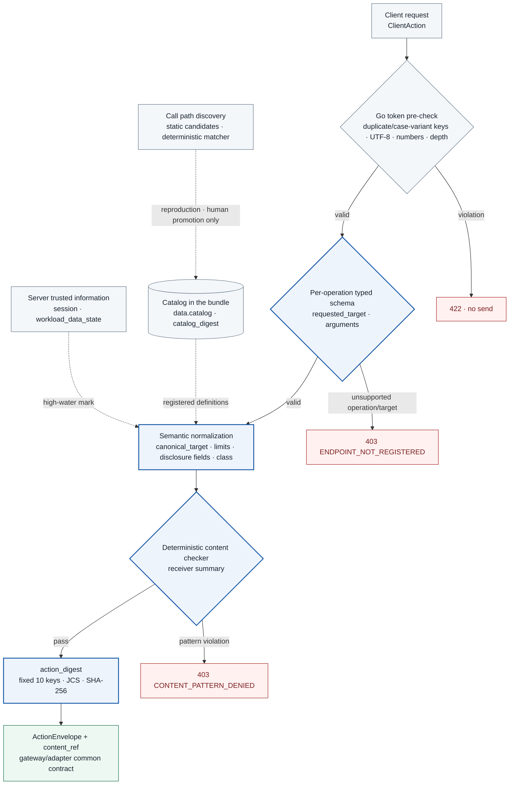

<a id="task-02--endpoint-catalog-and-execution-contract-ref"></a>

# TASK-02 · Endpoint catalog and execution contract

> This document is the specification of the features to be implemented. Settings, check items, APIs, storage constraints, and failure handling are the implementation contract, and implementation and deployment have not been performed yet. Values generated in the deployment environment are managed as installation inputs. The [Shared Tech Spec](COMMON.md) is the source of truth for structures, fields, enums, reason codes, and event_type names.

## Structure at a glance

> Target design · implementation, deployment, and functional effect unverified. Solid lines are placement, processing, and calls; dotted lines are references and observation evidence; the text on each arrow distinguishes its meaning.



**How to read:** Requests that differ in representation but have the same meaning produce the same digest, and different targets, bodies, disclosure scopes, limits, or catalog contents produce different digests. Normalization, JCS, and hashing are computed only by the single Go shared package `packages/canonical/`, and the gateway and adapters use the same package. Python components do not compute digests. The normalization stage makes no network calls or secret lookups. A matching hash alone does not grant execution permission.

| Item | Content |
| --- | --- |
| Plan | [Final plan](../plan.md#task-02) |
| Development prerequisites | None |
| Integration dependencies (runtime) | [TASK-04](TASK-04-policy-gateway.md) (Normalize call, decision), [TASK-05](TASK-05-service-adapters.md) (Prepare, send), [TASK-11](TASK-11-alignment-timeline.md) (provides `/internal/evidence/*`), [TASK-13](TASK-13-regression-harness.md) (dynamic discovery runs), [TASK-14](TASK-14-policy-release.md) (puts the catalog into bundle `data.catalog` and activates it) |
| Responsible role | Contract/API engineer · owner/due date undecided |
| Common rules | [Shared Tech Spec](COMMON.md) |
| Basis | Working tree after efe8dce (revised 2026-10-11) |

## 1. Goals and scope

Express the service, operation, target, and disclosure data scope as a common contract. Implement deterministic normalization so that the gateway and adapters obtain the same hash from requests with the same meaning. This document fixes the per-operation input schema, hash keys, catalog YAML schema, and `catalog_digest` computation. Automatically discovered endpoints and call paths are stored only as candidates and are promoted to catalog registration or forbidden fixtures only after dynamic reproduction and human review (3.4).

## 2. Required environment, inputs, and resources

Required: the typed structures and strict JSON decoder of the Go shared package (`packages/canonical/`), a strict YAML decoder, a versioned catalog, and normal, forbidden, and normalization-equivalent/non-equivalent fixtures. The initial operations are limited to Kubernetes Pod/event list queries, Pod log queries, sending to our own receiver, `generateContent` of Gemini Enterprise Agent Platform (formerly Vertex AI, hereafter Agent Platform), sanitized evidence queries, and discovery read tools. Service owners register only actual target addresses.

## 3. Technical implementation design

1. The catalog consists of two files, `catalog/gcp/operations.yaml` and `catalog/gcp/targets.yaml`. The JSON Schema in Appendix A is the source of truth for fields, types, and enums.
2. `catalog_digest` = SHA-256(JCS(`{"operations": [sorted by operation_id], "targets": [sorted by target_id]}`)). The YAML is strict-decoded (unknown fields and duplicate keys rejected), converted to JSON values, and then computed. `catalog_version` is a human-readable display label and is not a digest input. Because `catalog_digest` changes even if only an address, CA, or CIDR changes, decisions received under the previous catalog must be re-decided (`CATALOG_DIGEST_MISMATCH`).
3. TASK-14 `packages/bundles` puts the same two files into bundle data as `data.catalog`. The shape is a map keyed by id: `data.catalog = {catalog_digest, operations: {<operation_id>: {...}}, targets: {<target_id>: {...}}}`. The gateway and adapters read `data.catalog` of the loaded bundle as a Go `Catalog` value and use it in Normalize and Prepare. No separate ConfigMap or file is used.
4. ClientAction is strictly parsed at the raw body stage (3.1) and validated again with the per-operation typed schema (3.2).
5. `Normalize`, which uses no network, fixes `canonical_target`, `limits`, disclosure fields, size, and data class. The data class inherits as-is the high-water mark of `workload_data_state` passed by the trusted context, and it cannot be lowered by user input or agent text. If there is no row, it starts at `none`.
6. After semantic normalization, `action_digest` is computed over 10 fixed keys (3.3). Only set fields are sorted, and the order of ordinary arrays is preserved. Optional fields are not omitted but included as `null`.

### 3.1 Strict JSON pre-check (Go)

The gateway (`services/gateway/`, Go) receives raw body bytes and checks them with the strict decoder of `packages/canonical/`. Go `encoding/json` (v1) accepts objects with duplicate names ([encoding/json](https://pkg.go.dev/encoding/json)), matches struct fields by "preferring an exact match but also accepting a case-insensitive match", and replaces invalid UTF-8 and invalid UTF-16 surrogates in strings with U+FFFD without error ([decode.go](https://github.com/golang/go/blob/master/src/encoding/json/decode.go)). Therefore all of the checks below must pass before decoding.

1. The whole body is 1MiB or less (`http.MaxBytesReader`). If it exceeds this, the result is 413 `BODY_TOO_LARGE`.
2. All raw bytes must be `utf8.Valid`. String escapes are read directly from the raw bytes, and the body is rejected if `\uD800`–`\uDBFF` is not followed by `\uDC00`–`\uDFFF` or if `\uDC00`–`\uDFFF` appears alone.
3. Read the token stream once with `json.Decoder.Token()`, keeping the key set for each object. Reject duplicates of the same key and of keys that differ only in case (by `strings.ToLower`). Depth counts the top-level value as 1 and must be 16 or less, and key length must be 128 or less in UTF-8 bytes.
4. Number tokens are received as raw strings with `UseNumber`. Reject numbers with a decimal point or exponent, and check that integers are in the range [-(2^53-1), 2^53-1]. `NaN` and `Infinity` are not JSON syntax, so the decoder returns an error. Reject if tokens remain after the top-level value.
5. Check that each object's keys match the json tags of the target struct **exactly** (case differences are also rejected). First check the outer ClientAction (`session_id, operation_id, requested_target, arguments, client_request_key`), then check `requested_target` and `arguments` again with the operation struct selected by `operation_id`.
6. Decode the bytes that passed the checks with a new `json.Decoder` with `DisallowUnknownFields()` and `UseNumber()` enabled.

The Go standard library also has `encoding/json/v2`, which rejects duplicate names by default (controlled by `jsontext.AllowDuplicateNames`). If v2 can be used officially in the adopted Go version, Q0 checks whether some checks can be replaced with v2 options; until that is confirmed, the procedure above is used.

**Error contract:** `Normalize` returns `NormalizeError{reason_codes, http_status, rule_id}`. If the outer ClientAction cannot be read, the result is 422 `SCHEMA_INVALID` and no action is created. If the outer structure is valid but `operation_id` is not in the catalog or `requested_target.target_id` is not registered, the result is 403 `ENDPOINT_NOT_REGISTERED` (`normalize.endpoint_registered.v1`); a per-operation schema violation is 422 `SCHEMA_INVALID` (`normalize.schema.v1`); and a content checker violation is 403 `CONTENT_PATTERN_DENIED` (`normalize.content_pattern.v1`). TASK-04 3.1 defines how these three cases are recorded. Python components (ADK runtime, policy proposal, intent check, discovery) only submit ClientActions and do not perform normalization or digest computation.
### 3.2 ClientAction typed schema by operation

The outer structure of ClientAction is defined by COMMON. `session_id` is a lowercase UUID, and `client_request_key` is `[A-Za-z0-9_-]{8,64}`. `pod_uid`, actor, data_class, and version are not provided by the client. The Go structs below are the canonical source for each operation, and JSON Schemas with the same content are generated as `packages/canonical/schema/clientaction/*.json`. All structs undergo the exact key match validation of 3.1.

```go
// Common
type TargetRef struct {
	TargetID string `json:"target_id"` // ^[a-z0-9][a-z0-9-]{0,62}$, registered catalog value
}
type Empty struct{} // Only {} allowed

// k8s.pods.list, k8s.events.list
type K8sListTarget = TargetRef // namespace is fixed in target
type K8sListArgs = Empty        // limit=100 is a server constant

// k8s.pods.logs
type K8sLogsTarget struct {
	TargetID  string `json:"target_id"`
	PodName   string `json:"pod_name"`  // DNS-1123 subdomain, 1..253 bytes, lowercase
	Container string `json:"container"` // DNS-1123 label, 1..63 bytes
}
type K8sLogsArgs struct {
	TailLines  int64 `json:"tail_lines"`  // 1..200
	LimitBytes int64 `json:"limit_bytes"` // 1..1048576
}

// receiver.submit
type ReceiverTarget = TargetRef
type ReceiverArgs struct {
	Payload ReceiverPayload `json:"payload"`
}
type ReceiverPayload struct {
	Summary string  `json:"summary"` // 1..4096 bytes UTF-8
	Email   *string `json:"email"`   // null or 3..254 bytes. Allowed field only in synthetic test catalog
}

// model.generate
type ModelTarget struct {
	TargetID string `json:"target_id"`
	Profile  string `json:"profile"` // agent | policy_proposal | intent_check | discovery
}
type ModelArgs struct {
	Phase *string `json:"phase,omitempty"` // Required exploration|final only for policy_proposal; key forbidden for other profiles
	ConversationID   string            `json:"conversation_id"`   // Lowercase UUID, caller session scope
	Messages         []ModelMessage    `json:"messages"`          // 1..64 items
	ToolDeclarations []ToolDeclaration `json:"tool_declarations"` // For agent, matches array of three installed tools; for other profiles, must be []
}
type ModelMessage struct {
	Kind         string     `json:"kind"`          // text | tool_result | model_turn
	Role         string     `json:"role"`          // user | model (model only for model_turn)
	Source       *string    `json:"source"`        // text: user | system, tool_result: tool_result, model_turn: null
	Text         *string    `json:"text"`          // Only when kind=text, 1..16384 bytes
	Ref          *ResultRef `json:"ref"`           // Only when kind=tool_result|model_turn
	FunctionName *string    `json:"function_name"` // Only when kind=tool_result, ^[A-Za-z_][A-Za-z0-9_]{0,63}$
}
type ResultRef struct {
	Ref        string  `json:"ref"`         // action_result | model_turn
	ActionID   *string `json:"action_id"`   // ref=action_result
	TurnIndex  *int64  `json:"turn_index"`  // ref=model_turn, sequence number within the same conversation_id
}
type ToolDeclaration struct {
	Name        string          `json:"name"`        // ^[A-Za-z_][A-Za-z0-9_]{0,63}$
	Description string          `json:"description"` // 1..1024 bytes
	Parameters  json.RawMessage `json:"parameters"`  // JSON Schema object, JCS serialization 4KiB or less
}

// evidence.action.read, evidence.bundle.read, evidence.regression.read
type EvidenceTarget struct {
	TargetID   string `json:"target_id"`   // evidence-api
	ResourceID string `json:"resource_id"` // action_id, bundle_id, run_id. Lowercase UUID or 64-character hex digest
}
type EvidenceArgs = Empty

// discovery.source.read
type DiscoverySourceTarget struct {
	TargetID   string `json:"target_id"`   // discovery-snapshots
	SnapshotID string `json:"snapshot_id"` // 64-character hex
	Path       string `json:"path"`        // Relative path in snapshot manifest, 1..512 bytes, ".." forbidden
}
type DiscoverySourceArgs struct {
	StartLine int64 `json:"start_line"` // >= 1
	EndLine   int64 `json:"end_line"`   // start_line..start_line+400
}

// discovery.callgraph.read
type DiscoveryCallgraphTarget struct {
	TargetID   string `json:"target_id"`
	SnapshotID string `json:"snapshot_id"`
	Symbol     string `json:"symbol"` // 1..256 bytes, must be in the snapshot's symbol list
}
type DiscoveryCallgraphArgs struct {
	Depth int64 `json:"depth"` // 1..3
}
```

The generation config and response schema for `model.generate` are fixed by the server per profile and are not sent by the client (TASK-05 3.1). The `action_id` of a `tool_result` message must be an action created by the same session (user session or service session), and `model_turn` must be a `conversation_id` from the same session. This ownership verification and raw text resolution are performed by the adapter (TASK-05).

| operation | Valid Example (`requested_target` / `arguments`) | Rejection Example and Reason |
| --- | --- | --- |
| `k8s.pods.list` | `{"target_id":"k8s-agent-targets"}` / `{}` | `{"limit":500}`: Unknown key → 422 |
| `k8s.events.list` | `{"target_id":"k8s-agent-targets"}` / `{}` | `"target_id":"k8s-kube-system"`: Unregistered target → 403 `ENDPOINT_NOT_REGISTERED` |
| `k8s.pods.logs` | `{"target_id":"k8s-agent-targets","pod_name":"demo-api-7d9f","container":"app"}` / `{"tail_lines":100,"limit_bytes":65536}` | `"tail_lines":500`: Out of range → 422 |
| `receiver.submit` | `{"target_id":"receiver-primary"}` / `{"payload":{"summary":"3 pods restarted","email":null}}` | `{"payload":{"summary":"x","Summary":"y"}}`: Duplicate key differing only in case → 422 |
| `model.generate` | target is `{"target_id":"agent-platform-gemini","profile":"agent"}`. arguments follows the typed schema above, and the three items of the agent array from installed `model-tools.json` are included as-is in `tool_declarations`. | `"profile":"policy_proposal"` and `phase=final` sent by a user session: schema is valid, but Rego `SERVICE_SCOPE_DENIED` or approval required (TASK-04) |
| `evidence.action.read` | `{"target_id":"evidence-api","resource_id":"2b7e…"}` / `{}` | `"resource_id":"../x"`: Format violation → 422 |
| `evidence.bundle.read` | `{"target_id":"evidence-api","resource_id":"<64 hex>"}` / `{}` | `"resource_id":"ABC"`: Uppercase hex → 422 |
| `evidence.regression.read` | `{"target_id":"evidence-api","resource_id":"<run_id uuid>"}` / `{}` | `"arguments":{"run_id":"…"}`: arguments only allows `{}` → 422 |
| `discovery.source.read` | `{"target_id":"discovery-snapshots","snapshot_id":"<64 hex>","path":"httpx/_client.py"}` / `{"start_line":1,"end_line":200}` | `"end_line":900`: Exceeds 400 lines → 422 |
| `discovery.callgraph.read` | `{"target_id":"discovery-snapshots","snapshot_id":"<64 hex>","symbol":"httpx.Client.send"}` / `{"depth":2}` | `"depth":1.5`: Decimal → 422 |
### 3.3 Normalization and Hashing

`Normalize` in `packages/canonical/` (Go) operates in the following order.

1. Verify the typed values that passed the checks in 3.1 and 3.2 and the registered target.
2. Construct `canonical_target`. It always contains `target_id, route_id` and adds operation-specific fields (table below). `route_id` is the value from the catalog operation.
3. The server computes `disclosure_fields`. For receiver, it is the set of field names present (non-null) in the payload. The baseline defect fixture's `receiver.allowed_disclosure_fields` allows both `summary` and `email`, whereas normal operation candidate allows only `summary`. This defect data is included only in the synthetic test catalog.
4. **Deterministic content checker:** Because disclosure control is field-based, placing an email inside the `summary` string passes the field checks. To compensate for this, according to the catalog's `receiver.submit` operation `content_checks` (Appendix A), `summary` is inspected against the RE2 regular expression `[A-Za-z0-9._%+-]+@[A-Za-z0-9.-]+\.[A-Za-z]{2,}` and a registered list of synthetic identifiers, and if a match is found, it is rejected with 403 `CONTENT_PATTERN_DENIED`. This checker is not a general-purpose DLP and does not claim to detect circumvention representations such as whitespace insertion or alternative character substitutions, or semantic personal information.
5. The original text subject to approval is stored in Cloud SQL `action_contents` (key `content_digest`), and only `content_ref` is placed in the envelope. The gateway performs the storage, and only the corresponding adapter and the TASK-03 contract renderer read it.
6. Serialize the hash object below using JCS and compute SHA-256 to produce `action_digest`.

**Hash object keys (fixed):** `operation_id, canonical_target, disclosure_fields, content_digest, limits, catalog_digest, canonicalization_version, schema_version, environment, tenant`. Only these 10 keys are used. `data_class`, `data_sources`, `bytes`, `endpoint_id`, request/attempt ID, trace, and timestamp are not included. Therefore, even if the same request is resent after the high-water mark advances, `action_digest` remains identical. Resubmission comparison for the same `client_request_key` is performed using `raw_body_digest` (SHA-256 of raw body bytes), not `action_digest` (TASK-04).

| operation | `canonical_target` | `limits` | `content_digest` input | `disclosure_fields` |
| --- | --- | --- | --- | --- |
| `k8s.pods.list`, `k8s.events.list` | `target_id, route_id, namespace` | `{limit: 100, response_bytes: 1048576}` | `null` | `[]` |
| `k8s.pods.logs` | `target_id, route_id, namespace, pod_name, container` | `{tail_lines, limit_bytes}` | `null` | `[]` |
| `receiver.submit` | `target_id, route_id` | `{}` | canonical digest(`payload`, including null fields) | Field names present in payload |
| `model.generate` | `target_id, route_id, profile` | `{max_output_tokens, max_request_bytes}` (profile constant) | canonical digest(`{conversation_id, messages, generation_config_digest, tool_declarations_digest, response_schema_digest}` + `phase` only when policy_proposal) | Set of `source` values from `text` and `tool_result` messages (excluding `model_turn`) |
| `evidence.*` | `target_id, route_id, resource_id` | `{response_bytes: 65536}` | `null` | `[]` |
| `discovery.source.read` | `target_id, route_id, snapshot_id, path` | `{start_line, end_line, response_bytes: 65536}` | `null` | `[]` |
| `discovery.callgraph.read` | `target_id, route_id, snapshot_id, symbol` | `{depth, response_bytes: 65536}` | `null` | `[]` |

`pod_uid` is not provided by the client and is not included in the hash. When executing, the adapter queries the Pod to verify the UID and records it in the result, and queries it again after receiving logs to cross-check (TASK-05). Sub-digests for model are as follows: `generation_config_digest` = canonical digest (server-fixed generation config of profile), `tool_declarations_digest` = canonical digest (`tool_declarations` array, preserving order), `response_schema_digest` = canonical digest (server-fixed responseSchema of profile) or `null`, and is `null` in policy_proposal exploration. For `messages`, references (`ref`) are hashed directly instead of original text. The actual request bytes resulting from the adapter resolving references into original text are recorded separately as `wire_body_digest`. All values in `limits` are integers, and `max_request_bytes` is a profile upper bound, not a measured value.

```json
{
  "operation_id": "receiver.submit",
  "canonical_target": {"target_id": "receiver-primary", "route_id": "submissions-v1"},
  "disclosure_fields": ["summary"],
  "content_digest": "<canonical digest(payload)>",
  "limits": {},
  "catalog_digest": "<SHA-256(JCS(operations+targets))>",
  "canonicalization_version": "v1",
  "schema_version": "v1",
  "environment": "test",
  "tenant": "hackathon"
}
```

The digest placeholders in the example above are not fixed dummy strings; the function fills them with actual values. The actor and session owner binding is checked separately in the DB and is not authenticated by the action hash alone. `content_digest` validates the approved semantic content, while `wire_body_digest` validates the actual transmitted body bytes. Since the receiver body is transmitted as `JCS(payload)` bytes, the digest computed by the receiver is compared against `wire_body_digest`.

**Identifier rules:** Hostnames in the catalog are lowercase ASCII, internationalized domain names are stored as IDNA A-labels, and trailing dots are not appended. The client does not send hostnames. Kubernetes `pod_name` is a DNS-1123 subdomain and `container` is a DNS-1123 label, and they are compared as-is without changing case (uppercase is rejected at the schema stage). UUIDs are accepted only in lowercase 8-4-4-4-12 format, and digests only in 64 lowercase hex characters. Path elements are assembled with percent-encoding, and `/`, `..`, query, and host modifications are rejected. Kubernetes namespaces use only the target's `namespace` value and cannot be overridden by requests.

**JCS implementation (Go):** RFC 8785 specifies that object keys must be sorted in UTF-16 code unit order (Section 3.2.3), numbers serialized according to ECMAScript rules, and input must be I-JSON with no duplicate keys ([RFC 8785](https://www.rfc-editor.org/rfc/rfc8785)). The approach of sorting Go maps by key order and calling `json.Marshal` is not used because results may differ for characters outside the BMP where code point order differs from UTF-16 order. The candidate for adoption is the Go implementation (`go/src/webpki.org/jsoncanonicalizer`, `func Transform(jsonData []byte) (result []byte, e error)`) in the repository `github.com/cyberphone/json-canonicalization` by Anders Rundgren, co-author of RFC 8785 ([Repository](https://github.com/cyberphone/json-canonicalization), [Go README](https://github.com/cyberphone/json-canonicalization/blob/master/go/README.md)). Directly verified facts are as follows: LICENSE is Apache License 2.0 (Copyright 2018 Anders Rundgren), the Go directory follows GOPATH style without `go.mod`, there are no releases and only a single tag `es6testfile`, and only objects or arrays are accepted as top-level values. Therefore, source code from a specific commit SHA is vendored into `packages/canonical/internal/jcs/` and LICENSE is kept alongside it. Adoption is a Q0 verification item confirmed after passing the vector tests below. Because all hash objects in this project are top-level objects, they are not affected by the above constraint.

**Set sorting:** For fields with set semantics, duplicates are eliminated and the JCS serialization bytes of each element are sorted in lexicographical byte order. Elements of `disclosure_fields` are restricted to ASCII identifiers.

**Test vectors:** Vectors are owned by the Go package. `packages/canonical/testdata/vectors.json` stores raw JSON, normalized JSON, JCS bytes, and expected SHA-256 together. It includes the following cases: vectors from the RFC 8785 appendix, keys containing characters outside the BMP, decimal serialization (for library verification only), duplicate keys and keys differing only in case, invalid UTF-8 and unpaired surrogates, depth 17, and integers exceeding 2^53. Identical set order and JSON key order must produce the same hash, while changes to receiver, payload, disclosure fields, environment, tenant, `limits`, `catalog_digest`, profile, or tool declarations must produce different hashes. To prevent the expected digest from being merely a transcribed value of the implementation's output, expected bytes outside RFC vectors are cross-computed in CI using an independent implementation (Rundgren's JavaScript reference implementation or Python `rfc8785`). This cross-computation is for testing only and is not used for digest computation in the operational path.
### 3.4 Call Path Discovery Candidates and Promotion Procedure

Inputs are generated to populate the visibility denominator in Section 3 of the plan ("finalizing the list of calls, SDK automatic retries, and redirects used by initial tasks"). The methodology cites REA (https://rea.tools/) solely as reference material. The entire contract conforms to the "Call Path Discovery (discovery)" section of the [Shared Tech Spec](COMMON.md), and this section defines the snapshot, analysis, matching, and promotion procedures owned by TASK-02. Classification is performed by a deterministic matcher, and Gemini only handles candidate generation and explanations.

**snapshot creation:** An operator sends `{library, library_version, language: go|python, source_uri, source_digest}` to `POST /internal/discovery/snapshots`. The operator first uploads the source archive (`tar.gz`·`tgz`·`tar`·`zip`·`whl`) to `gs://<discovery-bucket>/sources/<source_digest>.<extension>`. `source_uri` must be in exactly this format, the bucket must be the discovery bucket of this environment, and the digest in the object name must match `source_digest`. Other formats (`https://`, VCS URLs, etc.) are rejected. This is because the cluster has no Cloud NAT and cannot download from external addresses, and accepting arbitrary addresses would turn into a vector for the Job to call services inside the cluster (SSRF). The Job first queries the object size and does not download it if it exceeds the archive upper limit, and after also enforcing the limit while reading, checks the SHA-256 against `source_digest`. The Job runs outside the execution domain (`agent-observe`) with KSA `discovery-snapshot`.

| Language | Static Tool | Output |
| --- | --- | --- |
| Go | Builds a call graph using `golang.org/x/tools/go/callgraph/vta` and lists call sites leading to functions in `net`, `net/http`, `crypto/tls`, `os/exec`, and `os` (file open) packages | `callgraph.json` (symbol → callee list), `call_sites.json` |
| Python | Parses source using the standard `ast` module and lists `socket`, `http.client`, `urllib3`, `requests`, `httpx`, `subprocess`, and `os.open`·`open` call sites and import aliases. Dynamic dispatch may be missed, and this limitation is reported | `call_sites.json`, simple `callgraph.json` |

Snapshots are stored in `gs://<discovery-bucket>/snapshots/<snapshot_id>/` as `manifest.json` (file path and SHA-256 list), original files, `callgraph.json`, and `call_sites.json`. `snapshot_id` = canonical digest(`manifest.json`). `discovery.source.read` and `discovery.callgraph.read` read only this snapshot.

The tarball to be staged must contain only regular files and directories. Because tarballs with PAX global headers (type `g`), such as those from `git archive`, are rejected by `entry_type`, repackage it before upload to contain only regular files and directories, and use the SHA-256 of the resulting tarball as `source_digest`.

**Archive processing limits:** Source archives are untrusted input. The snapshot Job enforces the following limits, and if even one limit is exceeded, the entire snapshot fails. Partial results are not written, and the name of the exceeded limit (`archive_bytes`, `extracted_bytes`, `file_bytes`, `entries`, `path_bytes`, `entry_type`, `path`) is recorded in the failure reason of the request.

| Item | Limit |
| --- | --- |
| Archive size | 256MiB. Verified first using object metadata, and also enforced while reading |
| Total size after decompression | 1GiB. Counted by actually written bytes, not by the size written in headers |
| Single file size | 64MiB |
| Number of entries | 50,000 entries. Directories and rejected entries are also counted |
| Path length | 512 bytes |
| Path | Absolute paths, `..` components, NUL, and duplicate paths after normalization reject the entire archive (zip slip) |
| Entry types | Only regular files and directories are allowed. If there is even one other type such as symlink, hardlink, device, or fifo, the entire archive is rejected. Do not skip |

No compression ratio upper limit is set. Because absolute upper limits exist for the total size after decompression and the size of a single file, archives with high compression ratios (zip bombs) are also halted at these limits. Archives and decompression results are streamed to the working directory without being loaded into memory. Analysis reads the unpacked tree in place without copying it. The working directory has an emptyDir `sizeLimit` of 2Gi (archive 256MiB, decompression 1GiB, analysis artifacts and margin), container memory limit is 2Gi, ephemeral-storage limit is 2560Mi, and Job `activeDeadlineSeconds` is 3600. If the Job terminates due to timeout, OOM, or disk exhaustion, the service marks the request as `failed` and records the termination reason reported by Kubernetes.

`<discovery-bucket>` is `storage.discovery_bucket` from the environment lock, created by `platform/gcp/` in the same location as other project common buckets. The bucket enables uniform bucket-level access and public access prevention, and does not set retention or lifecycle deletion rules. Because `discovery_candidates` continuously points to `snapshot_id` as a reproduction reference, snapshots are not deleted automatically. The snapshot Job (KSA `discovery-snapshot`) and the discovery service (KSA `discovery`) directly call the Cloud Storage API using their respective Workload Identity (PGA VIP 443). Because the Job handles untrusted external sources, its KSA is separated from the service. The Job KSA only has permissions to create and view objects in this bucket, and does not have Cloud SQL or kube-apiserver permissions. The service KSA only reads this bucket. Cloud Storage FUSE CSI is not used. This is because FUSE injects a sidecar container via GKE, whereas the VAP of the role Namespace rejects container images not in the digest allowlist (TASK-01 3.2). Objects are written only once with the `ifGenerationMatch=0` condition. If the same `snapshot_id` already exists, it is not overwritten; instead, after verifying whether the digest of the existing `manifest.json` matches, that snapshot is reused.

**destination_template syntax:** `<scheme>://<host-glob>[:<port>]<path-prefix>`. `scheme` is `https` or `http`, `host-glob` is dot-separated labels where `*` corresponds to exactly one label (`**` prohibited). Comparison is case-insensitive for ASCII. If `port` is absent, it defaults to the scheme default (443, 80). `path-prefix` is a literal starting with `/` and matches only on segment boundaries (`/v1` matches `/v1/x` but does not match `/v10`). Example: `https://*.googleapis.com/v1/`, `https://oauth2.googleapis.com/token`.

| Stage | Implementation contract |
| --- | --- |
| Static analysis | `POST /internal/discovery/runs {snapshot_id, scenario_set_id}` → `{run_id, state: queued}`. The analyzer (`services/discovery/`, Python) uses only the gateway `model.generate` (`discovery` profile) and `discovery.*` read tools within the discovery service session (`snapshot_id` scope). Model output returns `call_site, library_version, trigger_condition, destination_template, retry_redirect_behavior, evidence_ref` as structured output, and after the server reverifies the schema and template syntax, it saves it with `state = candidate` (`discovery_candidate_recorded`). Comments and string literals within the source code are marked as data, not instructions. |
| Dynamic observation | The analyzer requests TASK-13 `POST /internal/regression-runs` (`run_kind = discovery`, `scenario_set_id`) and records `reproduction_run_id` in the candidate run. The TASK-13 harness executes fixed scenarios with control on/off and records the observation list `observations[] {arm: on|off, process_exec_id, dst_ip, dst_port, tls_sni?, dns_name?, http_method?, http_path?, source: kernel|adapter|egress_log}` in the report. |
| Matching | When the dynamic run completes, the deterministic matcher runs. The observation host uses `tls_sni`, or if absent, `dns_name` of the same process. When the candidate template and the observation match on scheme (https if 443+TLS), host-glob, and port, and match on path-prefix if a path exists in the observation, the candidate is changed to `reproduced` and `dynamic_match = matched` is recorded (`path_unverified = true` if there is no path). Candidates that do not match any observation are `static_not_observed` and remain as `candidate`. Observations that do not match any candidate are saved as new `observed_not_static` candidates; if the host is unknown, the template is set to `https://<dst_ip>:<dst_port>/`. Since the dynamic observation itself is the reproduction evidence, this candidate is saved with `state = reproduced`. The matcher checks observations across both the control on and off arms, and records the reproduced arms for each candidate in `matched_arms` (a sorted subset of `off`, `on`). If reproduced only in off, it is the original library behavior; if reproduced only in on, it is a retry/bypass behavior that appears after being blocked by controls. Observations destined for Agentarium's own infrastructure are excluded from matching, do not generate `observed_not_static` candidates, and are counted as `infra_filtered`. Infrastructure observations consist of the following four: (a) port 8443 of `network.gateway_cluster_ip` from the target environment lock (gateway). (b) port 53 of cluster DNS Service ClusterIP `cidrhost(network.services_range, 10)`. (c) port 443 of `kubernetes` Service ClusterIP `cidrhost(network.services_range, 1)`. (d) metadata server `169.254.169.254` observations sent by the adapter (`source = adapter`) in the on arm (WIF token issuance). (b) and (c) rely on the fact that GKE assigns `.10` and `.1` of the services range to the two Services (TASK-01 Q0 `20261014-task01-q0-min`). When upgrading the GKE version, re-verify with Q0. In the same Q0, because the destination of the kernel `tcp_connect` event was the ClusterIP before DNAT, the address-based determination is used as-is for kernel observations. Metadata observations from the off arm or entities other than the adapter represent credential acquisition behavior of the SDK and are thus retained as candidates (paths that TASK-06 must block). Private Google Access VIP is not excluded, because observations where the adapter called real Google APIs in the on arm also go to the same VIP. Explanations attached by Gemini are candidate annotations and cannot change the state. |
| Query | `GET /internal/discovery/candidates?run_id=&state=&cursor=` → `{items: DiscoveryCandidate[], next_cursor}`, up to 100 items at a time. |
| Human review and promotion | `POST /internal/discovery/candidates/{candidate_id}/promote {promotion_kind, reproduction_run_id, review_note}` returns 409 if not `reproduced`. The caller must have the `operator` role. `promotion_kind` is one of `allow_operation` (request to register a catalog operation, requires new `catalog_digest` and testing), `deny_fixture` (addition of TASK-13 forbidden fixture), or `sdk_setting_check` (verification item for disabling SDK settings). Candidates with `dynamic_match = observed_not_static` can only be promoted to `deny_fixture` or `sdk_setting_check`, and `allow_operation` returns 409. This is to avoid creating an allowlist entry purely from observations without static evidence (call sites). If an allowance is necessary, the corresponding call site must be rediscovered via static analysis, reproduced as a `matched` candidate, and then promoted. Promotion is recorded as a `discovery_candidate_promoted` event. Even for `allow_operation`, it must be separately activated by the catalog owner and an authorized deployer. |
| Rejection | `POST /internal/discovery/candidates/{candidate_id}/reject {reason}` changes the state to `rejected` and records the reason. |
AI output alone cannot register anything in the catalog or create an allowance (COMMON "AI one-way principle"). The metrics are the number of candidates, the share of candidates dynamically reproduced, the number of dynamic observations not found statically, the number of promotions (allow/deny), and the number of unresolved candidates, and the visibility denominator report separately marks "the scope confirmed by the discovery procedure".

<a id="4-api-data-and-connection-contract-ref"></a>

## 4. API, data, and connection contract

This uses ClientAction, ActionEnvelope (including `schema_version, catalog_digest, content_ref, limits, raw_body_digest`), ActionContent, and DiscoveryCandidate as defined in "Common data structures" of the [Shared Tech Spec](COMMON.md).

`canonical.Normalize(action ClientAction, raw []byte, trusted TrustedContext, cat Catalog) (ActionEnvelope, Content, *NormalizeError)` is a pure Go function without network access, implemented by TASK-02. `TrustedContext` is `{action_id, request_id, authenticated_actor, session_kind, session_id, workload_id?, tenant, environment, workload_data_state}`, and `environment` is a gateway installation setting. This document defines the interface and invariants of `Prepare(envelope, content, resolved) (WirePlan, error)` (no network or secret lookups, the same `wire_body_digest` for the same input), and [TASK-05](TASK-05-service-adapters.md) owns the per-service mappers and reference resolution (`resolved`). The gateway and the adapter use the same `packages/canonical/` version, and if they differ, adapter preflight rejects with `PREFLIGHT_MISMATCH`. If a Python-side tool needs to check a digest, it uses the Go CLI `canonical-digest`. Unsupported raw URL, header, and proxy settings are not exposed in the API.

The discovery API is provided by the Python service `services/discovery/` (FastAPI + Pydantic v2): `POST /internal/discovery/snapshots`, `POST /internal/discovery/runs`, `GET /internal/discovery/candidates`, `POST /internal/discovery/candidates/{candidate_id}/promote`, `POST /internal/discovery/candidates/{candidate_id}/reject`, and the read tool APIs `GET /internal/discovery/snapshots/{snapshot_id}/files` and `GET /internal/discovery/snapshots/{snapshot_id}/callgraph`. The analyzer's model calls go through gateway `model.generate` with a service session. The `discovery_candidates` table is owned by TASK-02 and preserves state transitions and reproduction run references. The schema is managed with `golang-migrate` SQL files in `migrations/`.

## 5. Security boundaries, failure handling, and operations

Schema and catalog violations are a 422 or a policy denial and are not executed. A matching hash alone does not grant permission. Validation of the contract, approval, identity, and active version is also required. Because content hashes are also open to guessing attacks on small inputs, they are not published as anonymized data.

Only the catalog owner and approved deployers activate registrations. Candidates created from API discovery or discovery results are not automatically added to the adapter allowlist. The discovery analyzer and the snapshot Job run outside the execution area, and the original analysis input is treated as external data. Version errors are handled fail-closed.

## 6. Implementation files and work order

Implementation files are written at the paths below. There are currently no GCP implementation files, and if an implementation path changes, this spec and CI are updated together.

| Implementation path | Implementation responsibility |
| --- | --- |
| catalog/gcp/ | `operations.yaml`, `targets.yaml`, appendix A JSON Schema |
| packages/canonical/ (Go) | Typed common structures (COMMON source-of-truth names), strict JSON pre-check, ClientAction typed schema, Normalize, content checker, vendored JCS, digest, `catalog_digest`, `testdata/vectors.json`, CLI `canonical-digest` |
| services/discovery/ (Python) | Snapshot, run, candidate, and promotion APIs, analyzer, matcher |
| tools/discovery-snapshot/ | Go `vta` and Python `ast` scanner Job |
| migrations/ | `discovery_candidates` state and reproduction references (`golang-migrate` SQL) |
| tests/contracts/ | Cross tests confirming that the gateway and adapter binaries produce the same digest for the same vector |

## 7. Verification methods and pass conditions

| Test | Method and independent confirmation basis | Pass condition |
| --- | --- | --- |
| Normalization equivalence | Fixed fixtures of input representations with the same meaning | All supported implementations produce the same digest |
| Policy meaning change | Fixtures changing recipient, body, environment, disclosed fields, limits, and profile | Every meaning change yields a separate digest or a rejection |
| Resubmission after class increase | The same request after raising the high-water mark | `action_digest` is the same; the same key and the same raw body return the existing action |
| Catalog content change | A catalog with only the target address changed under the same `catalog_version` label | `catalog_digest` changes and existing decisions get `CATALOG_DIGEST_MISMATCH` |
| Catalog strict | Unknown fields, duplicate keys, and out-of-enum values in operations.yaml | Loading is rejected |
| Strict input | Duplicate keys, keys differing only in case, keys differing in case from the tag, invalid UTF-8, unpaired surrogates, NaN, integers above 2^53, decimals, depth 17, trailing tokens, raw URLs | 422 `SCHEMA_INVALID` without sending |
| typed schema | All valid and rejected examples in the 3.2 table | Valid examples pass, rejected examples give the result in the table |
| JCS vector | RFC 8785 vectors, keys with characters outside the BMP, decimal cases | The output of the vendored Go implementation matches the expected bytes and also matches a cross computation by an independent implementation. If they do not match, it is not adopted |
| Implementation agreement | The same vector input to the gateway binary and the adapter binary | Both binaries produce the same `action_digest` and `wire_body_digest` |
| Content checker | A request with a synthetic email inside the allowed field `summary` | 403 `CONTENT_PATTERN_DENIED`, nothing sent |
| discovery matcher | A fixed observation list and template set (host glob, port, and path boundary cases) | Matches the expected `dynamic_match` and state |
| discovery promotion invariant | A promote call on a candidate with only model output | 409, no catalog change. `ai_created_allow_count = 0` |
| Promotion of observation-only candidates | `allow_operation`, `deny_fixture`, and `sdk_setting_check` promote on an `observed_not_static` candidate | Only `allow_operation` gets 409; the other two kinds are promoted |
| Arm comparison and infrastructure exclusion | Destinations observed only in off, only in on, and in both; observations going to the gateway, cluster DNS, and the `kubernetes` Service; metadata observations from the on arm adapter and the off arm SDK; observations going to a different port of the DNS address | The candidate's `matched_arms` is `[off]`, `[on]`, or `[off, on]`. Infrastructure observations and metadata observations from the on arm adapter are counted as `infra_filtered` without new candidates. Off arm metadata observations and observations going to a different port of the DNS address remain as candidates |

Before running verification, the code, image, schema, and policy/catalog versions, the target environment, and the test denominators are pinned. The tests above were not run while writing this document. Actual run records are stored according to the "Result recording contract" of the [Shared Tech Spec](COMMON.md).

## 8. Deliverables and implementation results

### Deliverables to leave after implementation

- Catalog files and JSON Schema, ClientAction typed schema, Normalize/Prepare contract, test vectors and hash conventions, version compatibility table.
- Discovery snapshots, candidate lists and reproduction runs, promotion and rejection records, and the "scope confirmed by the discovery procedure" report for the visibility denominator.

### Currently confirmed results

| Category | Current state |
| --- | --- |
| Tech Spec | Implementation spec written; only static link checks performed; rendering and functional verification not run |
| Implementation files | As of now, the corresponding GCP implementation paths have not been created |
| Functional tests | Not run |
| GCP/GKE deployment | Not performed or confirmed in this work |
| Completion decision | Planned; not judged as functionally complete |

### When recording implementation results

- Record `implementation_commit`, image digests, `run_id`, the environment manifest, and safe references to the verification report and original evidence.
- Leave `expected / observed / passed / failed / unknown / not_run` and the denominator per test. Numbers that were not measured are left as `null`.
- Record failed, unobserved, and undecided items, impact on normal work, and deployment/recovery results together, and change only the verified scope to complete.

## 9. Deployment inputs and change conditions

Operation, field, size, and hash rules are fixed by chapter 3. The installer registers the actual API server, receiver, Agent Platform project/location/model, CA, and allowed CIDRs in the catalog. A registration change requires a new `catalog_digest` and tests. The JCS implementation is vendored at a commit SHA that passed the vector tests, and the Go version and `go.sum` are pinned in `deploy/gcp/environment.lock.json` (schema owned by TASK-16).

Changing permissions, trust boundaries, supported behavior, or default failure responses requires revising the final plan and the related Tasks together. The responsible roles are defined in the table above, but the actual owners are not yet decided, so this document is not to be read as operational approval.

## 10. Technical basis

- [RFC 8785 JCS](https://www.rfc-editor.org/rfc/rfc8785): key ordering by UTF-16 code units, the I-JSON premise, ECMAScript number serialization, authors (A. Rundgren, B. Jordan, S. Erdtman) (document checked).
- [cyberphone/json-canonicalization](https://github.com/cyberphone/json-canonicalization): Go implementation, Apache-2.0, no `go.mod`, no releases, `Transform` API and top-level object/array constraint (repository, LICENSE, and Go README checked). Adoption is confirmed after the vectors pass (Q0).
- [Go encoding/json](https://pkg.go.dev/encoding/json), [decode.go](https://github.com/golang/go/blob/master/src/encoding/json/decode.go): v1 allows duplicate names, matches fields case-insensitively, replaces invalid UTF-8 and surrogates with U+FFFD; `Decoder.Token`, `DisallowUnknownFields`, `UseNumber`; v2's `jsontext.AllowDuplicateNames` (documentation and source checked).
- [gopkg.in/yaml.v3](https://pkg.go.dev/gopkg.in/yaml.v3): `Decoder.KnownFields` (documentation checked), duplicate mapping key error ("already defined", [decode.go](https://github.com/go-yaml/yaml/blob/v3/decode.go) source checked). The page shows v3.0.1; the repository maintenance status and the replacement module path are Q0.
- [golang.org/x/tools/go/callgraph/vta](https://pkg.go.dev/golang.org/x/tools/go/callgraph/vta): Go call graph construction package (existence checked).
- [Kubernetes API concepts: retrieving large result sets in chunks](https://kubernetes.io/docs/reference/using-api/api-concepts/#retrieving-large-results-sets-in-chunks), [PodLogOptions source](https://github.com/kubernetes/kubernetes/blob/master/staging/src/k8s.io/api/core/v1/types.go): `limit` and `continue`, `tailLines` and `limitBytes` (approximate limit) (source checked).
- [FastAPI request model](https://fastapi.tiangolo.com/tutorial/body/): reference for the Python `services/discovery/` API.
- [REA](https://rea.tools/): methodology reference for call path discovery.

## Appendix A. catalog YAML schema and examples

YAML is strictly decoded with `gopkg.in/yaml.v3`'s `Decoder.KnownFields(true)`, duplicate keys are rejected, and then validated with the JSON Schema (draft 2020-12) below. The two schema files are `catalog/gcp/schema/operations.schema.json` and `targets.schema.json`.

```json
{
  "$id": "operations.schema.json",
  "type": "object", "additionalProperties": false, "required": ["catalog_version", "operations"],
  "properties": {
    "catalog_version": {"type": "string"},
    "operations": {"type": "array", "items": {
      "type": "object", "additionalProperties": false,
      "required": ["operation_id", "endpoint_id", "service_id", "adapter_id", "transport", "method", "route_id",
                   "route_template", "effect_type", "disclosure", "credential_binding", "limits", "retry_policy",
                   "idempotency_support", "evidence_strategy", "evidence_level_max", "evidence_deadline_seconds",
                   "intent_check_on_standing_rule", "response_data_class", "redact_fields",
                   "response_limit_bytes", "description", "schema_version", "owner"],
      "properties": {
        "operation_id": {"type": "string", "pattern": "^[a-z0-9]+(\\.[a-z0-9_]+)+$"},
        "endpoint_id": {"type": "string"}, "service_id": {"type": "string"},
        "adapter_id": {"enum": ["kubernetes-reader", "receiver-sender", "model", "evidence-reader"]},
        "transport": {"enum": ["https_rest"]},
        "method": {"enum": ["GET", "POST"]},
        "route_id": {"type": "string"}, "route_template": {"type": "string", "pattern": "^/"},
        "effect_type": {"enum": ["read", "external_send", "model_disclosure"]},
        "disclosure": {"type": "object", "additionalProperties": false, "required": ["kind"],
          "properties": {"kind": {"enum": ["none", "payload_fields", "message_sources"]}}},
        "credential_binding": {"type": ["string", "null"]},
        "limits": {"type": "object", "additionalProperties": {"type": "object", "additionalProperties": false,
          "required": ["max"], "properties": {"min": {"type": "integer"}, "max": {"type": "integer"}, "fixed": {"type": "integer"}}}},
        "retry_policy": {"enum": ["none"]},
        "idempotency_support": {"enum": ["none", "idempotency_key"]},
        "evidence_strategy": {"enum": ["response_only", "receiver_receipt", "provider_response"]},
        "evidence_level_max": {"enum": ["accepted", "effect_verified"]},
        "evidence_deadline_seconds": {"type": "integer", "minimum": 0, "maximum": 300},
        "intent_check_on_standing_rule": {"type": "boolean"},
        "model_profiles": {"type": "array", "items": {"enum": ["agent", "policy_proposal", "intent_check", "discovery"]}},
        "response_data_class": {"enum": ["none", "synthetic", "internal", "confidential", "inherit"]},
        "redact_fields": {"type": "array", "items": {"type": "string", "pattern": "^(/([^/~]|~[01])*)*$"}},
        "response_limit_bytes": {"type": "integer", "minimum": 1, "maximum": 1048576},
        "content_checks": {"type": "object", "additionalProperties": false,
          "properties": {"fields": {"type": "array", "items": {"type": "string"}},
                         "email_pattern": {"type": "boolean"},
                         "synthetic_identifiers": {"type": "array", "items": {"type": "string"}}}},
        "description": {"type": "string", "maxLength": 512},
        "schema_version": {"type": "string"}, "owner": {"type": "string"}
      }}}
  }
}
```

```json
{
  "$id": "targets.schema.json",
  "type": "object", "additionalProperties": false, "required": ["targets"],
  "properties": {"targets": {"type": "array", "items": {
    "type": "object", "additionalProperties": false,
    "required": ["target_id", "endpoint_id", "environment", "tenant", "origin", "expected_tls_name",
                 "ca_ref", "allowed_cidrs", "max_data_class", "operation_ids"],
    "if": {"required": ["ca_ref"], "properties": {"ca_ref": {"const": "agentarium-trust"}}},
    "then": {"required": ["expected_uri_san"]},
    "else": {"not": {"required": ["expected_uri_san"]}},
    "properties": {
      "target_id": {"type": "string", "pattern": "^[a-z0-9][a-z0-9-]{0,62}$"},
      "endpoint_id": {"type": "string"}, "environment": {"type": "string"}, "tenant": {"type": "string"},
      "origin": {"type": "string", "pattern": "^https://[a-z0-9.-]+(:[0-9]{1,5})?$"},
      "expected_tls_name": {"type": "string"},
      "expected_uri_san": {"type": "string",
        "pattern": "^spiffe://agentarium\\.internal/ns/[a-z0-9]([a-z0-9-]{0,61}[a-z0-9])?/sa/[a-z0-9]([a-z0-9-]{0,61}[a-z0-9])?$"},
      "ca_ref": {"enum": ["system", "cluster", "agentarium-trust"]},
      "auth_audience": {"type": ["string", "null"]},
      "allowed_cidrs": {"type": "array", "minItems": 1, "items": {"type": "string"}},
      "max_data_class": {"enum": ["none", "synthetic", "internal", "confidential"]},
      "operation_ids": {"type": "array", "minItems": 1, "items": {"type": "string"}},
      "namespace": {"type": ["string", "null"]},
      "model": {"type": ["object", "null"], "additionalProperties": false,
        "properties": {"project": {"type": "string"}, "location": {"type": "string"}, "model_id": {"type": "string"}}}
    }}}}
}
```

`expected_uri_san` is a required field placed only on targets with `ca_ref = agentarium-trust`, and cannot be placed on targets with other `ca_ref`s. The value is a single service SAN `spiffe://agentarium.internal/ns/<namespace>/sa/<ksa>` of the target service KSA. namespace and KSA use only DNS label characters (lowercase letters, numbers, `-`), and wildcards, queries, fragments, and `/pod/` suffixes are not allowed. KSA names follow the [TASK-06 KSA table](TASK-06-egress-credentials.md). Adapters check the server certificate's URI SAN with this value ([TASK-05 3.2](TASK-05-service-adapters.md#32-transport-implementation)). In such targets, `expected_tls_name` is used only as an SNI value.

`fixed` in `limits` is a server constant (e.g., list `limit`), and `min` and `max` are client input ranges. `redact_fields` is a JSON Pointer, and `*` can only be used in array element positions (this project's extension). `response_data_class = inherit` means that in `model.generate`, the result classification is set to the request envelope's `data_class`. The examples below are based on a synthetic test environment. Actual addresses and CIDRs are installation inputs.

```yaml
# catalog/gcp/operations.yaml (excerpt)
catalog_version: test-2026-10-11
operations:
  - operation_id: k8s.pods.logs
    endpoint_id: k8s-api-v1
    service_id: kubernetes
    adapter_id: kubernetes-reader
    transport: https_rest
    method: GET
    route_id: pod-log-v1
    route_template: /api/v1/namespaces/{namespace}/pods/{pod_name}/log
    effect_type: read
    disclosure: {kind: none}
    credential_binding: null          # projected KSA token(TASK-05)
    limits:
      tail_lines: {min: 1, max: 200}
      limit_bytes: {min: 1, max: 1048576}
    retry_policy: none
    idempotency_support: none
    evidence_strategy: response_only
    evidence_level_max: accepted
    evidence_deadline_seconds: 0
    intent_check_on_standing_rule: true
    response_data_class: synthetic    # internal in production catalog
    redact_fields: []
    response_limit_bytes: 1048576
    description: "Reads the last few lines of registered Pod logs in the agent-targets namespace"
    schema_version: v1
    owner: platform-team
  - operation_id: receiver.submit
    endpoint_id: test-receiver-v1
    service_id: test-receiver
    adapter_id: receiver-sender
    transport: https_rest
    method: POST
    route_id: submissions-v1
    route_template: /test/v1/submissions
    effect_type: external_send
    disclosure: {kind: payload_fields}
    credential_binding: receiver-api-key
    limits: {}
    retry_policy: none
    idempotency_support: idempotency_key
    evidence_strategy: receiver_receipt
    evidence_level_max: effect_verified
    evidence_deadline_seconds: 30
    intent_check_on_standing_rule: false
    response_data_class: none
    redact_fields: []
    response_limit_bytes: 65536
    content_checks: {fields: [summary], email_pattern: true, synthetic_identifiers: ["SYN-USER-0001", "SYN-USER-0002"]}
    description: "Sends an approved summary to the self-test receiver"
    schema_version: v1
    owner: platform-team
```

```yaml
# catalog/gcp/targets.yaml (excerpt)
targets:
  - target_id: k8s-agent-targets
    endpoint_id: k8s-api-v1
    environment: test
    tenant: hackathon
    origin: https://kubernetes.default.svc:443
    expected_tls_name: kubernetes.default.svc
    ca_ref: cluster
    auth_audience: null
    allowed_cidrs: ["<kubernetes ClusterIP of service CIDR>/32"]
    max_data_class: synthetic
    operation_ids: [k8s.pods.list, k8s.events.list, k8s.pods.logs]
    namespace: agent-targets
  - target_id: receiver-primary
    endpoint_id: test-receiver-v1
    environment: test
    tenant: hackathon
    origin: https://receiver.agent-targets.svc:8443
    expected_tls_name: receiver.agent-targets.svc
    ca_ref: agentarium-trust
    expected_uri_san: spiffe://agentarium.internal/ns/agent-targets/sa/receiver
    allowed_cidrs: ["<receiver ClusterIP>/32"]
    max_data_class: synthetic
    operation_ids: [receiver.submit]
  - target_id: receiver-probe          # activation probe only (probe.activation.v1)
    endpoint_id: test-receiver-v1
    environment: test
    tenant: hackathon
    origin: https://receiver-probe.agent-targets.svc:8443
    expected_tls_name: receiver-probe.agent-targets.svc
    ca_ref: agentarium-trust
    expected_uri_san: spiffe://agentarium.internal/ns/agent-targets/sa/receiver   # Service for probe running with receiver KSA
    allowed_cidrs: ["<receiver-probe ClusterIP>/32"]
    max_data_class: synthetic
    operation_ids: [receiver.submit]
  - target_id: agent-platform-gemini
    endpoint_id: agent-platform-v1
    environment: test
    tenant: hackathon
    origin: https://<location>-aiplatform.googleapis.com:443
    expected_tls_name: <location>-aiplatform.googleapis.com
    ca_ref: system
    allowed_cidrs: ["199.36.153.8/30"]
    max_data_class: internal
    operation_ids: [model.generate]
    model: {project: "<PROJECT_ID>", location: "<LOCATION>", model_id: "<MODEL_ID>"}
```

The actual endpoint hostname of Agent Platform and the location of the Gemini 3 model (whether global-only) are confirmed and fixed in Q0. The `allowed_cidrs` and TLS name for the k8s target are determined based on checking the in-cluster API server certificate SANs (Q0).
