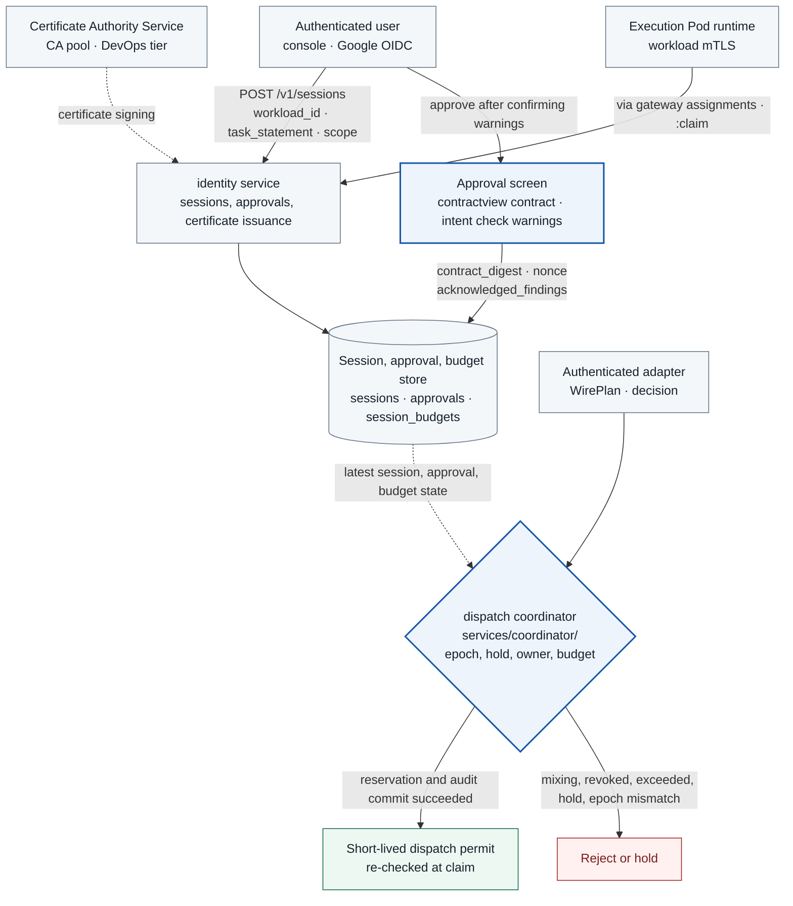

# TASK-03 · Session Identity and User Approval

> This document is the specification of the features to be implemented. Settings, check items, APIs, storage constraints, and failure handling are implementation contracts; implementation and deployment have not yet been performed. Values generated in the deployment environment are managed as installation inputs.

## Structure at a Glance

> Target design · implementation, deployment, and functional effect not verified. Solid lines are placement, processing, and calls; dotted lines are references and observation evidence; the labels on the arrows distinguish the meaning.



**How to read:** The runtime fetches the session created by the user directly with workload mTLS (pull model). Ingress to the execution Pod stays blocked. The scope shown to the user is bound to the stored contract, and at actual use, approvals from other sessions and exceeded budgets are rejected. This is API permission separation and does not mean that files and memory inside a shared Pod are strongly isolated per session.

| Item | Content |
| --- | --- |
| Plan | [Final plan](../plan.md#task-03) |
| Development prerequisite | [TASK-02](TASK-02-catalog-contracts.md) |
| Integration dependencies (runtime) | [TASK-04](TASK-04-policy-gateway.md) (decision, `:reevaluate`, intent check, pending view), [TASK-05](TASK-05-service-adapters.md) (reservation and outcome caller), [TASK-06](TASK-06-egress-credentials.md) (NetworkPolicy, IAM), [TASK-07](TASK-07-audit-store.md) (`audit_append()`, `audit_producer`), [TASK-10](TASK-10-correlation-health.md) (hold, lease, `coordinator_reader`, consumption of `attempt_observations`), [TASK-11](TASK-11-alignment-timeline.md) (calls `resolve_unknown_attempt()`), [TASK-14](TASK-14-policy-release.md) (activation probe registration, activation invalidation) |
| Role | Identity and approval engineer · owner/due date TBD |
| Common conventions | [Shared Tech Spec](COMMON.md) |
| Baseline | Working tree after efe8dce (revised 2026-10-11) |

## 1. Goals and Scope

A trusted user intake path creates sessions and finalizes approval contracts. API permissions are verified so that approvals and budgets are not mixed across multiple logical sessions in a shared Pod. Memory and file isolation between malicious code inside the same Pod is not part of the completion claim.

This Task owns three components. The identity service (`services/identity/`) handles user OIDC login, sessions and service sessions, approvals, and issuance of all service mTLS certificates. The dispatch coordinator (`services/coordinator/`) handles reservation transactions, dispatch permit issuance and claim, attempt outcome transitions, session budgets, activation probe registration, and cleanup of stuck attempts (sweeper). The display contract renderer `packages/contractview/` makes the approval screen and the intent check use the same contract. The gateway does not make reservations.

**Implementation language:** identity and coordinator are implemented in Go. The HTTP server uses the standard `net/http` (with the `chi` router if needed), and request bodies follow the Go strict JSON rules in COMMON. DB access uses `pgx` v5 and query code generated with `sqlc`, and migrations are managed as `golang-migrate` SQL files. The approval screen is TypeScript/React (`apps/console/approvals/`).

## 2. Required Environment, Inputs, and Resources

The following installation inputs are required: a Google OIDC client (client ID and secret in Secret Manager), the list of allowed ID token audiences (console client ID, client ID for the CLI demo), a claim code HMAC key (32 bytes or more, a fixed version of a Secret Manager secret separate from OIDC; Terraform creates the secret and its first version; delivery method and permissions are in [TASK-06 3.3](TASK-06-egress-credentials.md#33-secrets-and-wif-permissions-ref)), the allowed Google Workspace domain (`hd`), the tenant/role mapping file per verified email, the initial `registered_workloads` rows, Cloud SQL (PostgreSQL), the Certificate Authority Service CA pool, and the approval UI. Expiry, maximum number of actions, and concurrency limits use the implementation values in chapter 3. TASK-06 defines the network paths and IAM used by this Task's Pods.

## 3. Technical Implementation Design

1. The user logs in to the console with Google OIDC. When the user creates a session with the target `workload_id`, the task description `task_statement`, and the requested scope, the server issues a single-use `claim_code`, and the runtime polls for the assignment with workload mTLS and claims the session token. A request that delivers only a session_id is not treated as authentication.
2. The approval screen shows the display contract produced by `packages/contractview/` (action, target, disclosed fields, body summary, count, relative expiry period, environment) and the intent check warnings. The model's natural-language summary alone is never treated as the object of approval.
3. Approval submission is bound to a single-use nonce and `contract_digest` and goes through re-authentication/CSRF checks. divergent/unclear findings must each be acknowledged before approval is possible. After approval, the contract is immutable, and modifications are made as a new revision.
4. Pre-approved low-risk requests are handled without an ApprovalContract, through standing rules and session budgets (`session_budgets`). Service session requests are handled only within the limits of the server profile table. ApprovalContract is used only for single-action user approval (`approval_kind = action`).
5. Dispatch reservation locks rows in the global lock order from COMMON and re-matches budget, revocation, digest, epoch, and hold. The budget per logical action is consumed only once, and each attempt is recorded separately.
6. Cancellation blocks subsequent permits but does not claim to cancel external effects that are already being sent. Duplicate/conflict decisions for client_request_key are performed by TASK-04, which owns actions.

### 3.1 Authentication and approval creation

**OIDC (Google):** The IdP is fixed to Google (`accounts.google.com`). The user UI uses Authorization Code + PKCE. The discovery document is not fetched at runtime but kept as static configuration: `authorization_endpoint = https://accounts.google.com/o/oauth2/v2/auth`, `token_endpoint = https://oauth2.googleapis.com/token`, `jwks_uri = https://www.googleapis.com/oauth2/v3/certs`. Only the user's browser connects to `accounts.google.com`, and the identity service connects only to the token endpoint and the JWKS. Both addresses are `*.googleapis.com`, so they resolve to the Private Google Access VIP, but whether actual responses are received over this path is a Q0 verification item. [Google OpenID Connect](https://developers.google.com/identity/openid-connect/openid-connect), [Configuring Private Google Access](https://docs.cloud.google.com/vpc/docs/configure-private-google-access)

The server checks the ID token signature (JWKS), `iss` (both `https://accounts.google.com` and `accounts.google.com` are allowed, as in the Google documentation), `aud` (a value in the allowed audience list given as installation input), `exp` and `iat`, `nonce`, and the allowed domain `hd`. The `hd` request parameter only changes the account selection screen, so the token's `hd` claim must always be checked. If there are multiple audiences, `azp` is also checked. `(iss normalized to the https form, sub)` is mapped to the internal `authenticated_actor`. state/nonce are stored in `oidc_login_states`, used only once, and discarded after 5 minutes. The login cookie is set with `Secure`, `HttpOnly`, and `SameSite=Lax`, and approval POSTs apply a CSRF token and an Origin check. Reauthentication for an approval POST is judged by whether the ID token's `auth_time` is within 5 minutes; if it is older, reauthentication is requested again with `max_age=300`. [OpenID Connect Core](https://openid.net/specs/openid-connect-core-1_0.html)

**CLI bearer ID token:** Instead of a browser login, console users can call the same API with `Authorization: Bearer <Google ID token>`. The server performs the same signature, `iss`, `aud`, `exp`, `iat`, and `hd` checks as above, and looks up the verified `email` (`email_verified = true`, with a domain equal to `hd`) in the role mapping. Because this path has no login state issued by identity, `nonce` is not checked, and because the browser does not send it automatically, it is not subject to the cookie CSRF check. In addition to the console OAuth client ID, the allowed audience list can contain the client ID of a CLI tool (e.g. `32555940559.apps.googleusercontent.com` of `gcloud auth print-identity-token`). A token obtained with this client ID can also be used by other tools of the same Google account, so users are restricted by the allowed domain and the role mapping. Every verification failure is 401 `AUTH_REQUIRED`.

**Approval reauthentication on the CLI path:** Reauthentication for an approval POST is judged by whether `auth_time` is within 5 minutes (above), but the CLI path also accepts ID tokens without an `auth_time` claim. The server uses `auth_time` as the reauthentication time if present, otherwise `iat`, and checks whether it is within 5 minutes. The `iat` fallback checks only the freshness of the token issuance time and does not prove that the user logged in again or is currently present. Because a new token can also be obtained with a stored refresh credential, it is not equivalent to user reauthentication in the browser. Running `gcloud auth print-identity-token` again does not guarantee a new `iat`, and the server checks the 5-minute condition on the actual claim regardless of the issuance behavior, including caching. This limitation is a residual risk of the CLI demo path and is not treated as evidence of user reconfirmation. [gcloud command contract](https://docs.cloud.google.com/sdk/gcloud/reference/auth/print-identity-token), [Getting a Google ID token](https://docs.cloud.google.com/docs/authentication/get-id-token). A reauthentication failure is a recoverable condition, so it does not consume the contract nonce. Other approval failures (digest, action, or owner mismatch, etc.) consume the nonce as single-use, as they do now.

The operational roles are COMMON's `operator | approver | release_operator | viewer`, and the identity service maps Google group membership to roles using the mapping in the installation input. Google ID tokens contain no groups, and group lookup (Admin SDK Directory API) is not in the identity egress and IAM tables, so until that path is decided, the mapping is a list of tenants and roles per verified email. The backend for each path of console requests follows COMMON's console path table.

**Time values:** A Session's `expires_at` is 30 minutes after creation and is extended by 30 minutes with `:refresh`, but not beyond 8 hours after creation. Individual approvals are 5 minutes, dispatch permits 10 seconds, approval nonces 10 minutes, and `claim_code` 60 seconds.

**Approval flow:**

1. `GET /v1/approvals/pending?session_id=`: The console owner receives the list of actions pending approval. The identity service reads only the read view `pending_approval_actions(action_id, session_id, operation_id, decision_id, created_at)` provided by TASK-04.
2. `GET /v1/actions/{action_id}/approval-contract`: The display contract is rendered with `packages/contractview/`, and `contract_digest` and a nonce are created. Then `action_id, contract_digest, rendered_contract` are passed to TASK-04 `POST /internal/intent-checks`, and the received `IntentCheckResult` is returned together. If there is no result within 3 seconds or the call fails, a result with `intent_check_status = not_run` is returned. A `contract_created` event is recorded at this point.
3. `POST /v1/approvals`: Receives `action_id, displayed_contract_digest, nonce, acknowledged_findings` ([COMMON API implementation contract](COMMON.md#api-implementation-contract)). The server sets `max_actions` to 1. For compatibility with the previous format, if `max_actions` is sent, only 1 is accepted and other values are rejected with `SCHEMA_INVALID`. The server consumes the nonce only once from `approval_nonces`, re-renders the display contract, and approves only when `displayed_contract_digest` equals the newly computed `contract_digest`. Send and model approvals must include the content digest.
4. The runtime or console receives a new decision for the same action_id and action_digest via TASK-04's `POST /v1/actions/{action_id}:reevaluate`. The TASK-15 runtime calls only `request_approval(action_id)` and does not accept a summary written by the agent.

**contractview:** The inputs of `packages/contractview/` (Go) are the ActionEnvelope, the catalog operation description, and the content preview. A preview exists only for content whose `data_class` is `none` or `synthetic`; if it is absent, the contract is not rendered (fail-closed). The preview is read from the read view `action_content_previews(content_digest, preview_text, truncated)` written by TASK-04. The raw `action_contents` is read only by adapters. The output is the [COMMON ContractView](COMMON.md#common-data-structures), and `content_preview` is included only when content is being sent.

```json
{
  "contract_version": "1",
  "action_id": "uuid",
  "operation_id": "receiver.submit",
  "operation_label": "catalog operation description",
  "target": {"target_id": "receiver-primary", "label": "receiver-primary"},
  "disclosure_fields": ["summary"],
  "content_preview": {"text": "string", "truncated": false, "content_digest": "hex64"},
  "max_actions": 1,
  "expires_in_seconds": 300,
  "environment": "test",
  "tenant": "hackathon"
}
```

`operation_label` is the `description` of the catalog operation, and because the catalog has no target display name, `target.label` is `target_id`. `disclosure_fields` is sorted. `content_preview.text` is at most 2000 characters; if longer, it is truncated and `truncated = true` is set. `content_preview.content_digest` is the digest of the entire original, not of the preview. Expiry is displayed not as an absolute time but as the fixed duration `expires_in_seconds`. This keeps the digest at rendering time and at POST time identical. The actual `expires_at` of the approval is set by the server by adding this duration to the time of the approval POST. `contract_digest` is the canonical digest of this JSON (JCS + SHA-256 of `packages/canonical/`). Approval screen rendering, the intent check input, and the TASK-04 gateway on the standing rule path all use the same package, and the Python intent check service neither re-renders this JSON nor computes the digest. Text written by the agent is not put into the renderer input.
**Handling intent check warnings:** The intent check is an auxiliary warning of the [COMMON approval intent comparison](COMMON.md#approval-intent-check-intent-check) and does not claim any guarantee. When `overall` is `divergent` or `unclear`, the approval screen displays `kind`, `contract_path`, `user_text_span`, and `explanation` for each finding and has the user confirm each item. `acknowledged_findings` must include every divergent/unclear finding ID of the corresponding `intent_check_id`; if even one is missing, the request is rejected with 422 `INTENT_ACK_REQUIRED`. A `consistent` result adds no permission. If `intent_check_status = not_run`, the screen shows "Intent comparison not run" and the approval procedure proceeds with the deterministic contract alone. The server records `intent_check_id` and `acknowledged_findings` in `approvals`, and also puts `acknowledged_findings` in the `approval_granted` event. AI output does not widen the approval scope or remove an approval requirement ([AI one-way principle](COMMON.md#ai-one-way-principle)).

**Policy epoch and approval invalidation:** An approval records the active `policy_epoch` at the time of approval. When a new epoch is activated, the [COMMON policy change and approval invalidation](COMMON.md#policy-changes-and-approval-invalidation) table applies. The identity service provides the DB function `revoke_approvals_for_policy_change(new_epoch, patch_kind, allowed_fields)`, and the TASK-14 activation transaction calls this function within the same transaction. Each revocation leaves an `approval_revoked` record. For other patches the approval is kept, and if the decision epoch differs from the active epoch at reservation time, the reservation is rejected with `POLICY_EPOCH_STALE`, requiring `:reevaluate`. The gateway's `approval_snapshot` is looked up by `approvals.action_id`, and among the unexpired and unrevoked rows the one with the highest revision is used.

`POST /v1/approvals/{approval_id}/revoke` can be called only by the approval owner or an operational revocation role. It does not modify the approval revision; it records `revoked_at`, `revoke_reason` (`user_revoked`, `operator_revoked`), and a separate event.

**Hold release screen:** The operator screen that releases security-reason holds calls `POST /internal/holds/{hold_id}/release` (TASK-10) with `operator_approval {authenticated_actor, approved_at, console_request_id}`. Whether this screen goes in `apps/console/approvals/` or the TASK-14 console is coordinated with TASK-14.

### 3.2 Atomic state and execution reservation transaction

Atomic state is state stored together in a DB transaction so that approval counts, execution reservations, attempts, and the audit outbox do not contradict each other. Atomicity is the property that all changes of that transaction are either committed or rolled back. The effects on targets called over the network are not included in this DB transaction.

Migrations are placed in a single repository-wide `migrations/` directory in `golang-migrate` format (`{version}_{title}.up.sql`/`.down.sql`), and `identity_` and `coordinator_` prefixes are added to file names for this Task. The DDL for tables owned by this Task is as follows. `actions` and `decisions` are owned by TASK-04, and `holds`, `control_health_leases`, and `node_boot_generation` are owned by TASK-10.

```sql
CREATE SCHEMA identity;
CREATE SCHEMA coordinator;

CREATE TABLE identity.registered_workloads (
  namespace          text NOT NULL,
  ksa                text NOT NULL,
  role               text NOT NULL CHECK (role IN ('runtime','adapter','service','node_bridge','probe')),
  adapter_id         text NULL,
  service_principal  text NULL,
  enabled            boolean NOT NULL DEFAULT true,
  PRIMARY KEY (namespace, ksa),
  CHECK ((role = 'adapter') = (adapter_id IS NOT NULL))
);

CREATE TABLE identity.issued_certificates (
  serial         text PRIMARY KEY,
  san_uri        text NOT NULL,
  namespace      text NOT NULL,
  ksa            text NOT NULL,
  pod_uid        uuid NULL,
  node_uid       uuid NULL,
  boot_id        text NULL,
  issued_at      timestamptz NOT NULL,
  expires_at     timestamptz NOT NULL,
  revoked_at     timestamptz NULL,
  FOREIGN KEY (namespace, ksa) REFERENCES identity.registered_workloads
);
CREATE INDEX issued_certificates_pod ON identity.issued_certificates (pod_uid) WHERE revoked_at IS NULL;

CREATE TABLE identity.oidc_login_states (
  state          text PRIMARY KEY,
  nonce_digest   bytea NOT NULL,
  pkce_verifier_digest bytea NOT NULL,
  expires_at     timestamptz NOT NULL
);

CREATE TABLE identity.sessions (
  session_id          uuid PRIMARY KEY,
  authenticated_actor text NOT NULL,
  tenant              text NOT NULL,
  workload_id         text NOT NULL,            -- '<namespace>/<ksa>' of registered_workloads
  task_statement      text NOT NULL CHECK (length(task_statement) <= 4000),
  allowed_operation_ids text[] NOT NULL,
  state               text NOT NULL CHECK (state IN ('created','claimed','expired','revoked')),
  claim_code_digest   bytea NOT NULL,
  claim_expires_at    timestamptz NOT NULL,
  claimed_workload_identity text NULL,          -- SAN of claimed Pod certificate
  created_at          timestamptz NOT NULL,
  expires_at          timestamptz NOT NULL,
  max_expires_at      timestamptz NOT NULL      -- created_at + 8h
);

CREATE TABLE identity.session_tokens (
  token_digest   bytea PRIMARY KEY,             -- SHA-256(token)
  session_id     uuid NULL REFERENCES identity.sessions,
  service_session_id uuid NULL,
  bound_identity text NOT NULL,                 -- Certificate SAN
  issued_at      timestamptz NOT NULL,
  revoked_at     timestamptz NULL,
  CHECK ((session_id IS NULL) <> (service_session_id IS NULL))
);

CREATE TABLE identity.service_sessions (
  service_session_id uuid PRIMARY KEY,
  caller_principal   text NOT NULL,
  authenticated_actor text NOT NULL CHECK (authenticated_actor LIKE 'service:%'),  -- service:<namespace>/<ksa>
  profile            text NOT NULL CHECK (profile IN ('intent_check','policy_proposal','discovery','activation_probe')),
  tenant             text NOT NULL,
  issue_id           uuid NULL,
  candidate_id       uuid NULL,
  change_id          uuid NULL,
  snapshot_id        uuid NULL,
  action_id          uuid NULL,
  state              text NOT NULL CHECK (state IN ('active','expired','revoked')),
  created_at         timestamptz NOT NULL,
  expires_at         timestamptz NOT NULL,
  CHECK (num_nonnulls(issue_id, change_id, snapshot_id, action_id) = 1),
  CHECK (candidate_id IS NULL OR issue_id IS NOT NULL)
);
ALTER TABLE identity.session_tokens
  ADD FOREIGN KEY (service_session_id) REFERENCES identity.service_sessions;

CREATE TABLE identity.service_session_counters (
  service_session_id uuid NOT NULL REFERENCES identity.service_sessions,
  counter            text NOT NULL CHECK (counter IN ('read_tools','model','snapshot_reads','probe_actions')),
  max_value          integer NOT NULL CHECK (max_value >= 0),
  used_value         integer NOT NULL DEFAULT 0 CHECK (used_value >= 0 AND used_value <= max_value),
  PRIMARY KEY (service_session_id, counter)
);

CREATE TABLE identity.issue_candidates (
  issue_id      uuid NOT NULL,
  candidate_id  uuid NOT NULL,
  created_at    timestamptz NOT NULL,
  PRIMARY KEY (issue_id, candidate_id)
);

-- Cumulative usage for a single candidate. All service sessions of that candidate share this row.
CREATE TABLE identity.issue_candidate_counters (
  issue_id      uuid NOT NULL,
  candidate_id  uuid NOT NULL,
  counter       text NOT NULL CHECK (counter IN ('read_tools','model','snapshot_reads','probe_actions')),
  used_value    integer NOT NULL DEFAULT 0 CHECK (used_value >= 0),
  PRIMARY KEY (issue_id, candidate_id, counter),
  FOREIGN KEY (issue_id, candidate_id) REFERENCES identity.issue_candidates
);

CREATE TABLE identity.session_budgets (
  session_id        uuid NOT NULL REFERENCES identity.sessions,
  standing_rule_id  text NOT NULL,
  max_actions       integer NOT NULL CHECK (max_actions > 0),
  used_actions      integer NOT NULL DEFAULT 0 CHECK (used_actions >= 0 AND used_actions <= max_actions),
  expires_at        timestamptz NOT NULL,
  PRIMARY KEY (session_id, standing_rule_id)
);

CREATE TABLE identity.approvals (
  approval_id         uuid NOT NULL,
  revision            integer NOT NULL CHECK (revision >= 1),
  approval_kind       text NOT NULL CHECK (approval_kind = 'action'),
  action_id           uuid NOT NULL,
  authenticated_actor text NOT NULL,
  session_id          uuid NOT NULL REFERENCES identity.sessions,
  contract_digest     char(64) NOT NULL,
  displayed_contract_digest char(64) NOT NULL CHECK (displayed_contract_digest = contract_digest),
  allowed_operation   text NOT NULL,
  canonical_target    jsonb NOT NULL,
  disclosure_fields   text[] NOT NULL,
  content_digest      char(64) NULL,
  max_actions         integer NOT NULL CHECK (max_actions = 1),
  used_actions        integer NOT NULL DEFAULT 0 CHECK (used_actions >= 0 AND used_actions <= max_actions),
  policy_epoch        bigint NOT NULL,
  contract_version    text NOT NULL,
  intent_check_id     uuid NULL,
  acknowledged_findings text[] NOT NULL DEFAULT '{}',
  created_at          timestamptz NOT NULL,
  expires_at          timestamptz NOT NULL,
  revoked_at          timestamptz NULL,
  revoke_reason       text NULL CHECK (revoke_reason IN ('user_revoked','operator_revoked','policy_changed','session_ended')),
  PRIMARY KEY (approval_id, revision)
);
CREATE INDEX approvals_by_action ON identity.approvals (action_id, revision DESC)
  WHERE revoked_at IS NULL;

CREATE TABLE identity.approval_nonces (
  nonce               text PRIMARY KEY,
  action_id           uuid NOT NULL,
  authenticated_actor text NOT NULL,
  contract_digest     char(64) NOT NULL,
  expires_at          timestamptz NOT NULL      -- Issuance + 10 minutes
);

CREATE TABLE coordinator.reservations (
  reservation_id  uuid PRIMARY KEY,
  action_id       uuid NOT NULL UNIQUE,
  decision_id     uuid NOT NULL,
  action_digest   char(64) NOT NULL,
  decision_basis  text NOT NULL CHECK (decision_basis IN ('approval','standing_rule','service_scope','activation_probe')),
  approval_id     uuid NULL,
  approval_revision integer NULL,
  session_id      uuid NULL,
  standing_rule_id text NULL,
  service_session_id uuid NULL,
  budget_counter  text NULL,                    -- service_session_counters.counter
  state           text NOT NULL CHECK (state IN ('reserved','committed','released')),
  created_at      timestamptz NOT NULL,
  updated_at      timestamptz NOT NULL
);

CREATE TABLE coordinator.attempts (
  attempt_id      uuid PRIMARY KEY,
  action_id       uuid NOT NULL,
  reservation_id  uuid NOT NULL REFERENCES coordinator.reservations,
  adapter_id      text NOT NULL,
  adapter_node_uid uuid NOT NULL,
  state           text NOT NULL CHECK (state IN ('planned','claimed','dispatched','response_received','failed','unknown','released','resolved')),
  reason_codes    text[] NOT NULL DEFAULT '{}',
  created_at      timestamptz NOT NULL,
  claimed_at      timestamptz NULL,
  updated_at      timestamptz NOT NULL,
  resolution_id   uuid NULL
);
CREATE UNIQUE INDEX attempts_one_active_action ON coordinator.attempts (action_id)
  WHERE state IN ('planned', 'claimed', 'dispatched', 'unknown');

CREATE TABLE coordinator.dispatch_permits (
  permit_id       uuid PRIMARY KEY,
  attempt_id      uuid NOT NULL UNIQUE REFERENCES coordinator.attempts,
  decision_id     uuid NOT NULL,
  action_id       uuid NOT NULL,
  adapter_id      text NOT NULL,
  action_digest   char(64) NOT NULL,
  wire_body_digest char(64) NOT NULL,
  policy_epoch    bigint NOT NULL,
  catalog_digest  char(64) NOT NULL,
  expires_at      timestamptz NOT NULL,
  claimed_at      timestamptz NULL
);
CREATE INDEX dispatch_permits_unclaimed ON coordinator.dispatch_permits (expires_at) WHERE claimed_at IS NULL;

CREATE TABLE coordinator.activation_probes (
  activation_probe_id uuid PRIMARY KEY,
  change_id       uuid NOT NULL,
  service_session_id uuid NOT NULL REFERENCES identity.service_sessions,
  client_request_key text NOT NULL,
  action_id       uuid NULL,                 -- Populated by the gateway using bind_activation_probe_action() upon submission
  target_epoch    bigint NOT NULL,
  expires_at      timestamptz NOT NULL,
  UNIQUE (service_session_id, client_request_key),
  UNIQUE (action_id)
);

CREATE TABLE coordinator.attempt_observations (
  attempt_id          uuid NOT NULL REFERENCES coordinator.attempts,
  request_ordinal     integer NOT NULL CHECK (request_ordinal >= 1),
  request_role        text NOT NULL CHECK (request_role IN ('primary','pod_identity_before','pod_logs','pod_identity_after')),
  local_addr          inet NULL,
  local_port          integer NULL,
  peer_addr           inet NULL,
  peer_port           integer NULL,
  dialed_addr         inet NULL,             -- Address chosen by DialContext. NULL if it fails before attempting a connection
  peer_addr_kind      text NULL CHECK (peer_addr_kind IN ('service_vip','endpoint','external')),  -- NULL if there is no peer_addr
  netns_inode         bigint NULL,
  pod_uid             uuid NULL,
  connect_started_at  timestamptz NULL,
  send_started_at     timestamptz NULL,
  send_finished_at    timestamptz NULL,
  response_at         timestamptz NULL,
  provider_request_id text NULL,
  k8s_audit_id        text NULL,
  wire_body_digest    char(64) NULL,
  recorded_at         timestamptz NOT NULL,
  PRIMARY KEY (attempt_id, request_ordinal)
);
CREATE INDEX attempt_observations_tuple
  ON coordinator.attempt_observations (netns_inode, local_addr, local_port);

CREATE VIEW coordinator.attempt_credential_scope AS
  SELECT a.attempt_id, a.adapter_id, action.operation_id, a.state,
         w.namespace AS adapter_namespace, w.ksa AS adapter_ksa
  FROM coordinator.attempts a
  JOIN coordinator.reservations r USING (reservation_id)
  JOIN decisions.actions action ON action.action_id = r.action_id
  JOIN identity.registered_workloads w ON w.adapter_id = a.adapter_id
    AND w.role = 'adapter' AND w.enabled;
```
The return columns of `attempt_credential_scope` are `attempt_id, adapter_id, operation_id, state, adapter_namespace, adapter_ksa`. The view links only registered workloads that are currently active (`enabled = true`), have the role `adapter`, and whose adapter_id matches the attempt. There is one row per `(attempt_id, adapter_namespace, adapter_ksa)`, so if several KSAs are registered for the same adapter_id, an attempt can have several rows. The broker queries by matching the ns/sa of the caller SAN verified through mTLS against the two adapter columns, so it selects at most one row per request. Disabling a registration or changing its role or adapter_id is reflected immediately on the next query. `action_id` is used only in the internal join that finds the operation and is not additionally returned to the broker. The broker compares the operation in this view with `credential_bindings.operation_id`, and the caller cannot assert the operation.

This view is created after the TASK-04 `decisions.actions` schema is ready. The coordinator migration, which runs first, does not create this view; it is created in a follow-up migration owned by TASK-03. Migrations that are already merged are not edited. The view is created as a default view without the `security_invoker` option, so access permissions on the underlying tables are checked with the permissions of the view owner, not the caller ([PostgreSQL CREATE VIEW](https://www.postgresql.org/docs/17/sql-createview.html)). The view owner has the permissions needed for the underlying SELECT, and the runtime `broker_reader` is given only `coordinator` schema USAGE and SELECT on this view. `identity` schema USAGE, `identity.registered_workloads`, and SELECT on the original attempts, reservations, and actions are not granted to the broker. The TASK-03 follow-up migration runs after the TASK-04 decisions migration and the TASK-06 migration that creates the `broker_reader` role, and it applies the view creation and the schema USAGE and SELECT grants unconditionally. Do not assume that a missing grant will be restored automatically because the role was created later. If the view, the operation_id, adapter_namespace, or adapter_ksa columns, or the schema USAGE or SELECT permission is missing, the broker does not return credentials.

`attempt_observations` stores the AdapterObservations received by the outcome API, one row per `(attempt_id, request_ordinal)`. An attempt of a single-call adapter gets one row with `request_ordinal = 1`. A k8s logs attempt gets one row for each sub-request that attempted a connection ([TASK-05 3.1](TASK-05-service-adapters.md#31-actual-implementation-scope-per-adapter)). The TASK-10 linker compares these with kernel events by `(netns_inode, local_addr, local_port)`, so this index exists. Unspecified addresses (`0.0.0.0`, `::`) are not connection endpoints. The IPv4-mapped unspecified address `::ffff:0.0.0.0` is not a connection endpoint either. The TASK-10 linker does not support addresses with an IPv6 zone as connection keys. The linker skips rows containing `0.0.0.0`, `::`, or an address with a zone. Therefore the outcome API rejects with 422 `SCHEMA_INVALID` any AdapterObservation that has such an address in `local_addr`, `peer_addr`, or `dialed_addr`. If the time fields go against the order `connect_started_at → send_started_at → send_finished_at → response_at`, it is rejected with the same response.

**DB roles:**

| Role | Permissions |
| --- | --- |
| `identity_app` | SELECT, INSERT, and UPDATE on `identity` schema tables (DELETE only on `oidc_login_states` and `approval_nonces`), SELECT on the TASK-04 views `pending_approval_actions` and `action_content_previews`, SELECT on `active_policy` |
| `coordinator_app` | SELECT, INSERT, and UPDATE on `coordinator` schema tables, SELECT and UPDATE (budget columns only) on `identity.sessions`, `service_sessions`, `service_session_counters`, `issue_candidate_counters`, `session_budgets`, and `approvals`, SELECT on `active_policy`, SELECT on TASK-04 `decisions`. Member of `audit_producer` (TASK-07) and `coordinator_reader` (TASK-10: SELECT on `health.holds`, `health.control_health_leases`, `health.node_boot_generation`) |
| `correlation_reader` (role owned by TASK-10) | SELECT on `coordinator.attempt_observations` and `coordinator.attempts` |
| `broker_reader`(TASK-06) | Only `coordinator` schema USAGE and SELECT on the view `coordinator.attempt_credential_scope`. The broker is not given SELECT on `identity.registered_workloads` or on the original attempts, reservations, and actions |

The audit source_ids of the coordinator and identity are registered in TASK-07 `db_role_sources`. Execution Pods are not given DB credentials.

**Lock order:** The coordinator follows the [COMMON lock order](COMMON.md#lock-order-and-time) under `READ COMMITTED`, and the full order used by this Task is `active_policy → holds → node_boot_generation → sessions → service_sessions → issue_candidates → service_session_counters·session_budgets → issue_candidate_counters → approvals → reservations → attempts → dispatch_permits → session_process_bindings → work_readiness_checks` (the last row is used only by the TASK-10 readiness judgment). No transaction that violates this order is created. `issue_candidates` rows are locked only in the identity transaction that issues service sessions, and the coordinator does not lock these rows. `active_policy` is locked `FOR SHARE` during reservation, and only policy activation (TASK-14) uses `FOR UPDATE`. All expiry comparisons use `statement_timestamp()`. At the start of the transaction, `SET LOCAL lock_timeout = '2s'` is executed, and if a lock wait exceeds this, the whole transaction is rolled back and 503 `LOCK_TIMEOUT` is returned. [PostgreSQL time functions](https://www.postgresql.org/docs/17/functions-datetime.html)

**Reading holds and leases:** The reservation transaction reads, `FOR SHARE`, the holds with `released_at IS NULL` whose scope matches one of the following: `global`, the adapter's node (`attempts.adapter_node_uid`, the node in the adapter certificate issuance record), the action's `workload_id`, the target of `canonical_target`, and `session_id`. For `node_boot_generation`, it reads the adapter node row `FOR SHARE` and checks that its `boot_id` equals the boot in the adapter certificate issuance record and that its state is ready. The required lease set is the part of the required lease rule in [COMMON OPA input and result](COMMON.md#opa-input-and-result) that the coordinator can see. Every reservation requires the `gateway`, `coordinator`, `audit-db`, and `audit-export` leases of the global scope, and `receiver.submit` additionally requires the `destination-evidence` lease of its target scope. Other operations do not require `destination-evidence`. The coordinator does not check the `adapter`, `node-sensors`, and `lifecycle-recorder` leases directly. These leases are enforced by the gateway decision and by the `lease_expired` hold that TASK-10 places when a lease expires. It checks `lease_until > statement_timestamp()` for every required lease. Because the rows were read `FOR SHARE`, a TASK-10 hold-release UPDATE takes effect after this transaction ends, and a new hold INSERT is reflected because the permit check runs the same query again. `FOR SHARE` is performed in the same transaction not through direct SQL but through `health.lock_dispatch_holds(node_uid, workload_id, target_id, session_id, service_session_id)` and `health.lock_dispatch_node(node_uid)`, which are registered in COMMON. TASK-10 grants EXECUTE on the two functions to `coordinator_reader` and does not grant UPDATE permission on the base tables. The node function must return exactly one row; zero or multiple rows are handled through the existing readiness failure path. Even after calling the functions, the boot, generation, lease, and hold reason checks are not skipped.

**Reservation transaction:** The order implements the [COMMON reservation transaction](COMMON.md#reservation-transaction). Budget consumption differs according to the decision's `decision_basis`.

| decision_basis | Row locked and consumed | On exhaustion |
| --- | --- | --- |
| `approval` | `used_actions` of `approvals` (the latest valid revision for action_id) | `APPROVAL_UNAVAILABLE` |
| `standing_rule` | `session_budgets (session_id, standing_rule_id)` | `SESSION_BUDGET_EXHAUSTED` |
| `service_scope` | `service_session_counters` (per-operation counter, profile table below). For a session with a candidate, `issue_candidate_counters` is also locked and consumed (see 'candidate counter' below) | `TOOL_BUDGET_EXHAUSTED` |
| `activation_probe` | `service_session_counters.probe_actions` and the `activation_probes` row | `TOOL_BUDGET_EXHAUSTED` |

Consumption on the approval path is the following UPDATE. The other paths update their corresponding rows in the same form.

```sql
UPDATE identity.approvals
SET used_actions = used_actions + 1
WHERE approval_id = $1 AND revision = $2
  AND revoked_at IS NULL
  AND expires_at > statement_timestamp()
  AND used_actions < max_actions
RETURNING approval_id, used_actions;
```

The reservation INSERT is subject to `UNIQUE (action_id)`. The rules when an existing row is present are defined as follows. If the state is `reserved` or `committed`, only the same `action_digest` and retry conditions are checked, and the budget is not consumed again. If the state is `released`, the previous budget has already been restored, so the row is set back to `reserved` and the budget is consumed again. This rule adds the `released` exception to "existed → no re-deduction" in the COMMON pseudocode. In the same transaction, the attempt (`state = planned`), dispatch permit, and `attempt_planned` event/outbox are recorded with `audit_append()`. If any step fails, everything is rolled back and no permit is issued. The decision check returns `DECISION_EXPIRED`, `POLICY_EPOCH_STALE`, `CATALOG_DIGEST_MISMATCH`, `CONTROL_HEALTH_UNAVAILABLE`, and `HOLD_ACTIVE` as distinct results.

**Permit claim:** `POST /internal/dispatch/permits/{permit_id}/check` can be called only with that permit's adapter certificate (matching `registered_workloads.adapter_id`). The `claimed_at` of an unconsumed permit is updated once to `statement_timestamp()`, and in the same transaction the reservation is changed to `committed` and the attempt to `claimed`. Expiry, cancellation, and epoch, hold, or health mismatches are rejected with `PERMIT_INVALID` and similar codes.

**Attempt outcome transitions:** The adapter reports the transition and an array of AdapterObservations `observations[]` via `POST /internal/dispatch/attempts/{attempt_id}/outcome`. Classification follows the [COMMON failure classification](COMMON.md#failure-classification).
- **Array rules:** Each element has a different `request_ordinal`, and the coordinator distinguishes elements by `request_ordinal`, not by array order. Every transition except `released` must have at least one element. The array of a single-call adapter is one element with `request_ordinal = 1`.
- **Per-element checks:** Elements before the largest `request_ordinal` are sub-requests that received a response, so they must satisfy the field conditions of `response_received`. The last element is subject to the following conditions depending on the transition.
  - `dispatched` and `failed`: The array has only one element with `request_ordinal = 1`, and that element must satisfy the field conditions of the corresponding transition.
  - `unknown`: The last element must satisfy the field conditions of `unknown`.
  - `response_received`: The last element must satisfy the field conditions of `response_received`. If there are preceding elements, the last element may instead satisfy the field conditions of `failed` (failure before `WroteHeaders`) ([TASK-05 3.3](TASK-05-service-adapters.md#33-actual-invocation-sequence-and-state-mapping) k8s logs mapping).
- **Cumulative reporting:** The array of a later transition must contain every `request_ordinal` that was in earlier reports. Earlier-stage elements are not removed even if a later stage fails. The following rules apply to field values.
  - A field stored with a non-NULL value in an earlier report cannot be changed. Sending the same value again is allowed.
  - A field that was NULL in an earlier report can be filled with a value from a later report. For example, a `dispatched` report does not yet have `send_finished_at` or `response_at`, and the final report fills these values.
  - If a later report sends a field that was non-NULL earlier as NULL or with a different value, the entire report is rejected.
  - A new `request_ordinal` must be greater than the existing maximum.

| Point | attempt | reservation and budget | Event |
| --- | --- | --- | --- |
| Failure before permit claim (`CREDENTIAL_UNAVAILABLE`, permit rejection, hold) | `released` | `released`, budget restored | `attempt_released` |
| Failure after claim but before `WroteHeaders` (connect, TLS, header write) | `failed` | Kept, no budget restoration | `attempt_failed` (TASK-05) |
| Send started | `dispatched` | Kept | `dispatch_started` (TASK-05) |
| Response received | `response_received` | Kept | `response_received` (TASK-05) |
| No response after `WroteHeaders` of Go `httptrace.ClientTrace` | `unknown` | Kept | `attempt_uncertain` (TASK-05) |

**Budget restoration on released:** The `released` transition does not lock starting from the attempt row. The coordinator first reads the keys of the attempt→reservation→budget rows without locks, then locks in the global order `sessions·service_sessions → budget row (the relevant row among approvals, session_budgets, service_session_counters; for a service session with a candidate, the issue_candidate_counters row after it) → reservations → attempts → dispatch_permits` and re-checks that the state has not changed in between. Then, in the same transaction, it changes the attempt and reservation to `released`, decrements the budget row by 1, and records `attempt_released` (`budget_restored = true`). For a service session with a candidate, the `issue_candidate_counters` row is also decremented by 1. Even if that session has already expired and there is a new session for the same candidate, the coordinator decrements the same candidate row. So the returned usage can be used in the new session. If the permit has already been claimed (reservation `committed`), `released` is rejected and only `failed` or `unknown` is allowed.

**Sweeper:** Every 5 seconds the coordinator cleans up the following two cases. It uses the same lock order and processes at most 100 items at a time. At the same interval, the sweeper reports the `component = coordinator` lease to TASK-10. The sweeper's `unknown` transition does not create a hold, and resolution is handled by TASK-11.

1. A permit whose `expires_at` has passed without being claimed: the attempt and reservation are changed to `released` and the budget is restored (`attempt_released`, `reason_codes = [PERMIT_INVALID]`).
2. An attempt (`claimed` or `dispatched`) for which no outcome has arrived within 60 seconds after claim: it is changed to `unknown` and `attempt_uncertain` (stage `outcome_timeout`) is recorded. Because it is unknown whether the adapter sent the request, the budget is not restored.

A retry after `failed` is allowed only as a new attempt and new permit under the same reservation. A receiver retry is allowed only when receiver dedupe has been verified. Automatic retries in the MVP are 0, and retries are done only by manual resubmission. `unknown` forbids automatic retry. When an operator resolves it with evidence via TASK-11's `POST /v1/actions/{action_id}/resolutions`, TASK-11's resolutions transaction calls the coordinator's DB function `resolve_unknown_attempt(attempt_id, resolution_id)`. This function changes the attempt from `unknown` to `resolved` and records an `unknown_resolved` event. Only after becoming `resolved` does it drop out of the active partial unique index, so a new attempt cannot be created without this transition. A model call without provider idempotency is not re-executed without a separate status check and re-approval.

**Activation probe dedicated dispatch:** During a `policy_activation` hold, only probes registered by the releaser can receive permits ([COMMON activation probe](COMMON.md#activation-probe-only-dispatch)). Before submitting the action, the TASK-14 releaser registers `change_id, client_request_key, target_epoch` via `POST /internal/dispatch/activation-probes`. At this point there is no `action_id`. The coordinator checks that the caller is an `activation_probe` service session with the same `change_id` scope and that the `policy_activation` hold of that change is open, then issues `activation_probe_id` and `expires_at` and records `activation_probe_registered`. When the releaser submits `POST /v1/actions` with the same `client_request_key`, the TASK-04 gateway calls this Task's SECURITY DEFINER function `bind_activation_probe_action(service_session_id, client_request_key, action_id)` in the decision transaction to fill in `action_id`. The function updates only rows whose `action_id` is null and fails if another value is already present. The probe's decision basis is the standing rule `probe.activation.v1` (at most 4 times per change). The reservation transaction lets the probe pass the hold only when all matching holds are `policy_activation`, the action is a probe of that change, and `target_epoch` is the active epoch. If there is even one other hold reason, the probe is also rejected with `HOLD_ACTIVE`.

Submitting 20 concurrent requests with a `max_actions=1` approval tests that only one reservation is created. A failure just before commit must leave no usage count, attempt, or outbox. A failure after commit preserves the reservation, and whether the remote send happened is re-investigated as `unknown`. Budget restoration applies only to failures before permit claim (`released`).

### Work start gate and session permissions

The [COMMON work start contract](COMMON.md#agent-work-startup-contract) is required for the MVP. Session creation, assignment, and token claim are not permission to run a runner. identity_owner creates `identity.work_readiness_session_view` and grants only SELECT to control_health_writer. The fields are session_id/tenant/claimed_workload_identity/workload_id/state/expires_at/allowed_operation_ids/budget_available, and the token digest, raw token, and nonce are not included. budget_available means whether any startable budget exists among the valid session budgets of the current policy, and it does not replace permission for a specific operation or approval of an action. `session_budgets` rows are created only for sessions covered by a standing rule. Therefore, a session without a row has no budget limit and is true, and a session with rows is true only if at least one row is unexpired (`expires_at > now`) and has `used_actions < max_actions`.

An unknown claimed identity, expiry, revocation, or absence of a valid budget causes the work start to be refused. Only the supervisor holds the raw session token, and it links requests from dedicated workers to sessions via pre-assigned IPC. For worker registration, TASK-10 compares this view with the claimed workload. Session expiry/revocation closes the corresponding worker gate and binding, and a token claim is not treated as worker observation or work permission. The readiness check does not consume budget or approval counts, and the existing final dispatch verification and consumption are kept. The dispatch health check includes not only the adapter node but also the hold/generation of the original agent node found through the stored caller Pod lifecycle. Because a service session has no original agent Pod, it follows the existing service scope.

### 3.3 workload mTLS bootstrap

**Restricted audit source lookup:** `identity.audit_source_certificate(certificate_serial text, exact_san text, requested_boot_hash text DEFAULT NULL)` returns `TABLE(namespace text, ksa text, node_uid uuid, certificate_boot_id text, historical_boot_id text)`. It applies the exact serial/SAN, current validity period, revocation, and enabled service principal/KSA checks of [COMMON Lifecycle source](COMMON.md#lifecycle-source-authentication-and-epoch). This function is used not only by the lifecycle source but also by the kernel source (`ns/agent-sensors/sa/tetragon`) and netpol-collector (`ns/agent-sensors/sa/netpol-collector`). For any source, a result is returned only if the namespace and KSA of that SAN exist as an enabled row in `registered_workloads`, the row's role is `service`, and `service_principal` equals the KSA. The optional hash returns only past issuance boot evidence for the same SAN/node and does not allow current authentication of that old cert. Records are kept for at least the WAL/source retention period (initially 30 days). Only SECURITY DEFINER by the existing identity object owner, a fixed search_path/fully qualified names, revoking PUBLIC EXECUTE, and EXECUTE and schema USAGE for audit_writer/audit_owner are allowed. As an exception, the DB role of the TASK-10 netpol linker (`correlation_writer`) receives EXECUTE on this function and schema USAGE through a TASK-10 migration ([TASK-10 3.7](TASK-10-correlation-health.md#37-network-policy-records-and-composite-decisions)). No base-table SELECT or lookup of certificate or session contents is added.

#### 3.3.1 Service mTLS PKI

All workload and service certificates are issued solely by the identity service. Signing is performed by a single DevOps tier CA pool in Certificate Authority Service (CAS), and only the identity service has permission to request certificates from this pool (TASK-06 IAM). Since CA keys are managed by CAS, they never leave the process. The DevOps tier does not store certificates, so it does not support listing or revocation, and it can issue up to 25 requests per second per CA. [CA Service tier](https://docs.cloud.google.com/certificate-authority-service/docs/tiers) The operational impact of these constraints (issuance volume, issuance policy support scope) is a Q0 validation item.

| Target | SAN (single URI) | EKU | Lifetime / Renewal |
| --- | --- | --- | --- |
| Service (gateway, identity, coordinator, broker, adapter, audit, timeline, control-health, etc.) | `spiffe://agentarium.internal/ns/<namespace>/sa/<ksa>` | serverAuth, clientAuth | 24 hours, renewed at 50% (12 hours) |
| Execution Pod / probe / fixture | `spiffe://agentarium.internal/ns/<namespace>/sa/<ksa>/pod/<pod_uid>` | clientAuth | 24 hours, renewed at 50% |
| node runtime bridge | `spiffe://agentarium.internal/node-bridge/<node_uid>/<boot_id>` | clientAuth | 24 hours, reissued when boot ID changes |

**EKU separation using Certificate templates:** Apply [the first proposal of issue #28](https://github.com/Beaver-Dam-Community/Agentarium/issues/28). Retain the existing DevOps CA pool, CA, and trust anchor, and place two templates in the same location. The SAN, EKU, lifetime, and role verification in the table above remain unchanged.

| Template purpose | Profile verified by identity | Template key usage |
| --- | --- | --- |
| Service | Service / adapter and identity's own server certificate | `digitalSignature`, EKU `serverAuth` and `clientAuth` only |
| client-only | Execution Pod / probe / fixture / node runtime bridge | `digitalSignature`, EKU `clientAuth` only |

- The pool retains the 24-hour maximum lifetime, existing key type, config-based issuance, and URI SAN restrictions. The entire `non-CA` and `keyUsage` baseline is moved to the two templates so as not to duplicate definitions with the pool. Each template enforces `isCa=false`, `digitalSignature`, and the exact EKU for the corresponding profile, and does not allow requested extensions outside the template predefined values. Even if only `CA_OPTIONS` is kept as a passthrough target, the template's `isCa=false` takes precedence over the same requested attribute, and no other requested extensions are added. Because CAS treats defining the same extension in both the pool and the template as a conflict, adding only EKU to the template does not solve the issue. Since the Google Terraform provider 8.6.0 used for installation requires `key_usage` inside the pool's `baseline_values`, a configuration leaving only non-CA in the pool baseline is also not used. As non-CA enforcement moves to the templates, the template-mandatory IAM condition and inspection for inherited unconditional issuance permissions in TASK-06 are also mandatory. [Policy conflicts](https://docs.cloud.google.com/certificate-authority-service/docs/policy-conflicts), [CertificateTemplate API](https://docs.cloud.google.com/certificate-authority-service/docs/reference/rest/v1/projects.locations.certificateTemplates)
- The identity constraints of the template allow only a single URI belonging to the corresponding profile among existing SAN formats. A service template is not used to issue Pod or node bridge SANs, nor is a client-only template used to issue service SANs. No new Namespace, KSA, or SAN formats are added.
- identity uses two distinct template resource names from the installation inputs (`projects/<project>/locations/<location>/certificateTemplates/<template>`). It verifies whether they belong to the same installation project/location, and sets CAS `Certificate.certificate_template` according to the existing profile of the verified role. If there is a missing value, format error, or identical template configuration, issuance is not initiated. No template selection field is added to the CSR or bootstrap body, and it does not fall back to issuance without a template. Exact SAN, EKU, public key, lifetime, and non-CA checks on the leaf returned by CAS are retained. [Template issuance](https://docs.cloud.google.com/certificate-authority-service/docs/issue-certificate-using-template)
- Apply the conditional requester binding of TASK-06 together with usage permissions for each of the two templates. In the first step, apply only the templates and IAM restrictions while maintaining the existing pool baseline, and inspect actual IAM to check even for inherited unconditional issuance permissions. After verification, in the second step, remove the pool baseline and deploy identity using the templates. Do not substitute the resource listing order in a single apply for this verification. Issuance failure during transition is permitted, but issuance without a template is not permitted. Preserve completed step configurations, and since rollback that unconditionally restores the pool baseline can recreate duplicate extension conflicts, review IAM, templates, and issuers together.

**Verification scope:** This is the PKI configuration to be implemented. Official [tier comparison](https://docs.cloud.google.com/certificate-authority-service/docs/tiers) and [resource description](https://docs.cloud.google.com/certificate-authority-service/docs/ca-service-concepts#certificate_template) do not specify that templates are restricted to Enterprise only. Successful issuance with the current DevOps pool is not claimed based solely on reviewing this documentation. In Q0, issue actual certificates for each service, Pod, and node bridge profile using the existing pool to verify exact SAN, EKU, non-CA, lifetime from the table above, and existing trust bundle verification. Also verify that omitted template, different template, profile/SAN cross-use, multiple URIs, DNS/IP SAN requests, and requests from principals other than identity are rejected. Terraform plan/mock test and CAS `validateOnly` do not substitute for actual signed certificate verification. [CreateCertificate API](https://docs.cloud.google.com/certificate-authority-service/docs/reference/rest/v1/projects.locations.caPools.certificates/create)

The issuance policy of the CA pool restricts URI SANs to the `spiffe://agentarium.internal/` prefix. The trust bundle (bundle of CA certificates of the CA pool) is distributed to all role Namespaces as ConfigMap `agentarium-trust`, and during CA rotation, the new CA is added to the bundle first, and the previous CA is removed after 24 hours. The verifier looks up `registered_workloads` using `ns/<namespace>/sa/<ksa>` of the SAN to determine the principal (`role`, `adapter_id`, `service_principal`). SANs not in the table are rejected.

Because the DevOps tier does not support revocation, compromised certificates cannot be blocked at the CA level within their validity period. To compensate for this, the identity service logs issuance records in `issued_certificates`, and when a Pod is deleted (detected by identity's Pod informer), it records `revoked_at` in that Pod certificate's row. gateway and coordinator check this row on every request for execution Pod and node bridge certificates (`revoked_at IS NULL`). Since general service certificates of gateway/coordinator change together with Deployment replacements, there is a limitation that this lookup is omitted. Lifecycle reception also checks service certificates on every request using the restriction function below. So that this lookup reflects Pod deletion, the identity service also records the UID of the target issuance Pod in the service certificates of lifecycle sources (`agent-sensors/lifecycle-recorder`, `agent-observe/pod-watcher`). The SAN remains the service SAN. When that Pod is deleted, `revoked_at` is also recorded in this certificate's row.

The identity service's own server certificate is requested directly from CAS at startup using WIF identity. Other services receive theirs via the bootstrap below. Since gateway 8443 receives both bootstrap requests without client certificates and mTLS requests on the same port, it sets `tls.Config.ClientAuth = tls.VerifyClientCertIfGiven` and mandates certificate verification on all paths except the bootstrap path.
#### 3.3.2 Certificate bootstrap

The runtime, adapter, service, and node runtime bridge generate a private key in memory at startup and submit a CSR and projected token (audience `agentarium-identity`) via `POST /internal/workload-certificates`. Services in the control plane connect directly to the identity service. Service workloads of agent-sensors running with hostNetwork (`tetragon` exporter, `netpol-collector`) also egress from the node CIDR and therefore do not reach the identity service directly. Like the node runtime bridge, these workloads obtain issuance via the gateway's `/internal/workload-certificates` relay, and the identity service records the node/boot from the Pod's `spec.nodeName` in the issuance log. The SAN becomes a service SAN (`ns/agent-sensors/sa/<ksa>`) according to the role in `registered_workloads`. `lifecycle-recorder`, running on the Pod network, directly requests the identity service like other services. Because egress for execution Pods and hostNetwork node components is open only to gateway 8443, the four paths used by the runtime (`/internal/workload-certificates`, `/v1/runtime/assignments`, `/v1/sessions/{session_id}:claim`, `/v1/sessions/{session_id}:refresh`) are received by the gateway and forwarded to the identity service. The bootstrap request passes the body (CSR and token) through as-is. For requests arriving on the remaining three paths that require mTLS (`/v1/runtime/assignments`, `/v1/sessions/{session_id}:claim`, `/v1/sessions/{session_id}:refresh`), the gateway validates the client certificate before forwarding them. At this time, the gateway strips any header of the same name sent by the client and puts the verified SAN into `X-Agentarium-Peer-Identity`. The identity service trusts this header only on connections established with the gateway's mTLS certificate.

The identity service verifies identity in the following order:

1. Verify the signature, expiration, and audience of the token by specifying `audiences: [agentarium-identity]` in `TokenReview`. Also verify `status.authenticated=true` and the intersection of the returned audiences.
2. Query the actual Pod using the Pod UID (`authentication.kubernetes.io/pod-uid`) from `status.user.extra`, and verify that the Namespace and SA are present in `registered_workloads`. If the Pod UID extra is missing or untrusted, issuance is not performed. Whether this extra is actually present in the pinned GKE version is a Q0 verification item.
3. Query the Node using the Pod's `spec.nodeName`, and record the Node's `metadata.uid` and `status.nodeInfo.bootID` in the issuance log. The certificate of the node runtime bridge is bound to this node/boot. Because bootID is a self-reported value by the kubelet, it has the limitation that if the node is compromised, this value cannot be trusted either.
4. Ignore the SAN request in the CSR, construct the SAN with the values verified above, and request it from CAS.

The session owner is not determined by user actor values from the token or CSR. [TokenReview API](https://kubernetes.io/docs/reference/kubernetes-api/authentication-resources/token-review-v1/), [projected ServiceAccount token](https://kubernetes.io/docs/tasks/configure-pod-container/configure-service-account/)

The bootstrap token is an auto-renewing projected volume with a 600-second TTL and differs from the default Kubernetes API token mount. The identity service KSA is granted only `tokenreviews.create`, Node `get` and `watch`, and Pod `get`, `list`, and `watch` across seven role namespaces (`agent-control`, `agent-adapters`, `agent-exec`, `agent-observe`, `agent-release`, `agent-sensors`, `agent-targets`) (TASK-06 RBAC). Pod `list` and `watch` are used to detect Pod deletion and revoke certificates bound to that Pod. Execution SAs are not granted API call permissions. The bootstrap endpoint does not process typed action, credential, or policy change requests. Expired tokens, different audiences, different Pod UIDs, deleted Pods, unregistered SAs, and altered boot IDs are rejected. If a shared Pod is compromised, the workload identity can also be hijacked, so actor/session authorization checks and workload-scoped holds are maintained separately.
### 3.4 Session delivery, service sessions, and standing rule budgets

**User sessions (pull model):** Because all ingress to the execution Pod is blocked, the server does not push sessions into the runtime.

1. The user submits `workload_id`, `task_statement`, and `requested_scope` from the console with `POST /v1/sessions`. `workload_id` is `<namespace>/<ksa>` in `registered_workloads`, and its role must be `runtime`. `requested_scope` is `{operation_ids: [string], target_ids: [string]}`, the same as in the COMMON Session. Each operation and target must be in the catalog, each target must match the session's tenant and environment, and each operation must be provided by one of the requested targets. The server stores the operation list in `sessions.allowed_operation_ids` (the source of the gateway's `verified_session.allowed_operation_ids`) and the target list in `sessions.requested_target_ids`, stores the `claim_code` (TTL 60 seconds) only as a digest, and records `session_created`.
2. The runtime polls `GET /v1/runtime/assignments` with workload mTLS. The server returns the `session_id`, `claim_code`, `claim_expires_at`, and `task_statement` of sessions in the `created` state assigned to the certificate's workload. No token is given.
3. The runtime submits mTLS and the `claim_code` to `POST /v1/sessions/{session_id}:claim`. The server confirms that the certificate's workload equals the session's `workload_id`, that the code digest matches, and that it has not expired, and performs `created → claimed` exactly once with CAS. On failure, it rejects with `CLAIM_CODE_INVALID`.
4. The server issues a 256-bit random session token and stores only its SHA-256 digest in `session_tokens`. The token is bound to the SAN of the claiming Pod (`claimed_workload_identity`), and `session_claimed` is recorded. The runtime sends `Authorization: Bearer <token>`.

`claim_code` is `base64url(HMAC-SHA256(claim_key, "agentarium/claim_code/v1\0" || session_id))`. `session_id` is the 16 bytes of the UUID, and base64url is used without padding. The server stores only the SHA-256 of this value in `claim_code_digest`. Because the Pod that handles `GET /v1/runtime/assignments` regenerates the code with its own key and returns it, during a key rotation rollout the claim fails with `CLAIM_CODE_INVALID` if a Pod whose key differs from the Pod that handled `Create` responds. A failed claim does not consume the session.

`claim_code` is not a secret against the same workload. It is a one-time claim value that makes exactly one Pod instance among several replicas of the same workload take the session. The gateway checks both the token's session/actor/tenant/expiry and that the SAN of the mTLS certificate equals `bound_identity`. An expired token is 401 `AUTH_REQUIRED`.

**Session end and extension:** The owner ends a session with `POST /v1/sessions/{session_id}:revoke`. The server changes the session to `revoked`, records `revoked_at` on the session's tokens, and revokes unused approvals with `revoke_reason = session_ended`. Already reserved attempts are not canceled. The runtime calls `POST /v1/sessions/{session_id}:refresh` with mTLS and the current token ([COMMON API implementation contract](COMMON.md#api-implementation-contract)). The SAN bound to the current token must equal the caller SAN, and the server issues a new token and immediately revokes the previous token in one transaction. `expires_at` and the session's `session_budgets.expires_at` are extended by 30 minutes, but not beyond `max_expires_at` (8 hours after creation). Expired or revoked sessions cannot be refreshed.

**Service sessions:** A registered service principal creates a session with `POST /internal/service-sessions`. The server looks up `registered_workloads.service_principal` from the caller's SAN, and only profiles allowed for that principal can be used. The `tool_budget` sent by the caller is capped by the upper limits in the server profile table below. The scope selects exactly one of `issue_id` (with `candidate_id` if needed), `change_id`, `snapshot_id`, and `action_id`; if more than one is given, the request is rejected. On creation, `service_session_created` is recorded and a token is issued (stored in `session_tokens`). The server puts the [COMMON ToolBudget](COMMON.md#actions-approvals-and-decisions) value it applied identically into the response's `tool_budget` and the `tool_budget` of the `service_session_created` event. This value is not null. The `tool_budget` value of an `activation_probe` session is `{probe_actions: {max, used: 0}}`. `max` is the caller's value capped at the upper limit 4 according to the rule above, and is 4 if the caller sends no value. This `max` equals the `max_value` of the `service_session_counters.probe_actions` row created in the same transaction.

| profile | caller principal | scope | Allowed operations | counter limit | TTL |
| --- | --- | --- | --- | --- | --- |
| `intent_check` | intent-checker | `action_id` | `model.generate` (`intent_check` profile) | `model` 1 | 30 seconds |
| `policy_proposal` | policy-proposer | `issue_id` + `candidate_id` | `evidence.*`, `model.generate` (`policy_proposal`) | `read_tools` 6, `model` 8 | 15 minutes |
| `discovery` | discovery | `snapshot_id` | `discovery.source.read`, `discovery.callgraph.read`, `model.generate` (`discovery`) | `snapshot_reads` 50, `model` 20 | 30 minutes |
| `activation_probe` | releaser | `change_id` | Only the operations of standing rule `probe.activation.v1` | `probe_actions` 4 | 10 minutes |

`policy_proposal` creates one service session per candidate. The creation transaction inserts `(issue_id, candidate_id)` into `issue_candidates` and rejects if the same issue has more than 2 candidates. Therefore there are at most 16 model calls per issue. The gateway receives this table as the input (`verified_session.service_scope`) of TASK-04 Rego `service.scope_allow.v1` and records the decision basis as `decision_basis = service_scope`. The coordinator consumes the per-operation counters (`model.generate` → `model`, `evidence.*` → `read_tools`, `discovery.*` → `snapshot_reads`, probe → `probe_actions`) in the reservation transaction. The TTL of an `activation_probe` session ends together with the release of the change's `policy_activation` hold. Service sessions are not reused for ordinary user requests.

**Candidate session reissuance:** The same candidate (`issue_id`, `candidate_id`) has only one active service session. If an active session exists, the request is rejected with 409 `SERVICE_SESSION_ACTIVE`. After the previous session expires or is revoked, a new session can be issued for the same candidate. The identity service runs the issuance transaction as `SERIALIZABLE` and retries on serialization failure. In this transaction, the identity service locks the candidate's previous `service_sessions` rows, `issue_candidates` row, and `issue_candidate_counters` rows with `FOR UPDATE`, in that order. If a coordinator transaction that processes a reservation or release with the previous session has not finished yet, the identity service waits for that transaction to finish and then reads the committed usage. If the limit applied to the new session is smaller than the candidate's cumulative usage, the request is rejected with 409 `TOOL_BUDGET_EXHAUSTED`. The audit event `service_session_created` includes `previous_service_session_id` (the most recent previous session) and `inherited_used` (the candidate's cumulative usage at issuance time).

**Candidate counters:** A candidate's cumulative usage exists only in one row per counter in `issue_candidate_counters`. This row is created with 0 when the candidate's first session is issued. The per-session `service_session_counters` rows hold the limit applied to that session (`max_value`) and the number of consumptions through that session (`used_value`). On reissuance, the previous session's usage is not copied into the new session's rows, and the new session row's `used_value` starts at 0. In a reservation for a session with a candidate, the coordinator locks the `service_session_counters` row and then the `issue_candidate_counters` row. Only when the candidate row's `used_value` is smaller than the session's `max_value` are both rows incremented by 1 together. When processing a release, the coordinator decrements both rows by 1 together. Therefore the candidate row's `used_value` equals the sum of `used_value` over all sessions of that candidate. Sessions without a candidate (`intent_check`, `discovery`, `activation_probe`) use only the `service_session_counters` row.

**Standing rules and session budgets:** Pre-approved low-risk rules are defined in policy data `data.standing_rules`, and TASK-04 Rego makes the decision. The initial rules are `k8s.pods.list`, `k8s.events.list`, and `k8s.pods.logs` (including size and count limits) on a fixed namespace, and `model.generate` with the synthetic data profile. When creating a session, the identity service reads `data.standing_rules` of the active bundle (through the same signature verification path) with TASK-04 `packages/policyloader/`, and creates a `session_budgets` row for each rule that corresponds to `requested_scope`. The starting value of `max_actions` is the rule's `session_budget`, and the expiry equals the session's `expires_at` (extended together on refresh). A GatewayDecision contains only `decision_basis` and a single corresponding ID (`approval_id`, `standing_rule_id`, `service_session_id`, `activation_probe_id`).

<a id="4-api-data-and-connection-contract-ref"></a>

## 4. API, data, and connection contract

The APIs owned by this Task follow exactly the fields of the [COMMON internal API responsibilities](COMMON.md#internal-api-responsibilities) and the [API implementation contract](COMMON.md#api-implementation-contract).

| API | caller |
| --- | --- |
| `POST /v1/sessions`, `POST /v1/sessions/{session_id}:revoke` | Console user (owner). revoke also by an `operator` of the same tenant |
| `GET /v1/runtime/assignments`, `POST /v1/sessions/{session_id}:claim`, `POST /v1/sessions/{session_id}:refresh` | runtime (mTLS via the gateway). refresh also requires the current token |
| `POST /internal/service-sessions` | Registered service principal (profile table) |
| `GET /v1/approvals/pending`, `GET /v1/actions/{action_id}/approval-contract`, `POST /v1/approvals`, `POST /v1/approvals/{approval_id}/revoke` | Console owner, operations cancel role |
| `POST /internal/workload-certificates` | All registered workloads (execution Pods, node bridges, and hostNetwork agent-sensors service workloads go through the gateway) |
| `POST /internal/dispatch/reservations`, `POST /internal/dispatch/permits/{permit_id}/check`, `POST /internal/dispatch/attempts/{attempt_id}/outcome` | adapter |
| `POST /internal/dispatch/activation-probes` | TASK-14 releaser |

The approval row is `identity.approvals` in the DDL above, in the form of the COMMON ApprovalContract source-of-truth fields plus `action_id`. `pod_uid` is not a basis for session permission, so it is not included in the approval. Approval IDs and client traces are not a basis for permission. A dispatch permit is issued only when the DB transaction commit and the audit event/outbox insert both succeed.
## 5. Security boundaries, failure handling, and operations

OIDC validation failure is rejected with 401, approval from another session with 403, an expired/revoked contract with `APPROVAL_UNAVAILABLE`, and a claim failure with `CLAIM_CODE_INVALID`. If there is a DB or required audit storage outage or an unreleased hold, new executions are held. If CAS fails, new certificates cannot be issued, but existing certificates remain valid for their 24-hour lifetime, so there is no impact if recovery happens within the 12-hour renewal margin. If renewal failures continue, the component's lease expires and a hold is applied.

Even with a dedicated worker, if a credential is stolen from shared supervisor memory or a same-UID file/identity mount, the signed token alone does not prevent it. Worker separation and bootstrap memory control are required by TASK-15, and blocking same-UID file access is not guaranteed. The claim method also cannot prevent other code in the same workload from reading the assignments response first. Placing arbitrary code from different trust principals in a shared Pod is outside the support guarantee, and sensitive data restrictions are also applied conservatively at workload scope. The UI does not include secret values in the approval content. The intent check result is only a warning, and even if it fails, the deterministic decision and the approval procedure work unchanged.

## 6. Implementation files and work order

Implementation files are written at the paths below. There are currently no GCP implementation files, and if an implementation path changes, this spec and CI are updated together.

| Implementation path | Implementation responsibility |
| --- | --- |
| services/identity/ (Go) | Google OIDC, session create/claim/revoke/refresh, service sessions, approval, revocation, acknowledge check, epoch invalidation function, CAS certificate issuance, `issued_certificates` |
| services/coordinator/ (Go) | Reservation transaction, permit claim, attempt result transitions, `attempt_observations` storage, session budget, activation probe, sweeper |
| packages/contractview/ (Go) | Display contract renderer (shared by the approval screen and intent check input) and JSON schema |
| apps/console/approvals/ (TypeScript/React) | Exact scope display, intent check warnings, nonce/CSRF |
| migrations/ (golang-migrate) | Files with `identity_` and `coordinator_` prefixes: 3.2 DDL, DB roles, functions |

## 7. Verification methods and pass conditions

| Test | Method and independent confirmation basis | Pass condition |
| --- | --- | --- |
| Session mixing | Request B using session A's approval in one Pod; also change user/tenant | 0 cases of allowance/budget mixing |
| Session claim | Claim with another workload's certificate, expired or reused code, concurrent claims by two replicas | Another workload and reuse are rejected; exactly 1 concurrent claim succeeds |
| Session end | Token use after `:revoke`, state of unused approvals, an attempt to exceed 8 hours with `:refresh` | Token 401, approval `session_ended`, exceeding 8 hours rejected |
| OIDC check | Different `aud` or `iss`, `alg=none` or HS256 signature, different `hd`, nonce reuse, missing CSRF token, Origin mismatch, `auth_time` 6 minutes ago | All rejected (approval POST requires reauthentication) |
| Certificate issuance | Expired token, different audience, deleted Pod, unregistered SA, boot ID change, forged CSR SAN, `X-Agentarium-Peer-Identity` set by the client | Issuance rejected for all. The forged SAN and the injected header are ignored, and only server-confirmed values go into the SAN |
| Certificate revocation compensation | Delete the Pod after certificate issuance, then call the gateway and coordinator with that certificate | Rejected after `revoked_at` is recorded |
| Concurrent consumption | 20 parallel reservations against a single approval (at most once) and a standing rule budget of 1 | Exactly 1 reservation; the rest are rejected or re-fetch the same result |
| Service profile | Caller requests a `tool_budget` larger than the ceiling, a 3rd candidate for the same issue, a request for two scopes at once, a request to create an `activation_probe` session without `tool_budget`, a request to create an `activation_probe` session with `probe_actions.max` of 2, injected audit write failure | Clipped to the ceiling, 3rd candidate rejected, two scopes rejected. In both the `activation_probe` session response and the `service_session_created` event, `probe_actions.max` equals the counter row's `max_value`. That value is 4 when the caller did not send `tool_budget`, and 2 when `probe_actions.max` was requested as 2. If the audit write fails, no session, token, or counter rows remain |
| Post-approval tampering | Change the display contract and the submitted digest/target, nonce reuse, `max_actions = 2` | Rejected before sending |
| Intent warning | Missing acknowledge of a divergent finding, injected intent check failure | Missing acknowledge gives `INTENT_ACK_REQUIRED`; on failure, `not_run` is shown and the deterministic approval is kept |
| Epoch invalidation | Unused approvals before and after activation of a disclosure-narrowing patch, and other patches | Only approvals that are not a subset are revoked as `policy_changed`; the others get `POLICY_EPOCH_STALE` and are re-decided |
| Failure classification | Inject credential failure before claim, TLS failure after claim, timeout after sending headers | `released` (budget restored), `failed`, and `unknown` respectively; no new attempt can be created before the unknown is resolved |
| Cumulative observation | After `dispatched`, a final report that fills a `response_at` that was NULL, a change to the stored `local_port`, a missing earlier `request_ordinal`, a new ordinal at or below the existing maximum | Only the NULL fill is stored and the other reports are rejected. Rejected reports do not change the attempt state or the stored observations |
| sweeper | Kill the adapter right after permit issuance, and right after claim | `released` (budget restored) after permit expiry, and `unknown` after 60 seconds, respectively |
| probe dispatch | Registered/unregistered probes during a `policy_activation` hold, another hold present at the same time, a 5th probe | Only registered probes get a permit; rejected if another hold exists or more than 4 |
| Lock contention | 5 minutes of reservations at 50 req/s from different sessions running concurrently with policy activation | No serialization on `active_policy`, `LOCK_TIMEOUT` ratio at most 1% (starting value, adjusted after measurement), 0 deadlocks |
| Cancellation race | Control the cancellation timing before/after permit and compare with receiver records | Subsequent sends are held; effects already in progress are recorded as separate facts |

Before running verification, the code, image, schema, and policy/catalog versions, the target environment, and the test denominators are pinned. The tests above were not run while writing this document. Actual run records are stored according to the [common result recording contract](COMMON.md#result-recording-contract).

## 8. Deliverables and implementation results

### Deliverables to leave after implementation

- Session/claim/approval APIs, approval screen, coordinator, PKI configuration (CA pool, issuance policy, trust bundle), DB migrations, contention tests and per-user permission fixtures, and an explanation of token exposure limits.

### Currently confirmed results

| Category | Current state |
| --- | --- |
| Tech Spec | Implementation spec written; only static link checks performed; rendering and functional verification not run |
| Implementation files | As of now, the corresponding GCP implementation paths have not been created |
| Functional tests | Not run |
| GCP/GKE deployment | Not performed or confirmed in this work |
| Completion decision | Planned; not judged as functionally complete |

### When recording implementation results

- Record `implementation_commit`, image digests, `run_id`, the environment manifest, and safe references to the verification report and original evidence.
- Leave `expected / observed / passed / failed / unknown / not_run` and the denominator per test. Numbers that were not measured are left as `null`.
- Record failed, unobserved, and undecided items, impact on normal work, and deployment/recovery results together, and change only the verified scope to complete.

## 9. Deployment inputs and change conditions

The following are installation inputs: the Google OIDC client, the list of allowed ID token audiences (`--oidc-audience`), the claim code HMAC key, the allowed domain (`--oidc-allowed-hd`), the tenant and role mapping file per verified email (`--oidc-role-map`), the bundle verification public key ID and PEM file (`--bundle-key-id`, `--bundle-key-file`), the audit source ID and deployment version (`--audit-source-id`, `--audit-source-version`), a persistent epoch directory/volume exclusive to each process (`--epoch-dir`), the initial `registered_workloads` rows, and the CAS CA pool. The audit source ID must match `audit.db_role_sources` registered for that DB login. The bundle verification key is a public key, and the private signing key is not passed to identity. The claim key must be a fixed version of a Secret Manager secret different from the OIDC secret and the broker credential secret; identity uses every byte of the file as the key and only checks that it is at least 32 bytes. Terraform creates this secret and its first version, and the value is 64 bytes: 48 bytes of ephemeral `random_bytes` encoded in base64. The value is passed only through a write-only argument, so it does not remain in the plan or state. Identity reads the key only once at startup, so changing the key requires a rolling restart ([TASK-06 3.3](TASK-06-egress-credentials.md#33-secrets-and-wif-permissions-ref)). Session/approval/permit/claim_code/nonce TTLs, service profile ceilings, and concurrency handling rules are fixed by chapter 3 and COMMON. Strong session isolation within a shared Pod is not part of this implementation's completion conditions.

Changing permissions, trust boundaries, supported behavior, or default failure responses requires revising the final plan and the related Tasks together. The responsible roles are defined in the table above and the actual owners are not yet decided, so this is not to be read as operational approval.

## 10. Technical basis

- [PostgreSQL row locking](https://www.postgresql.org/docs/17/explicit-locking.html), [PostgreSQL date/time functions](https://www.postgresql.org/docs/17/functions-datetime.html)
- [Google OpenID Connect](https://developers.google.com/identity/openid-connect/openid-connect), [OpenID Connect Core](https://openid.net/specs/openid-connect-core-1_0.html)
- [CA Service tier](https://docs.cloud.google.com/certificate-authority-service/docs/tiers), [CA Service IAM](https://docs.cloud.google.com/certificate-authority-service/docs/access-control)
- [TokenReview API](https://kubernetes.io/docs/reference/kubernetes-api/authentication-resources/token-review-v1/)
- [Private Google Access configuration](https://docs.cloud.google.com/vpc/docs/configure-private-google-access)
