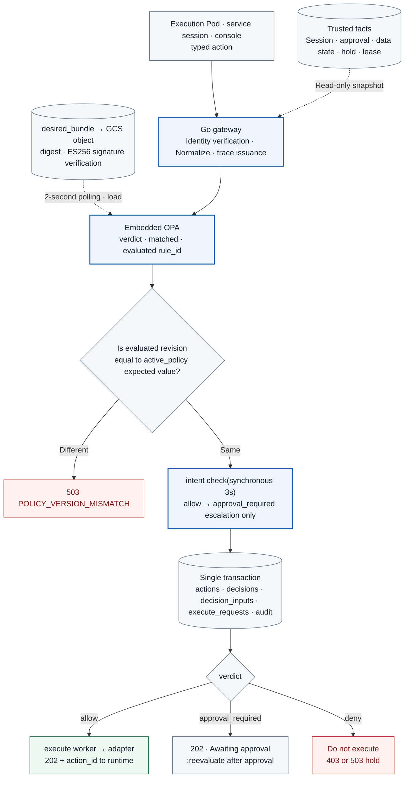

# TASK-04 · Policy Gateway

> This document is the specification of the features to be implemented. Configurations, check items, APIs, storage constraints, and failure handling are implementation contracts; implementation and deployment have not yet been performed. Values generated in the deployment environment are managed as installation inputs. The canonical source for structure, field, enum, reason code, and event_type names is the [Shared Tech Spec](COMMON.md). Field names of OPA input are based on the Rego and input table in 3.2, and the OPA input table in COMMON uses the same names.

## Architecture at a Glance

> Target design · Implementation, deployment, and functional effects are unverified. Solid lines represent placement, processing, and invocation; dotted lines represent reference and observation evidence; and meanings are distinguished by text on arrows.



**How to read:** Rego policy in the OPA embedded in the gateway determines whether service usage is allowed. Even `allow` does not mean transmission is complete; reservation and permit are handled by the coordinator, while final comparison and transmission are handled by the adapter. Missing verdict results, bundle revision mismatches, and evaluation/storage failures prohibit execution. AI-based intent check can only make verdicts stricter.

| Item | Content |
| --- | --- |
| Plan | [Final Plan](../plan.md#task-04) |
| Development Prerequisites | [TASK-02](TASK-02-catalog-contracts.md) · [TASK-03](TASK-03-identity-approval.md) |
| Integration Dependencies (runtime) | [TASK-03](TASK-03-identity-approval.md)(session · service session · approval · coordinator · contract renderer · activation probe registration), [TASK-05](TASK-05-service-adapters.md)(adapter execute, `intent_check` profile), [TASK-07](TASK-07-audit-store.md)(audit storage, `decision_inputs` export), [TASK-08](TASK-08-destination-evidence.md)(reading `actions_target_view`), [TASK-10](TASK-10-correlation-health.md)(lease · hold), [TASK-12](TASK-12-policy-proposals.md)(issue reception, using `evaluated_rule_ids`), [TASK-13](TASK-13-regression-harness.md)(`decision_replay` reads `decision_inputs`), [TASK-14](TASK-14-policy-release.md)(`desired_bundle` · signature · activation) |
| Assigned Role | Policy Engineer · Assignee/target date undecided |
| Common Specifications | [Shared Tech Spec](COMMON.md) |
| Baseline | Working tree after efe8dce (revised 2026-10-11) |

## 1. Goals and Scope

The Rego policy of OPA embedded in the gateway determines allowed services, actions, targets, and public data scope, and the adapter enforces this decision on actual transmission. It returns structured normal allow, human approval required, and deny, binding every verdict to the exact request, decision basis (`decision_basis`), matched rule IDs (`matched_rule_ids`), evaluated rule IDs (`evaluated_rule_ids`), decision inputs (`decision_inputs`), and the bundle revision actually evaluated. The gateway does not make reservations. Reservations, permits, session budgets, and tool budgets are handled by the TASK-03 coordinator (`services/coordinator/`). The approval intent check service and escalation, the `actions`, `decisions`, `decision_inputs`, `execute_requests`, and `intent_checks` tables, and `actions_target_view` are also owned by this Task.

## 2. Required Environment, Inputs, and Resources

| Component | Details |
| --- | --- |
| gateway | Go `services/gateway/`, `net/http`. Paths with `:` inside a single path segment like `/v1/actions/{action_id}:reevaluate` are received as `/v1/actions/{tail}` and split by suffix directly |
| OPA | Go libraries `github.com/open-policy-agent/opa/v1/rego` and `.../v1/bundle`. Loading uses the shared package `packages/policyloader/` (owned by TASK-04, shared with `tools/decision-replay/`) |
| Normalization | `packages/canonical/` (TASK-02) |
| DB | Cloud SQL (`pgx` v5 + `sqlc`). Connects to the Cloud SQL Auth Proxy native sidecar (`initContainers`, `restartPolicy: Always`, `--private-ip`, `--auto-iam-authn`) in the same Pod via `127.0.0.1:3307` ([Cloud SQL GKE connection](https://docs.cloud.google.com/sql/docs/postgres/connect-kubernetes-engine)). metadata egress, `roles/cloudsql.client`, `roles/cloudsql.instanceUser`, and DB IAM users are created by TASK-06 |
| bundle | `desired_bundle` row (written by TASK-14), GCS bundle bucket read (`roles/storage.objectViewer`), verification public key ConfigMap `agentarium-bundle-keys` |
| intent checker | Python `services/intent_check/` (FastAPI + Pydantic v2). Model calls go through the gateway via service session |
| health | TASK-10 lease · hold, `intent_check` profile of TASK-05 model adapter |

Before all integrations are ready, only mock decision testing is possible, and that state is not marked as ready for actual transmission.

## 3. Technical Implementation Design

The processing order for `POST /v1/actions` is as follows:

1. **Authentication:** Authenticate the caller using one of the three methods in 3.1, and the gateway newly issues an internal W3C trace context for each request. The `traceparent` and `baggage` headers sent by the runtime are removed without being used as authorization evidence.
2. **Resubmission check:** Compute SHA-256 (`raw_body_digest`) of the raw body. If `(authenticated_actor, session_id, client_request_key)` already exists in `actions`, compare `raw_body_digest`. If equal, return the existing `action_id` and the latest decision as is; if different, return 409 `CLIENT_KEY_BODY_CONFLICT`.
3. **Normalization:** Call `packages/canonical.Normalize` (TASK-02) using `data.catalog` of the loaded bundle snapshot. Do not read actor, data classification, active epoch, or health status from the client JSON. If rejected, follow the recording rules in 3.1.
4. **Fact collection:** Read facts in a single `REPEATABLE READ READ ONLY` transaction, and use `statement_timestamp()` of that transaction as `control_health.evaluated_at` (input table in 3.2).
5. **Evaluation:** Acquire a loaded bundle at the start of evaluation. If its revision differs from the expected revision in `active_policy`, return 503 `POLICY_VERSION_MISMATCH` and record `policy_evaluation_failed`. Do not create action or decision. If equal, call `PreparedEvalQuery.Eval` with a 500ms context timeout. If ResultSet is empty, the result differs from the schema, or a timeout occurs, return 503 `POLICY_UNAVAILABLE` and record only the same failure event without creating action or decision.
6. **intent check:** If it is a standing rule path and `intent_check_on_standing_rule = true` in the catalog, wait synchronously for up to 3 seconds (3.3).
7. **Storage (single transaction):** COMMIT the following in a single transaction. If storage fails, return 503 `STATE_STORE_UNAVAILABLE` and do not execute.
   - `actions`
   - `action_contents`
   - `decision_inputs` (if duplicate digest, add reference only)
   - immutable `decisions` row
   - if allow, `execute_requests` row
   - audit events `request_received`, `policy_decided`, and where applicable `approval_requested` · `intent_checked`
8. **Response:** allow and approval_required are 202, and deny is 403 or 503 (status rules in 3.1). If allow, the `execute_requests` worker invokes the adapter (3.5).
9. **Re-evaluation:** The decision TTL is 10 seconds. After obtaining approval or after the epoch changes, receive a new decision for the same `action_id` and `action_digest` via `POST /v1/actions/{action_id}:reevaluate` (3.5).

If a crash occurs before the decision storage transaction commits, rows for that transaction do not remain. Audit events committed separately during rejection prior to normalization or evaluation failure may remain. If the client resends with the same key and same body, it evaluates from the beginning.
### 3.1 Authentication, Recording Rules, Embedded OPA Loading

**Caller authentication:** The gateway accepts only typed action APIs on 8443.

| Caller | Authentication | Allowed APIs |
| --- | --- | --- |
| runtime(application session bridge) | workload mTLS(SAN `spiffe://agentarium.internal/ns/<ns>/sa/<ksa>/pod/<pod_uid>`) and session token. Looked up via `sessions.token_digest = SHA-256(token)` and matches claimed workload identity against the SAN | All |
| services(intent checker, proposal service, discovery analyzer, releaser) | service mTLS(SAN `.../ns/<ns>/sa/<ksa>`, principal verified via `registered_workloads`) and service session token(`service_sessions.token_digest`) | `POST /v1/actions`, `GET`·`/result`·`:reevaluate` of own actions |
| console user | Google ID token(`Authorization: Bearer`) incoming via path routing of HTTPS LB. `iss` is `https://accounts.google.com` or `accounts.google.com`, `aud` is console OAuth client ID, and signature is verified via JWKS([Google OpenID Connect](https://developers.google.com/identity/openid-connect/openid-connect)). The discovery document is kept as a static configuration and JWKS(`https://www.googleapis.com/oauth2/v3/certs`) is fetched and cached via PGA path. Verify during installation whether the actual `jwks_uri` matches the value in the discovery document | `GET`·`/result`·`:reevaluate` of own session actions, `operator` role queries all within the same tenant |

**Recording rules (by decision stage):**

| Case | Response | Retained records |
| --- | --- | --- |
| Authentication failure | 401 `AUTH_REQUIRED` | No action, decision, or audit events (rate limit logs only). Follows COMMON recording rules |
| Cannot create envelope (body/per-operation schema violation, unregistered `operation_id`·`target_id`, size exceeded) | 422 `SCHEMA_INVALID`, 403 `ENDPOINT_NOT_REGISTERED`, 413 `BODY_TOO_LARGE` | `request_rejected` without action or decision. Records `request_id` and `reason_codes`, while `session_id`, `operation_id`, and `raw_body_digest` follow the optional field rules of the COMMON event registry |
| Envelope exists, but content inspector rejects normalization | 403 `CONTENT_PATTERN_DENIED` | In a single transaction: `actions`, `decisions`(`decision_stage = normalize`, verdict `deny`, `matched_rule_ids = ["normalize.content_pattern.v1"]`, `evaluated_rule_ids` identical, `decision_input_ref = null`, `rego_result`·`opa_bundle_revision` null), `request_received`·`policy_decided`. This stage is the only case where `decision_input_ref` is null |
| Revision mismatch / abnormal OPA result | 503 `POLICY_VERSION_MISMATCH`, `POLICY_UNAVAILABLE` | `policy_evaluation_failed` without action or decision. Fields follow the COMMON event registry. Can be resubmitted with the same `client_request_key`. Reports `observed_state` of the gateway lease as `degraded` and records the reason |
| Fact query / decision storage failure | 503 `STATE_STORE_UNAVAILABLE` | Decision storage transaction is not committed and not executed. Reports `observed_state` of the gateway lease as `degraded` and records the reason |
| OPA decision | Status rules below | Chapter 3, Step 7 |

Unregistered operations/targets (`normalize.endpoint_registered.v1`) and per-operation schema violations (`normalize.schema.v1`) return `NormalizeError.rule_id` from TASK-02, but since an envelope cannot be created, they follow the `request_rejected` rule. A normalize decision is not created with this rule ID.

The response HTTP status follows the HTTP value in the reason code dictionary, and if multiple codes appear together, it is selected in the order of 503 > 409 > 403 > 422. Even for deny response bodies where a decision is recorded, `action_id, decision_id, verdict, reason_codes, execution_allowed = false` are included. Responses where no action or decision was created return only `reason_codes` and trace ID. For allow, `execution_allowed = true`.

**Bundle loading (in-process, `packages/policyloader/`):** Every 2 seconds, the gateway reads the `desired_bundle` row (`bundle_id, artifact_digest, object_uri = gs://<bucket>/bundles/<artifact_digest>.tar.gz, set_by_change_id, set_at`) of its environment. If `artifact_digest` differs from the currently loaded value, it loads in the following order:

1. Download the GCS object and verify that the SHA-256 (tarball, including `.signatures.json`) matches `artifact_digest`. If different, reject it.
2. Specify `WithBundleVerificationConfig(bundle.NewVerificationConfig(keys, "prod-v1", scope, nil))` on `bundle.NewCustomReader(bundle.NewTarballLoaderWithBaseURL(r, ""))` and call `Read()`.
   - If a signature file exists, OPA verifies the JWT signature and returns an error on failure. However, when there is no signature file, it rejects only if `KeyID` is not empty ([bundle.go](https://github.com/open-policy-agent/opa/blob/main/v1/bundle/bundle.go) `checkSignaturesAndDescriptors`). Therefore, keyID `prod-v1` must be specified.
   - The key algorithm is ES256. The public key is the PEM (`PUBLIC KEY`) of ConfigMap `agentarium-bundle-keys`, and `KeyConfig.Algorithm = "ES256"`.
   - The OPA verifier looks up the algorithm using jwx v3's `jwa.LookupSignatureAlgorithm` and parses the `PUBLIC KEY` PEM with PKIX ([verify.go](https://github.com/open-policy-agent/opa/blob/main/v1/bundle/verify.go)). Therefore, the ES256 verification path exists in the source code.
   - TASK-14 `packages/bundles` is responsible for converting the Cloud KMS `EC_SIGN_P256_SHA256` signature value into JWS ES256 format (R‖S 64 bytes). This conversion and the actual verification against the pinned OPA version are Q0 verification items.
   - The production gateway trusts only `prod-v1`, and the regression project uses `regression-v1`. `WithSkipBundleVerification(true)` is not used.
3. If `Bundle.Manifest.Revision` is empty, reject it.
4. Call `PrepareForEval` using `rego.New(rego.Query("data.agentarium.gateway.result"), rego.ParsedBundle("agentarium", &b))` ([rego package](https://pkg.go.dev/github.com/open-policy-agent/opa/v1/rego)). If it fails, retain the previous bundle.
5. Upon success, bundle the following values and replace via an atomic pointer: prepared query, `Manifest.Revision`, `artifact_digest`, `bundle_id`, and Go `Catalog` built from `data.catalog` of the bundle data. Immediately after replacement, report the loaded value via lease (3.5).

GCS reads are performed with the `cloud.google.com/go/storage` client, and internal retries of this client are permitted only for reading internal infrastructure. This is because it is not an outbound action transmission path. The client version and retry configuration are verified against the pinned version (Q0).

Immediately after startup, if there is no bundle yet, the readiness probe fails and returns 503 `POLICY_UNAVAILABLE` for new requests. If signature verification or preparation fails, the gateway continues to use the previous bundle and reports the failure reason in the lease. The activation sequence is defined by TASK-14: `policy_activation` hold → `desired_bundle` update → lease ack from all expected replicas (120-second timeout) → epoch CAS → activation probe → hold release. Therefore, regular requests received before the epoch CAS by a gateway that loaded the new bundle earlier during the hold are rejected with `POLICY_VERSION_MISMATCH`. After the epoch CAS, because the expected revision becomes the value of the new bundle, the probe is evaluated normally.

The OPA module version is pinned in `go.mod` to the same value as `tools/decision-replay/` (TASK-13) and recorded in `deploy/gcp/environment.lock.json`. `rego.StrictBuiltinErrors` is not turned on. This is because Rego is written so that if a builtin fails, such as a timestamp parse error, the condition becomes undefined and leans toward rejection.
### 3.2 OPA Input and Rego Decision

`policies/gateway/decision.rego` uses Rego v1, and the code below is that file. The data format follows COMMON Appendix A: `data.standing_rules` is a map keyed by `standing_rule_id` and each rule has `operation_ids[]`, and `data.service_profiles[profile]` is `{operation_ids[], model_profiles[], target_ids[]}`. Rego evaluates using raw facts and policy data, and every rule has a stable `rule_id`. The result is `{verdict, reason_codes, matched_rule_ids, evaluated_rule_ids, decision_basis}`.
- `matched_rule_ids` are the rule IDs that served as the basis for the verdict.
- `evaluated_rule_ids` are all inspection rules applied and evaluated for this operation, including rules that passed. The TASK-12 proposal validator checks whether the target rule_id of the patch is in the `evaluated_rule_ids` of the underlying decision.
- The ID of a standing rule uses the `standing_rule_id` from policy data (e.g., `standing.k8s_read.v1`, `standing.model_synthetic.v1`), and the activation probe rule is `probe.activation.v1`.

**OPA input fields (canonical):**

| input key | Field | Source |
| --- | --- | --- |
| `envelope` | Entire ActionEnvelope (`session_kind, session_id, workload_id?, operation_id, canonical_target, disclosure_fields, content_digest, limits, catalog_digest, data_class, environment, tenant`, etc.) | Normalize result |
| `verified_session` | `{kind: user/service, session_id, authenticated_actor, tenant, workload_id?, state, expires_at, allowed_operation_ids[], service_scope?: {profile, issue_id?, candidate_id?, change_id?, snapshot_id?, action_id?}}`. For service sessions as well, the key name is `session_id` (value is `service_session_id`), and the `authenticated_actor` of a service session is `service:<namespace>/<ksa>`. `allowed_operation_ids` for user is `sessions.allowed_operation_ids` (calculated and stored upon creation by TASK-03), while for service it is an empty array and uses `data.service_profiles` for decisions. `state` of a service session is `active/expired/revoked`, and for a user session is `created/claimed/expired/revoked` | `sessions`·`service_sessions` |
| `approval_snapshot` | `{approval_id, action_id, revision, approval_kind, session_id, authenticated_actor, allowed_operation, canonical_target, disclosure_fields, content_digest, max_actions, used_actions, policy_epoch, expires_at, revoked_at}` or `null`. A single unexpired, unrevoked latest revision where `approvals.action_id = envelope.action_id`, and `null` if none exists (COMMON). If only expired or revoked approvals exist, it becomes `null` and searches for a standing rule, and if that also does not exist, it is `approval_required` | `approvals` |
| `workload_data_state` | `{data_class_high_water, data_sources}`. The key is `(workload_id)` for user sessions, `(service_session_id)` for service sessions. If there is no row, `{"data_class_high_water": "none", "data_sources": []}` | `workload_data_state` |
| `control_health` | `{evaluated_at, active_artifact_digest, active_holds[] {hold_id, scope, scope_id, reason}, required_leases[] {component, source_id, observed_state, lease_until, active_version}, activation_probe?: {activation_probe_id, change_id, service_session_id, action_id, target_epoch, expires_at}}` | Rules below |

The rules for constructing `control_health` are as follows:
- **hold:** Only include rows from `holds` that are unreleased and whose scope is one of the following: `(global, *)`, `(workload, envelope.workload_id)`, `(target, canonical_target.target_id)`, `(session, session_id)`. The node scope is checked at reservation time by the coordinator, which knows the adapter node.
- **Required lease:** The component list is determined per operation. Every operation requires `coordinator`, `audit-db`, and that operation's `adapter`, with `destination-evidence` added for `receiver.submit`. For each component, valid leases (`lease_until > evaluated_at`) of the same component are collected and aggregated into one.
  - `observed_state` is the worst value among valid replicas (`unhealthy > degraded > healthy`).
  - `lease_until` is the latest value.
  - `active_version` is that value if all valid replicas report the same `artifact_digest`, otherwise `"mixed"`.
  - If there is not a single valid replica, `observed_state = "unhealthy"`.
- **`active_artifact_digest`:** The active bundle `artifact_digest` of `active_policy`.
- **`activation_probe`:** Included only when the service session has the `activation_probe` profile. The row in `activation_probes` where `(service_session_id, client_request_key)` matches this request is found, and its `action_id` is populated with this action (registration is done via the TASK-03 API prior to submission).

```rego
package agentarium.gateway

required_keys := {"envelope", "verified_session", "approval_snapshot", "workload_data_state", "control_health"}

missing_keys contains k if {
	some k in required_keys
	not k in object.keys(input)
}

env := input.envelope

sess := input.verified_session

now := time.parse_rfc3339_ns(input.control_health.evaluated_at)

target := data.catalog.targets[env.canonical_target.target_id]

operation := data.catalog.operations[env.operation_id]

disclosure_operations := {"receiver.submit", "model.generate"}

versioned_components := {"adapter"}

# ---------- denials: {code, rule_id} ----------

denials contains {"code": "CONTEXT_INCOMPLETE", "rule_id": "input.required_keys.v1"} if {
	count(missing_keys) > 0
}

denials contains {"code": "CONTEXT_INCOMPLETE", "rule_id": "input.evaluated_at.v1"} if {
	not now
}

endpoint_registered if {
	operation.endpoint_id == target.endpoint_id
	env.operation_id in target.operation_ids
	env.canonical_target.route_id == operation.route_id
}

denials contains {"code": "ENDPOINT_NOT_REGISTERED", "rule_id": "catalog.endpoint_registered.v1"} if {
	not endpoint_registered
}

denials contains {"code": "CATALOG_DIGEST_MISMATCH", "rule_id": "catalog.digest_match.v1"} if {
	not env.catalog_digest == data.catalog.catalog_digest
}

session_valid if {
	sess.kind == "user"
	sess.state == "claimed"
	env.session_kind == "user"
	sess.session_id == env.session_id
	sess.authenticated_actor == env.authenticated_actor
	sess.workload_id == env.workload_id
	sess.tenant == env.tenant
	time.parse_rfc3339_ns(sess.expires_at) > now
}

session_valid if {
	sess.kind == "service"
	sess.state == "active"
	env.session_kind == "service"
	sess.session_id == env.session_id
	sess.authenticated_actor == env.authenticated_actor
	sess.tenant == env.tenant
	time.parse_rfc3339_ns(sess.expires_at) > now
}

denials contains {"code": "SESSION_BINDING_INVALID", "rule_id": "session.binding.v1"} if {
	not session_valid
}

target_env_ok if {
	target.environment == env.environment
	target.tenant == env.tenant
}

denials contains {"code": "TARGET_SCOPE_DENIED", "rule_id": "target.scope.v1"} if {
	endpoint_registered
	not target_env_ok
}

denials contains {"code": "TARGET_SCOPE_DENIED", "rule_id": "target.scope.v1"} if {
	sess.kind == "user"
	not env.operation_id in sess.allowed_operation_ids
}

denials contains {"code": "DISCLOSURE_SCOPE_DENIED", "rule_id": "disclosure.receiver.v1"} if {
	env.operation_id == "receiver.submit"
	some f in env.disclosure_fields
	not f in data.receiver.allowed_disclosure_fields
}

data_class_allowed if {
	data.data_class_rank[input.workload_data_state.data_class_high_water] <= data.data_class_rank[target.max_data_class]
}

denials contains {"code": "DATA_CLASS_DENIED", "rule_id": "data_class.high_water.v1"} if {
	env.operation_id in disclosure_operations
	not data_class_allowed
}

# ---------- service session scope ----------

service_scope_ok if {
	sess.kind == "service"
	p := data.service_profiles[sess.service_scope.profile]
	env.operation_id in p.operation_ids
	env.canonical_target.target_id in p.target_ids
	model_profile_ok(p)
	scope_binding_ok
}

# model.generate must use one of the profile's model profiles; other
# operations carry no model profile.
model_profile_ok(_) if env.operation_id != "model.generate"

model_profile_ok(p) if {
	env.operation_id == "model.generate"
	env.canonical_target.profile in p.model_profiles
}

scope_binding_ok if not startswith(env.operation_id, "discovery.")

scope_binding_ok if {
	startswith(env.operation_id, "discovery.")
	env.canonical_target.snapshot_id == sess.service_scope.snapshot_id
}

denials contains {"code": "SERVICE_SCOPE_DENIED", "rule_id": "service.scope_allow.v1"} if {
	sess.kind == "service"
	not service_scope_ok
	not standing_rule_id
}

# ---------- approval contract (user sessions) ----------

# ApprovalContract is a single-action user approval (TASK-03). A service
# session never carries one; if it does, the request is denied rather than
# recorded as decision_basis = approval.
approval_present if input.approval_snapshot != null

has_approval if {
	sess.kind == "user"
	approval_present
}

denials contains {"code": "APPROVAL_INVALID", "rule_id": "approval.binding.v1"} if {
	sess.kind == "service"
	approval_present
}

approval_matches if {
	a := input.approval_snapshot
	a.approval_kind == "action"
	a.session_id == env.session_id
	a.authenticated_actor == env.authenticated_actor
	a.allowed_operation == env.operation_id
	a.canonical_target == env.canonical_target
	a.disclosure_fields == env.disclosure_fields
	a.content_digest == env.content_digest
}

approval_usable if {
	a := input.approval_snapshot
	a.revoked_at == null
	a.used_actions < a.max_actions
	time.parse_rfc3339_ns(a.expires_at) > now
}

denials contains {"code": "APPROVAL_INVALID", "rule_id": "approval.binding.v1"} if {
	has_approval
	not approval_matches
}

denials contains {"code": "APPROVAL_UNAVAILABLE", "rule_id": "approval.usable.v1"} if {
	has_approval
	approval_matches
	not approval_usable
}

# ---------- standing rules (only without an approval) ----------

matched_standing contains r.standing_rule_id if {
	not has_approval
	some id, r in data.standing_rules
	r.standing_rule_id == id
	r.session_kind == sess.kind
	env.operation_id in r.operation_ids
	glob.match(r.target_pattern, ["/"], env.canonical_target.target_id)
	standing_profile_ok(r)
	every k, v in env.limits {
		v <= r.limits[k]
	}
	standing_disclosure_ok(r)
	standing_data_ok(r)
}

# profile is null for rules that apply to any profile (standing.k8s_read.v1).
# `not r.profile` would fail on null, so compare with null explicitly.
standing_profile_ok(r) if object.get(r, "profile", null) == null

standing_profile_ok(r) if {
	r.session_kind == "user"
	env.canonical_target.profile == r.profile
}

standing_profile_ok(r) if {
	r.session_kind == "service"
	sess.service_scope.profile == r.profile
	sess.service_scope.change_id != null
}

standing_disclosure_ok(r) if object.get(r, "disclosure_fields", null) == null

standing_disclosure_ok(r) if {
	every f in env.disclosure_fields {
		f in r.disclosure_fields
	}
}

standing_data_ok(r) if object.get(r, "data_profile", null) == null

standing_data_ok(r) if {
	data.data_class_rank[input.workload_data_state.data_class_high_water] <= data.data_class_rank[r.data_profile]
}

standing_rule_id := sort(matched_standing)[0]

# ---------- holds and required leases ----------

probe_exempt(h) if {
	h.reason == "policy_activation"
	standing_rule_id == "probe.activation.v1"
	p := input.control_health.activation_probe
	p.service_session_id == sess.session_id
	p.change_id == sess.service_scope.change_id
	p.action_id == env.action_id
	time.parse_rfc3339_ns(p.expires_at) > now
}

denials contains {"code": "HOLD_ACTIVE", "rule_id": "hold.blocking.v1"} if {
	some h in input.control_health.active_holds
	not probe_exempt(h)
}

probe_exempt_ids contains "hold.activation_probe_exempt.v1" if {
	some h in input.control_health.active_holds
	probe_exempt(h)
}

denials contains {"code": "CONTROL_HEALTH_UNAVAILABLE", "rule_id": "health.required_leases.v1"} if {
	count(object.get(input.control_health, "required_leases", [])) == 0
}

denials contains {"code": "CONTROL_HEALTH_UNAVAILABLE", "rule_id": "health.required_leases.v1"} if {
	some l in input.control_health.required_leases
	not lease_ok(l)
}

lease_ok(l) if {
	l.observed_state != "unhealthy"
	time.parse_rfc3339_ns(l.lease_until) > now
	not l.component in versioned_components
}

lease_ok(l) if {
	l.observed_state != "unhealthy"
	time.parse_rfc3339_ns(l.lease_until) > now
	l.component in versioned_components
	l.active_version == input.control_health.active_artifact_digest
}

# ---------- evaluated rules ----------

evaluated contains id if {
	some id in {
		"input.required_keys.v1", "input.evaluated_at.v1", "catalog.endpoint_registered.v1",
		"catalog.digest_match.v1", "session.binding.v1", "target.scope.v1",
		"hold.blocking.v1", "health.required_leases.v1",
	}
}

evaluated contains "disclosure.receiver.v1" if env.operation_id == "receiver.submit"

evaluated contains "data_class.high_water.v1" if env.operation_id in disclosure_operations

evaluated contains "service.scope_allow.v1" if sess.kind == "service"

evaluated contains "approval.binding.v1" if approval_present

evaluated contains "approval.usable.v1" if has_approval

evaluated contains r.standing_rule_id if {
	some r in data.standing_rules
	r.session_kind == sess.kind
	env.operation_id in r.operation_ids
}

evaluated contains "hold.activation_probe_exempt.v1" if count(object.get(input.control_health, "active_holds", [])) > 0

# ---------- result ----------

deny_codes := {d.code | some d in denials}

deny_rule_ids := {d.rule_id | some d in denials}

verdict := "deny" if {
	count(denials) > 0
} else := "allow" if {
	sess.kind == "user"
	approval_matches
	approval_usable
} else := "allow" if {
	standing_rule_id
} else := "allow" if {
	service_scope_ok
} else := "approval_required" if {
	sess.kind == "user"
} else := "deny"

reason_codes := sort(deny_codes) if {
	count(denials) > 0
} else := ["APPROVAL_REQUIRED"] if {
	verdict == "approval_required"
} else := ["SERVICE_SCOPE_DENIED"] if {
	verdict == "deny"
} else := []

decision_basis := "approval" if {
	verdict == "allow"
	has_approval
} else := "activation_probe" if {
	verdict == "allow"
	standing_rule_id == "probe.activation.v1"
} else := "standing_rule" if {
	verdict == "allow"
	standing_rule_id
} else := "service_scope" if {
	verdict == "allow"
	service_scope_ok
} else := null

matched_rule_ids := sort(deny_rule_ids) if {
	count(denials) > 0
} else := array.concat(["approval.allow.v1"], sort(probe_exempt_ids)) if {
	decision_basis == "approval"
} else := array.concat([standing_rule_id], sort(probe_exempt_ids)) if {
	decision_basis in {"standing_rule", "activation_probe"}
} else := ["service.scope_allow.v1"] if {
	decision_basis == "service_scope"
} else := ["approval.required_default.v1"] if {
	verdict == "approval_required"
} else := ["service.scope_allow.v1"]

result := {
	"verdict": verdict,
	"reason_codes": reason_codes,
	"matched_rule_ids": matched_rule_ids,
	"evaluated_rule_ids": sort(evaluated),
	"decision_basis": decision_basis,
}
```
`probe.activation.v1` is an entry in `data.standing_rules`: `session_kind = service`, `profile = activation_probe`, `operation_ids = ["receiver.submit"]`, `target_pattern = receiver-probe`, `disclosure_fields = ["summary"]`. The upper limit of 4 times per change is enforced by the service profile budget (TASK-03). COMMON appendix A is the canonical source for the initial standing rules and the actual JSON of `data.service_profiles`. The proposal validator (TASK-12) rejects patches that touch `probe.activation.v1`.

The gateway derives the following values from the result and puts them into GatewayDecision.

| Field | Value |
| --- | --- |
| `decision_basis` | Rego result as is |
| `standing_rule_id` | `matched_rule_ids[0]` when `decision_basis ∈ {standing_rule, activation_probe}`. If it becomes `approval_required` due to intent escalation (3.3), it is cleared along with `decision_basis`. The original standing rule ID remains only in `matched_rule_ids` and `rego_result.matched_rule_ids` |
| `approval_id` | Value of the snapshot when `decision_basis = approval` |
| `service_session_id` | `session_id` if it is a service session request |
| `activation_probe_id` | Probe row ID of the input if `hold.activation_probe_exempt.v1` is in matched |
| `rego_result` | Raw result of `{verdict, reason_codes, matched_rule_ids}` |
| `gateway_added_rule_ids` | `["intent.divergence_escalation.v1"]` only upon intent escalation |

The remaining principles are as follows.
- **Input content:** Secret values or raw logs are not placed in the OPA input. The envelope contains only `content_ref` and `content_digest` instead of the raw text. Session budgets (`SESSION_BUDGET_EXHAUSTED`) and tool budgets (`TOOL_BUDGET_EXHAUSTED`) are checked by the coordinator at reservation time.
- **Basis of trust for decisions:** Decisions are stored as immutable rows queryable by the adapter and coordinator, and client-generated decision JSON is not accepted as proof of authorization. Decision authentication is "mTLS service connection + DB immutable decision row", and no separate signature is used.

**Rego test fixtures:** Unit tests are performed with `opa test` (the same OPA version as the gateway) by feeding `policies/gateway/testdata/*.json`. Below is the input of the approval path allow fixture. Violation fixtures are kept together in the same directory.
- Missing one input key
- Empty array for `required_leases`
- Adapter lease `active_version = "mixed"`
- Operation outside the profile in a service session
- User session calling `model.generate` with `policy_proposal` profile
- Unregistered probe during `policy_activation` hold

```json
{
  "envelope": {"schema_version": "v1", "action_id": "8c1e…", "session_kind": "user", "session_id": "51ab…",
    "authenticated_actor": "user:alice@example.com", "workload_id": "agent-runtime-0", "endpoint_id": "test-receiver-v1",
    "operation_id": "receiver.submit", "canonical_target": {"target_id": "receiver-primary", "route_id": "submissions-v1"},
    "environment": "test", "tenant": "hackathon", "disclosure_fields": ["summary"], "data_class": "synthetic",
    "data_sources": ["fixture:receiver-safe-v1"], "content_digest": "<64 hex>", "content_ref": "<64 hex>", "bytes": 23,
    "limits": {}, "catalog_digest": "<catalog digest>", "catalog_version": "test-2026-10-11",
    "canonicalization_version": "v1", "raw_body_digest": "<64 hex>", "action_digest": "<64 hex>"},
  "verified_session": {"kind": "user", "session_id": "51ab…", "authenticated_actor": "user:alice@example.com",
    "tenant": "hackathon", "workload_id": "agent-runtime-0", "state": "claimed", "expires_at": "2026-10-11T12:30:00Z",
    "allowed_operation_ids": ["k8s.pods.list", "k8s.pods.logs", "receiver.submit", "model.generate"], "service_scope": null},
  "approval_snapshot": {"approval_id": "a9…", "revision": 1, "approval_kind": "action", "session_id": "51ab…",
    "authenticated_actor": "user:alice@example.com", "allowed_operation": "receiver.submit",
    "canonical_target": {"target_id": "receiver-primary", "route_id": "submissions-v1"}, "disclosure_fields": ["summary"],
    "content_digest": "<64 hex>", "max_actions": 1, "used_actions": 0, "policy_epoch": 7,
    "expires_at": "2026-10-11T12:10:00Z", "revoked_at": null},
  "workload_data_state": {"data_class_high_water": "synthetic", "data_sources": ["fixture:receiver-safe-v1"]},
  "control_health": {"evaluated_at": "2026-10-11T12:00:00Z", "active_artifact_digest": "<artifact digest>",
    "active_holds": [],
    "required_leases": [
      {"component": "coordinator", "observed_state": "healthy", "lease_until": "2026-10-11T12:00:12Z", "active_version": null},
      {"component": "audit-db", "observed_state": "healthy", "lease_until": "2026-10-11T12:00:12Z", "active_version": null},
      {"component": "adapter", "observed_state": "healthy", "lease_until": "2026-10-11T12:00:11Z", "active_version": "<artifact digest>"},
      {"component": "destination-evidence", "observed_state": "healthy", "lease_until": "2026-10-11T12:00:10Z", "active_version": null}]}
}
```

The expected result is as follows.

```json
{"verdict": "allow", "reason_codes": [], "matched_rule_ids": ["approval.allow.v1"], "decision_basis": "approval", "evaluated_rule_ids": ["approval.binding.v1", "approval.usable.v1", "catalog.digest_match.v1", "catalog.endpoint_registered.v1", "data_class.high_water.v1", "disclosure.receiver.v1", "health.required_leases.v1", "hold.blocking.v1", "input.evaluated_at.v1", "input.required_keys.v1", "session.binding.v1", "target.scope.v1"]}
```

**Verdict semantic tests:** If the session is invalid and there is also no approval, it is deny. In a user session, if there is no legitimate approval and no standing rule, it is approval_required. Service sessions only result in allow or deny. In all verdicts, `matched_rule_ids` and `evaluated_rule_ids` must not be empty.
### 3.3 Approval Intent Check (intent check)

`services/intent_check/`(Python) is an auxiliary feature that warns of discrepancies between the user's task description and the contract rendered by the server. It merely assists with the gap left by Plan Chapter 4 stating that "complete semantic verification of free-form intent is not guaranteed," and does not claim to guarantee semantic consistency. The entire contract follows "Approval Intent Check (intent check)" and the "AI One-Way Principle" of [Shared Tech Spec](COMMON.md).

| Item | Implementation contract |
| --- | --- |
| Execution timing | (1) `approval_required`: Before TASK-03 renders `GET /v1/actions/{action_id}/approval-contract`, it calls `POST /internal/intent-checks {action_id, contract_digest, rendered_contract}`. `contract_digest` is the digest of ContractView calculated by the TASK-03 renderer. (2) standing rule path: When an operation with `intent_check_on_standing_rule = true` in the catalog is `allow`ed by a standing rule, the gateway synchronously calls the same API and waits up to 3 seconds. The display contract is generated by the gateway using the same renderer package as TASK-03. Service session requests are not targeted (including intent check's own `model.generate`). Deny requests and requests allowed by user approval are also not targeted. |
| Input | The `task_statement` entered by the user at session creation and stored by the server, the structured display contract (target, exposed fields, count, relative expiration, synthetic data content preview), and the catalog operation `description`. Text written by the agent is not included. External text within the input is enclosed in delimiters and marked as data. If the session's high-water mark exceeds the permitted tier of the `intent_check` profile, the content preview is omitted, and if it still cannot be included, it is `not_run`. |
| Model invocation | For each request, the intent checker receives a service session via `POST /internal/service-sessions` (TASK-03, profile `intent_check`, scope `action_id`, 1 model call, TTL 30 seconds). With that token, it submits `model.generate` (`intent_check` profile) to gateway `POST /v1/actions` and polls `GET /v1/actions/{id}/result` at 100ms intervals. This call goes through the same gateway evaluation (`service.scope_allow.v1`) and model adapter path as other requests. Because the gateway processing waiting for the original request and the service session request are separate requests, they do not block each other. Digest calculation is performed by the gateway and not by the intent checker. |
| Time limit and feasibility | Within 3 seconds, service session creation, gateway evaluation, the adapter's Agent Platform invocation, and result polling must all complete. Depending on the model response time, `not_run` may occur frequently on the standing path. In Q0, the `not_run` rate and latency are measured and reported, and if the rate is high, it is recorded that the standing path intent check has no demonstration efficacy. The decision TTL is counted starting from when the decision is saved after the intent check finishes. |
| Output validation | The response is re-validated against the `IntentCheckResult` schema (Pydantic strict). Validation failure, timeout, or model refusal results in `intent_check_status = not_run`, and the deterministic verdict is used as is. |
| Effect | If `overall = divergent` in a standing rule allow candidate, the verdict is changed to `approval_required` and `reason_codes` is set to `["APPROVAL_REQUIRED", "INTENT_DIVERGENCE_ESCALATED"]`. The original standing rule ID is retained in `matched_rule_ids`, and `intent.divergence_escalation.v1` is recorded in `gateway_added_rule_ids`. `decision_basis` is null, and `standing_rule_id` is not recorded. The original allow result remains in `rego_result`. `unclear` is recorded only and does not change the standing rule verdict. On the approval screen, `divergent` and `unclear` findings are displayed as warnings, and the user must acknowledge each finding before approval is allowed (TASK-03, `INTENT_ACK_REQUIRED`). `consistent` does not add any permissions. |
| Storage and events | The intent checker writes the IntentCheckResult to `intent_checks` (owned by TASK-04), and the gateway records `intent_check_id` in the decision and logs an `intent_checked` event. |
| Issue creation | If `overall = divergent`, the intent checker calls `POST /internal/issues` (TASK-12) with `{source: "intent_divergence", action_id, intent_check_id, evidence_ids: [intent_check_id]}`. The idempotency key is the natural key `(source, subject_ref = intent_check_id, reason = first finding kind such as field_extra)`. In the demo, the `field_extra` warning between the "forward summary only" task description and the contract containing an email field leads to this issue, serving as the starting ground for policy improvement. |

The intent check cannot produce an `allow` or downgrade `deny` or `approval_required`. After receiving the intent check result, the gateway (Go) asserts that the final verdict is stricter than or equal to `rego_result.verdict` and saves it. If this assert fails, it saves the original Rego verdict and logs an error. The regression invariant `ai_created_allow_count` is the sum of the number of decisions where the final verdict is more permissive than `rego_result.verdict` (which must always be 0) and the number of policy changes activated without human approval.

### 3.4 Decision Input Storage and Replay

The gateway stores the OPA input used for evaluation in `decision_inputs(decision_input_digest PK, tenant, sanitized_input jsonb, policy_bundle_id, created_at)`. It is owned by TASK-04. Because the OPA input is configured from the outset to contain only `content_digest` and `content_ref` without secrets, raw logs, or raw content, `sanitized_input` is the same value as the evaluated input.
- **digest:** `decision_input_digest` is calculated as the canonical digest of `packages/canonical/`, and `decision_input_ref = decision_input_digest`.
- **jsonb storage:** jsonb rewrites key order and whitespace, but preserves the semantics of JSON values. The replay tool reads the row, recalculates the canonical digest, verifies that it matches the stored value, and then uses it. Because all integers are less than 2^53, differences in numeric representation do not alter the digest.
- **Retention:** The same digest is stored only once, and retention deletion is performed only after all decisions referencing that row have exceeded 30 days.

TASK-13 `tools/decision-replay/` (Go, same `packages/policyloader/` and OPA version) re-evaluates these rows against the baseline and candidate bundles. Replay targets only inputs evaluated with the baseline bundle, covering the last 7 days and up to 5,000 cases. Replay results are compared only with the `rego_result` of the decision. Results added by the gateway, such as intent escalation (`gateway_added_rule_ids`), cannot be reproduced by Rego and are therefore excluded from the comparison and displayed separately. `release_eligible` is not determined solely by replay results. The regression project does not read the production DB. The TASK-07 exporter exports `decision_inputs` as NDJSON batches to the production project's GCS bucket `decision-input-exports`, and the regression project's decision-replay SA has only `roles/storage.objectViewer` for that bucket.

### 3.5 Execution Delivery, Re-evaluation, Result Serving, Trace, Lease

- **Execution delivery (durable):** In the same transaction as the allow decision, writes an `execute_requests(decision_id PK, action_id, adapter_id, state(pending/delivered/expired), attempts, next_attempt_at, lease_until, updated_at)` row (COMMON canonical name; the former name `dispatch_queue` is not used). A gateway worker picks up rows using `FOR UPDATE SKIP LOCKED` and calls `POST /internal/adapter/{adapter_id}/execute {decision_id, action_id}`.
  - If the adapter returns 202, changes it to `delivered`.
  - If it fails, retries with exponential backoff starting from 200ms (doubling each time) only within the decision TTL (10 seconds).
  - When the TTL expires, changes it to `expired`, and the runtime restarts via `:reevaluate`.
  - The adapter ignores duplicate calls for the same decision via `adapter_executions(decision_id PK)` (TASK-05). This internal retry is not a retry of external actions.
- **Re-evaluation:** `POST /v1/actions/{action_id}:reevaluate {expected_action_digest}` is called by the runtime (session owner), the service session owner, or the console.
  - If `expected_action_digest` differs from the stored value, it returns 409 `ACTION_DIGEST_MISMATCH`.
  - If the envelope's `catalog_digest` differs from the active catalog, it returns 409 `CATALOG_DIGEST_MISMATCH` and the runtime must submit a new action.
  - If there is already a reservation for the same action, it does not create a new decision and returns the current state with 200.
  - Otherwise, even if the previous verdict was deny, it regathers current facts using the stored envelope, evaluates them, and issues a new `decision_id`, a new `request_id`, and a new 10-second TTL (`action_reevaluated` event). The response status follows the same rules as `POST /v1/actions`.
- **Result serving:** `GET /v1/actions/{action_id}/result` returns the ActionResult written to `action_results` by the TASK-05 adapter only to the owner or the corresponding service session. For other callers, it returns 404 `RESOURCE_NOT_FOUND` to conceal its existence. If results are not yet available, it returns 202 along with the current `execution_state`.
- **`execution_state` derivation:** `GET /v1/actions/{action_id}` and `/result` calculate `execution_state` according to the rules below. Because `effect_verified` and `effect_mismatch` require target evidence, they are calculated by the TASK-11 timeline, and this API points to them via `alignment_ref`.

| Condition | `execution_state` |
| --- | --- |
| decision verdict `deny` (including normalize) | `denied` |
| `approval_required` | `approval_pending` |
| allow, `adapter_executions.state = preflight_rejected` | `preflight_rejected` |
| allow, no attempt | `dispatch_pending` (`dispatch_status` = `execute_requests.state`) |
| attempt `planned`·`claimed` | `attempt_planned` |
| attempt `dispatched` | `dispatched` |
| attempt `response_received` | `action_results.execution_state` (`accepted` or `failed`) |
| attempt `failed`·`released` | `failed` |
| attempt `unknown` | `unknown` |
| attempt `resolved` | Read and display resolution result from TASK-11 |

- **trace:** The trace context issued by the gateway is propagated only between internal services (adapter execute, coordinator, audit). Traces are not used for evaluation or approval.
- **lease reporting:** Reported every 5 seconds per gateway replica via `POST /internal/control-health/leases` (TASK-10). `component = gateway`, `active_version` = loaded bundle `artifact_digest`, `active_bundle_revision` = `Manifest.Revision`, and `canonical_version` = `packages/canonical/` version; if there is a load failure or OPA error, `observed_state = degraded` and the cause are included. TASK-14 confirms the ack when "number of valid leases reporting desired digest = Deployment `status.replicas`".
### Routing the work-start gate through the gateway

The gateway relays the TASK-10 session-worker registration/GET/close and the public work-readiness POST/GET, as well as TASK-07's `POST /v1/runtime/work-events`, with workload mTLS and the claimed session token. It strips external peer/session identity headers and forwards only the context confirmed by authentication over management mTLS. Relays for readiness checks, audit, and recovery are allowed even during the related holds, but they cannot execute work actions. The public POST returns pending 202/check ID, and GET returns the caller's own result and remaining TTL. The runtime's egress is still only the gateway.

The runtime's `POST /v1/actions` and `POST /v1/actions/{action_id}:reevaluate`, which re-allows execution, require the `X-Agentarium-Work-Run-Id` and `X-Agentarium-Work-Readiness-Check-Id` references. The normalizer checks the caller/session/work_run_id in the TASK-10 record, the observed worker_instance_id/worker_binding_id/root_exec_id, the actual Pod binding, the current generation/epoch, expiry, and node holds on the originating agent, and then proceeds to OPA. Not ready/expired returns 503, and a reference to another identity/session returns 403. The headers are not evidence of permission, and no claim is made that they block theft of shared credentials. Service sessions and the console query and approval APIs do not require these runtime headers.

The references are stored in the server-normalized context and in audit evidence_refs, and the COMMON ClientAction JSON/operation schema is not altered. Action approval, standing rules, and dispatch permits are checked separately. Resubmitting or querying an existing action/key does not create new work permission or a new dispatch. However, the first submission of a new action requires a current readiness result, and network retries of an unsubmitted action go through a new check once the result expires. After submission, pending/result queries must be possible without re-running the work. The console's :reevaluate also proceeds to an execution allow only when the server has confirmed the current readiness result of the stored original execution Pod/session. Creating an approval from the console itself is possible even when work is not ready, but it does not issue ready or bypass the execution gate.

<a id="4-api-data-and-connection-contract-ref"></a>

## 4. API, Data, and Connection contract

| API | Owner and caller | Response |
| --- | --- | --- |
| `POST /v1/runtime/session-workers`, `GET /v1/runtime/session-workers/{id}`, `POST /v1/runtime/session-workers/{id}:close` | supervisor workload mTLS + the corresponding session token | Relay of TASK-10 registration/observation state/close. Forwards the verified `session_id` as `X-Agentarium-Peer-Session`, and control-health compares it with the target worker's session. A reference to another session returns 403, a conflict returns 409 |
| `POST /v1/runtime/work-readiness/checks`, `GET /v1/runtime/work-readiness/checks/{id}` | runtime workload mTLS + session token | TASK-10 relay. pending/own result and remaining TTL |
| `POST /v1/runtime/work-events` | Same runtime identity | TASK-07 relay. Reads the check using the verified caller SAN (`X-Agentarium-Peer-Identity`) and the session ID from the token (`X-Agentarium-Peer-Session`), matches caller, session, workload, and event ID, and then forwards to audit-writer `POST /internal/audit/work-events` (gateway flags `--audit-url`, `--audit-writer-san`). Returns the registered event ack as is |
| `POST /v1/actions` | runtime session token + work-readiness headers, service session | allow and approval_required return 202 + `action_id, decision_id, verdict, execution_allowed, reason_codes, decision_basis`. A resubmission with the same key and the same raw body returns the existing action. deny returns 403 or 503, with `action_id, decision_id` in the body |
| `GET /v1/actions/{action_id}` | Owner, the corresponding service session, console | Decision, `matched_rule_ids`, `execution_state`, `dispatch_status`. Outside permission, 404 `RESOURCE_NOT_FOUND` |
| `POST /v1/actions/{action_id}:reevaluate` | runtime, service session, console | New `decision_id`, verdict, `expires_at`, or the current state if a reservation exists |
| `GET /v1/actions/{action_id}/result` | Owner, the corresponding service session, console | ActionResult; 202 if none |
| `POST /internal/intent-checks` | TASK-03 contract renderer, gateway (standing path) | IntentCheckResult (`services/intent_check/`) |
| Embedded OPA `PreparedEvalQuery.Eval(ctx, rego.EvalInput(input))` | Inside the gateway process | The result object from 3.2 |

The storage units are as follows.
- **Owned by TASK-04:** `actions`, `decisions`, `decision_inputs`, `execute_requests`, `intent_checks`. All are in the DB schema `decisions` (for example, `decisions.decision_inputs`). After the `decision_inputs` INSERT, the decision transaction calls `audit.enqueue_decision_input(decision_input_digest, record_bytes)` (TASK-07), and TASK-07 `audit_exporter` is given only SELECT on `decisions.decision_inputs`.
  - `actions` has `UNIQUE (authenticated_actor, session_id, client_request_key)`, `raw_body_digest`, and envelope columns.
  - `decisions` has all GatewayDecision columns, with `decision_stage ∈ {normalize, opa}`.
- **Written by TASK-04, read by TASK-05 and the TASK-03 renderer:** `action_contents`.
  - The primary key is `(content_digest, action_id)`. Two actions whose contents are byte-for-byte identical each have their own row containing their own `action_id` and `tenant`. If content_digest alone were the key, the second action would read the first action's row, and the adapter's `canonical.VerifyContent` would reject that row with `CONTENT_DIGEST_MISMATCH`. Rows are still looked up by the leading key column `content_digest`.
  - Only `gateway_app` reads raw rows directly from the table. Adapters read only through the `adapter_action_contents` view below.
- **Adapter login mapping:** `adapter_db_roles(db_role name PK, adapter_id text NOT NULL)`. Each row maps the PostgreSQL login name that one adapter uses to connect (a Cloud SQL IAM DB user, i.e., the `session_user` value) to that adapter's `adapter_id`. The migration owner inserts the rows during installation (TASK-05, TASK-16). No permission on this table is given to `adapter_reader` or PUBLIC.
- **Read views for other Tasks:** Only the five views below are provided. The first three are in the COMMON registration table. The two adapter views, `adapter_db_roles`, and the key of `action_contents` will be added to COMMON in a separate common specification PR.
  - `actions_target_view(action_id, tenant, operation_id, canonical_target)`: SELECT for `evidence_collector` (TASK-08).
  - `pending_approval_actions(action_id, session_id, operation_id, decision_id, created_at)`: actions whose latest decision is `approval_required` and that have no usable approval. SELECT for the TASK-03 identity service.
  - `action_content_previews(content_digest, preview_text, truncated)`: content preview (first 512 characters). Only content whose action has a `data_class` of `none` or `synthetic` is visible. `none` means the workload has not yet read any data, so that content contains no read data. Content that is `internal` or `confidential` and actions without an envelope have no preview, and contract rendering fails (fail-closed). SELECT for the TASK-03 contract renderer. Adapters read the raw text through `adapter_action_contents` below.
  - `adapter_action_envelopes(action_id, envelope)`: the full ActionEnvelope of actions that have an allow decision for the calling adapter. SELECT for TASK-05 `adapter_reader`.
  - `adapter_action_contents(content_digest, tenant, action_id, adapter_id, content_bytes, created_at, expires_at)`: unexpired `action_contents` rows that have an allow decision for the calling adapter. The row's `adapter_id` must also equal the decision's `adapter_id`. SELECT for TASK-05 `adapter_reader`.
- **Per-adapter read isolation:** The two adapter views treat the `adapter_id` of the `adapter_db_roles` row with `db_role = session_user` as the calling adapter. Even after `SET ROLE adapter_reader`, `session_user` remains the login name, so the result does not change. A login without a mapping receives no rows. Both views are owner-privilege views with `security_barrier` enabled and do not use `security_invoker`. Therefore `adapter_reader` needs no permissions on the base tables or on `adapter_db_roles`. The migration explicitly revokes permissions on these tables from PUBLIC and `adapter_reader`. The only permissions left for `adapter_reader` are SELECT on `decisions` (COMMON) and SELECT on the two views.

The schema is managed as `golang-migrate` SQL files in `migrations/`, and Go code uses `pgx` v5 and `sqlc`-generated queries.

The permissions of the gateway DB role (`gateway_app`) are as follows.

| Permission | Target |
| --- | --- |
| INSERT, SELECT | The TASK-04 tables above |
| SELECT | `sessions`, `service_sessions`, `approvals`, `activation_probes`, `active_policy`, `desired_bundle`, `health.holds`, `health.control_health_leases`, `workload_data_state`, `action_results`, `reservations`, `attempts`, `adapter_executions` |
| UPDATE | Status columns of `execute_requests` |
| EXECUTE | `audit.enqueue_decision_input()` (TASK-07), `coordinator.bind_activation_probe_action()` (TASK-03, fills `activation_probes.action_id`) |
| Audit write | EXECUTE on `audit_append()` |

The maximum permissions of registered service credentials are not replaced by the service allow policy.

The audit events emitted are `request_received`, `request_rejected`, `policy_decided`, `policy_evaluation_failed`, `approval_requested`, `action_reevaluated`, and `intent_checked`.

## 5. Security Boundaries, Failure Handling, and Operations

- **fail-closed:** Failures of the policy, DB, or health sources are fail-closed for new executions. No failure exception is made even for allowed queries.
- **Races:** Races between policy evaluation and actual sending are reduced by the coordinator's reservation re-verification (epoch, catalog, revision, hold, node) and the final permit, but no claim is made that the atomicity of external requests is guaranteed.
- **Bundle delay:** Decisions made while loading a new bundle is delayed or failing are blocked by matching the revision of the evaluation bundle and by matching the `active_version` of the adapter lease (rejected if `mixed`).
- **Gateway compromise:** If the gateway process is compromised, the decisions of the embedded OPA cannot be trusted either. This limitation is compensated by independent audit, adapter preflight, and destination evidence.
- **Input and response protection:** mTLS service identity, request size limits, rate limits, and timeouts are applied. Secrets are not put into reason codes. The management API for policy testing and the execution API are separated with distinct permissions.
- **intent check output:** Because intent check input can contain prompt injection, its output is used only for warnings and escalation. Even if the model follows an injected instruction, it cannot create an allow.

## 6. Implementation Files and Work Order

Implementation files are authored at the paths below. Currently, no GCP implementation files exist, and if the implementation paths change, this specification and CI must be updated together.

| Implementation Path | Implementation Responsibilities |
| --- | --- |
| services/gateway/ (Go) | Three types of authentication, trace issuance, Normalize invocation, fact collection, built-in OPA evaluation, revision comparison, single-transaction storage, execute worker, re-evaluation, result serving, lease reporting |
| packages/policyloader/ (Go) | `desired_bundle` polling, GCS download and digest comparison, ES256 signature verification, `PrepareForEval`, atomic replacement |
| policies/gateway/ | `decision.rego`, rule_id list, `testdata/*.json`, Rego unit tests |
| packages/decisions/ (Go) | Decision result schema validation, `decision_basis`/`standing_rule_id` derivation, intent escalation assert |
| services/intent_check/ (Python) | `POST /internal/intent-checks`, service session creation, model invocation via gateway, schema re-validation, `intent_checks` storage, issue creation |
| migrations/ | `actions`, `decisions`, `decision_inputs`, `execute_requests`, `intent_checks`, views `actions_target_view` · `pending_approval_actions` · `action_content_previews` |
| tests/gateway/ | Normal · rejection · OPA failure · revision mismatch · epoch race · intent check · re-evaluation |

## 7. Verification Methods and Pass Criteria

| Test | Method / Independent Verification Evidence | Pass Criteria |
| --- | --- | --- |
| Service allowance decision | Target/env variants for the same actor across registered/unregistered services | Only specified scope is allowed; rejections do not reach receiver |
| Policy data application | Requests containing email in baseline and candidate bundles | Baseline allows (bug reproduction); candidate results in `deny DISCLOSURE_SCOPE_DENIED` and `matched_rule_ids = ["disclosure.receiver.v1"]`, with `evaluated_rule_ids` containing `disclosure.receiver.v1` |
| Service session decision | Allowed operations and out-of-profile operations for intent_check, policy_proposal, and discovery service sessions | Allowed operations yield `decision_basis = service_scope`; out-of-profile operations yield `SERVICE_SCOPE_DENIED` |
| Profile misuse | User session executes `model.generate` with the `policy_proposal` profile | approval_required due to standing rule mismatch; service path not allowed |
| Missing required input | Removal of one input key, empty array for `required_leases`, missing `evaluated_at` | Denied with `CONTEXT_INCOMPLETE` or `CONTROL_HEALTH_UNAVAILABLE` |
| Mixed versions | Two adapter replicas report different `artifact_digest` | `CONTROL_HEALTH_UNAVAILABLE` |
| Decision result anomaly | Empty ResultSet, invalid enum, or injection exceeding 500ms | 503 `POLICY_UNAVAILABLE`, no decision row, lease `degraded` |
| Bundle verification | Missing `.signatures.json`, signed with a different key, digest-mismatched object | Load rejected, previous bundle retained, 503 `POLICY_VERSION_MISMATCH` for the new expected revision |
| Decision input replay | Re-evaluate stored `decision_inputs` against the same bundle | Matches `rego_result`. Intent escalation decisions are excluded from comparison and marked separately |
| Pre-envelope rejection recording | Per-body/per-operation schema violation, unregistered operation/target, size exceeded | Only `request_rejected` is recorded, with no action or decision. No audit event for authentication failures |
| Normalize stage recording | Content inspector violation with envelope | decision `decision_stage = normalize`, `normalize.content_pattern.v1`, `rego_result` and `opa_bundle_revision` null, `request_received` and `policy_decided` recorded |
| Evaluation failure recording | Revision mismatch, OPA result anomaly or timeout | Records `policy_evaluation_failed`, without creating action, decision, or execute request |
| Client key | Resubmission with same key and same raw body; same key and different body; resubmission with same body after high-water increase | Returns existing action; 409 `CLIENT_KEY_BODY_CONFLICT`; returns existing action |
| Approval waiting and re-evaluation | Unapproved transmission → approval → `:reevaluate` | First response 202 + `execution_allowed=false`, no adapter call; new decision_id after re-evaluation |
| Policy replacement race | Reservation after allow and active epoch replacement | Reservation is rejected with `POLICY_EPOCH_STALE` and requires re-evaluation |
| Activation probe | Pre-registered probe and unregistered action, during `policy_activation` hold | Only probe is allowed (`decision_basis = activation_probe`, `activation_probe_id`); unregistered actions result in `HOLD_ACTIVE` |
| Execution delivery | Kill gateway immediately after storing decision | Restarted worker invokes via `execute_requests` within TTL; no duplicate adapter execution |
| Intent check escalation | Intent divergence fixture on standing rule allow candidate | `approval_required` + `INTENT_DIVERGENCE_ESCALATED`, `rego_result` is allow, one `intent_divergence` issue |
| Intent check failure | Model timeout, schema violation, or prompt injection fixture | `not_run` or warning only, deterministic decision maintained. `ai_created_allow_count = 0` |
| Intent check latency | Repeated execution of standing path | Report `not_run` ratio and p50/p95 latency (sample basis COMMON) |
| Console authentication | `:reevaluate` on another user's action using a console token | 404 `RESOURCE_NOT_FOUND` |
| Trace stripping | Request where runtime sends `traceparent` and `baggage` | Internal trace is newly issued; client values are not used for decision or propagation |

Before running verification, fix the code, image, schema, policy/catalog versions, target environment, and test denominators. The tests above were not executed during the drafting of this document. Actual execution records are stored in accordance with the "Result Recording Contract" of the [Shared Tech Spec](COMMON.md).

## 8. Deliverables and Implementation Results

### Deliverables to Leave After Implementation

- Gateway API, policy bundle structure and rule_id list, implementations for decision, input storage, execution delivery, re-evaluation, and result serving, along with policy unit/integration test reports.
- Storage of intent check results and escalation records, raw data for aggregating false positives, false negatives, and `not_run` (metric calculation is TASK-13).

### Currently Confirmed Results

| Category | Current Status |
| --- | --- |
| Tech Spec | Only implementation specification drafting and static link checks performed; rendering and functional verification not executed |
| Implementation Files | The corresponding GCP implementation paths have not been created as of now |
| Functional Tests | Not executed |
| GCP/GKE Deployment | Neither performed nor verified in this task |
| Completion Determination | Pending · Not determined as functionally complete |

### When Recording Implementation Results

- Record secure references to `implementation_commit`, image digest, `run_id`, environment manifest, and verification reports/original evidence.
- Leave `expected / observed / passed / failed / unknown / not_run` and denominators per test. Unmeasured numbers are left as `null`.
- Record failed, unobserved, and pending items, normal operational impact, and deployment/recovery results together, changing only the verified scope to complete.

## 9. Deployment Inputs and Change Conditions

Rego manages decision logic and rule_id, while signed immutable policy data manages catalog, disclosure scope, standing rules, service profiles, and data sensitivity ranking. Decisions are authenticated via mTLS gateway identity and DB immutable rows, and queried by adapter and coordinator.

Upon installation, fix the following values in `deploy/gcp/environment.lock.json` (schema owned by TASK-16) and leave Q0 empirical measurement evidence:
- OPA module version (identical to `tools/decision-replay/`)
- Verification key ID `prod-v1`
- `desired_bundle` polling interval of 2 seconds
- Console OAuth client ID
- Intent check time limit

TTLs and reason codes are implemented with values from Chapter 3 and COMMON. Changing or deleting a rule_id requires a new bundle and regression testing. No failure exceptions that continue to permit queries are included in the MVP.

If permissions, trust boundaries, supported behaviors, or default failure handlings change, the final plan and related Tasks must be revised together. Although responsible roles are defined in the table above, actual assignees remain undecided, so this document must not be construed as operational approval.

## 10. Technical Rationale

- [OPA Go rego package v1](https://pkg.go.dev/github.com/open-policy-agent/opa/v1/rego): `ParsedBundle`, `Query`, `PrepareForEval`, `PreparedEvalQuery.Eval`, `EvalInput`, `StrictBuiltinErrors` (documentation verified, v1.21.1 per page).
- [OPA Go bundle package v1](https://pkg.go.dev/github.com/open-policy-agent/opa/v1/bundle), [bundle.go](https://github.com/open-policy-agent/opa/blob/main/v1/bundle/bundle.go), [verify.go](https://github.com/open-policy-agent/opa/blob/main/v1/bundle/verify.go): `NewCustomReader` (`NewReader` is deprecated), `WithBundleVerificationConfig`, `NewVerificationConfig`, `Manifest.Revision`, missing signature file rejected only when `KeyID` is present, jwx v3 `jwa.LookupSignatureAlgorithm` and PKIX public key parsing (documentation and main branch source verified). Actual ES256 verification and KMS signature conversion are Q0.
- [OPA bundles](https://www.openpolicyagent.org/docs/management-bundles): bundle signing and `.manifest` `revision` (documentation verified).
- [OPA policy reference](https://www.openpolicyagent.org/docs/policy-reference): `object.keys`, `time.parse_rfc3339_ns`, `glob.match`, `array.concat`, `every`, `else`. Re-verified with `opa test` in the selected OPA version.
- [Google OpenID Connect](https://developers.google.com/identity/openid-connect/openid-connect): Two ID token `iss` values, discovery document URL, JWKS example values (documentation verified).
- [Cloud SQL GKE Connection](https://docs.cloud.google.com/sql/docs/postgres/connect-kubernetes-engine): Auth Proxy sidecar, `--port`, `--auto-iam-authn`, `--private-ip`, `127.0.0.1` connection, `restartPolicy: Always` in `initContainers` (documentation verified).
- [W3C Trace Context](https://www.w3.org/TR/trace-context/): `traceparent` format.
