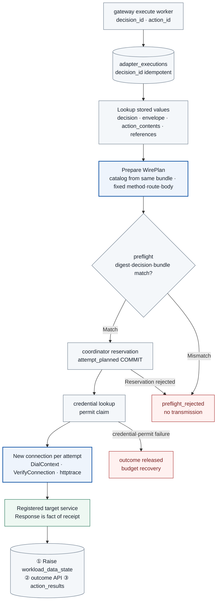

# TASK-05 · Per-Service Adapters

> This document is the specification of features to be implemented. Configurations, inspection items, APIs, storage constraints, and failure handling are implementation contracts; implementation and deployment have not yet been performed. Values generated in the deployment environment are managed as installation inputs. Names of structures, fields, enums, reason codes, and event_types have [Shared Tech Spec](COMMON.md) as the authoritative source.

## Structure at a Glance

> Target design · Implementation, deployment, and functional effects unverified. Solid lines represent placement/processing/calls, dashed lines represent reference/observation evidence, and meanings are distinguished by text on arrows.



**How to read:** The adapter does not newly judge the allowed scope, but compares the gateway decision against the actual transmission request. Calls are also aborted on DNS, TLS, or destination failures. If no response is received after writing request headers (`WroteHeaders`), automatic retries are not performed because remote effects cannot be known.

| Item | Content |
| --- | --- |
| Plan | [Final Plan](../plan.md#task-05) |
| Development Prerequisites | [TASK-02](TASK-02-catalog-contracts.md) · [TASK-04](TASK-04-policy-gateway.md) |
| Integration Dependencies (runtime) | [TASK-03](TASK-03-identity-approval.md)(coordinator reservation·permit·attempt outcome·sweeper, `attempt_observations`), [TASK-06](TASK-06-egress-credentials.md)(credential broker·egress policy·IAM), [TASK-07](TASK-07-audit-store.md)(audit storage), [TASK-08](TASK-08-destination-evidence.md)(receiver), [TASK-10](TASK-10-correlation-health.md)(lease reporting, DNAT measurement), [TASK-11](TASK-11-alignment-timeline.md)(`/internal/evidence/*`), [TASK-14](TASK-14-policy-release.md)(`desired_bundle`), [TASK-01](TASK-01-gke-platform.md)(Deployment placement·NetworkPolicy) |
| Assigned Role | Adapter Engineer · Assignee/target date TBD |
| Common Convention | [Shared Tech Spec](COMMON.md) |
| Baseline | Working tree after efe8dce (revised 2026-10-11) |

## 1. Goals and Scope

Only requests with approved semantics are transmitted via designated protocols, destinations, and credentials. Kubernetes lookups, receiver transmissions, model invocations, and evidence lookups are separated into service-specific Go adapters, and adapters do not broaden allowed service decisions on their own. The adapter is a writing entity that records transmission results (`action_results`), the classification of data received in responses (`workload_data_state`), raw model responses (`model_turns`), and execute processing status (`adapter_executions`).

## 2. Required Environment, Inputs, and Resources

| Component | Details |
| --- | --- |
| Languages/Libraries | Go standard `net/http`·`crypto/tls`·`net/http/httptrace`, shared canonicalization package `packages/canonical/` (TASK-02, same version as gateway), bundle loading `packages/policyloader/` (TASK-04, data read-only) |
| bundle | Read `desired_bundle` rows, read GCS bundle bucket, verification public key ConfigMap `agentarium-bundle-keys`. catalog and adapter constraints are read from the same bundle and are not received separately via ConfigMap |
| DB | Cloud SQL (`pgx` v5 + `sqlc`). Connects to `127.0.0.1:3307` on the Cloud SQL Auth Proxy native sidecar (`initContainers`, `restartPolicy: Always`, `--private-ip`, `--auto-iam-authn`) in the same Pod ([Cloud SQL GKE connection](https://docs.cloud.google.com/sql/docs/postgres/connect-kubernetes-engine)). metadata egress, `roles/cloudsql.client`·`roles/cloudsql.instanceUser`, and DB IAM users are created by TASK-06 |
| Identity | Per-Deployment KSA·WIF principal, mTLS certificate issued by identity service (SAN `spiffe://agentarium.internal/ns/agent-adapters/sa/<ksa>`) |
| credential | TASK-06 broker (`POST /internal/credentials:resolve`), projected KSA token of kubernetes-reader, WIF token of model |

Hidden redirects, retries, token exchanges, and additional calls of API clients/SDKs are inventoried via the TASK-02 discovery procedure. For model calls, REST is called directly without using the Go SDK.

## 3. Technical Implementation Design

1. Idempotently process the gateway execute request via `adapter_executions(decision_id PK)` (3.4).
2. Read the stored decision, envelope, original `action_contents`, and references pointed to by the request (`action_results`, `model_turns`), recalculate the digest of the original text, and verify it against `content_digest`.
3. Service-specific mappers fix the method/path/query/body/header. Users cannot pass Authorization/Host/proxy/raw URL/arbitrary Kubernetes subresources.
4. In `Transport.DialContext`, check DNS results against the target's `allowed_cidrs` and connect to the verified IP. For TLS, fix `tls.Config.ServerName` to catalog's `expected_tls_name` and record verification results in `VerifyConnection`. For targets with `ca_ref = agentarium-trust`, the adapter directly verifies the chain and the exact URI SAN (`expected_uri_san`) in `VerifyConnection` (3.2).
5. Use only HTTP/1.1 and disable redirects, automatic retries, and keep-alive. The MVP creates a new `http.Transport` and connection per attempt (per sub-request for k8s logs) and closes them after response. Connection reuse is not supported.
6. Obtain credentials after coordinator reservation COMMIT. Claim the permit immediately before transmission and re-verify `wire_body_digest` and length.
7. Limit response size and timeout, and sanitize with catalog `redact_fields`. HTTP success represents the fact of receipt, and destination effect verification is handled by TASK-08. Timeouts after transmission are unknown, and it is not assumed that there was no receiving effect.
### 3.1 Actual implementation scope per adapter

A Kubernetes ServiceAccount is assigned per Pod (`spec.serviceAccountName`), so identity separation is per Deployment, not per process ([Kubernetes ServiceAccount](https://kubernetes.io/docs/concepts/security/service-accounts/)). The adapters are built as four Go services, `services/adapters/{kubernetes-reader,receiver-sender,model,evidence-reader}/`, and each uses a separate Deployment, KSA, WIF principal, and mTLS identity. The gateway decides whether a service is allowed, and the adapter checks **whether that decision and the actual outgoing request are the same**. An adapter cannot arbitrarily add allowed services or substitute for user approval.

| Adapter (`adapter_id`) | Request built by prepare | credential | Items enforced before and after sending |
| --- | --- | --- | --- |
| `kubernetes-reader` | Registered API server + catalog route | Projected KSA token file (audience is the API server, expiry 600 seconds). No broker is used | namespace is the target value, list `limit=100` (`continue` not used), logs `container`, `tailLines`, `limitBytes`, `follow=false`. RBAC allows only `pods` get/list, `events` list, and `pods/log` get of the `agent-targets` Role |
| `receiver-sender` | Registered HTTPS origin + `/test/v1/submissions` | mTLS client certificate + a synthetic API key header provided by the broker (`credential_binding = receiver-api-key`). The header is `X-Agentarium-Receiver-Key`, the value is 43 characters of unpadded base64url of 32 random bytes, and the broker binding is `header_format = raw`. With a different header name or format, the result is `released` (`CREDENTIAL_UNAVAILABLE`) before claim; a receiver 401 `RECEIVER_KEY_INVALID` is recorded as attempt outcome `response_received`, `execution_state = failed`, reason `TARGET_REJECTED`, and is not resent. The receiver check follows the [owner decision in #169](https://github.com/Beaver-Dam-Community/Agentarium/issues/169#issuecomment-6240956805) and [TASK-08 3.1](TASK-08-destination-evidence.md#31-storing-receiver-receipts-and-effects) (reflecting #226). The key value is not left in logs, audit, or the DB | The body is `JCS(payload)` bytes, and the approved `content_digest`, `wire_body_digest`, public fields, receiver ID, and the 64KiB upper bound are checked. `data.receiver.allowed_disclosure_fields` of the same bundle is also checked as a second line of defense |
| `model` | Registered project/location/model + `:generateContent` | WIF token from the GKE metadata server (`golang.org/x/oauth2/google`) | Limits, tools, and output schema of the profile table, reference resolution, rejection of streaming and unregistered tools |
| `evidence-reader` | Fixed-ID route `/internal/evidence/*` (TASK-11) or `/internal/discovery/snapshots/*` (TASK-02) | mTLS client certificate | It builds the `X-Agentarium-Service-Session` header directly from the `service_session_id` of the stored decision and sends it ([COMMON identifier registration](COMMON.md#state-atomicity-and-db-permissions)). The issue/tenant scope is resolved by the TASK-11 evidence API. Response 64KiB. The call count budget is enforced by the coordinator's service session tool budget |

If the credential cannot be obtained (broker rejection or lookup failure, token file read failure, WIF token failure), `released` is reported through the outcome API before the permit claim (`CREDENTIAL_UNAVAILABLE`). The broker call is `POST /internal/credentials:resolve {attempt_id, adapter_id, credential_binding}`, and the response is `{secret_version, header_name, header_value, expires_at}`. The value is kept only in memory, and only `secret_version` is left in the audit. The behavior in which the metadata token source of `golang.org/x/oauth2/google` internally retries metadata server calls is an allowed exception on the credential path, because it is not the sending of an external action. The exact constructor and retry behavior are confirmed in the pinned version (Q0).

**Target identity of k8s logs:** A Pod log request specifies the target only by name, and `PodLogOptions` has no UID condition ([source](https://github.com/kubernetes/kubernetes/blob/master/staging/src/k8s.io/api/core/v1/types.go)). The client does not send `pod_uid`; the adapter confirms it in the following order. The three requests are sub-requests of one attempt, and the parentheses show each sub-request's `request_ordinal` and `request_role`.
1. Just before the log request, the Pod is queried and its UID is recorded (1, `pod_identity_before`).
2. The logs are received (2, `pod_logs`).
3. The Pod with the same name is queried again (3, `pod_identity_after`).
4. If the two UIDs differ, the result is discarded and 409 `TARGET_IDENTITY_CHANGED` and alignment `mismatch` are recorded. If they are the same, `pod_uid` is recorded in the result.

The following rules apply to sub-requests.
- **attempt and permit:** There is only one attempt and one permit claim for all three sub-requests. The adapter claims the permit only once, just before sending the first sub-request.
- **Connections:** A new `http.Transport` and connection are created for each sub-request (3.2). One AdapterObservation is created per sub-request, and they are distinguished by `request_ordinal` (3.4).
- **No resending:** The adapter does not resend any sub-request. If one stage fails, later stages are not sent.
- **Observation retention:** Even if a later stage fails, the observations of sub-requests already sent remain in the outcome report as is.
- **Status mapping:** The per-stage status is defined in the "k8s logs sub-request mapping" table in 3.3.

A Pod is never recreated between the two queries and then returned with the same UID, but a case in which the Pod changes between the first query and the log request and changes back before the second query is not caught by this check. This case is left as a residual race.

**Response size:** If a list response exceeds `response_limit_bytes`, it is a failure, 502 `RESPONSE_TOO_LARGE`. If the response has `metadata.continue`, it is a success and is recorded as `truncated = true, truncation_reason = "continue"`. The adapter's final byte upper bound for logs equals the request's `limit_bytes`. Because the server may return slightly more or fewer bytes than `limitBytes`, the part exceeding the upper bound is cut off and recorded as `truncated = true, truncation_reason = "limit_bytes"`.

Installation files, registered tools, and session-scoped reference reads follow the [COMMON model integration contract](COMMON.md#appendix-b-modelgenerate-integration-contract). The initial scope of the agent is the three registered tools of TASK-15, and restoration of arbitrary declarations is not supported.

**model profile:** Every AI call goes through `model.generate` and this adapter. Calls from the proposal service, the intent checker, and the discovery analyzer also come into this adapter through gateway 8443, and there is no direct path. The Go model adapter calls the Agent Platform Gemini REST `generateContent` directly.

| profile | caller | Tools/output | Request/output limits | timeout |
| --- | --- | --- | --- | --- |
| `agent` | application session bridge (TASK-15 runtime session) | `tool_declarations` of ClientAction (exactly 3 registered TASK-15 tools, with the digest as `content_digest` input). Function call execution is submitted separately by the runtime with `submit_action` | Request 64KiB (including reference resolution and thought signatures), `maxOutputTokens` in the lock | 30 seconds per call (Q0) |
| `policy_proposal` | Policy proposal service (service session) | Server-fixed declarations of the three `evidence.*` tools; the final step uses `responseMimeType=application/json` and `responseSchema` | Request 64KiB (including thought signatures), `thinkingConfig`, temperature, and `maxOutputTokens` in the lock | 30 seconds per call (Q0) |
| `intent_check` | TASK-04 intent checker (service session) | No tools, `IntentCheckResult` output schema required | Request 16KiB, output 1024 tokens (initial value) | 3 seconds (Q0) |
| `discovery` | TASK-02 discovery analyzer (service session) | Server-fixed declarations of `discovery.*` read tools, candidate output schema | Request 64KiB | 30 seconds per call (Q0) |
Lock values are placed in `deploy/gcp/environment.lock.json` (schema owned by TASK-16). The following items are confirmed and fixed in Q0:
- Location of the selected Gemini 3 model (whether it is global-only) and the resulting PGA route and `model_region`
- Whether `responseSchema` and function calling can be used together in a single request
- Format of `thinkingConfig`

**Reference resolution and functionResponse:** References in messages follow the TASK-02 3.2 format. The adapter converts references into Gemini `contents` according to the following table. If a referenced row does not belong to the same session (`session_id` for user sessions, `service_session_id` for service sessions) or does not exist, it is rejected with `PREFLIGHT_MISMATCH`.

| Message | Row read | Gemini part |
| --- | --- | --- |
| `{kind: text, role: user, source: user, text}` | None | `{"role":"user","parts":[{"text": text}]}` |
| `{kind: text, source: system, text}` | None | `systemInstruction.parts[].text`(in order if multiple) |
| `{kind: model_turn, ref: {ref: model_turn, turn_index}}` | `raw_parts` of `model_turns(conversation_id, turn_index)` | `{"role":"model","parts": raw_parts}`(verbatim including thought signature) |
| `{kind: tool_result, ref: {ref: action_result, action_id}, function_name}` | `action_results(action_id)` | `{"role":"user","parts":[{"functionResponse":{"name": function_name, "response":{"execution_state":…, "truncated":…, "result": result_body}}}]}`. `function_name` must be one of the `functionCall.name`s in the immediately preceding `model_turn` |

When a response is received across all profiles, the raw parts (including signatures) of the response candidate are stored as-is in `model_turns(conversation_id, turn_index, raw_parts jsonb, created_at)`. This table is dedicated to the model adapter and cannot be read by other roles. The columns additionally include `tenant`, `session_kind`, `session_key` (user `session_id` or `service_session_id`), and `action_id`. `turn_index` increments by 1 within the same `conversation_id`, and the retention limit for deletion is `max_expires_at` for user sessions or `expires_at` for service sessions. Lookup authorization checks the current session state and expiry separately (COMMON appendix B). Only sanitized text and `functionCall` names and arguments are placed into `result_body` of ActionResult, and `thoughtSignature` values are not included. They are not included in audits or logs either. Because Gemini 3 function calling requires echoing back the thought signature of the previous response as-is in the subsequent request ([Thought signatures](https://docs.cloud.google.com/gemini-enterprise-agent-platform/models/thought-signatures)), the caller points to the previous turn using a `model_turn` reference, and the adapter reinserts the original parts. The request size after reference resolution must also be within the profile limit.

`Prepare(envelope, content, resolved)` creates an immutable WirePlan without network or secret lookups. Reference resolution (`resolved`) refers to values read from the DB beforehand. WirePlan contains `method, origin_id, route, safe_headers, body_bytes, wire_body_digest, response_limit, timeout, expected_tls_name, expected_uri_san?, allowed_cidrs` as defined in COMMON. `expected_uri_san` has a value only when the target's `ca_ref` is `agentarium-trust`.
- **Fixed header:** The receiver's `safe_headers` includes `Idempotency-Key` (action_id) and `X-Agentarium-Attempt-Id`. For `User-Agent`, the adapter specifies a fixed value.
- **credential header:** Authorization or broker headers are added during the credential step and excluded from the digest and audit body.
- **trace header:** Internal trace headers of the gateway (`traceparent` and `baggage`) are not forwarded to external targets. Correlation with targets is done using attempt headers and provider request IDs.
### 3.2 transport implementation

`packages/transport/` (Go) creates a new `http.Transport` and `http.Client` with the configuration below for each attempt (for each subrequest in k8s logs). The rationale based on Go documentation and source code is [net/http](https://pkg.go.dev/net/http), [httptrace](https://pkg.go.dev/net/http/httptrace), and [crypto/tls source](https://github.com/golang/go/blob/master/src/crypto/tls/common.go).

| Setting | Value and Effect |
| --- | --- |
| `Transport.Proxy` | `nil`. The documentation specifies that if nil, no proxy is used. `ProxyFromEnvironment`, which reads environment variable proxies, is not used. |
| `Transport.DialContext` | First asserts whether the host:port of the argument `addr` matches the hostname:port of the WirePlan origin, and terminates with an error if it differs. Then, newly resolves the hostname for each attempt using `net.Resolver.LookupNetIP(ctx, "ip4", host)` (no cache, IPv4 only). All addresses in the response must be within the target `allowed_cidrs`; if even one is outside, it does not connect and records 403 `DESTINATION_NOT_ALLOWED`. If it passes, it calls `net.Dialer.DialContext` with the first address in the response order and records that address as `dialed_addr`. It also records the `LocalAddr` and `RemoteAddr` of the connection. |
| `Transport.DisableKeepAlives` | `true`. Uses a connection for only a single request. |
| `Transport.ForceAttemptHTTP2` | `false`. The documentation explains that using a custom dialer or TLS configuration conservatively disables HTTP/2. `tls.Config.NextProtos` is also fixed to `["http/1.1"]`. |
| `Transport.DisableCompression` | `true`. Prevents the Transport from adding `Accept-Encoding: gzip` on its own. |
| `Transport.TLSClientConfig` | `ServerName = expected_tls_name`, `RootCAs` = catalog `ca_ref`, `MinVersion` TLS 1.2. If `ca_ref` is `system` or `cluster`, standard hostname verification is used as is. `VerifyConnection` is called after normal certificate verification, and returning an error aborts the handshake. Here, the verified chain and negotiation result are recorded. Verification for `agentarium-trust` follows "Service Certificate Verification" below. On failure, it is 502 `TLS_VERIFY_FAILED`. |
| `Transport.WriteBufferSize` | Uses the default value (currently 4KB) and limits total request headers to 2KiB or less (see boundary explanation below). |
| `Client.CheckRedirect` | Always returns `http.ErrUseLastResponse`. The documentation specifies that in this case, it does not send the next request and returns the last response as is. 3xx is recorded as a response and not followed. |
| Reading response | Reads up to upper bound +1 byte using `io.LimitReader` and applies the size rules of 3.1. |

**Service Certificate Verification (`ca_ref = agentarium-trust`):** The identity of the service certificate is the URI SAN `spiffe://agentarium.internal/ns/<namespace>/sa/<ksa>`. Therefore, standard hostname verification is not used for this target, and the adapter directly performs the verification below in `VerifyConnection`. In Go `crypto/tls`, there is no setting to disable only the hostname check in normal verification. Thus, the adapter disables normal verification with `InsecureSkipVerify = true`. Even with this setting, `VerifyConnection` is called ([crypto/tls](https://pkg.go.dev/crypto/tls#Config)).
- **SNI:** `ServerName = expected_tls_name` is used solely as the SNI value.
- **chain:** Sets the first certificate in `ConnectionState.PeerCertificates` as the leaf and the rest as the intermediates pool. Then calls `x509.Certificate.Verify` with `Roots` = trust bundle (ConfigMap `agentarium-trust`), `Intermediates` = the above pool, `KeyUsages = [ExtKeyUsageServerAuth]`, and `CurrentTime` = current time. `DNSName` is left blank.
- **URI SAN:** The leaf must have exactly one URI SAN, and its value must match the target's `expected_uri_san` as a string.
- **Failure:** If any check fails to pass, it aborts the handshake and records 502 `TLS_VERIFY_FAILED`. The chain returned by `Verify` is recorded as the verified chain.

This rule is identical to the client verification rule of COMMON service PKI. Following that rule, service and adapter clients verify the chain, validity period, serverAuth EKU, and exact service URI SAN.

**No Automatic Retries:** The documentation states that Go Transport only resends a request when a network error occurs on a "connection on which a request has already been written successfully", the request is idempotent, and it has no body or has `GetBody`. Because connections are not reused with `DisableKeepAlives = true`, this condition is not met. Nevertheless, connection drops are injected in Q0 testing to verify that destination receipt occurs only once. The MVP adapter does not create a second attempt for the same action on its own. To resend, the caller submits a new action with a new `client_request_key`.

**Recording Transmission Phases:** Attaches `httptrace.ClientTrace` to the request context to populate the following timestamps into AdapterObservation.

| hook | Documented Meaning | Field Populated |
| --- | --- | --- |
| `ConnectStart`·`ConnectDone` | dial start·completion | `connect_started_at` |
| `GotConn` | Connection acquired | None |
| `WroteHeaders` | After Transport has written all request headers | `send_started_at` |
| `WroteRequest` | Result of writing request and body | `send_finished_at` |
| `GotFirstResponseByte` | Arrival of the first byte of response headers | `response_at` |

**Boundary Between failed and unknown:** A failure before calling `WroteHeaders` is `failed`, and not receiving a response after the call is `unknown`.
- In Go source code, `Request.write` writes headers to a buffered writer before calling `WroteHeaders` ([request.go](https://github.com/golang/go/blob/master/src/net/http/request.go)). A flush immediately after headers only occurs when waiting for `Expect: 100-continue`, and normally it accumulates in the buffer up through the body before being flushed.
- This project does not use `Expect: 100-continue`. Since headers are kept at or below 2KiB, the buffer does not overflow and flush prematurely. Therefore, no bytes have exited through the socket prior to `WroteHeaders`.
- Conversely, after `WroteHeaders`, it is also possible that nothing was actually sent. This boundary is judged conservatively as "unknown if there is a possibility it was sent".
- As noted by COMMON, assuming that the destination does not process incomplete requests is reported as a limitation.

If `User-Agent` is absent, Go `Request.Write` inserts `Go-http-client/1.1`, and Host and Content-Length are also generated by the Transport. Therefore, identity between actual transmission and the WirePlan is asserted solely as "body byte identity".

**Destination Scope:** Destination checks are based solely on per-target `allowed_cidrs`, and do not blanket-ban private addresses. Kubernetes API server, receiver, and internal evidence API reside on private addresses.
- **Agent Platform:** Calls are pinned to the `private.googleapis.com` VIP of Private Google Access, and the IPv4 range in official documentation is `199.36.153.8/30`. For this path, `*.googleapis.com` must be CNAME'd to `private.googleapis.com` in a private Cloud DNS zone, and addresses of the two VIPs must not be mixed ([Private Google Access](https://docs.cloud.google.com/vpc/docs/configure-private-google-access)).
- **Configuration Ownership:** DNS zone and routing configuration are handled by TASK-01/06.
- **Q0 Verification Items:** Whether any API uses `34.126.0.0/18`, which PGA documentation recommends for other routes, and SAN of the in-cluster API server certificate.

**DB Writes:** Adapters access the following tables via the Auth Proxy sidecar. Common write targets are `adapter_executions`, `pending_outcomes`, `action_results`, and `workload_data_state`. `model_turns` is used only by model adapters and is not included in the common group permissions. Read targets are TASK-04's `decisions` table, `adapter_action_envelopes` view, `adapter_action_contents` view, and `action_results` of the same session. Adapters do not directly read the `actions`·`action_contents` tables. Egress for the proxy to reach Cloud SQL and the metadata server is opened by TASK-01/06 NetworkPolicy. The combination of Auth Proxy's IAM token acquisition with NetworkPolicy, and the metadata server port in Dataplane V2, are Q0 verification items.

**DB Identity:** Each adapter connects as its own Cloud SQL IAM DB user, and this user is a member of `adapter_reader`. `decisions.adapter_db_roles` contains the mapping between the login name (`session_user`) and `adapter_id`. The results of the two adapter views are restricted to rows with the `adapter_id` mapped to the connected login. If connected with a login that has no mapping, no rows are visible. Therefore, in the installation phase (TASK-05·TASK-16), one `adapter_db_roles` row must be registered for each adapter login. This row is inserted by the migration owner, and `adapter_reader` has no privileges on this table. The adapter verifies once more that the `adapter_id` of the content row matches its own value. The write role is the NOLOGIN group `adapter_app`. The adapter login is a member of `adapter_app`, and `adapter_app` is a member of `adapter_reader` and `audit_producer`. `adapter_app` has only SELECT·INSERT on the four tables `adapter.adapter_executions`, `adapter.pending_outcomes`, `adapter.action_results`, and `adapter.workload_data_state`, and limits UPDATE to the columns `adapter_executions(state, attempt_id, preflight_passed_event_id, preflight_rejected_event_id, updated_at)` and `workload_data_state(data_class_high_water, data_sources, updated_by_attempt_id, updated_at)`. There is no DELETE·TRUNCATE. The installation phase registers `adapter_db_roles`, `audit.db_role_sources`, and `producer_event_grants` for the 6 audit events of Chapter 4 for each login. Access to `model_turns` separately requires a dedicated DB role for the model adapter, and permissions must not be granted to the common group `adapter_app` allowing other adapters to read it. The dedicated role·migration will be determined in a separate PR during model adapter implementation.
### 3.3 Actual Invocation Sequence and State Mapping

```text
receive POST /internal/adapter/{adapter_id}/execute {decision_id, action_id} (gateway mTLS)
INSERT adapter_executions(decision_id, state=received) ON CONFLICT DO NOTHING
  -> already exists: return 202 with current state (no new work)
load bundle snapshot (same packages/policyloader as gateway)
load decision, envelope, action_contents(content_ref); recompute content_digest
resolve refs (action_results, model_turns) with session ownership check
Prepare immutable WirePlan; recompute action_digest and wire_body_digest (packages/canonical)
preflight: decision.policy_bundle_id == loaded bundle_id, catalog_digest equal, digests equal
  -> mismatch: adapter_executions=preflight_rejected, preflight_rejected event, stop
POST /internal/dispatch/reservations                      -> attempt planned (TASK-03); adapter_executions=reserved
acquire credential (broker / token file / WIF)            -> failure: outcome released
POST /internal/dispatch/permits/{permit_id}/check (CAS)   -> failure: outcome released
new http.Transport; DialContext + TLS VerifyConnection    -> failure before WroteHeaders: outcome failed
httptrace WroteHeaders                                    -> dispatch_started
read bounded response; apply redact_fields
(1) UPSERT workload_data_state SET data_class_high_water = GREATEST(current, response class)
(2) POST /internal/dispatch/attempts/{attempt_id}/outcome {transition, observations[], reason_codes}
(3) INSERT action_results; adapter_executions=completed (or failed)
```

`k8s logs` repeats from `new http.Transport` through reading the response for each sub-request (3.1). The permit claim is performed only once before the first sub-request.

**Commit order:** Upon receiving a response, it is recorded in the order of ① raise `workload_data_state` → ② outcome API → ③ `action_results`.
- ① uses `GREATEST`, so the result is the same even if executed multiple times. The reason for doing ① first is that if a crash occurs before ①, the classification level is not raised, and subsequent disclosure requests could be evaluated at a lower level.
- The response classification level is the `response_data_class` of the catalog operation. If `inherit`, it is the `data_class` of the envelope.
- The keys are the user session `(workload_id)` and the service session `(service_session_id)`.

**Restart reconciliation:** When an adapter starts, it reads rows from `adapter_executions` for its own `adapter_id` that are not `completed`, `failed`, or `preflight_rejected`, and processes them as follows:
- `received`: Since the permit has not yet been claimed, process again from the beginning.
- `reserved` and permit unclaimed: The coordinator sweeper transitions it to `released` after permit expiration and restores the budget.
- `reserved` and claimed but no outcome: Because the adapter does not know the response contents, it immediately reports an outcome of `unknown` (`attempt_uncertain`). If 60 seconds elapse without a report, the sweeper marks it as `unknown` with `OUTCOME_TIMEOUT`.

If ① was completed but ② and ③ could not be completed, only the classification level remains raised. Since this leans toward making evaluations stricter, it is left as is.

**Response mapping by adapter:** All attempts that received a response have `attempt.state = response_received`. The table below shows the `execution_state` and `reason_codes` at that time. If no response was received, the boundary rules of 3.2 are followed. MVP automatic retries are 0, with only manual resubmission available.

| adapter | Response | `execution_state` | `reason_codes` | `evidence_level` |
| --- | --- | --- | --- | --- |
| kubernetes-reader | 200 (list·events); for logs, all three sub-requests are 200 and UID matches | `accepted` | `[]` | `accepted` |
| kubernetes-reader | For logs, all three sub-requests are 200 and UID mismatches | `failed` | `TARGET_IDENTITY_CHANGED` | `none` |
| kubernetes-reader | 401·403·404 | `failed` | `TARGET_REJECTED` | `none` |
| kubernetes-reader | 429·5xx | `failed` | `TARGET_UNAVAILABLE` | `none` |
| receiver-sender | 200·201 | `accepted` | `[]` | `accepted` (effect verification in TASK-08) |
| receiver-sender | 409 | `failed` | `TARGET_KEY_BODY_CONFLICT` | `none` |
| receiver-sender | Other 4xx | `failed` | `TARGET_REJECTED` | `none` |
| receiver-sender | 429 | `failed` | `TARGET_UNAVAILABLE` | `none` (receiver returns 429 before processing) |
| receiver-sender | 5xx | `unknown` | `TARGET_UNAVAILABLE` | `unknown` (processing status unknown; resolved via TASK-08 receipt) |
| model | 200, `finishReason = STOP` | `accepted` | `[]` | `accepted` |
| model | 200, `MAX_TOKENS` | `failed` | `MODEL_OUTPUT_TRUNCATED` | `accepted` |
| model | 200, `SAFETY`·`PROHIBITED_CONTENT`·`BLOCKLIST`·`SPII`·`RECITATION`·`MODEL_ARMOR`, or `promptFeedback.blockReason` present | `failed` | `MODEL_BLOCKED` | `accepted` |
| model | 200, `MALFORMED_FUNCTION_CALL`·`UNEXPECTED_TOOL_CALL`, output schema violation | `failed` | `MODEL_SCHEMA_INVALID` | `accepted` |
| model | 200, other `finishReason` | `failed` | `MODEL_BLOCKED` | `accepted` |
| model | 400·403·404 | `failed` | `TARGET_REJECTED` | `none` |
| model | 429·5xx | `failed` | `TARGET_UNAVAILABLE` | `none` |
| evidence-reader | 200 | `accepted` | `[]` | `accepted` |
| evidence-reader | 403·404 | `failed` | `RESOURCE_NOT_FOUND` | `none` |
| Common | Response exceeds upper bound | `failed` | `RESPONSE_TOO_LARGE` | `none` |
| Common | 3xx | `failed` | `TARGET_REJECTED` | `none` |

**k8s logs sub-request mapping:** A logs attempt consists of the three sub-requests in 3.1. In the table below, "initial query" is `pod_identity_before`, "log request" is `pod_logs`, and "requery" is `pod_identity_after`. If an earlier step does not succeed, subsequent steps are not sent. Logs are included in the result only in the first row.

| Case | `attempt.state` | `execution_state` | `reason_codes` | `evidence_level` |
| --- | --- | --- | --- | --- |
| All three sub-requests are 200 and UID matches | `response_received` | `accepted` | `[]` | `accepted` |
| All three sub-requests are 200 and UID mismatches | `response_received` | `failed` | `TARGET_IDENTITY_CHANGED` | `none` |
| Initial query fails | Same as single request | Same as single request | Table above and 3.2 boundary rules | Same as single request |
| Initial query is 200, and log request fails before `WroteHeaders` | `response_received` | `failed` | Reason code of that failure (e.g., `TLS_VERIFY_FAILED`) | `none` |
| Log request response is 401·403·404 | `response_received` | `failed` | `TARGET_REJECTED` | `none` |
| Log request response is 429·5xx | `response_received` | `failed` | `TARGET_UNAVAILABLE` | `none` |
| No response after log request `WroteHeaders` | `unknown` | `unknown` | `TARGET_UNAVAILABLE` | `unknown` |
| Log request is 200, and requery fails before `WroteHeaders` | `response_received` | `failed` | `TARGET_IDENTITY_UNCONFIRMED` | `none` |
| Requery response is completed 401·403·404 | `response_received` | `failed` | `TARGET_IDENTITY_UNCONFIRMED` | `none` |
| Requery response is completed 429·5xx | `response_received` | `failed` | `TARGET_IDENTITY_UNCONFIRMED` | `none` |
| No response after requery `WroteHeaders` | `unknown` | `unknown` | `TARGET_IDENTITY_UNCONFIRMED` | `unknown` |

Once the initial query is sent, the attempt enters `dispatched`. There is no transition from `dispatched` to `failed` (TASK-03). Therefore, if a subsequent step fails after receiving the response to the initial query, `attempt.state` becomes `response_received`. If the UID cannot be confirmed via requery, the adapter does not include the received logs in the result.

Even if a model call results in `failed`, the request body has already been delivered to Agent Platform, so the fact of disclosure remains. The `finishReason` values and the meaning of `MAX_TOKENS` have been confirmed with the official enum ([GenerateContentResponse](https://docs.cloud.google.com/vertex-ai/generative-ai/docs/reference/rest/v1/GenerateContentResponse)), and the response's `responseId` is recorded as `provider_request_id`.

**Failure classification (before response):** Follows the "Failure classification" of COMMON as is.

| Timing | Example | Record |
| --- | --- | --- |
| Before reservation | preflight mismatch, original digest mismatch, bundle mismatch, reference ownership violation | `preflight_rejected` (`PREFLIGHT_MISMATCH`, `CONTENT_DIGEST_MISMATCH`, `CATALOG_DIGEST_MISMATCH`), no reservation |
| Before permit claim | `CREDENTIAL_UNAVAILABLE`, `PERMIT_INVALID`, `HOLD_ACTIVE` | The adapter reports `released` to the outcome API. The coordinator transitions the reservation to `released` and reverts the budget (`attempt_released`). |
| After claim, before `WroteHeaders` | DNS·CIDR·connect·TLS failure | outcome `failed` (`attempt_failed`). Reservation is retained and budget is not restored. |
| No response after `WroteHeaders` | timeout, disconnection, crash | outcome `unknown` (`attempt_uncertain`). Automatic retry prohibited. Resume only after `unknown_resolved` |

The adapter does not query receiver receipts; receipt collection is handled by the TASK-08 evidence collector. The remote timeout is the COMMON default of 10 seconds, with the value in the profile table taking precedence. On failure, `request_id/attempt_id/reason_codes` are returned, and raw token/payload data is not retained in logs. Authentication token renewal is also performed exclusively through controlled credential paths, and SDK patterns that implicitly make telemetry, retry, or upload calls are not used.
### 3.4 Records for Results, Data Classes, Bundles, and Leases

- **adapter_executions:** `adapter_executions(decision_id PK, action_id, adapter_id, state(received/preflight_rejected/reserved/completed/failed), attempt_id?, updated_at)`. Owned by TASK-05. Even if the gateway worker calls again with the same decision, no new reservation is created. The gateway reads this row to display the `preflight_rejected` state (TASK-04 3.5).
- **AdapterObservation:** The adapter transport recorder creates one inside the adapter process for each sub-request. The adapter always sends the following fields in `observations[]` of the outcome API (all transitions except `released`), and TASK-03 stores them in `attempt_observations` as one row per `(attempt_id, request_ordinal)`.
  - **Sub-request identification:** `request_ordinal` is the sub-request number starting from 1, and `request_role` is one of `primary`, `pod_identity_before`, `pod_logs`, and `pod_identity_after`. A single-call adapter sends one element with `request_ordinal = 1` and `request_role = primary`. Sub-requests are identified by `request_ordinal`, not by array order.
  - **Reporting time:** The adapter reports `dispatched` after `WroteHeaders` of the first sub-request. `observations[]` of the final transition (`response_received`, `failed`, `unknown`) contains the observations of all sub-requests that have already attempted a connection. If the adapter stops before the final report, the sweeper changes the attempt to `unknown`. In that case, observations after the first sub-request are not stored.
  - **Audit events:** The adapter records `dispatch_started` and `response_received` once for each sub-request. Both events include `request_ordinal` and `request_role`.
  - **Addresses:** `local_addr`, `local_port`, `peer_addr`, and `peer_port` are the `LocalAddr` and `RemoteAddr` values of the connection. `dialed_addr` is the address chosen by DialContext. `peer_addr_kind` is one of `service_vip` (the target is a cluster Service and `RemoteAddr` is the ClusterIP), `endpoint` (Pod IP), and `external` (anything else). Depending on whether Dataplane V2 uses socket LB, `RemoteAddr` can be either the Service VIP or the endpoint, so this value is an input to the TASK-10 DNAT measurement (Q0).
  - **Kernel link key:** `netns_inode` is the inode of the `/proc/self/ns/net` link. `local_addr`, `local_port`, and `netns_inode` are the key for linking to the kernel, so they are never omitted except for failures before connect.
  - **Timestamps:** `pod_uid`, `connect_started_at`, `send_started_at`, `send_finished_at`, `response_at`.
  - **Optional fields:** `provider_request_id?`, `k8s_audit_id?`, `wire_body_digest?`. `k8s_audit_id` is read from the response header `Audit-Id`, and whether this value can be linked to the GKE audit log is a Q0 verification item.
  - **Fields not included:** `process_exec_id` is not included because the adapter cannot know it; it is attached on the kernel event side (TASK-10).
- **ActionResult:** The response is sanitized and written to `action_results` as `action_id, attempt_id, execution_state, data_class, result_body, truncated, truncation_reason?, evidence_level, result_digest, created_at`.
  - **Sanitization:** The catalog `redact_fields` (JSON Pointer, with `*` allowed in array positions) are removed first. Example: `/items/*/metadata/managedFields` and `/items/*/spec/containers/*/env` of a pods list.
  - **Class:** `data_class` is the response class described above.
  - **Delivery:** The gateway serves it through `GET /v1/actions/{action_id}/result` (TASK-04). The upper bound of `evidence_level` for model and k8s calls is `accepted`.
- **Bundle loading:** Each adapter replica reads `desired_bundle` every 2 seconds with the same `packages/policyloader/` as the gateway. It confirms that the SHA-256 of the GCS object equals `artifact_digest` and that the ES256 signature (keyID `prod-v1`) is valid, and then loads the bundle data (`data.catalog`, `data.receiver`, adapter constraints). It does not perform OPA evaluation. Preflight passes only when the decision's `policy_bundle_id` equals the currently loaded bundle.
- **Lease obligation:** Each replica of the four Deployments reports a ControlHealthLease every 5 seconds through `POST /internal/control-health/leases` (TASK-10).
  - **Reported values:** `component = adapter`, `scope = workload`, `scope_id = <namespace>/<KSA>` (e.g. `agent-adapters/receiver-sender`), `source_id = <adapter_id>/<pod name>`, `active_version` = the loaded bundle's `artifact_digest`, `loaded_artifact_digest`, `canonical_version` = the `packages/canonical/` version. Before the first load the status is `unhealthy`, only `active_version` and `loaded_artifact_digest` are null, and `canonical_version` is `v1`. If loading a new bundle fails while an existing bundle is present, the replica reports `degraded` while keeping the existing digest. If the DB ping fails, the status is `unhealthy`, which takes precedence over the `degraded` of a load failure.
  - **Effect on gateway decisions:** If there is no valid lease or `artifact_digest` differs between replicas (`mixed`), the gateway decision becomes `CONTROL_HEALTH_UNAVAILABLE` (TASK-04 3.2).
  - **Activation confirmation:** TASK-14 confirms the ack by checking "number of valid leases that report the desired digest = Deployment `status.replicas`".

<a id="4-api-data-and-connection-contract-ref"></a>

## 4. API, Data, and Connection contract

`POST /internal/adapter/{adapter_id}/execute` accepts only the gateway's mTLS identity and `{decision_id, action_id}`. The adapter does not receive the envelope as the request body; it looks up the stored values directly. Direct calls from users are rejected. The response is 202, and a repeated call with the same `decision_id` also returns 202 and the current `adapter_executions.state`. Execution results remain in the outcome API and `action_results`. The HTTP server is implemented with the Go standard `net/http`.

The implementation interfaces are `Prepare(envelope, content, resolved) (WirePlan, error)` and `Execute(ctx, plan, permit, credential) ([]AdapterObservation, Response, error)`. The observation array returned by a single-call adapter has one element. The k8s logs array has one element for each sub-request that attempted a connection (3.1, 3.4). Credentials are not serialized.

The internal APIs that the adapter calls are as follows.
- TASK-03: `POST /internal/dispatch/reservations`, `POST /internal/dispatch/permits/{permit_id}/check`, `POST /internal/dispatch/attempts/{attempt_id}/outcome`
- TASK-06: `POST /internal/credentials:resolve`
- TASK-07: `audit.audit_append()` in a separate DB transaction for each event (the adapter login is a member of `audit_producer`). It is not atomic with the business state update transactions such as `adapter_executions`. `source_id` and `source_version` are startup settings, and `source_epoch` is a restart counter on a persistent volume. The event's `tenant`, `session_id`, and `workload_id` are taken in the same transaction from the stored envelope in `adapter_action_envelopes`. If, after a restart, the producer internally replays the same logical event and the same `event_id` is a `conflict`, the adapter rolls back the append transaction, commits `audit_record_conflict()` in a separate transaction, and treats the existing event as recorded ([TASK-07 conflict handling](TASK-07-audit-store.md)). A failure to store the incident is not treated as success. This applies only to replay inside the adapter and does not change the 409 rule of the external audit HTTP API. `POST /internal/audit/events` is not used
- TASK-10: `POST /internal/control-health/leases`

The audit events emitted by the adapter are `preflight_passed`, `preflight_rejected`, `dispatch_started`, `response_received`, `attempt_uncertain`, and `attempt_failed`. The storage units are the TASK-05-owned `adapter_executions`, `action_results`, `workload_data_state` (read by the gateway), and `model_turns` (model adapter only), and `action_contents` is read only. The schema is managed as `golang-migrate` SQL files in `migrations/`. Full content is not put into the default audit records.

## 5. Security Boundaries, Failure Handling, and Operations

Even when there is a policy allow, the adapter can reject if the preflight comparison, the deployment permission upper bound, or destination/TLS verification fails. It cannot create a new allow through its own rules. An unknown destination, an address outside the allowed CIDRs, a redirect, or an oversize response results in aborting execution or a failure event.

The cancellation race between the permit claim and `WroteHeaders`, and false records from a compromised adapter, are residual risks. The independent receiver, audit sources, and eBPF compensate for these, but they cannot prove every secret and every plaintext. Until receiver dedupe is verified, requests with unknown effects are not resent automatically. `model_turns` contains thought signatures and raw model text, so only the model adapter DB role can access it, and it is deleted after the session expires.

## 6. Implementation Files and Work Order

The implementation files are written in the paths below. There are currently no GCP implementation files, and if an implementation path changes, this specification and the CI are updated with it. Normalization, JCS, and hashing use TASK-02's `packages/canonical/`, and bundle loading uses TASK-04's `packages/policyloader/`.

| Implementation path | Implementation responsibility |
| --- | --- |
| packages/adapters/prepare/ (Go) | Pure per-service WirePlan mappers, conversion of reference resolution results into Gemini `contents` |
| packages/transport/ (Go) | Per-attempt Transport configuration, DNS and CIDR checks, TLS `VerifyConnection`, httptrace timestamps, bounded IO, adapter transport recorder |
| services/adapters/kubernetes-reader/ (Go) | Query routes, Pod UID confirmation and re-query, response size rules, RBAC upper bound |
| services/adapters/receiver-sender/ (Go) | Sending, `Idempotency-Key`, broker credential |
| services/adapters/model/ (Go) | REST calls, WIF token, per-profile limits, tools, and output schema, reference resolution, `model_turns` |
| services/adapters/evidence-reader/ (Go) | Evidence and discovery read routes and service session forwarding |
| migrations/ | `adapter_executions`, `action_results`, `workload_data_state`, `model_turns` |

## 7. Verification Methods and Pass Criteria

| Test | Method / Independent Verification Basis | Pass Criteria |
| --- | --- | --- |
| Pre-transmission modification | Modify target, body, header, and original text after allow; compare receiver request count | `preflight_rejected`, 0 received |
| execute idempotency | execute twice with the same decision_id, twice concurrently | One reservation and attempt; second returns current state |
| bundle mismatch | Adapter loads new bundle, then execute with previous bundle decision | `preflight_rejected`(`PREFLIGHT_MISMATCH`) |
| DNS/redirect | Rebinding and mixed answer in controlled test DNS, 30x, TLS hostname error, environment variable proxy configuration, DialContext argument host tampering | No connection to IPs outside allowed CIDR, redirects, or proxies; success for normal TLS targets |
| Failure classification | credential failure, permit denial, connect refusal, response interruption after `WroteHeaders` | `released` (budget recovery), `released`, `failed`, `unknown`, respectively |
| Response mapping | Inject each response from Section 3.3 table per adapter into mock target | `execution_state`, `reason_codes`, and `evidence_level` from the table |
| Absence of automatic retries | Inject connection drop before response | 1 or fewer receiver receptions, 0 adapter retransmissions |
| commit order | Crash after ①, crash after ② | After restart, classification remains elevated, outcome is `unknown` or recorded value, no duplicate results |
| k8s target identity | Recreate Pod with the same name immediately after log request | `TARGET_IDENTITY_CHANGED`, result discarded |
| k8s size | list response exceeding 1MiB, response with `continue`, log exceeding `limitBytes` | `RESPONSE_TOO_LARGE`, `truncated=continue`, `truncated=limit_bytes` |
| Model limits | `MAX_TOKENS`, `SAFETY`, unregistered tool, request exceeding 64KiB | `MODEL_OUTPUT_TRUNCATED`, `MODEL_BLOCKED`, `PREFLIGHT_MISMATCH` |
| References and thought signatures | Reference `model_turn` and `tool_result` from same session, reference from different session, `function_name` mismatch | Reinsert original text only for same session, others `PREFLIGHT_MISMATCH`. No signature value in audit, log, or ActionResult |
| Data classification | Query higher classification response then transmit to receiver | high-water mark rises, subsequent decision is `DATA_CLASS_DENIED` |
| AdapterObservation | Successful transmission and failure after claim | `local_addr`, `local_port`, `netns_inode`, `peer_addr_kind` present in outcome |
| lease | One adapter stops reporting lease, only one replica loads new bundle | `CONTROL_HEALTH_UNAVAILABLE` after 15 seconds, `CONTROL_HEALTH_UNAVAILABLE` due to `mixed` |
| Path observation | Compare packet/node records with discovery call list | 0 unregistered destinations within observation interval. Observation gaps and loss counts reported with separate denominator |

Before running verification, fix the code, image, schema, policy/catalog versions, target environment, and test denominators. The above tests were not executed during the drafting of this document. Actual execution records are stored in accordance with the "result recording contract" of the [Shared Tech Spec](COMMON.md).

## 8. Deliverables and Implementation Results

### Deliverables to be Retained After Implementation

- Per-service adapters, transport configuration and trace hooks, supported operations/protocols/profiles table, response mapping table, preflight diff, transmission/response/unconfirmed outcome tests.

### Currently Verified Results

| Category | Current Status |
| --- | --- |
| Tech Spec | Authored implementation specification and performed static link checks only; rendering and functional verification not executed |
| Implementation files | As of now, the corresponding GCP implementation path has not been created |
| Functional tests | Not executed |
| GCP/GKE deployment | Neither performed nor verified in this task |
| Completion determination | Pending; not determined as functionally complete |

### When Recording Implementation Results

- Record `implementation_commit`, image digest, `run_id`, environment manifest, and secure references to verification reports and raw evidence.
- Retain `expected / observed / passed / failed / unknown / not_run` and denominators for each test. Unmeasured numbers are left as `null`.
- Record failed, unobserved, and pending items, impact on normal business operations, and deployment/recovery results together, and change only the verified scope to complete.

## 9. Deployment Inputs and Modification Conditions

Implement Agent Platform `generateContent`, receiver POST, Kubernetes queries, and evidence/discovery reads with the transport constraints of Section 3. Actual origins, CIDRs, CAs, and model IDs are catalog inputs. DNS is resolved afresh for each attempt. HTTP/2, redirects, streaming, keep-alive, proxies, and provider automatic retries are prohibited until modification tests. The Go version, `go.sum`, per-profile `maxOutputTokens` and timeouts, and the `desired_bundle` polling interval are pinned in `deploy/gcp/environment.lock.json`, and the above Transport behaviors and trace timings must be re-verified on that version.

If permissions, trust boundaries, supported operations, or default failure handling are modified, the final plan and related Tasks must be revised together. Responsible roles are defined in the table above, but because actual assignees are undecided, this document must not be construed as operational approval.

## 10. Technical Rationale

- [Go net/http](https://pkg.go.dev/net/http): `Transport`'s `DialContext`, `DisableKeepAlives`, `ForceAttemptHTTP2`, `DisableCompression`, `Proxy`, `WriteBufferSize`, `TLSClientConfig`, retry conditions, `CheckRedirect` and `ErrUseLastResponse`, default `User-Agent` (verified in documentation).
- [Go net/http/httptrace](https://pkg.go.dev/net/http/httptrace): `ConnectStart`, `ConnectDone`, `GotConn`, `WroteHeaders`, `WroteRequest`, `GotFirstResponseByte` (verified in documentation).
- [Go request.go](https://github.com/golang/go/blob/master/src/net/http/request.go), [crypto/tls common.go](https://github.com/golang/go/blob/master/src/crypto/tls/common.go): `WroteHeaders` invocation timing and flush location, `VerifyConnection` invocation timing (verified in source, re-verify on pinned Go version).
- [Private Google Access](https://docs.cloud.google.com/vpc/docs/configure-private-google-access): `private.googleapis.com` range and DNS settings (verified in documentation).
- [Cloud SQL GKE connection](https://docs.cloud.google.com/sql/docs/postgres/connect-kubernetes-engine): Auth Proxy sidecar and `127.0.0.1` connection (verified in documentation).
- [GenerateContentResponse](https://docs.cloud.google.com/vertex-ai/generative-ai/docs/reference/rest/v1/GenerateContentResponse): `responseId`, `finishReason` enum (`MAX_TOKENS`, `SAFETY`, `MALFORMED_FUNCTION_CALL`, `UNEXPECTED_TOOL_CALL`, etc.), `usageMetadata` (verified in documentation).
- [Thought signatures](https://docs.cloud.google.com/gemini-enterprise-agent-platform/models/thought-signatures): Mandatory signature return in Gemini 3 function calling.
- [golang.org/x/oauth2/google](https://pkg.go.dev/golang.org/x/oauth2/google): ADC token source (verified in documentation). GKE metadata server behavior and internal retries are Q0.
- [Kubernetes ServiceAccount](https://kubernetes.io/docs/concepts/security/service-accounts/), [RBAC](https://kubernetes.io/docs/reference/access-authn-authz/rbac/), [PodLogOptions source](https://github.com/kubernetes/kubernetes/blob/master/staging/src/k8s.io/api/core/v1/types.go): Per-Pod KSA, subresource permissions, `limitBytes` approximate limit, and absence of UID conditions (verified in source).
