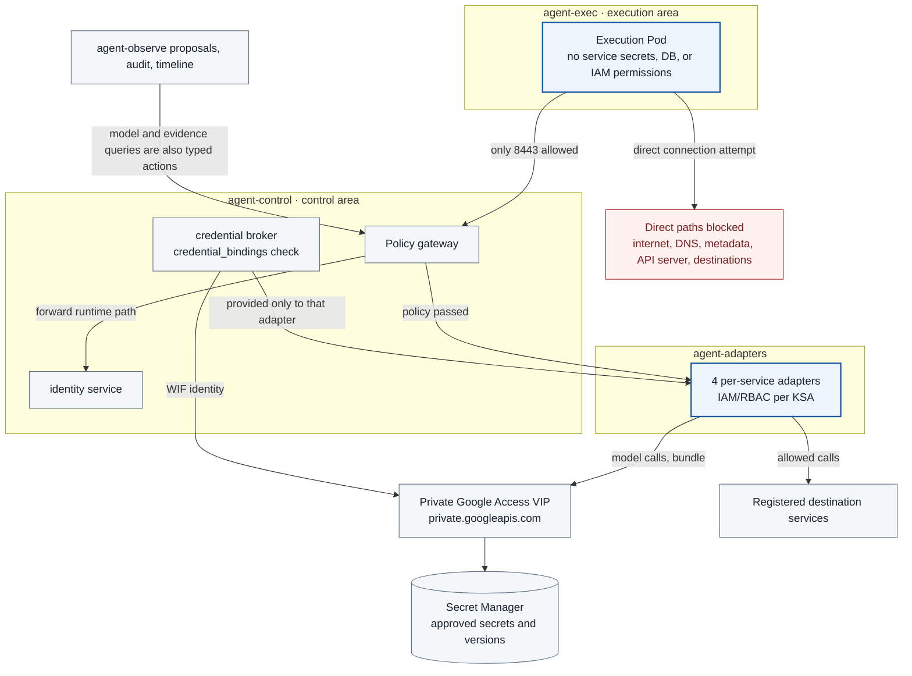

<a id="task-06--direct-egress-restriction-and-credential-brokering-ref"></a>

# TASK-06 · Direct egress restriction and credential brokering

> This document is a specification of the features to implement. The settings, check items, APIs, storage constraints, and failure handling are the implementation contract; implementation and deployment have not been performed yet. Values generated in the deployment environment are managed as install inputs.

## Structure at a glance

> Target design · implementation, deployment, and functional effect unverified. Solid lines are placement, processing, and calls; dotted lines are references and observation evidence; the label on each arrow distinguishes its meaning.



**How to read it:** Instead of the execution Pod going directly to the internet, the adapter performs the allowed calls. Model calls from the proposal service also go through the gateway to the model adapter, and no direct path is created from `agent-observe` to the model adapter. Blocking metadata for execution Pods is distinguished from the paths that the broker and adapters need to obtain their WIF identity. Whether the permission and network rules are actually enforced is confirmed by blocking tests together with normal routing tests.

| Item | Content |
| --- | --- |
| Plan | [Final plan](../plan.md#task-06) |
| Development prerequisites | [TASK-01](TASK-01-gke-platform.md) · [TASK-05](TASK-05-service-adapters.md) |
| Integration dependencies (runtime) | [TASK-03](TASK-03-identity-approval.md) (workload certificates, `attempt_credential_scope`), [TASK-04](TASK-04-policy-gateway.md) (gateway path), [TASK-07](TASK-07-audit-store.md) (audit writer permissions, batch API), the COMMON internal API table (source of the allow table) |
| Owner role | Network/IAM engineer · owner/planned date not set |
| Common conventions | [Shared Tech Spec](COMMON.md) |
| Baseline | Working tree after efe8dce (2026-10-11 revision) |

## 1. Goals and scope

Restrict the paths by which an execution Pod directly accesses the internet, DNS, metadata, kube-apiserver, or destination services, and let traffic pass only through the gateway. Between services in the control area, open only the calls listed in the COMMON internal API table. Actual service credentials are provided in a limited way to the per-service adapters. Enforcement does not rely on environment variable proxy settings alone.

## 2. Required environment, inputs, and resources

The TASK-01 placement is required. The cluster is created with Dataplane V2, which has built-in NetworkPolicy enforcement. On a cluster without a NetworkPolicy plugin, policies are not enforced, so do not install with a different dataplane. [GKE Dataplane V2](https://docs.cloud.google.com/kubernetes-engine/docs/how-to/dataplane-v2), [GKE NetworkPolicy](https://docs.cloud.google.com/kubernetes-engine/docs/how-to/network-policy)

The network is fixed to IPv4 only (TASK-01 lock). Therefore the DNS zone has only A records, and the IPv6 VIP range is not used. In addition, Service NAT information, WIF configuration, Private Google Access on the subnet, a Secret Manager test secret, and minimal IAM are required.

Google API name resolution is fixed to the Cloud DNS private zone `googleapis.com.` attached to the VPC. This zone has the A records `199.36.153.8`, `.9`, `.10`, and `.11` for `private.googleapis.com`, and a CNAME `*.googleapis.com` → `private.googleapis.com`. The official documentation requires this record configuration and says not to mix the addresses of the two VIPs. [Configuring Private Google Access](https://docs.cloud.google.com/vpc/docs/configure-private-google-access) Terraform creates the zone and records together in `platform/gcp/`. Whether Pod name resolution goes through this private zone is confirmed in Q0 by checking that `secretmanager.googleapis.com`, `oauth2.googleapis.com`, and `www.googleapis.com` resolve to the VIP. The MVP does not enable NodeLocal DNSCache.

## 3. Technical implementation design

1. Apply ingress/egress default deny to every role Namespace, and open only the NetworkPolicies rendered from the allow table in 3.1. The allow table has one row per (caller, API) in the COMMON internal API table, plus infrastructure rows (DNS, metadata, PGA, kube-apiserver, Cloud SQL, IdP, console LB).
2. Test direct access from the execution Pod to UDP/TCP 53, external 443/80, the metadata address, kube-apiserver, and destination ClusterIPs/PodIPs. Expose only the typed action API so that the allowed gateway does not act as an arbitrary proxy/CONNECT.
3. Split the adapters into 4 Go Deployments; since a KSA is per Deployment, give each Deployment one KSA (3.1 KSA table).
4. The Kubernetes reader is allowed only pods/events list and pods/log get in the required namespaces, excluding secrets, exec, and writes.
5. The credential broker (Go) runs in the `agent-control` Namespace. It looks up secrets with the allowlist in the `credential_bindings` table and does not return secrets or SA tokens to the execution area.
6. Google APIs are reached only through the `private.googleapis.com` VIP of Private Google Access. NetworkPolicies are written IP-based, and FQDN-based policies (GKE FQDNNetworkPolicy) are not used. VPC Service Controls is kept as an optional reinforcement.
7. Every Pod that uses Cloud SQL connects through a Cloud SQL Auth Proxy native sidecar, and each KSA has its own DB IAM user (3.3).
8. Enable Dataplane V2 network policy logging to record connections that NetworkPolicy denied or allowed (3.4). Because of cost, Cloud Logging is not used for storage and query; the node collector sends the records left in node files to the control area. TASK-10 does the judgment.

### 3.1 Network allow table and bootstrap

**Label rule:** The `app.kubernetes.io/name` label of every Pod is equal to that Pod's KSA name. TASK-01 Admission checks that the label and `serviceAccountName` match, so a Pod that a NetworkPolicy selects by label is a Pod of that KSA. This rule is entered in the COMMON identifier registry table.

| Namespace | KSA(= label) | Component | Cloud SQL | kube-apiserver |
| --- | --- | --- | --- | --- |
| agent-exec | `agent-runtime`, `probe-runner`, `start-fixture` | ADK runtime, ground-truth probe, short-lived Pod fixture | No | No |
| agent-control | `policy-gateway` | gateway (embedded OPA) | Yes | No |
| agent-control | `workload-identity` | identity service | Yes | Yes |
| agent-control | `coordinator`, `credential-broker`, `intent-checker` | coordinator, broker, intent check | Yes | No |
| agent-control | `node-readiness` | node readiness controller | No | Yes |
| agent-adapters | `kubernetes-reader` | k8s read adapter | Yes | Yes |
| agent-adapters | `receiver-sender`, `model-adapter`, `evidence-reader` | send, model, and evidence read adapters | Yes | No |
| agent-adapters | `probe-runner` | ground-truth probe on adapters nodes | No | No |
| agent-observe | `audit-writer`, `audit-exporter`, `audit-verifier`, `audit-retention`, `evidence-collector`, `timeline`, `correlation`, `start-coordinator`, `policy-proposer` | audit, evidence, DB retention jobs, timeline, correlation, start coordination, proposals | Yes | Only `correlation`: Yes |
| agent-observe | `discovery` | call path discovery service (creates and reads snapshot Jobs) | Yes | Yes |
| agent-observe | `discovery-snapshot` | snapshot Job (external source analysis, [TASK-02 3.4](TASK-02-catalog-contracts.md#34-call-path-discovery-candidates-and-promotion-procedure)) | No | No |
| agent-observe | `control-health`, `drift-probe`, `pod-watcher` | health verification, baseline drift, Pod watcher | `control-health` and `drift-probe`: Yes | Yes (`control-health` has Node `get` and `list`, see 3.2 below) |
| agent-release | `releaser` | policy release | Yes | Yes (only get, update, and patch on the designated TracingPolicyNamespaced in `agent-exec`, [TASK-14 3.4](TASK-14-policy-release.md#34-deployment-permissions-and-rollback). Bundle ack is confirmed through TASK-10 `bundle_ack`, without reading the Deployment directly) |
| agent-release (operations project) | `regression-dispatcher` | regression request relay (TASK-13) | Yes | No |
| agent-targets | `receiver` | test receiver | Yes | No |
| agent-targets | `probe-sink`, `start-marker` | ground-truth TCP receiver, marker server | No | No |
| agent-sensors | `tetragon`, `runtime-guard`, `netpol-collector` | hostNetwork DaemonSet | No | No |
| agent-sensors | `lifecycle-recorder` | Pod network DaemonSet. Only the `containerd-proxy` container in the same Pod uses the containerd socket ([TASK-09 3.6](TASK-09-node-sensor.md#36-lifecycle-recorder-and-pod-watcher)) | No | Yes (only `get` on its own Node) |

Except for `lifecycle-recorder`, the Pods in `agent-sensors` use hostNetwork, so NetworkPolicy cannot select them. `lifecycle-recorder` does not need hostNetwork, so it runs on the Pod network and its egress is restricted by `lifecycle-recorder-allow` like other KSAs. Traffic sent by these Pods comes from node IPs, so the receiving side opens ingress with a node subnet CIDR (`node_cidr`) ipBlock, and each API-owning Task performs the mTLS SAN check. Dataplane V2 (Cilium) classifies traffic from nodes as host or remote-node identity, so whether the `node_cidr` ipBlock actually matches is a Q0 verification item (COMMON shared Q0). If it does not match, the alternative is to place a non-hostNetwork relay Pod in `agent-observe` on each node, have the sensors send to the relay over a node-local socket, and open ingress by the relay's namespace and label. For the same reason, callers that are ordinary Pods, such as `pod-watcher`, are opened by namespace and label rather than `node_cidr`.

**Infrastructure addresses:**

| Name | Value | Basis and status |
| --- | --- | --- |
| `metadata` | `169.254.169.254/32` TCP 80·8080 | Confirmed: [GKE NetworkPolicy](https://docs.cloud.google.com/kubernetes-engine/docs/how-to/network-policy). The ports actually used on Dataplane V2, and whether the WIF path additionally needs `169.254.169.252/32` TCP 988, are Q0 |
| `pga` | `199.36.153.8/30` TCP 443 | Confirmed: [Private Google Access configuration](https://docs.cloud.google.com/vpc/docs/configure-private-google-access) |
| `pga_direct` | `34.126.0.0/18` | The same document lists this as the direct connectivity range for some services. Whether the APIs in use rely on this range is Q0; if they do not, it is not allowed |
| `kube_apiserver` | control plane endpoint `/32` TCP 443 | The private endpoint IP is recorded at install time. Whether the ipBlock matches after `kubernetes.default` DNAT is Q0 |
| `cloudsql` | Cloud SQL private IP `/32` TCP 3307 | The Auth Proxy connects to the instance on 3307 and to the Admin API on 443. [Cloud SQL Auth Proxy](https://docs.cloud.google.com/sql/docs/postgres/sql-proxy) |
| `kube_dns` | `kube-system` / `k8s-app: kube-dns` UDP·TCP 53 | |
| `node_cidr` | node subnet CIDR | lock value |
| `gfe` | `130.211.0.0/22`, `35.191.0.0/16` | GFE and health check ranges that the global external Application Load Balancer uses to reach zonal NEG backends. [LB firewall rules](https://docs.cloud.google.com/load-balancing/docs/firewall-rules) |
| IdP | `oauth2.googleapis.com`, `www.googleapis.com` → `pga` | Access from the identity service to the token endpoint and JWKS. The VIP is used via the `*.googleapis.com` wildcard, but the actual responses are Q0. The user browser's access to `accounts.google.com` is not cluster egress |

**Call allow table (derived from the COMMON internal API table):** All internal APIs use TCP 8443. Callers and callees in the table are `namespace/KSA`, and each row is rendered both as the caller's egress and as the callee's ingress.

| caller | callee | API |
| --- | --- | --- |
| agent-exec/agent-runtime | agent-control/policy-gateway | `/v1/actions*`, `/v1/runtime/assignments`, `/v1/sessions/{id}:claim`, `/v1/sessions/{id}:refresh`, `/internal/workload-certificates` |
| agent-exec/probe-runner, agent-exec/start-fixture | agent-control/policy-gateway | `/internal/workload-certificates`. The probe runner additionally uses `/v1/runtime/probe-reports` (probe result and lease relay) |
| `node_cidr` (node runtime bridge, and the hostNetwork agent-sensors service workloads `tetragon` exporter and `netpol-collector`) | agent-control/policy-gateway | `/internal/workload-certificates` |
| agent-control/policy-gateway | agent-control/workload-identity | forwarding of the execution-zone paths above (`/internal/workload-certificates`, `/v1/runtime/assignments`, `:claim`, `:refresh`) |
| agent-control/policy-gateway | agent-observe/control-health | `/v1/runtime/probe-reports` relay → `/internal/control-health/probe-results` and `/leases` (caller SAN is in `X-Agentarium-Peer-Identity`) |
| all KSAs in agent-control, adapters, observe, release, and targets, plus agent-sensors/lifecycle-recorder | agent-control/workload-identity | `/internal/workload-certificates` |
| `gfe` (console) | agent-control/workload-identity | all APIs other than the console static UI (`/v1/sessions*`, `/v1/approvals*`, `/v1/actions/*`, `/v1/policy-changes*`, `/console/internal/*`, OIDC callback). The console has no other entry path to services (COMMON console BFF) |
| agent-control/workload-identity (console BFF) | agent-control/policy-gateway | `/v1/actions/{id}:reevaluate`, `GET /v1/actions/{id}`, `/v1/actions/{id}/result` |
| agent-control/workload-identity (console BFF) | agent-observe/timeline | `/v1/actions/{id}/timeline`, `/v1/actions/{id}/resolutions` |
| agent-control/workload-identity (console BFF) | agent-observe/policy-proposer | `/internal/proposals*` |
| agent-control/workload-identity (console BFF) | agent-release/releaser | `/internal/policy-diff:check`, `/v1/policy-changes*` |
| agent-control/workload-identity (console BFF) | agent-observe/discovery | `/internal/discovery/snapshots`, `/runs`, `/candidates*` |
| agent-control/workload-identity (console BFF) | agent-observe/control-health | `/internal/holds/{id}/release` (release by operator approval) |
| agent-control/workload-identity | agent-control/intent-checker | `/internal/intent-checks` |
| agent-control/policy-gateway | agent-control/intent-checker | intent check on the standing rule path |
| agent-control/intent-checker | agent-control/workload-identity | `/internal/service-sessions` |
| agent-control/intent-checker | agent-control/policy-gateway | `/v1/actions`, `/v1/actions/{id}/result` |
| agent-control/intent-checker | agent-observe/policy-proposer | `/internal/issues` |
| agent-observe/policy-proposer | agent-control/workload-identity | `/internal/service-sessions` |
| agent-observe/policy-proposer | agent-control/policy-gateway | `/v1/actions`, `/v1/actions/{id}/result` |
| agent-observe/policy-proposer | agent-release/releaser | `/internal/policy-diff:check` |
| agent-observe/discovery | agent-control/workload-identity, agent-control/policy-gateway | `/internal/service-sessions`, `/v1/actions*` |
| agent-release/releaser | agent-control/workload-identity, agent-control/policy-gateway | `/internal/service-sessions`, `/v1/actions*` (probe) |
| agent-release/releaser | agent-control/coordinator | `/internal/dispatch/activation-probes` |
| agent-control/policy-gateway | agent-adapters/kubernetes-reader, receiver-sender, model-adapter, evidence-reader | `/internal/adapter/{id}/execute` |
| the 4 adapters in agent-adapters | agent-control/coordinator | `/internal/dispatch/reservations`, `/permits/{id}/check`, `/attempts/{id}/outcome` |
| agent-adapters/receiver-sender | agent-control/credential-broker | `/internal/credentials:resolve` |
| agent-adapters/receiver-sender | agent-targets/receiver | `/test/v1/submissions` |
| agent-adapters/evidence-reader | agent-observe/timeline | `/internal/evidence/*` |
| agent-adapters/evidence-reader | agent-observe/discovery | `/internal/discovery/snapshots/*` |
| agent-observe/evidence-collector | agent-targets/receiver | `/test/v1/receipts/{action_id}` |
| policy-gateway, the 4 adapters, evidence-collector, timeline, releaser, intent-checker, audit-verifier | agent-observe/audit-writer | `/internal/audit/events`; only policy-gateway uses `/internal/audit/work-events` (audit-verifier sends only `export_verification_failed`, [TASK-07 3.2.1](TASK-07-audit-store.md#321-confirmed-export-items). This event type restriction is enforced by audit-writer's `producer_event_grants`, not by NetworkPolicy) |
| `node_cidr` (exporter), agent-sensors/lifecycle-recorder, agent-observe/pod-watcher | agent-observe/audit-writer | `/internal/kernel/events:batch`, `/internal/lifecycle/events:batch`, `/internal/lifecycle/checkpoints` |
| policy-gateway, coordinator, the 4 adapters, audit-writer, audit-exporter, audit-verifier, evidence-collector, receiver, releaser, node-readiness, agent-adapters/probe-runner, agent-sensors/lifecycle-recorder, `node_cidr` (including the `netpol-collector` lease of the node collector) | agent-observe/control-health | `/internal/control-health/leases` |
| audit-exporter, evidence-collector, agent-adapters/probe-runner, `node_cidr` (sensor exporter) | agent-observe/control-health | `/internal/control-health/probe-results` |
| audit-writer, audit-exporter, audit-verifier, evidence-collector, timeline, releaser, `node_cidr` | agent-observe/control-health | `/internal/holds` (the probe runner does not call it) |
| coordinator, policy-gateway, releaser, timeline, node-readiness, `node_cidr` | agent-observe/control-health | `GET /internal/control-health` |
| agent-observe/pod-watcher, agent-sensors/lifecycle-recorder | agent-observe/control-health | `/internal/control-health/observation-gaps` |
| `node_cidr` (node runtime bridge) | agent-observe/start-coordinator | `/internal/runtime/start-permits*`, `/start-attempts*` |
| agent-observe/timeline | agent-observe/policy-proposer | `/internal/issues` |
| agent-observe/correlation | agent-observe/policy-proposer | `/internal/issues` (`source = network_finding`) |
| `node_cidr` (network policy log node collector) | agent-observe/correlation | `/internal/network-policy/records:batch` |
| agent-exec and agent-adapters/probe-runner | agent-targets/probe-sink | TCP 8443 ground-truth stimulus |
| agent-exec/start-fixture | agent-targets/start-marker | marker transmission |
| agent-observe/policy-proposer, agent-observe/discovery, agent-release/releaser, TASK-15 measurement runs (`tools/integration_runner/`. This caller is not rendered until TASK-15 registers the run KSA in the COMMON KSA table) | agent-release/regression-dispatcher | `/internal/regression-runs*` |
Because the regression test runner is in a separate GCP project, no network path is created between projects. policy-proposer, releaser, and discovery call `/internal/regression-runs` on the TASK-13 `regression-dispatcher` in the production project's `agent-release` (row below), and the dispatcher and the regression project runner exchange data only through the GCS buckets `regression-requests` and `regression-reports` ([COMMON regression test contract](COMMON.md#regression-test-contract)). The dispatcher's GCS access uses the PGA VIP 443, and its DB access uses the Cloud SQL Auth Proxy path.

**Infrastructure allow rows:**

| caller | destination |
| --- | --- |
| All KSAs that use Cloud SQL (KSA table above) | `cloudsql` 3307, `pga` 443, `metadata` 80·8080 |
| `model-adapter` | `pga`(Agent Platform) |
| `credential-broker` | `pga`(Secret Manager) |
| `workload-identity` | `pga`(CAS, IdP token·JWKS, GCS bundle objects: reading `data.standing_rules` with policyloader) |
| `audit-exporter`, `audit-verifier` | `pga`(GCS evidence and `decision-input-exports` buckets, KMS signing and verification) |
| `policy-gateway`, the 4 adapters | `pga`(GCS bundle objects) |
| `releaser` | `pga`(GCS bundle store, KMS signing) |
| `drift-probe` | `pga`(GKE API) |
| `discovery` | `pga`(read GCS discovery bucket) |
| `discovery-snapshot` | `pga`(GCS discovery bucket: read `sources/`, write `snapshots/`), `metadata` 80·8080(Workload Identity token) |
| KSAs that use kube-apiserver (table above) | `kube_apiserver` 443 |
| All KSAs outside agent-exec | `kube_dns` 53 |
| All Pods in agent-exec | None other than the call allow table above |

**Rendering rules:** The allow table is kept as data in a single file, `deploy/gcp/base/network/allow-matrix.yaml`, and the Go tool `tools/netpol-render/` generates NetworkPolicies deterministically. The renderer creates one default-deny per Namespace and one policy per KSA (`<ksa>-allow`). The egress of `<ksa>-allow` contains the rows where that KSA is the caller, and the ingress contains the rows where it is the callee. A Pod peer is written with `namespaceSelector` (`kubernetes.io/metadata.name`) and `podSelector` (`app.kubernetes.io/name`) in the same entry, and an address peer is written with `ipBlock`. CI checks that the rendering result is the same as `deploy/gcp/base/network/rendered/` in the repository, and that every (caller, API) pair in the COMMON internal API table is in `allow-matrix.yaml`. Because the caller column in COMMON includes phrases such as "registered component", CI also reads the mapping file `deploy/gcp/base/network/caller-map.yaml`, which converts caller phrases into lists of `namespace/KSA`. If a caller phrase not in the mapping appears in COMMON, CI fails. The format of the source file is as follows (a format definition, not an excerpt).

```yaml
# deploy/gcp/base/network/allow-matrix.yaml
version: 1
infra:
  metadata:       {ipBlock: 169.254.169.254/32, ports: [TCP/80, TCP/8080]}
  pga:            {ipBlock: 199.36.153.8/30, ports: [TCP/443]}
  kube_apiserver: {ipBlock: "${control_plane_endpoint}/32", ports: [TCP/443]}
  cloudsql:       {ipBlock: "${cloudsql_private_ip}/32", ports: [TCP/3307]}
  kube_dns:       {namespace: kube-system, podLabels: {k8s-app: kube-dns}, ports: [UDP/53, TCP/53]}
  node_cidr:      {ipBlock: "${node_cidr}"}
  gfe:            {ipBlocks: [130.211.0.0/22, 35.191.0.0/16]}
edges:
  - {from: agent-exec/agent-runtime, to: agent-control/policy-gateway, port: TCP/8443}
  - {from: node_cidr, to: agent-control/policy-gateway, port: TCP/8443}
  - {from: agent-control/policy-gateway, to: agent-control/workload-identity, port: TCP/8443}
  # ... one entry per row of the call allow table. A row with multiple caller KSAs is expanded per KSA.
  - {from: agent-exec/probe-runner, to: agent-control/policy-gateway, port: TCP/8443}
  - {from: agent-exec/start-fixture, to: agent-control/policy-gateway, port: TCP/8443}
  - {from: agent-exec/probe-runner, to: agent-targets/probe-sink, port: TCP/8443}
  - {from: agent-exec/start-fixture, to: agent-targets/start-marker, port: TCP/8443}
infra_edges:
  - {from: agent-control/credential-broker, to: [metadata, pga, cloudsql, kube_dns]}
  # ... one entry per infrastructure allow row
```

As examples of the rendering result, the full policies for the execution Namespace and the gateway are shown. The remaining KSAs are generated by the same rules. As in the allow table, the probe runner and start fixture egress only to the gateway (`/internal/workload-certificates`, probe result relay) and to their respective targets, and they do not connect directly to control-health. The CI of `tools/netpol-render/` re-renders the example blocks in this section from the allow table and compares them, and fails if they differ.

```yaml
apiVersion: networking.k8s.io/v1
kind: NetworkPolicy
metadata: {name: default-deny, namespace: agent-exec}
spec:
  podSelector: {}
  policyTypes: [Ingress, Egress]
---
apiVersion: networking.k8s.io/v1
kind: NetworkPolicy
metadata: {name: agent-runtime-allow, namespace: agent-exec}
spec:
  podSelector: {matchLabels: {app.kubernetes.io/name: agent-runtime}}
  policyTypes: [Ingress, Egress]
  ingress: []
  egress:
    - to:
        - namespaceSelector: {matchLabels: {kubernetes.io/metadata.name: agent-control}}
          podSelector: {matchLabels: {app.kubernetes.io/name: policy-gateway}}
      ports: [{protocol: TCP, port: 8443}]
---
apiVersion: networking.k8s.io/v1
kind: NetworkPolicy
metadata: {name: probe-runner-allow, namespace: agent-exec}
spec:
  podSelector: {matchLabels: {app.kubernetes.io/name: probe-runner}}
  policyTypes: [Ingress, Egress]
  ingress: []
  egress:
    - to:
        - namespaceSelector: {matchLabels: {kubernetes.io/metadata.name: agent-control}}
          podSelector: {matchLabels: {app.kubernetes.io/name: policy-gateway}}
      ports: [{protocol: TCP, port: 8443}]
    - to:
        - namespaceSelector: {matchLabels: {kubernetes.io/metadata.name: agent-targets}}
          podSelector: {matchLabels: {app.kubernetes.io/name: probe-sink}}
      ports: [{protocol: TCP, port: 8443}]
---
apiVersion: networking.k8s.io/v1
kind: NetworkPolicy
metadata: {name: start-fixture-allow, namespace: agent-exec}
spec:
  podSelector: {matchLabels: {app.kubernetes.io/name: start-fixture}}
  policyTypes: [Ingress, Egress]
  ingress: []
  egress:
    - to:
        - namespaceSelector: {matchLabels: {kubernetes.io/metadata.name: agent-control}}
          podSelector: {matchLabels: {app.kubernetes.io/name: policy-gateway}}
      ports: [{protocol: TCP, port: 8443}]
    - to:
        - namespaceSelector: {matchLabels: {kubernetes.io/metadata.name: agent-targets}}
          podSelector: {matchLabels: {app.kubernetes.io/name: start-marker}}
      ports: [{protocol: TCP, port: 8443}]
---
apiVersion: networking.k8s.io/v1
kind: NetworkPolicy
metadata: {name: policy-gateway-allow, namespace: agent-control}
spec:
  podSelector: {matchLabels: {app.kubernetes.io/name: policy-gateway}}
  policyTypes: [Ingress, Egress]
  ingress:
    - from:
        - namespaceSelector: {matchLabels: {kubernetes.io/metadata.name: agent-exec}}
          podSelector: {matchExpressions: [{key: app.kubernetes.io/name, operator: In,
            values: [agent-runtime, probe-runner, start-fixture]}]}
        - ipBlock: {cidr: "${node_cidr}"}
        - namespaceSelector: {matchLabels: {kubernetes.io/metadata.name: agent-control}}
          podSelector: {matchLabels: {app.kubernetes.io/name: workload-identity}}
        - namespaceSelector: {matchLabels: {kubernetes.io/metadata.name: agent-control}}
          podSelector: {matchLabels: {app.kubernetes.io/name: intent-checker}}
        - namespaceSelector: {matchLabels: {kubernetes.io/metadata.name: agent-observe}}
          podSelector: {matchLabels: {app.kubernetes.io/name: policy-proposer}}
        - namespaceSelector: {matchLabels: {kubernetes.io/metadata.name: agent-observe}}
          podSelector: {matchLabels: {app.kubernetes.io/name: discovery}}
        - namespaceSelector: {matchLabels: {kubernetes.io/metadata.name: agent-release}}
          podSelector: {matchLabels: {app.kubernetes.io/name: releaser}}
      ports: [{protocol: TCP, port: 8443}]
  egress:
    - to:
        - namespaceSelector: {matchLabels: {kubernetes.io/metadata.name: agent-control}}
          podSelector: {matchLabels: {app.kubernetes.io/name: workload-identity}}
        - namespaceSelector: {matchLabels: {kubernetes.io/metadata.name: agent-control}}
          podSelector: {matchLabels: {app.kubernetes.io/name: intent-checker}}
        - namespaceSelector: {matchLabels: {kubernetes.io/metadata.name: agent-adapters}}
          podSelector: {matchExpressions: [{key: app.kubernetes.io/name, operator: In,
            values: [kubernetes-reader, receiver-sender, model-adapter, evidence-reader]}]}
        - namespaceSelector: {matchLabels: {kubernetes.io/metadata.name: agent-observe}}
          podSelector: {matchExpressions: [{key: app.kubernetes.io/name, operator: In,
            values: [audit-writer, control-health]}]}
      ports: [{protocol: TCP, port: 8443}]
    - to: [{ipBlock: {cidr: "${cloudsql_private_ip}/32"}}]
      ports: [{protocol: TCP, port: 3307}]
    - to: [{ipBlock: {cidr: 199.36.153.8/30}}]
      ports: [{protocol: TCP, port: 443}]
    - to: [{ipBlock: {cidr: 169.254.169.254/32}}]
      ports: [{protocol: TCP, port: 80}, {protocol: TCP, port: 8080}]
    - to:
        - namespaceSelector: {matchLabels: {kubernetes.io/metadata.name: kube-system}}
          podSelector: {matchLabels: {k8s-app: kube-dns}}
      ports: [{protocol: UDP, port: 53}, {protocol: TCP, port: 53}]
```

The probe runner and start fixture receive certificates only through the same gateway path as the runtime, and the probe runner sends results and leases only through the `/v1/runtime/probe-reports` relay. Neither can submit `/v1/actions` (no session token). The GFE ranges are not opened on gateway ingress, and console requests go through the identity BFF. Because a failure to reach the marker server must be distinguished from "first code not executed", before each test one normal fixture is run over the same path to first confirm that the marker arrives.

**Gateway bootstrap address:** The runtime is given a fixed gateway ClusterIP and the certificate DNS name as environment variables that are not secrets. The gateway Service declares `spec.clusterIP` as a fixed value within the service CIDR (TASK-01 lock). The socket connects by IP, and TLS SNI/hostname verification is performed with the fixed DNS name, so the execution Pod does not need DNS lookups. The CA bundle is included in the runtime image. No HTTP CONNECT or raw proxy API is provided.

**Metadata path:** All node pools are in `GKE_METADATA` mode (TASK-01). The GKE metadata server obtains from the API server a KSA token that identifies the requesting workload and exchanges it for Google credentials, so `automountServiceAccountToken: false` on the execution Pod alone is considered insufficient to prevent identity issuance through the metadata path, and the path is blocked with NetworkPolicy. [GKE WIF concepts](https://docs.cloud.google.com/kubernetes-engine/docs/concepts/workload-identity) A CI check (`platform/gcp/iam/checks/`) confirms that the IAM policies contain no `principalSet` grant for the `agent-exec` namespace, no `agent-exec` KSA principal grant, and no pool-wide grant. The check tool is a Go program that reads the JSON output of `gcloud projects get-iam-policy`, `gcloud secrets get-iam-policy`, and similar commands. Internal retries by the metadata token source are an allowed exception to the prohibition on automatic adapter retries.

**Limits of the second line of defense:** VPC firewall and hierarchical firewall policies do not apply to metadata server traffic. [VPC firewall](https://docs.cloud.google.com/firewall/docs/firewalls) Therefore, if it is confirmed that NetworkPolicy cannot block the metadata or node-local paths, no firewall is added; instead the node pool is isolated and execution is held until the test passes. Internet egress is reduced by one more layer through private nodes and not configuring Cloud NAT. Whether external connections actually fail in this configuration is measured in Q0.

**VPC Service Controls (optional):** To reduce data exfiltration by a compromised adapter or broker, Secret Manager, Agent Platform, GCS, and CAS are placed in one perimeter and the VIP is changed to `restricted.googleapis.com` (`199.36.153.4/30`). The restricted VIP allows only APIs supported by VPC Service Controls, so support for every API in use is confirmed before adoption. This is not included in the MVP completion conditions.

It is not claimed that IP-based NetworkPolicy alone inspects FQDNs or HTTPS paths. A Pod allowed to reach the PGA VIP can also reach other Google APIs behind the same VIP over TCP, so per-API restriction is handled by IAM and the adapter's catalog check.

### 3.2 Kubernetes reader RBAC files

`deploy/gcp/base/rbac/control-health-nodes.yaml` is a ClusterRole and binding that gives `agent-observe/control-health` only `get` and `list` on cluster-scope `nodes`. It is used only to find the current Node by the certificate's node UID and recheck the boot ID when a new node/boot is registered (TASK-10 3.5). Because Node names are not fixed, `resourceNames` is not used. `watch`, `nodes/status`, `patch`, taint modification, and Pod/Secret permissions are not given.

`deploy/gcp/base/rbac/kubernetes-reader.yaml` creates the Role/RoleBinding below. Namespace-wide secrets, `pods/exec`, `pods/attach`, and write permissions are not included. The adapter checks the namespace and Pod UID, and RBAC provides the upper bound of server permissions.

```yaml
apiVersion: rbac.authorization.k8s.io/v1
kind: Role
metadata:
  name: agentarium-kubernetes-reader
  namespace: agent-targets
rules:
  - apiGroups: [""]
    resources: [pods, events]
    verbs: [get, list]
  - apiGroups: [""]
    resources: [pods/log]
    verbs: [get]
---
apiVersion: rbac.authorization.k8s.io/v1
kind: RoleBinding
metadata:
  name: agentarium-kubernetes-reader
  namespace: agent-targets
subjects:
  - kind: ServiceAccount
    name: kubernetes-reader
    namespace: agent-adapters
roleRef:
  apiGroup: rbac.authorization.k8s.io
  kind: Role
  name: agentarium-kubernetes-reader
```

The Kubernetes reader uses a projected Kubernetes API token with a short TTL. This mount exists only in `agent-adapters` and is kept separate from the token prohibition policy of the execution Namespace. The TLS API server address and CA are registered in the catalog.

The KSA `workload-identity` (agent-control) of the TASK-03 identity service is given only the permissions below through `deploy/gcp/base/rbac/workload-identity.yaml`. Pod `get` and `watch` are granted by RoleBinding in every role Namespace that receives certificates (watch is needed to record certificate revocation when a Pod is deleted).

```yaml
apiVersion: rbac.authorization.k8s.io/v1
kind: ClusterRole
metadata:
  name: agentarium-workload-identity
rules:
  - apiGroups: [authentication.k8s.io]
    resources: [tokenreviews]
    verbs: [create]
  - apiGroups: [""]
    resources: [nodes]
    verbs: [get, watch]
---
apiVersion: rbac.authorization.k8s.io/v1
kind: Role
metadata:
  name: agentarium-workload-identity-pods
  namespace: agent-exec   # the same Role is placed in every role Namespace
rules:
  - apiGroups: [""]
    resources: [pods]
    verbs: [get, list, watch]
```

<a id="33-secrets-and-wif-permissions-ref"></a>
### 3.3 Secrets and WIF permissions

The WIF principal has the form `principal://iam.googleapis.com/projects/PROJECT_NUMBER/locations/global/workloadIdentityPools/PROJECT_ID.svc.id.goog/subject/ns/NAMESPACE/sa/KSA`. Clusters in the same project share the same pool, so the regression test environment is placed in a separate project (TASK-01). [GKE WIF concepts](https://docs.cloud.google.com/kubernetes-engine/docs/concepts/workload-identity)

**Cloud SQL IAM:** Cloud SQL IAM DB authentication is documented as accepting IAM users, service accounts, and groups as DB users, and we did not find documentation saying it accepts direct WIF principals. Therefore, for each KSA that uses Cloud SQL, a dedicated Google service account (GSA `<ksa>-db@PROJECT_ID.iam.gserviceaccount.com`) is created, and the KSA principal is given `roles/iam.workloadIdentityUser` on that GSA. The `iam.gke.io/gcp-service-account` annotation is not put on the KSA. The application ADC keeps the direct KSA principal. Only the Cloud SQL Auth Proxy is passed `--impersonate-service-account=<ksa>-db@PROJECT_ID.iam.gserviceaccount.com`. The KSA has `iam.serviceAccounts.getAccessToken` permission (`roles/iam.workloadIdentityUser`) only on its own DB GSA. The GSA is given instance-restricted `roles/cloudsql.client` and `roles/cloudsql.instanceUser` and the project's `roles/serviceusage.serviceUsageConsumer`, and the GSA is created as an IAM DB user in the DB. Non-DB permissions such as CAS and GCS are not duplicated on the GSA. Each Pod runs the Cloud SQL Auth Proxy as a native sidecar (`restartPolicy: Always` in `initContainers`) and connects with `--auto-iam-authn` and `--private-ip`. Native sidecars are stable in Kubernetes 1.33 and start before the main container. [Cloud SQL IAM authentication](https://docs.cloud.google.com/sql/docs/postgres/iam-authentication), [Cloud SQL GKE connection](https://docs.cloud.google.com/sql/docs/postgres/connect-kubernetes-engine), [sidecar containers](https://kubernetes.io/docs/concepts/workloads/pods/sidecar-containers/) Whether IAM DB authentication works with a direct WIF principal, and whether the Auth Proxy obtains IAM tokens under NetworkPolicy, are Q0 verification items. A KSA that uses a GSA uses the GSA only for this Cloud SQL purpose, and other Google API permissions are given to the direct principal as in the table below. [Proxy service account impersonation](https://github.com/GoogleCloudPlatform/cloud-sql-proxy/blob/main/README.md#configuring-service-account-impersonation). Because applications in the same Pod can also use the KSA's impersonation permission, this configuration does not claim IAM isolation between containers.

**IAM table per KSA:** "DB" means the Cloud SQL GSA configuration above.

| KSA | DB | Direct principal permissions |
| --- | --- | --- |
| `agent-control/policy-gateway` | Yes | bundle bucket `roles/storage.objectViewer` |
| `agent-control/workload-identity` | Yes | `roles/privateca.certificateRequester` on the CA pool with a template allowlist condition, `roles/privateca.templateUser` on each of the two designated certificate templates, OIDC client secret `roles/secretmanager.secretAccessor`, claim code HMAC key secret `roles/secretmanager.secretAccessor` (claim key delivery below), bundle bucket `roles/storage.objectViewer` (reading `data.standing_rules`) |
| `agent-control/coordinator` | Yes | None |
| `agent-control/credential-broker` | Yes | `roles/secretmanager.secretAccessor` on each individual secret in `credential_bindings` |
| `agent-control/intent-checker` | Yes | None |
| `agent-control/node-readiness` | No | None |
| `agent-adapters/kubernetes-reader` | Yes | bundle bucket `roles/storage.objectViewer` |
| `agent-adapters/receiver-sender` | Yes | bundle bucket `roles/storage.objectViewer` |
| `agent-adapters/model-adapter` | Yes | bundle bucket `roles/storage.objectViewer`, a custom role containing only `aiplatform.endpoints.predict` |
| `agent-adapters/evidence-reader` | Yes | bundle bucket `roles/storage.objectViewer` |
| `agent-observe/audit-writer` | Yes | None. No GCS or KMS permissions (export is done by audit-exporter) |
| `agent-observe/audit-exporter` | Yes | TASK-07 export custom role on the evidence bucket and the `decision-input-exports` bucket (`storage.objects.create` and `storage.objects.get`, the latter for comparing the existing object digest after a 412 response; no delete or overwrite), manifest signing key `roles/cloudkms.signerVerifier` |
| `agent-observe/audit-verifier` | Yes | `roles/storage.objectViewer` on the same buckets, manifest key `cloudkms.cryptoKeyVersions.viewPublicKey` (verification) |
| `agent-observe/audit-retention` | Yes | None. It performs only DB retention work and has no GCS or KMS permissions and no internal API calls. Only `audit_retention` is granted to the IAM DB login |
| `agent-observe/evidence-collector`, `timeline`, `correlation`, `start-coordinator`, `control-health`, `policy-proposer` | Yes | None |
| `agent-observe/discovery` | Yes | discovery bucket `roles/storage.objectViewer` (reading snapshots, [TASK-02 3.4](TASK-02-catalog-contracts.md#34-call-path-discovery-candidates-and-promotion-procedure)) |
| `agent-observe/discovery-snapshot` | No | A custom role on the discovery bucket containing only `storage.objects.create`, `storage.objects.get`, and `storage.objects.list` (reading `sources/` and writing `snapshots/`; no delete or overwrite) |
| `agent-observe/drift-probe` | Yes | A custom role containing only `container.clusters.get` |
| `agent-observe/pod-watcher` | No | None |
| `agent-release/releaser` | Yes | bundle bucket `roles/storage.objectCreator`, bundle signing key `roles/cloudkms.signerVerifier` (KMS `crypto.Signer` also needs public key lookup) |
| `agent-targets/receiver` | Yes | `roles/secretmanager.secretAccessor` on the receiver API key secret (the single secret that `receiver-api-key` in `credential_bindings` points to) (receiver API key delivery below) |
| `agent-exec/*` | No | No grants at all (CI check) |
| decision-replay SA in the regression project | No | Only `roles/storage.objectViewer` on the production project's `decision-input-exports` bucket and `cloudkms.cryptoKeyVersions.viewPublicKey` on the manifest signing key. No production DB permissions |
| `agent-release/regression-dispatcher` (production project) | Yes | `regression-requests` bucket `roles/storage.objectCreator`, `regression-reports` bucket `roles/storage.objectViewer` |
| regression-runner SA in the regression project | No | Only `roles/storage.objectViewer` on the production project's `regression-requests` bucket and `roles/storage.objectCreator` on the `regression-reports` bucket. No production DB permissions |
| Node service account | No | `roles/container.defaultNodeServiceAccount`, image repository `roles/artifactregistry.reader` |

**Cross-environment grant exceptions:** In the table above, the only combinations in which a regression project SA uses production project resources are the following four ([#97](https://github.com/Beaver-Dam-Community/Agentarium/issues/97) decision). The member is the exact KSA principal of the regression project's workload pool (`.../workloadIdentityPools/<regression-project-id>.svc.id.goog/subject/ns/agent-release/sa/<ksa>`), and the bindings have no condition.

| Regression KSA | Production project resource | role |
| --- | --- | --- |
| `agent-release/decision-replay` | `decision-input-exports` bucket | `roles/storage.objectViewer` |
| `agent-release/decision-replay` | manifest signing key | custom role `projects/<production project ID>/roles/agentariumManifestPublicKey` (contains only `cloudkms.cryptoKeyVersions.viewPublicKey`) |
| `agent-release/regression-runner` | `regression-requests` bucket | `roles/storage.objectViewer` |
| `agent-release/regression-runner` | `regression-reports` bucket | `roles/storage.objectCreator` |

`platform/gcp/iam/checks/` excludes from `CROSS_ENV_POOL` only bindings whose resource, role, and member exactly match a single row in this table. Other KSAs, other resources, other roles, principalSets, bindings with conditions, and production project DB/Secret permissions continue to fail as is. Manifest keys and custom roles must be under the production project being inspected. The predefined role `roles/cloudkms.publicKeyViewer` is not used because it also includes `cloudkms.locations.get`/`list` and `resourcemanager.projects.get`. Since the policy JSON alone does not reveal the custom role's permission list, the checker also takes the output of `gcloud iam roles describe <role> --format=json` and verifies that `includedPermissions` contains exactly `cloudkms.cryptoKeyVersions.viewPublicKey` alone. The checker reads the resource name of each policy file from the policy export itself and does not trust human-assigned labels.

**identity claim key delivery:** The identity service's claim code HMAC key (decision in [#101](https://github.com/Beaver-Dam-Community/Agentarium/issues/101)) is installed as follows:

- The key is placed in a single Secret Manager secret separate from the OIDC client secret. Terraform (`platform/gcp/iam/contact-services`) creates this secret and its first version (version 1) under the name written in the lock, and it is not created separately with gcloud. The value is 64 bytes obtained by base64-encoding 48 bytes generated via ephemeral `random_bytes` at apply time. Because identity uses all bytes of the file as the key and only checks whether it is at least 32 bytes, this value satisfies that condition. Since the value is passed only via the write-only argument `secret_data_wo`, it does not remain in the plan or state. `deletion_protection` and `prevent_destroy` are placed on the secret to prevent Terraform from deleting the secret.
- For the OIDC client secret, which is a secret separate from the claim key, Terraform (`platform/gcp/iam/workload-services`) creates only the secret under the `iam.oidc_client_secret` name in the lock and does not create a version. Because the value is determined by the Google OAuth client, the operator adds it directly as a version. Deletion protection is placed on this secret as well. Unlike the claim key, pinning the version in the lock, the SecretProviderClass mount, and trailing newline handling have not yet been determined for the OIDC client secret; these three will be decided in the TASK-03 browser login PR that reads this secret for the first time.
- Values are not written to repositories, issues, or locks; only the secret's canonical resource name (`projects/<project-number>/secrets/<name>`) and the pinned numeric version are placed in the lock. In the initial installation, this version is `1`, created by Terraform. Aliases like `latest` are not used.
- `roles/secretmanager.secretAccessor` is granted only to that single secret, to the direct WIF principal of the `agent-control/workload-identity` KSA. This is because the GKE Secret Manager add-on calls Secret Manager using the Pod's KSA principal. This permission is not replicated to the DB GSA for Cloud SQL (`workload-identity-db`).
- The GKE Secret Manager add-on from TASK-01 is used for delivery. The SecretProviderClass (`provider: gke`) in `agent-control` sets `projects/<project-number>/secrets/<name>/versions/<version>` as the file `claim-key`, and the identity Deployment mounts it read-only to `/var/run/secrets/agentarium` via a CSI volume. Because identity entrypoint's existing default path `/var/run/secrets/agentarium/claim-key` is used as is, the identity code is not modified.
- Rotation is performed in the sequence of adding a new version to Secret Manager, changing the version in the lock to re-render and apply the SecretProviderClass, and then performing a rolling restart of the identity Deployment. Because the validity period of a claim code is 60 seconds (TASK-03 3.1), if a claim code issued by a pre-rotation Pod is verified by a post-rotation Pod, it may fail. That claim must be restarted by the user, and this behavior is documented in operational procedures (TASK-16). The previous version is destroyed 60 seconds after the rolling restart completes.
- Since the mounted file's owner and permissions, as well as whether Pod startup is blocked when secret retrieval fails, are not in the official documentation, they are verified in Q0. On retrieval failure, identity does not start because the key file is missing (fail-closed), and does not generate a temporary key.

**receiver API key delivery:** The receiver's `--api-key-dir` in TASK-08 ([TASK-08](TASK-08-destination-evidence.md) receiver API key, #169) is installed in the same manner as the identity claim key.

- The secret is a single Secret Manager secret pointed to by the `receiver-api-key` row in broker `credential_bindings`. The broker attaches the header using the pinned version from that row, and the receiver verifies using the active version(s) (1 to 2) of the same secret. Therefore, this secret must be in the broker secret allowlist and must be distinct from the identity claim key and the OIDC client secret.
- Terraform (`platform/gcp/iam/workload-services`) also creates this secret and its first version (version 1) under the `receiver.api_key_secret` name in the lock. The value is obtained by converting 32 bytes generated via ephemeral `random_bytes` at apply time into 43 characters of base64url without padding, matching the key format specified by TASK-08. Since the value is passed only via the write-only argument `secret_data_wo`, it does not remain in the plan or state. Deletion protection is placed on the secret just like the claim key, and broker secret permissions are applied after the secret is created. Other broker credential secrets continue to be installation inputs that must be pre-created.
- `roles/secretmanager.secretAccessor` is granted only on that single secret to the direct WIF principal of the `agent-targets/receiver` KSA. It is not granted to the receiver DB GSA (`receiver-db`).
- The SecretProviderClass (`provider: gke`) in `agent-targets` sets the file name `<version>` for each `projects/<project-number>/secrets/<name>/versions/<version>`, and the receiver Deployment mounts it read-only to `/var/run/secrets/agentarium/receiver-api-key` via a CSI volume. The Pod is configured with the nodeSelector `iam.gke.io/gke-metadata-server-enabled: "true"`.
- In the lock, only the secret's canonical resource name and list of numeric versions are kept (current version first, two only during the rotation period). `latest` is not used. Rotation proceeds in the order of adding a new version → two versions in lock → receiver re-application → updating broker binding version → removing the previous version from lock and re-applying → destroying the previous version.

**CAS template IAM:** Only the two service/client-only templates from TASK-03 3.3.1 are allowed for the direct principal of the `workload-identity` KSA. In the CA pool's requester binding, the condition `api.getAttribute('privateca.googleapis.com/template', '') in ['<project-id>/-/<service-template-id>', '<project-id>/-/<client-template-id>']` is placed. CAS IAM attributes use the above format rather than full resource names, and the project ID/number notation must match the issuance request. Omitting templates or specifying other templates is rejected. Because leaving unconditional requester/manager/admin bindings on the same principal or inheriting them from parent resources can bypass this restriction, this is also verified during installation validation. `roles/privateca.templateUser` for the two templates is granted only on each template resource and not on the entire project. It is not replicated to other KSAs or DB GSAs. [CAS CEL](https://docs.cloud.google.com/certificate-authority-service/docs/using-cel), [Policy controls tutorial](https://docs.cloud.google.com/certificate-authority-service/docs/tutorials/manage-policy-controls)

This change defines only template issuance permissions. Trust bundle retrieval and distribution permissions are verified separately. `FetchCaCerts` requires `privateca.caPools.get` and is not substituted by issuance permissions of `certificateRequester`. It does not implicitly change the querying principal or additional permissions. [FetchCaCerts API](https://docs.cloud.google.com/certificate-authority-service/docs/reference/rest/v1/projects.locations.caPools/fetchCaCerts)

Rationale: [Secret Manager access control](https://docs.cloud.google.com/secret-manager/docs/access-control), [Agent Platform access control](https://docs.cloud.google.com/gemini-enterprise-agent-platform/models/access-control), [CA Service IAM](https://docs.cloud.google.com/certificate-authority-service/docs/access-control), [Node service accounts](https://docs.cloud.google.com/kubernetes-engine/security/configure-node-service-accounts)

The model adapter is implemented in Go and directly calls the Gemini REST API of Gemini Enterprise Agent Platform (formerly Vertex AI, hereafter Agent Platform). The access token is obtained via `golang.org/x/oauth2/google` from the WIF path (GKE metadata server). Agent Platform documentation indicates `aiplatform.endpoints.predict` as the permission for prompt requests. Because IAM cannot be restricted at the publisher model level, model origins/projects are additionally restricted by the catalog and adapter. Tokens and request bodies are redacted even in error tracing.
### 3.4 Network policy logging configuration

The fact that a NetworkPolicy blocked a connection is recorded separately at the network layer. This record is supporting evidence produced by a different component than the node sensor's kernel events (TASK-09), and storage and judgment are handled by [TASK-10 3.7](TASK-10-correlation-health.md#37-network-policy-records-and-composite-decisions). This section defines the configuration that enables logging and the collection path.

**Confirmed vendor facts** ([GKE network policy logging](https://docs.cloud.google.com/kubernetes-engine/docs/how-to/network-policy-logging), documentation checked 2026-10-12):

- Configuration is done with a `NetworkLogging` object (apiVersion `networking.gke.io/v1alpha1`), named `default`, one per cluster. It is a Dataplane V2-only feature.
- `spec.cluster.allow` and `spec.cluster.deny` each have `log` and `delegate`. With `allow.delegate = true`, only connections allowed by NetworkPolicies with the annotation `policy.network.gke.io/enable-logging: "true"` are logged. With `deny.delegate = true`, only denials in Namespaces with the Namespace annotation `policy.network.gke.io/enable-deny-logging: "true"` are logged.
- Records are written to Cloud Logging with resource type `k8s_node` and log name `projects/PROJECT/logs/policy-action`. Standard clusters also write them to the node file `/var/log/network/policy_action.log*`.
- Records contain `connection {src_ip, src_port, dest_ip, dest_port, protocol, direction}`, `disposition`, `policies[] {name, namespace}` (only in allow records), `{pod_name, namespace, workload_name, workload_kind, instance}` for `src` and `dest`, `count`, `node_name`, and `timestamp`.
- Denied connections that repeat within a 5-second window are aggregated into one record, with the number in `count`. The aggregation key is `src_ip, dest_ip, dest_port, protocol, direction`, and the source port can differ.
- If a single node exceeds 500 records per second, logs are dropped, but policy enforcement continues. Drops are observed through the node's anetd metrics (counters related to `policy_logging` at `localhost:9990/metrics`). The documentation does not name the individual counters.
- The documentation does not state whether node-originated traffic and hostNetwork Pod traffic are logged.

Whether the behavior above is the same on the pinned GKE version, and the items missing from the documentation, are checked with the "Network policy log" row of the COMMON [common Q0 list](COMMON.md#common-q0-list).

**Configuration:** Denials are logged for the whole cluster, and allows are logged only for annotated policies. If every allow were logged, normal calls between control services could fill the 500-per-second limit first, so the scope of allow logging is narrowed.

```yaml
# deploy/gcp/base/network/network-logging.yaml
apiVersion: networking.gke.io/v1alpha1
kind: NetworkLogging
metadata:
  name: default
spec:
  cluster:
    allow:
      log: true
      delegate: true     # log only allows from annotated NetworkPolicies
    deny:
      log: true
      delegate: false    # log denials in all Namespaces
```

| Item | Value | Responsibility |
| --- | --- | --- |
| `NetworkLogging` object | The single manifest above. Applied by the initial platform installer | `deploy/gcp/base/network/network-logging.yaml` |
| Allow logging annotation | The renderer adds `policy.network.gke.io/enable-logging: "true"` to the `<ksa>-allow` policies in the `agent-exec` and `agent-adapters` Namespaces. It is not added to the `default-deny` policy or to policies in other Namespaces | `tools/netpol-render/` |
| Deny logging annotation | Not used (`deny.delegate = false`) | N/A |
| Baseline | The `NetworkLogging` object and annotated NetworkPolicies are digest targets of TASK-01 `baseline_kind = network_policy`. If logging is turned off or an annotation is removed, the TASK-10 drift probe reports `control_drift_detected` | TASK-01, TASK-10 |
| Change permission | `NetworkLogging` is a cluster-scoped object. Execution-area SAs and the release SA are given no verbs on this resource | `deploy/gcp/base/rbac/` |

The annotation targets are limited to the two Namespaces to match the observation targets of the TASK-09 sensor (agent-exec, agent-adapters). For allowed connections of execution Pods (gateway 8443) and outbound connections of adapters, "which policy allowed it" is recorded, and for other calls between control services only denials are recorded.

**Collection path:** Because of cost, Cloud Logging is not used to store or query these records. Instead, the file that Standard clusters leave on the node (`/var/log/network/policy_action.log*`) is read.

- **Node collector:** A network policy log collector runs as a separate hostNetwork DaemonSet in the `agent-sensors` Namespace. Its KSA is `netpol-collector`, and its certificate SAN is `spiffe://agentarium.internal/ns/agent-sensors/sa/netpol-collector`. It uses the same method as the TASK-09 kernel event exporter (fsync to a local WAL before sending, no deletion before ack), but it is separated from the exporter into a different Pod, KSA, and WAL (`/var/lib/agentarium/netpol-spool`). This keeps the collector running even if the sensor or exporter stops, and lets the Health API distinguish the two components by caller SAN. The allowed image and hostPath are defined by [TASK-01 3.2.1](TASK-01-gke-platform.md#321-agent-sensors-exception-and-node-change-restrictions).
- **Transfer and storage:** The collector sends to the TASK-10 correlator's `POST /internal/network-policy/records:batch`, and the correlator stores the records as NetworkPolicyRecords ([TASK-10 3.7](TASK-10-correlation-health.md#37-network-policy-records-and-composite-decisions)). The collector needs no GCP API permissions.
- **Blocking on the Cloud Logging side:** GKE also sends the same records to Cloud Logging, so a `policy-action` exclusion is set on the `_Default` sink so that they are not stored. The official pricing documentation states that entries not stored in a log bucket are not charged ("the project doesn't store the log entry in one of its log buckets. In this scenario, the project isn't charged for the log entry", [Google Cloud Observability pricing](https://cloud.google.com/stackdriver/pricing)). According to the same documentation, routing itself is also free of charge. Whether the exclusion was actually applied is checked with the "Not stored in Cloud Logging" test in section 7.
- **Items to check during implementation:** Whether the node file format matches the record fields above, the file rotation limit (how long it holds while the collector is stopped), and the mounts and permissions the collector needs to read the file are checked with Q0 on the pinned GKE version. The detailed format of the transfer batch is defined in the implementation design to match the kernel batch contract in TASK-07 3.3.

**Log volume:** Because `deny.delegate = false`, denials in all Namespaces are logged. The 5-second aggregation of deny records is per `(src_ip, dest_ip, dest_port, protocol, direction)`, so attempts that change destinations are not aggregated. A hijacked agent can generate records up to the limit of 500 per second per node; in that case the control (blocking) is maintained, but records beyond the limit are discarded. Reducing the number of connections through connection reuse (keep-alive) and cutting off scan patterns with a hold were not adopted in this revision.

**Limitations:** The existence of a logging configuration does not prove blocking or recording. Whether actual deny records are produced is checked with the tests in section 7. Logs can be dropped at the 500-per-second limit, so the absence of a record is not used as evidence that no attempt occurred. Because the collection path is on the node, node disk failure and node loss before ack cut off both the kernel events and these records. The component that produces the records is also the node's dataplane, so if the node is compromised, the trustworthiness of these records is also limited. Whether the hostNetwork `agent-sensors` Pods and node-originated traffic are logged has not been confirmed.

<a id="4-api-data-and-connection-contract-ref"></a>

## 4. API, Data, and Connection contract

`POST /internal/credentials:resolve` follows the COMMON format. The adapter calls it after completing the reservation and before claiming the permit.

| Category | Content |
| --- | --- |
| Input | `attempt_id, adapter_id, credential_binding` |
| Response 200 | `{secret_version, header_name, header_value, expires_at}`. `expires_at` is the broker cache expiry (at most 60 seconds), and the adapter does not use the value after this time |
| Checks | The broker looks up the adapter identity by matching the ns/sa of the caller certificate SAN it verified against `adapter_namespace` and `adapter_ksa` in the restricted view `attempt_credential_scope`, and checks that this `adapter_id` equals the input (the view links only currently active adapter registrations, and the broker does not read `identity.registered_workloads` directly), that `credential_bindings` has a `(credential_binding, adapter_id)` row that is `enabled`, and that in the view `attempt_credential_scope` the attempt is in this adapter's `planned` state and the operation equals the binding's `operation_id` |
| Failure | 503 `CREDENTIAL_UNAVAILABLE`. The adapter reports the attempt as `released` to restore the budget (TASK-03) |
| Audit | Only resource/version identifiers are recorded; values and the Authorization header are not recorded |

The allowlist is a table owned by the broker.

```sql
CREATE TABLE broker.credential_bindings (
  credential_binding text PRIMARY KEY,
  adapter_id         text NOT NULL,
  operation_id       text NOT NULL,
  secret_resource    text NOT NULL,     -- projects/<p>/secrets/<name>
  secret_version     text NOT NULL,     -- fixed version number, 'latest' not allowed
  header_name        text NOT NULL,
  header_format      text NOT NULL CHECK (header_format IN ('bearer','raw')),
  enabled            boolean NOT NULL DEFAULT true,
  updated_at         timestamptz NOT NULL,
  updated_by         text NOT NULL,
  CHECK (secret_version ~ '^[0-9]+$')
);
```

At rotation, adding a new version to Secret Manager and updating `secret_version` is an operator procedure (TASK-16 runbook), and the broker process only reads this table. The previous version is disabled after the cache expiry (60 seconds).

## 5. Security boundaries, failure handling, and operations

The existence of a NetworkPolicy setting and actual blocking are different, so verification is done with an independent receiver and actual connection results. hostNetwork/privileged/admission bypass, node compromise, and administrator policy changes are the upper bound of the boundary. A hostNetwork sensor can access the Compute Engine metadata server and the node service account, so the node service account is kept at least privilege.

A failure to look up or refresh a secret holds new sends. A usable cache also cannot exceed the expiry/revocation policy. Rotation, permit suspension, and evidence preservation on secret exposure are defined in a runbook. The authentication refresh path of normal model calls is also included in the gate.

## 6. Implementation files and work order

Implementation files are written at the paths below. There are currently no GCP implementation files, and if an implementation path changes, this specification and CI are updated together.

| Implementation path | Implementation responsibility |
| --- | --- |
| deploy/gcp/base/network/allow-matrix.yaml | Source data of the allow table |
| deploy/gcp/base/network/rendered/ | Rendered NetworkPolicy (CI checks for a match) |
| deploy/gcp/base/network/network-logging.yaml | `NetworkLogging` object `default` (3.4) |
| platform/gcp/logging/ | `policy-action` exclusion of the `_Default` sink (3.4) |
| tools/netpol-render/ (Go) | Allow table → NetworkPolicy renderer, comparison against the COMMON internal API table, attaching the allow logging annotation to the `<ksa>-allow` policies of `agent-exec` and `agent-adapters` (3.4) |
| deploy/gcp/base/rbac/ | Per-service KSA and Kubernetes permissions |
| platform/gcp/iam/ | Per-KSA IAM, Cloud SQL GSA, PGA and private DNS zone |
| platform/gcp/iam/checks/ (Go) | Prohibition of `agent-exec` principal, principalSet, and whole-pool grants, check for pool mixing across environments (only the four combinations in 3.3 are exceptions) |
| services/credential-broker/ (Go) | `credential_bindings` lookup and in-memory cache. DB reads use `pgx` v5 and `sqlc` |
| tests/egress/ | Probes for actual paths, metadata, and secret exposure |

## 7. Verification methods and pass criteria

| Test | Method / independent confirmation basis | Pass criteria |
| --- | --- | --- |
| Direct path blocking | Probe DNS TCP/UDP, internet, metadata (80, 8080), kube-apiserver, Cloud SQL, PGA VIP, and target IPs from the exec Pod; compare with receiver/connection results | All forbidden paths fail; gateway-brokered calls succeed normally |
| Allow table match | Probe each row of `allow-matrix.yaml` per source, and probe 100 or more random (source, destination) pairs not in the rows | 100% success for allowed rows, 0 successes for pairs not in the rows. Direct connection from the proposal service to the model adapter fails |
| Table completeness | CI compares the COMMON internal API table with the allow table | 0 missing (caller, API) |
| Normal work path | Run the default scenarios (read, send, approval, policy proposal) under default-deny | 0 failures caused by network rejection |
| Permission bypass | Call secret/exec/NetworkPolicy changes with the execution SA, check IAM policies for forbidden grants | Permission denied, 0 forbidden grants |
| credential contract | resolve with another adapter's certificate, an attempt that is not `planned`, a disabled binding | All `CREDENTIAL_UNAVAILABLE` |
| Secret exposure | Inspect responses, logs, Pod env/volumes, and error output | In the inspected samples, service secret values are not in the execution area/audit |
| Rotation failure | Inject credential version replacement, revocation, and lookup failures | Sends held after expiry/revocation, attempt `released`; normal recovery confirmed |
| DNS resolution | Look up `*.googleapis.com` from each component that calls Google APIs | All resolve to addresses within `199.36.153.8/30` |
| Second line of defense for external egress | External connections in a test cluster with NetworkPolicy temporarily removed | Measure external connection failure in a configuration with private nodes and no Cloud NAT (Q0) |
| Logging configuration applied | Query the `spec` of the `NetworkLogging` object `default` and the annotations of the rendered NetworkPolicy; CI compares with `rendered/` | Matches the manifest; annotations only on the `<ksa>-allow` policies of `agent-exec` and `agent-adapters` |
| Deny records (depends on Q0) | After each forbidden path attempt in the "Direct path blocking" test, query the node file and the stored NetworkPolicyRecord | A `disposition = deny` record exists for each attempted destination. Delivery delay and destination address notation are recorded as Q0 measurements, and paths without a record are not counted as passing but left unconfirmed |
| Allow records (depends on Q0) | Query the stored records after the execution Pod's gateway 8443 connection and the adapter send | The `policies[]` of the `disposition = allow` record contains the name of the corresponding `<ksa>-allow` policy |
| Collection path permissions | Call `/internal/network-policy/records:batch` with an unregistered principal, attempt to read the node file from the execution Pod | All rejected |
| Resumed reading after collector stop | Attempt forbidden paths while the node collector is stopped, then restart the collector | `deny` records from the stopped period are read on from the file and stored. Separately confirm that intervals beyond the rotation limit are not read |
| Not stored in Cloud Logging | After applying the exclusion, attempt forbidden paths and query the `_Default` bucket | 0 `policy-action` entries. They exist in the node file and the stored records |
| Logging configuration drift | Turn off `deny.log` of `NetworkLogging` or remove a policy annotation | The TASK-10 drift probe produces `control_drift_detected` and a `control_drift` hold |

Before running verification, the code, image, schema, and policy/catalog versions, the target environment, and the test denominators are pinned. The tests above were not run while writing this document. Actual run records are stored according to the [common result recording contract](COMMON.md#result-recording-contract).

## 8. Deliverables and implementation results

### Deliverables to leave after implementation

- Allow table and rendered NetworkPolicy, `NetworkLogging` manifest, RBAC/IAM manifests, initial `credential_bindings` rows, measured connection table, forbidden grant check results, secret rotation and exposure response procedures.

### Currently confirmed results

| Category | Current status |
| --- | --- |
| Tech Spec | Implementation specification written · only static link checks performed, rendering and functional verification not run |
| Implementation files | As of now, the corresponding GCP implementation paths have not been created |
| Functional tests | Not run |
| GCP/GKE deployment | Not performed or confirmed in this work |
| Completion decision | Planned · not judged functionally complete |

### When recording implementation results

- Record `implementation_commit`, image digests, `run_id`, the environment manifest, and safe references to the verification report and original evidence.
- Record `expected / observed / passed / failed / unknown / not_run` and the denominator for each test. Numbers that were not measured are left as `null`.
- Record failed, unobserved, and undetermined items, impact on normal work, and deployment/recovery results together, and change only the verified scope to complete.

## 9. Deployment inputs and change conditions

The gateway's fixed ClusterIP/TLS name, the control plane endpoint, the Cloud SQL instance IP, the node CIDR, and the actual IAM principals/secret resources (including the resource and pinned version of the identity claim key secret) are registered in the environment lock. RBAC, egress policies, and cache TTL are implemented according to chapter 3. If the COMMON internal API table changes, the allow table must be changed together and pass the CI comparison again. If the IP/NAT conditions or the VIP type change, the direct egress negative tests are performed again.

If permissions, trust boundaries, supported operations, or default failure handling change, the final plan and the related Tasks are revised together. The owner roles are defined in the table above, and the actual owners are not yet set, so this is not to be interpreted as operational approval.

## 10. Technical basis

- [GKE NetworkPolicy](https://docs.cloud.google.com/kubernetes-engine/docs/how-to/network-policy), [GKE Dataplane V2](https://docs.cloud.google.com/kubernetes-engine/docs/how-to/dataplane-v2)
- [GKE network policy logging](https://docs.cloud.google.com/kubernetes-engine/docs/how-to/network-policy-logging): `NetworkLogging` object, `policy-action` logs, 5-second aggregation of denied connections, limit of 500 entries per second per node (document checked 2026-10-12)
- [Google Cloud Observability pricing](https://cloud.google.com/stackdriver/pricing): no Logging charge for entries not stored in a log bucket or for routing (document checked 2026-10-13)
- [GKE WIF](https://docs.cloud.google.com/kubernetes-engine/docs/concepts/workload-identity)
- [Configuring Private Google Access](https://docs.cloud.google.com/vpc/docs/configure-private-google-access), [VPC firewall](https://docs.cloud.google.com/firewall/docs/firewalls), [LB firewall rules](https://docs.cloud.google.com/load-balancing/docs/firewall-rules)
- [Cloud SQL Auth Proxy](https://docs.cloud.google.com/sql/docs/postgres/sql-proxy), [Cloud SQL IAM authentication](https://docs.cloud.google.com/sql/docs/postgres/iam-authentication), [Connecting to Cloud SQL from GKE](https://docs.cloud.google.com/sql/docs/postgres/connect-kubernetes-engine)
- [Secret Manager access control](https://docs.cloud.google.com/secret-manager/docs/access-control), [Agent Platform access control](https://docs.cloud.google.com/gemini-enterprise-agent-platform/models/access-control)
- [Kubernetes sidecar containers](https://kubernetes.io/docs/concepts/workloads/pods/sidecar-containers/)
