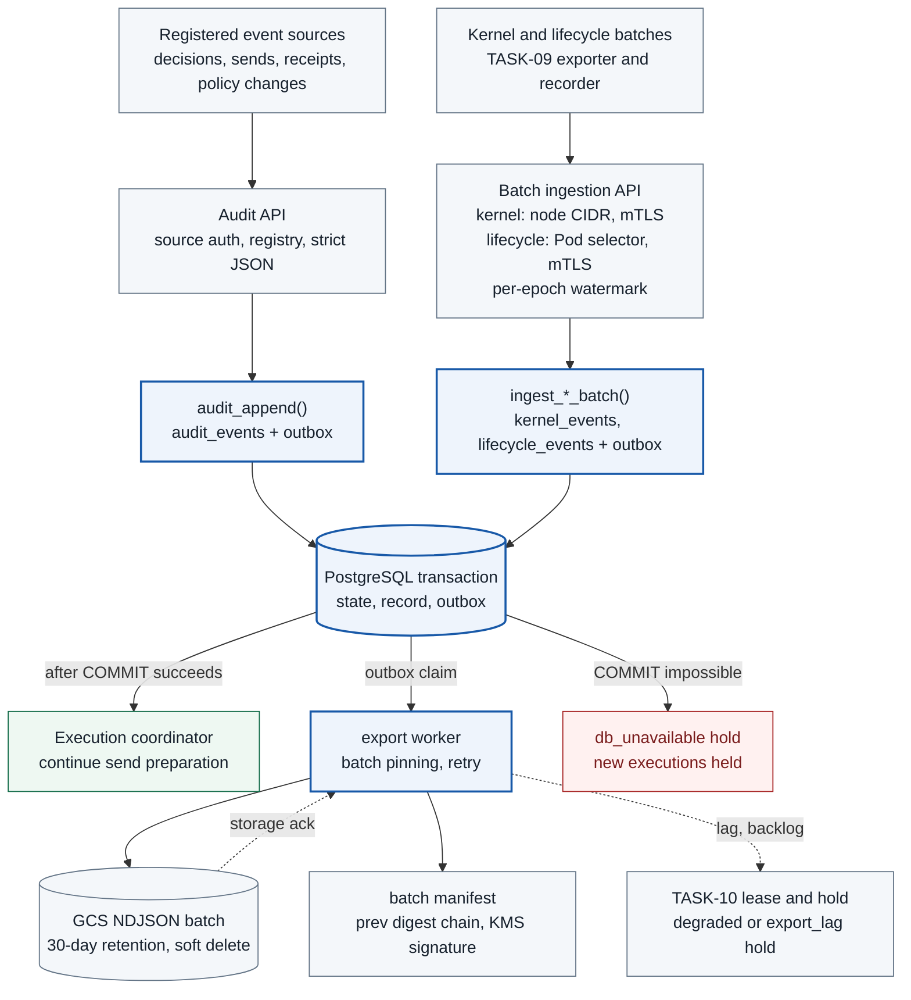

<a id="task-07--e2e-audit-records-and-durable-storage-ref"></a>

# TASK-07 · E2E Audit Records and Durable Storage

> This document is the specification of the features to be implemented. The settings, check items, APIs, storage constraints, and failure handling are the implementation contract, and implementation and deployment have not yet been performed. Values generated in the deployment environment are managed as installation inputs.

## Structure at a Glance

> Target design · implementation, deployment, and functional effect not verified. Solid lines are placement, processing, and calls; dashed lines are references and observation evidence; the text on each arrow distinguishes the meaning.



**How to read:** Records required for execution readiness are committed to the DB before sending. Not every audit event starts a send, and external export continues through the outbox. Business events are stored in `audit_events`, kernel events in `kernel_events`, and lifecycle records in `lifecycle_events`, each separately, and the outbox distinguishes them by `record_kind`. DB storage and the GCS storage ack are different boundaries. Trace sampling is not applied to audit events. When external export falls behind, it is first marked `degraded`, and it becomes a hold only when the lag limit is exceeded.

| Item | Content |
| --- | --- |
| Plan | [Final plan](../plan.md#task-07) |
| Development prerequisites | [TASK-01](TASK-01-gke-platform.md) · [TASK-02](TASK-02-catalog-contracts.md) |
| Integration dependencies (runtime) | [TASK-09](TASK-09-node-sensor.md) kernel/lifecycle producer · [TASK-10](TASK-10-correlation-health.md) lease and hold API, `health.observation_gaps`, consumption of kernel links · registry event producers (TASK-03/04/05/08/10/11/12/13/14). The TASK-01 Q0 harness runs against the prototype ingestion API of this Task, and Q0 is run again after this Task is complete |
| Owner role | Observability and data engineer · owner and due date undecided |
| Common conventions | [Shared Tech Spec](COMMON.md) |
| Baseline | Working tree after efe8dce (revised 2026-10-11) |

## 1. Goals and Scope

The chain approval → decision → send attempt → target/kernel evidence → verification → policy change is stored so that it can be reconstructed even after the Pod is deleted. OTel traces and the required audit logs are separated, and required audit events are not sampled.

This Task is responsible for three things.

1. `POST /internal/audit/events` accepts and stores only events in the [COMMON event_type registry](COMMON.md#event_type-registry).
2. It owns the ingestion and ack of `POST /internal/kernel/events:batch` and `POST /internal/lifecycle/events:batch`. TASK-10 consumes these stored results to perform linking and gap judgment.
3. It exports to GCS and leaves a signed manifest chain.
4. It exports the `decision_inputs` stored by TASK-04 to the dedicated bucket `decision-input-exports` in the operations project in the same way (NDJSON batches and a signed manifest chain). Decision replay in the regression project (TASK-13) reads only this bucket, not the operational DB.

The scope that can be claimed as external evidence goes only as far as "tampering is detectable"; it is not claimed that deletion or tampering by a principal with administrator privileges is prevented.

## 2. Required Environment, Inputs, and Resources

The following resources and inputs are required.

- Cloud SQL for PostgreSQL. The owner of the tables and functions is the `audit_owner` role, which cannot log in.
- An independent GCS evidence bucket (unlocked 30-day retention policy, soft delete) and a summary bucket (90-day retention)
- The decision input export bucket `decision-input-exports` (operations project, unlocked 30-day retention policy, soft delete). The decision-replay SA in the regression project is given only `roles/storage.objectViewer` on this bucket and public key lookup for manifest verification (`cloudkms.cryptoKeyVersions.viewPublicKey`), and no access to the operational DB
- A Cloud KMS asymmetric signing key (`EC_SIGN_P256_SHA256`)
- OTel Collector
- Per-service producer identities, the event_type allow table, and the retention policy

The TASK-02 schema and the AuditEvent, KernelEvent, and LifecycleRecord definitions in COMMON are used. Whether the audit content, retention period, and accessors fit within the personal data scope is reviewed.

**Implementation language and libraries:** All components of this Task are implemented in Go. The following binaries are split within the single `services/audit/` module.

- writer: audit API and kernel/lifecycle batch ingestion
- exporter: outbox exporter and manifest writer
- verifier: manifest verification

The libraries and tools used are as follows.

- The HTTP server uses the standard `net/http`.
- DB access uses `pgx` v5 and query code generated by `sqlc` ([pgx](https://github.com/jackc/pgx), [sqlc](https://github.com/sqlc-dev/sqlc)).
- Schema migrations apply the SQL files in the repository-wide `migrations/` directory with `golang-migrate` ([golang-migrate](https://github.com/golang-migrate/migrate)).
- Normalization, JCS, and hashing use the shared Go package `packages/canonical/`. The JCS implementation candidate is `github.com/cyberphone/json-canonicalization` by the author of RFC 8785. GitHub does not automatically identify this repository's license ("Other"), so the TASK-02 owner checks the license text and the pinned version, and the choice is finalized after it passes the RFC test vectors.
- The versions used are pinned in `deploy/gcp/environment.lock.json` (schema owned by TASK-16).

**KSA, labels, and Cloud SQL connection:** Each KSA of the Pods in this Task has one role. The Pod label `app.kubernetes.io/name` is set equal to the KSA name (COMMON rule). NetworkPolicy selects callers by this label.

| KSA (= label) | Namespace | Cloud SQL DB IAM user → DB role |
| --- | --- | --- |
| `audit-writer` | agent-observe | `audit_writer` (`audit_producer` member) |
| `audit-exporter` | agent-observe | `audit_exporter` |
| `audit-verifier` | agent-observe | `audit_verifier` (SELECT only on the tables and columns needed for export verification) |

All three Pods run the Cloud SQL Auth Proxy as a native sidecar (`restartPolicy: Always` in `initContainers`). Metadata server egress is allowed, each GSA is given `roles/cloudsql.client` and `roles/cloudsql.instanceUser`, and each Pod connects as an IAM DB authentication user. The IAM token path of the Auth Proxy and the NetworkPolicy behavior are Q0 verification items.

The Cloud SQL retention job runs with the KSA `audit-retention` (agent-observe), which is different from the three KSAs above. The IAM DB user of this KSA is granted only the `audit_retention` role, and service KSAs do not have this role. The retention job connects only to Cloud SQL and does not call internal APIs, so it does not obtain a service certificate. The execution form (CronJob schedule and so on) is left as a follow-up task. When it runs as a CronJob, it uses `concurrencyPolicy: Forbid`, disables automatic ServiceAccount token mounting, and has a bounded `batch_limit`. Until the time basis of the retention job and the verifier is decided in [3.2.1](#321-confirmed-export-items), `audit_retention` is not granted to this KSA's login.

**Export account IAM:** The export account is given only the permissions below. It has no delete or overwrite permission.

- A custom role (`storage.objects.create`, `storage.objects.get`)
- `cloudkms.cryptoKeyVersions.useToSign` on the KMS signing key

The verifier account has only object read and `cloudkms.cryptoKeyVersions.viewPublicKey` ([Cloud KMS create and validate signatures](https://docs.cloud.google.com/kms/docs/create-validate-signatures)).

## 3. Technical Implementation Design

1. Commit the audit event, action/reservation state change, and outbox within the same DB transaction. Append audit events and outbox only via the SECURITY DEFINER function `audit_append()`. Do not initiate actual transmission before this commit succeeds. A DB transaction cannot include remote side effects within the same transaction.
2. Deduplicate using `event_id` unique and source identity/epoch/sequence. If a different payload arrives with the same ID, do not overwrite it and record it as an `EVENT_ID_CONFLICT` incident. The producer role has only function EXECUTE privileges, and the exporter updates only the delivery status column of the outbox.
3. Store kernel events and lifecycle records in dedicated tables `kernel_events` and `lifecycle_events`, respectively. Do not re-insert the same facts into `audit_events`. The event types for the two tables are `kernel_event_observed` and `lifecycle_recorded` in the registry.
4. An authenticated worker claims the outbox, fixes batch members in the DB first, and then exports them as an NDJSON batch object. Change to completed only after receiving external storage ack. Retransmitting after an interruption reuses the same batch_id and object key, so duplicates are filtered out by the GCS generation precondition.
5. GCS objects are only newly created using generation preconditions. Maintain an unlocked 30-day retention policy and soft delete on the bucket. For each export batch, leave a manifest chained with `prev_manifest_digest` and signed with Cloud KMS. DB admin, GCP project admin, and KMS key admin privileges remain trust boundaries. Bucket Lock is an irreversible separate operational decision and is not activated by the creation of this document.
6. OTel trace_id is for exploratory linking and is not proof of authorization. Distinguish between the Collector persistent queue and the actual storage ack.
7. Report per-source registered version, sequence gap, collector lag, and export ack to TASK-10 via `POST /internal/control-health/leases`. Inability to DB COMMIT is a hold, external export delay is `degraded`, and exceeding the lag limit requests an `export_lag` hold.
### 3.1 Audit schema and outbox implementation

**Identifier and digest rules:**

| Item | Rule |
| --- | --- |
| Business `source_epoch` | Producer epoch that increments each time a producer process starts. Distinguishes from previous executions even if the sequence restarts from 1 after a restart |
| Kernel/lifecycle `source_epoch` | Distinguishes exporter instance and node boot as defined in COMMON |
| `source_sequence` | Starts from 1 for each epoch and increments by 1. 0 is used only as a watermark value indicating "none yet" |
| `payload_digest`(AuditEvent) | SHA-256 of the JCS-serialized bytes of all remaining fields after excluding `payload_digest` and `received_at` from the AuditEvent sent by the producer. If different when recalculated by the server, 422 `SCHEMA_INVALID` |
| `source_event_id`(KernelEvent) | UUIDv5(`NS_AGENTARIUM_KERNEL`, `"<sensor_id>/<source_epoch>/<source_sequence>"`). The namespace UUID is a `packages/canonical/` constant |
| `lifecycle_event_id` | UUIDv5(`NS_AGENTARIUM_LIFECYCLE`, `"<source_id>/<source_epoch>/<source_sequence>"`) |
| `record_digest`(Kernel/lifecycle) | SHA-256 of the JCS-serialized bytes of all remaining record fields after excluding `record_digest` itself and the server-only `received_at`. The wire value is a 64-character lowercase hex string and is recalculated by the server |

The server recalculates and verifies the above IDs and digests. The event ID is retained even if retransmitted by the producer, and the server determines the source from the mTLS identity. `received_at` is determined inside the function using the server time (`statement_timestamp()`), so callers cannot specify it. If the `received_at` key is present in a KernelEvent or LifecycleRecord request, it is rejected as `SCHEMA_INVALID`, including when null. The stored and queried results include the value determined by the server, and `record_digest` does not change even after adding this value. `source_time` is the observation time claimed by the producer and is preserved as is.

**Strict JSON parsing:** Go `encoding/json` v1 allows JSON objects with duplicate names ([encoding/json](https://pkg.go.dev/encoding/json)). Therefore, the audit API and batch API parse the body in two phases.

1. Tokens are read to the end with `json.Decoder.Token()` while validating the following limits:
   - There must be no duplicate keys.
   - Depth of 16 or less, 256 or fewer object keys, 1,000 or fewer array elements
   - Strings of 16KiB or less
   - Numbers must be integers only. Decimal points and exponential notation are rejected. All JSON numbers including sequence must be within the range of ±(2^53−1) per the strict number parsing of TASK-02 3.1 and the shared `packages/canonical/digest.go` contract. The DB's bigint storage type does not expand the wire numeric range.
2. Only bodies that pass are decoded into structs with a Decoder having `DisallowUnknownFields` and `UseNumber` enabled.

The upper limit for the total body size is COMMON's 1MiB. Violations result in 422 `SCHEMA_INVALID` (size violations result in 413 `BODY_TOO_LARGE`), and nothing is stored.

**Preventing source impersonation by direct DB producers:** There are producers that directly call `audit_append()` within a DB transaction, such as the TASK-03 coordinator. Inside a SECURITY DEFINER function, `current_user` switches to the function owner, but `session_user` remains the connected login role. The function checks whether the `source_id` registered for `session_user` in `db_role_sources` matches the event's `source_id`. `audit_writer` of the audit API is the only role that records on behalf of a source verified via mTLS and is registered with `proxy = true`.

The DDL below is the target state after applying the required new migrations. It does not modify merged `audit_store`. Before enabling receiver atomic audit, a new TASK-07 migration must install the nonempty `source_id` CHECK on proxy, NOT NULL on `abandoned_ranges.sequence_event_id` and `gap_event_id`, and the TASK-07 `producer_task` and required `source_id` and `stream` on the `event_types` row where `event_type = sequence_range_abandoned`. Existing proxy sources are configured with real values by the installer, and audit IDs of existing abandoned rows are not backfilled without a separate migration plan that preserves provenance with real events. Arbitrary sources, UUIDs, or past events must not be created to satisfy constraints; if there is no basis, the migration must be aborted.

```sql
CREATE SCHEMA audit;  -- Owner: audit_owner (NOLOGIN)

CREATE TABLE audit.event_types (            -- Loads COMMON event_type registry via migration
  event_type text PRIMARY KEY,
  producer_task text NOT NULL,
  storage_table text NOT NULL CHECK (storage_table IN ('audit_events','kernel_events','lifecycle_events')),
  source_class text NOT NULL CHECK (source_class IN ('business','kernel','lifecycle')),
  required_payload_fields jsonb NOT NULL
);
CREATE TABLE audit.db_role_sources (         -- session_user → allowed source
  db_role name PRIMARY KEY,
  source_id text,                            -- Required for all rows; proxy cannot be empty either
  proxy boolean NOT NULL DEFAULT false,      -- true only for audit_writer
  CHECK (source_id IS NOT NULL AND (NOT proxy OR source_id <> ''))
);
CREATE TABLE audit.producer_event_grants (   -- event_type and tenant that source can record
  source_id text NOT NULL,
  event_type text NOT NULL REFERENCES audit.event_types(event_type),
  tenant text NOT NULL,                      -- '*' means tenant-independent (kernel and lifecycle)
  PRIMARY KEY (source_id, event_type, tenant)
);

CREATE TABLE audit.audit_events (
  event_id uuid PRIMARY KEY,
  event_type text NOT NULL REFERENCES audit.event_types(event_type),
  tenant text NOT NULL,
  source_id text NOT NULL,
  source_version text NOT NULL,
  source_epoch text NOT NULL,
  source_sequence bigint CHECK (source_sequence >= 1),
  source_time timestamptz NOT NULL,
  received_at timestamptz NOT NULL,
  schema_version integer NOT NULL CHECK (schema_version = 1),
  authenticated_actor text,
  workload_id text,
  session_id uuid,
  action_id uuid,
  request_id uuid,
  attempt_id uuid,
  policy_bundle_id text,
  policy_epoch bigint,
  catalog_digest char(64),
  catalog_version text,
  payload_digest char(64) NOT NULL,
  evidence_refs jsonb NOT NULL DEFAULT '[]'::jsonb,
  safe_payload jsonb NOT NULL
);
CREATE UNIQUE INDEX audit_events_source_seq
  ON audit.audit_events (source_id, source_epoch, source_sequence) WHERE source_sequence IS NOT NULL;
CREATE INDEX audit_events_action ON audit.audit_events (action_id, received_at);
CREATE INDEX audit_events_feed ON audit.audit_events (event_type, received_at, event_id);

CREATE TABLE audit.kernel_events (           -- COMMON KernelEvent. INSERT-only
  source_event_id uuid PRIMARY KEY,
  source_id text NOT NULL,                   -- exporter mTLS identity
  sensor_id text NOT NULL,
  source_epoch text NOT NULL,
  source_sequence bigint NOT NULL CHECK (source_sequence >= 1),
  exporter_instance_id text NOT NULL,
  sensor_generation bigint NOT NULL,
  node_uid uuid NOT NULL,
  boot_id text NOT NULL,
  source_time timestamptz NOT NULL,
  spooled_at timestamptz NOT NULL,
  received_at timestamptz NOT NULL,
  event_type text NOT NULL,                  -- process_exec, process_exit, tcp_connect, tcp_state, file_open, openat
  process_exec_id text,                      -- tcp_state allows null, required for other process context events
  parent_exec_id text,
  process_start timestamptz,
  host_pid integer CHECK (host_pid > 0),   -- Required for process_exec session worker witness cross-check
  container_id text,
  docker_id_prefix text,
  pod_uid uuid,
  netns_inode bigint,
  saddr inet, sport integer, daddr inet, dport integer,   -- socket_tuple. Only when observed
  sock_ptr char(16) CHECK (sock_ptr ~ '^[0-9a-f]{16}$'), -- Hex string of unsigned 64-bit pointer. Secondary key
  tcp_new_state smallint,                    -- Required for tcp_state. TASK-09's ESTABLISHED(1) and CLOSE(7)
  lifecycle_record_id uuid,
  metadata_status text NOT NULL,
  normalization_version text NOT NULL,
  upstream_event_ref text,
  rule_hash char(64) NOT NULL,
  coverage text NOT NULL,
  safe_attributes jsonb NOT NULL,
  record_digest char(64) NOT NULL,
  CHECK (event_type = 'tcp_state' OR process_exec_id IS NOT NULL),
  CHECK (event_type <> 'tcp_state' OR tcp_new_state IS NOT NULL),
  UNIQUE (source_id, source_epoch, source_sequence)
);
CREATE INDEX kernel_events_tuple
  ON audit.kernel_events (netns_inode, saddr, sport, daddr, dport, source_time)
  WHERE saddr IS NOT NULL;
CREATE INDEX kernel_events_container ON audit.kernel_events (container_id, source_time);
CREATE INDEX kernel_events_exec ON audit.kernel_events (process_exec_id);
CREATE INDEX kernel_events_sock ON audit.kernel_events (node_uid, boot_id, sock_ptr, source_time)
  WHERE sock_ptr IS NOT NULL;

CREATE TABLE audit.lifecycle_events (        -- COMMON LifecycleRecord. INSERT-only
  lifecycle_event_id uuid PRIMARY KEY,
  source_id text NOT NULL,
  source_kind text NOT NULL CHECK (source_kind IN ('runtime','pod_watcher')),
  source_epoch text NOT NULL,
  source_sequence bigint NOT NULL CHECK (source_sequence >= 1),
  cluster_uid uuid NOT NULL,
  pod_uid uuid NOT NULL,
  namespace text NOT NULL,
  pod_name text NOT NULL,
  node_uid uuid,
  boot_id text,
  container_id text,
  cgroups_path text,
  cgroup_inode bigint,
  container_name text,
  restart_instance integer,
  image_id text,
  image_manifest_digest text,
  transition text NOT NULL,
  source_time timestamptz,
  received_at timestamptz NOT NULL,
  resource_version text,
  mapping_version integer NOT NULL,
  evidence_refs jsonb NOT NULL DEFAULT '[]'::jsonb,
  missing_reason text,
  record_digest char(64) NOT NULL,
  UNIQUE (source_id, source_epoch, source_sequence)
);
CREATE INDEX lifecycle_events_pod ON audit.lifecycle_events (pod_uid, received_at);
CREATE INDEX lifecycle_events_container ON audit.lifecycle_events (container_id);

CREATE TABLE audit.ingest_watermarks (       -- Contiguous ack points per epoch
  source_id text NOT NULL,
  stream text NOT NULL CHECK (stream IN ('kernel','lifecycle')),
  source_epoch text NOT NULL,
  node_uid uuid,                            -- Immutable provenance of runtime epoch
  boot_id text,                             -- Original boot of runtime, preserved even during historical replay
  watch_scope text,                         -- Immutable scope of watcher epoch
  acked_through bigint NOT NULL DEFAULT 0,   -- 1..acked_through are all stored or abandoned
  max_seen bigint NOT NULL DEFAULT 0,
  updated_at timestamptz NOT NULL,
  PRIMARY KEY (source_id, stream, source_epoch)
);
CREATE TABLE audit.abandoned_ranges (        -- sequence_range_abandoned receipt records
  source_id text NOT NULL,
  stream text NOT NULL,
  source_epoch text NOT NULL,
  from_seq bigint NOT NULL,
  to_seq bigint NOT NULL CHECK (to_seq >= from_seq),
  reason text NOT NULL,
  range_digest char(64) NOT NULL,
  gap_id uuid NOT NULL,                      -- health.observation_gaps(TASK-10)
  sequence_event_id uuid NOT NULL,           -- Receiver sequence_range_abandoned audit ID
  gap_event_id uuid NOT NULL,                -- Receiver observation_gap_recorded audit ID
  received_at timestamptz NOT NULL,
  PRIMARY KEY (source_id, stream, source_epoch, from_seq)
);
CREATE TABLE audit.watch_checkpoints (       -- Committed cursor of Pod watcher
  source_id text NOT NULL,
  scope text NOT NULL,                       -- e.g., namespace/agent-exec
  resource_version text NOT NULL,            -- opaque
  lifecycle_event_id uuid REFERENCES audit.lifecycle_events(lifecycle_event_id), -- NULL for cursor-only
  checkpoint_revision bigint NOT NULL CHECK (checkpoint_revision BETWEEN 1 AND 9007199254740991),
  last_batch_id uuid NOT NULL,
  last_batch_digest char(64) NOT NULL,
  committed_at timestamptz NOT NULL,
  PRIMARY KEY (source_id, scope)
);

CREATE TABLE audit.audit_outbox (
  record_kind text NOT NULL CHECK (record_kind IN ('audit_event','kernel_event','lifecycle_event','decision_input')),
  record_id text NOT NULL,                   -- uuid string or decision_input_digest
  destination text NOT NULL CHECK (destination IN ('gcs','gcs_decision_inputs')),
  source_class text NOT NULL CHECK (source_class IN ('business','kernel','lifecycle','decision_input')),
  record_bytes integer NOT NULL CHECK (record_bytes > 0),   -- For calculating backlog size limits
  state text NOT NULL CHECK (state IN ('pending','claimed','acked')),
  attempts integer NOT NULL DEFAULT 0,
  lease_until timestamptz,
  next_retry_at timestamptz NOT NULL DEFAULT statement_timestamp(),
  ack_ref text,
  enqueued_at timestamptz NOT NULL DEFAULT statement_timestamp(),
  PRIMARY KEY (record_kind, record_id, destination),
  CHECK ((destination = 'gcs_decision_inputs') = (record_kind = 'decision_input'))
);
CREATE INDEX audit_outbox_pending ON audit.audit_outbox (source_class, state, next_retry_at);

CREATE TABLE audit.export_batches (          -- GCS only. Freezes members before upload
  batch_id uuid PRIMARY KEY,
  destination text NOT NULL CHECK (destination IN ('gcs','gcs_decision_inputs')),
  source_class text NOT NULL,
  object_key text NOT NULL,
  UNIQUE (destination, object_key),
  created_at timestamptz NOT NULL DEFAULT statement_timestamp()
);
CREATE TABLE audit.export_batch_members (
  batch_id uuid NOT NULL REFERENCES audit.export_batches(batch_id),
  ordinal integer NOT NULL,
  record_kind text NOT NULL,
  record_id text NOT NULL,
  destination text NOT NULL CHECK (destination IN ('gcs','gcs_decision_inputs')),
  PRIMARY KEY (batch_id, ordinal),
  UNIQUE (record_kind, record_id, destination),   -- A single record belongs to only one batch
  FOREIGN KEY (record_kind, record_id, destination)
    REFERENCES audit.audit_outbox(record_kind, record_id, destination)
);
CREATE TABLE audit.manifest_intents (        -- Freezes manifest order before signing. One chain per bucket
  chain_id text NOT NULL CHECK (chain_id IN ('gcs','gcs_decision_inputs')),
  manifest_seq bigint NOT NULL CHECK (manifest_seq >= 1),
  batch_id uuid NOT NULL UNIQUE REFERENCES audit.export_batches(batch_id),
  PRIMARY KEY (chain_id, manifest_seq),
  created_at timestamptz NOT NULL DEFAULT statement_timestamp()
);
CREATE TABLE audit.export_manifests (
  chain_id text NOT NULL,
  manifest_seq bigint NOT NULL,
  PRIMARY KEY (chain_id, manifest_seq),
  FOREIGN KEY (chain_id, manifest_seq) REFERENCES audit.manifest_intents(chain_id, manifest_seq),
  object_generation bigint NOT NULL,
  batch_digest char(64) NOT NULL,
  prev_manifest_digest char(64),             -- null only for the first manifest
  manifest_digest char(64) NOT NULL,
  kms_key_version text NOT NULL,
  signature bytea NOT NULL,
  manifest_object_key text NOT NULL,
  created_at timestamptz NOT NULL DEFAULT statement_timestamp(),
  UNIQUE (chain_id, manifest_object_key)
);
CREATE TABLE audit.chain_anchors (           -- Chain verification anchor point after 30-day expiration
  chain_id text NOT NULL,
  anchor_date date NOT NULL,
  manifest_seq bigint NOT NULL,
  PRIMARY KEY (chain_id, anchor_date),
  FOREIGN KEY (chain_id, manifest_seq) REFERENCES audit.export_manifests(chain_id, manifest_seq),
  manifest_digest char(64) NOT NULL,
  anchor_object_key text NOT NULL UNIQUE     -- Stored in summary bucket (90 days)
);
CREATE TABLE audit.event_conflicts (         -- Recorded only via audit_record_conflict(). See §3.1/§3.3 for transaction boundaries
  conflict_id uuid PRIMARY KEY,
  record_kind text NOT NULL,
  record_id text NOT NULL,
  existing_digest char(64) NOT NULL,
  rejected_digest char(64) NOT NULL,
  source_id text NOT NULL,
  detected_at timestamptz NOT NULL
);
```
**Function:** The function body is a skeleton showing implementation criteria, and column lists are populated in the order of the table above.

```sql
CREATE FUNCTION audit.audit_append(e jsonb, outbox_destinations text[])
RETURNS text                                 -- 'created' | 'duplicate' | 'conflict'
LANGUAGE plpgsql SECURITY DEFINER
SET search_path = audit, pg_temp
AS $$
DECLARE existing char(64); cls text; tbl text; allowed record;
BEGIN
  SELECT * INTO allowed FROM db_role_sources WHERE db_role = session_user;
  IF NOT FOUND OR (NOT allowed.proxy AND allowed.source_id <> e->>'source_id') THEN
    RAISE EXCEPTION 'source not allowed for %', session_user USING ERRCODE = '42501';
  END IF;
  SELECT source_class, storage_table INTO cls, tbl FROM event_types WHERE event_type = e->>'event_type';
  IF NOT FOUND OR tbl <> 'audit_events' THEN
    RAISE EXCEPTION 'event_type not accepted here' USING ERRCODE = '22023';
  END IF;
  -- producer_event_grants·required_payload_fields·payload_digest recalculation check
  INSERT INTO audit_events (/* AuditEvent columns */ received_at)
  VALUES (/* values of e */ statement_timestamp())
  ON CONFLICT (event_id) DO NOTHING;
  IF FOUND THEN
    INSERT INTO audit_outbox (record_kind, record_id, destination, source_class, record_bytes, state)
    SELECT 'audit_event', e->>'event_id', d, cls, octet_length(e::text), 'pending'
    FROM unnest(outbox_destinations) AS d;
    RETURN 'created';
  END IF;
  SELECT payload_digest INTO existing FROM audit_events WHERE event_id = (e->>'event_id')::uuid;
  RETURN CASE WHEN existing = e->>'payload_digest' THEN 'duplicate' ELSE 'conflict' END;
END $$;

CREATE FUNCTION audit.audit_record_conflict(record_kind text, record_id text,
                                            rejected_digest char(64), source_id text)
RETURNS uuid LANGUAGE plpgsql SECURITY DEFINER SET search_path = audit, pg_temp
AS $$ /* Query existing digest, INSERT into event_conflicts, return conflict_id */ $$;

CREATE FUNCTION audit.enqueue_decision_input(decision_input_digest char(64), record_bytes integer)
RETURNS void LANGUAGE plpgsql SECURITY DEFINER SET search_path = audit, pg_temp
AS $$ /* Called within gateway's decision transaction. Add outbox(record_kind=decision_input,
         destination=gcs_decision_inputs) row with ON CONFLICT DO NOTHING */ $$;
ALTER FUNCTION audit.enqueue_decision_input(char, integer) OWNER TO audit_owner;
GRANT EXECUTE ON FUNCTION audit.enqueue_decision_input(char, integer) TO gateway_writer;  -- TASK-04 role

-- kernel uses the same 6-argument trusted parameters as lifecycle runtime (COMMON Kernel source authentication and epoch).
-- 2-argument signature is not installed.
CREATE FUNCTION audit.ingest_kernel_batch(
  source_id text, batch jsonb, certificate_serial text, exact_san text,
  writer_version text, writer_epoch text
) RETURNS jsonb
  LANGUAGE plpgsql SECURITY DEFINER SET search_path = pg_catalog, audit, health, identity, pg_temp
  AS $$ /* 3.3 source/cert/current boot/epoch re-verification + storage. No scope/cursor. Fully qualified object names */ $$;
CREATE FUNCTION audit.ingest_lifecycle_batch(
  source_id text, batch jsonb, certificate_serial text, exact_san text,
  writer_version text, writer_epoch text
) RETURNS jsonb
  LANGUAGE plpgsql SECURITY DEFINER SET search_path = pg_catalog, audit, health, identity, pg_temp
  AS $$ /* 3.3 source/cert/epoch re-verification + storage + watch_checkpoints update. Fully qualified object names */ $$;

CREATE FUNCTION audit.lifecycle_checkpoint(source_id text, requested_scope text)
RETURNS TABLE(scope text, resource_version text, committed_at timestamptz, checkpoint_revision bigint)
LANGUAGE plpgsql SECURITY DEFINER SET search_path = pg_catalog, audit, pg_temp
AS $$ /* Verify proxy registration/writer membership. Return only one row of verified source/scope */ $$;
ALTER FUNCTION audit.lifecycle_checkpoint(text, text) OWNER TO audit_owner;

ALTER FUNCTION audit.audit_append(jsonb, text[]) OWNER TO audit_owner;
ALTER FUNCTION audit.audit_record_conflict(text, text, char, text) OWNER TO audit_owner;
ALTER FUNCTION audit.ingest_kernel_batch(text, jsonb, text, text, text, text) OWNER TO audit_owner;
ALTER FUNCTION audit.ingest_lifecycle_batch(text, jsonb, text, text, text, text) OWNER TO audit_owner;

REVOKE ALL ON ALL TABLES IN SCHEMA audit FROM PUBLIC;
REVOKE ALL ON ALL FUNCTIONS IN SCHEMA audit FROM PUBLIC;
CREATE ROLE audit_producer NOLOGIN;          -- audit_writer, coordinator roles, etc. are members
GRANT USAGE ON SCHEMA audit TO audit_producer, audit_exporter, correlation_reader;
GRANT EXECUTE ON FUNCTION audit.audit_append(jsonb, text[]),
                          audit.audit_record_conflict(text, text, char, text) TO audit_producer;
GRANT audit_producer TO health_owner;     -- append inside TASK-10 health.record_drift(SECURITY DEFINER). Not granted to caller drift_reporter
GRANT EXECUTE ON FUNCTION audit.lifecycle_checkpoint(text, text) TO audit_writer;
GRANT EXECUTE ON FUNCTION audit.ingest_lifecycle_batch(text, jsonb, text, text, text, text) TO audit_writer;
GRANT EXECUTE ON FUNCTION audit.ingest_kernel_batch(text, jsonb, text, text, text, text) TO audit_writer;
GRANT SELECT ON audit.audit_events, audit.kernel_events, audit.lifecycle_events TO audit_exporter;
GRANT SELECT ON decisions.decision_inputs TO audit_exporter;   -- TASK-04 table. schema name follows TASK-04 definition
GRANT SELECT ON audit.audit_outbox TO audit_exporter;
GRANT UPDATE (state, attempts, lease_until, next_retry_at, ack_ref) ON audit.audit_outbox TO audit_exporter;
GRANT SELECT, INSERT ON audit.export_batches, audit.export_batch_members,
  audit.manifest_intents, audit.export_manifests, audit.chain_anchors TO audit_exporter;
GRANT SELECT ON audit.kernel_events, audit.lifecycle_events, audit.abandoned_ranges TO correlation_reader;
GRANT USAGE ON SCHEMA audit TO control_health_writer, health_owner;
GRANT SELECT ON audit.kernel_events TO control_health_writer; -- Cross-check worker witness original exec/COMMIT
-- TASK-10 answer probe evidence lookup. Returns only required columns without table SELECT.
-- audit.probe_evidence_events(node_uid uuid, boot_id text, container_ids text[],
--   from_time timestamptz, to_time timestamptz)
--   RETURNS TABLE(source_event_id uuid, event_type text, source_time timestamptz, saddr inet,
--     sport integer, daddr inet, dport integer, tcp_new_state smallint, return_value bigint)
--   Owned by audit_owner, SECURITY DEFINER, STABLE, search_path = pg_catalog, audit, pg_temp.
--   Returns only process_exec·process_exit·tcp_connect·file_open·openat of specified containers and
--   tcp_state of the same node·boot with the same tuple as that connect. Time window 30 seconds · 16 or fewer containers.
REVOKE ALL ON FUNCTION audit.probe_evidence_events(uuid, text, text[], timestamptz, timestamptz) FROM PUBLIC;
GRANT EXECUTE ON FUNCTION audit.probe_evidence_events(uuid, text, text[], timestamptz, timestamptz) TO control_health_writer;
GRANT REFERENCES ON audit.kernel_events TO health_owner;      -- TASK-10 binding/attribution FK
-- The health permissions below are installed not by TASK-07, but by a new migration owned by TASK-10.
-- It is not a grant already in main and is a prerequisite for activating lifecycle ingest.
GRANT USAGE ON SCHEMA health TO audit_owner;
GRANT INSERT (gap_id, stage, reason, node_uid, boot_id, source_id, source_epoch,
  sequence_from, sequence_to, range_digest, start_at, end_at, affected_workloads,
  loss_count, count_quality, evidence_refs, recovery_state, created_by)
  ON health.observation_gaps TO audit_owner;   -- Record abandoned range gaps (TASK-10 table)

CREATE VIEW audit.collector_feed WITH (security_barrier) AS   -- TASK-08 evidence collector input
  SELECT event_id, event_type, tenant, action_id, attempt_id, source_time, received_at, safe_payload
  FROM audit.audit_events
  WHERE event_type IN ('preflight_passed','dispatch_started','response_received',
                       'attempt_uncertain','attempt_failed');
GRANT USAGE ON SCHEMA audit TO evidence_collector;
GRANT SELECT ON audit.collector_feed TO evidence_collector;
```

The design rationale is PostgreSQL privilege rules. All forms of `ON CONFLICT` require SELECT privilege on the conflict target columns. Therefore, if only INSERT privilege is granted to the producer, 201/200/409 determination cannot be made, and the determination is performed inside a function executed with owner privileges ([PostgreSQL INSERT](https://www.postgresql.org/docs/17/sql-insert.html)). The function fixes `search_path` to prevent search path hijacking ([Writing SECURITY DEFINER Functions Safely](https://www.postgresql.org/docs/17/sql-createfunction.html#SQL-CREATEFUNCTION-SECURITY)). The two-argument signature `audit_append(event, outbox_destinations)` of COMMON is used as is, and the source class is determined from `event_types.source_class` in the registry.

**Conflict Handling:** If the function returns `conflict`, the caller rolls back the business transaction. Afterward, it calls `audit_record_conflict()` in a separate transaction to record an incident and returns 409 `EVENT_ID_CONFLICT`. This is to prevent the conflict record from disappearing along with the business rollback. The TASK-05 adapter uses a per-event append transaction that is separate from the business state. When replaying the same logical event ID internally within the producer, if a conflict occurs due to a change in source epoch/timestamp, it rolls back the append transaction, confirms the commit of the separate incident transaction, and then treats the existing event as recorded. It does not overwrite the existing event nor acknowledge that the new payload is identical. This internal replay processing is distinguished from the 409 response rule of external `POST /internal/audit/events`, and incident save failure is not treated as success.

**Exporter and Querying:** `audit_exporter` claims rows using `FOR UPDATE SKIP LOCKED`. PostgreSQL requires UPDATE privilege on one or more columns of the corresponding table for this lock, and this condition is satisfied with column-level UPDATE privileges. Query roles are granted only tenant-filtered views, and base table queries are not opened. Raw secrets and Authorization are not put into `safe_payload`.

**Required Event List:** The list of required events is not kept separately in this document, and the COMMON registry is used as is. The minimum expected events by state also follow the COMMON table, and E2E evidence completeness calculation is performed by TASK-13. OTel span export success is not used as success of required audit storage.
### 3.2 Export worker and failure limits

Export proceeds in this order: first fix the batch members, then upload, then record the ack.

1. **Claim and fix the batch (transaction 1):**
   - Per source class, the worker locks up to 100 rows with `FOR UPDATE SKIP LOCKED` that are `state = 'pending'` or `claimed` with an expired lease.
   - If a locked row already belongs to a batch, it locks all members of that batch together and reuses the same batch. If another worker holds a lock on some of the members, that batch is skipped in this claim. Therefore a batch is always uploaded only as a whole.
   - Rows that do not belong to a batch are fixed as a new batch in `export_batches` and `export_batch_members`.
   - It sets a 30-second lease and commits.
2. **Upload (outside the transaction):**
   - It reads the batch members in ordinal order and builds an NDJSON object. Each line is `{"record_kind", "event_type", "record"}`, and `record` is the JCS-serialized value.
   - The batch digest is the SHA-256 of all bytes of the NDJSON object.
   - The object key is `<h4>/<source_class>/<yyyy-mm-dd>/<batch_id>.ndjson`, where `h4` is the first 4 hex characters of `sha256(batch_id)`. Sequential names slow down GCS auto-scaling, so a hash prefix is added ([GCS request rate](https://docs.cloud.google.com/storage/docs/request-rate)).
   - The create request is sent with `ifGenerationMatch=0`. On a 412, it reads and compares the existing object's digest, and treats it as an ack if they are equal. If they differ, it records an incident and does not ack, so that it leads to a lag alert.
3. **Manifest:** The manifest writer is a single executor elected with the PostgreSQL lease and fencing token in [3.2.1](#321-confirmed-export-items).
   - It first commits `manifest_intents(manifest_seq, batch_id)` to fix the order.
   - It builds the manifest body. The body is `{manifest_seq, batch_id, object_key, object_generation, batch_digest, record_count, outbox_range {first_outbox_id, last_outbox_id}, sources[] {source_id, source_epoch, first_sequence, last_sequence}, prev_manifest_digest, created_at}`, and the SHA-256 of its JCS-serialized bytes is `manifest_digest`.
   - It signs that digest with Cloud KMS `asymmetricSign` (`EC_SIGN_P256_SHA256`, [Cloud KMS algorithms](https://docs.cloud.google.com/kms/docs/algorithms)).
   - It uploads `{manifest, signature_b64, kms_key_version}` to `manifests/<manifest_seq>.json` with `ifGenerationMatch=0`, and then commits the `export_manifests` row.
   - Because manifests are built per acked batch rather than per time interval, nothing is missed even if the commit order is reversed.
4. **Ack (transaction 2):** It changes the outbox rows of all batch members to `acked` at once and stores `ack_ref = <object_key>#<generation>`.

Retries use intervals of 1, 2, 4, 8, 16, and 30 seconds, and then retry every 30 seconds. Records are not dropped or silently excluded into a dead-letter.

**Decision input export:** Inside the decision transaction, the TASK-04 gateway writes a `decision_inputs` row and then calls `audit.enqueue_decision_input()`. This function adds an outbox row with `record_kind = decision_input` and `destination = gcs_decision_inputs`. Subsequent processing is the same as steps 1–4 above, with the following differences.

- **Target bucket and key:** Uploaded to the `decision-input-exports` bucket of the production project as `<h4>/decision_input/<yyyy-mm-dd>/<batch_id>.ndjson`. Each NDJSON line has the same five fields as the `decision_inputs` row in COMMON and TASK-04 (`decision_input_digest`, `tenant`, `sanitized_input`, `policy_bundle_id`, `created_at`). `tenant` preserves the string value of the stored row as is, and is not omitted or inferred from another field. TASK-04 never puts secrets or raw content in from the start.
- **Manifest chain:** Manifests are accumulated separately in `manifests/<manifest_seq>.json` of this bucket (`chain_id = gcs_decision_inputs`). They are signed with the same KMS key. Daily anchors are excluded from the MVP scope ([3.2.1](#321-confirmed-export-items)).
- **Reads from the regression project:** The decision-replay SA of the regression project can only read this bucket and look up the public key. The manifest chain and signatures must be verified before replay (TASK-13), and batches that cannot be verified are removed from the replay input. The TASK-13 replay verifier must also accept the 10-field manifest body of [3.2.1](#321-confirmed-export-items) (including `outbox_range`), and this format change is follow-up work for TASK-13. The replay verifier does not read the production DB, so it does not compare `outbox_range` against the DB and checks only signatures, the chain, record counts, and digests.
- **Health status:** Decision input export delay is unrelated to execution control, so it is reported only as `degraded` and no hold is placed.

**Retention per store:** For each store that keeps audit records, the retention period, deleting actor, lock state, and tests are as follows. Bucket Lock (an irreversible lock) is a separate operational decision, so every retention policy starts unlocked.

| Store | Retention period | Deleting actor | Lock | Test (chapter 7) |
| --- | --- | --- | --- | --- |
| evidence bucket | 30-day retention, lifecycle deletion at `age >= 31` | Lifecycle rule | Not locked | Deletion and replacement within 30 days are rejected |
| Summary bucket (including `chain_anchors`) | 90-day retention | Operations role (only objects past the retention period) | Not locked | Deletion and replacement within 90 days are rejected |
| `decision-input-exports` bucket | 30-day retention, soft delete | Operations role (only objects past the retention period) | Not locked | Deletion and replacement within 30 days are rejected |
| Cloud SQL original audit rows | 30 days | The retention job of the `audit_retention` role ([3.2.1](#321-confirmed-export-items)). Service KSAs have no DELETE permission | Not applicable | DELETE by a service KSA is rejected, and the retention job does not delete rows within the period |
| Cloud SQL refined summary rows | 90 days | When a summary table is created, its retention job is defined together with it. TASK-07 currently has no summary table, and `purge_expired_records` handles only original rows. TASK-04 defines the retention of `decisions.decision_inputs` | Not applicable | Defined when a summary table is added |
| Cloud Logging (`_Default` log bucket, including `policy-action`) | 30 days (Cloud Logging default) | Automatic expiry by Cloud Logging | Not locked | The log bucket retention setting is 30 days |

**Retention and tamper detection:** The GCS settings and verification procedure are as follows.

- **Retention policy:** The evidence bucket has an unlocked 30-day retention policy. Deleting or replacing an object within this period fails with `403 retentionPolicyNotMet`, and lifecycle rules also cannot delete an object before its retention is met ([GCS Bucket Lock and retention](https://docs.cloud.google.com/storage/docs/bucket-lock)).
- **Lifecycle deletion:** The lifecycle rule deletes objects with `age >= 31` days.
- **Limits of an unlocked policy:** An unlocked policy can be reduced or removed by a privileged user, so whoever has permission to change bucket settings is a trust limit.
- **Soft delete:** The default is 7 days and it can be set in the range of 7–90 days. Deleted objects can be restored within this period, so it is kept on at the default or higher ([GCS soft delete](https://docs.cloud.google.com/storage/docs/soft-delete)).
- **Chain reference point (follow-up task):** When old manifests are deleted after 30 days, the chain's starting point disappears. Daily anchors and verification beyond 30 days were excluded from the MVP scope (decision in [#98](https://github.com/Beaver-Dam-Community/Agentarium/issues/98)). If the starting point is greater than 1, the verifier uses the preceding manifest digest remaining in the DB `export_manifests` as the reference. The `chain_anchors` table is kept for the follow-up task, but no rows are written to it in this scope.
- **Time basis of the verification range:** `manifest_intents.created_at` and `export_manifests.created_at` are set by the DB with `clock_timestamp()` at INSERT and cannot be changed afterwards. A BEFORE INSERT trigger sets the value and a BEFORE UPDATE trigger rejects changes, and the exporter is given only column-level INSERT permission excluding these two columns. The intent time is the `created_at` of the signed manifest. The verification range is the last 30 days based on this intent time. The verifier checks that the signed `created_at` equals the DB intent time and that the manifest digest committed in the DB equals the stored manifest, and reports a `MANIFEST_INVALID` incident if they differ. For a manifest outside the range whose objects still exist, it verifies the signature, chain, pinned objects, and records (without comparing DB coverage), and records `verified_outside_window`. If the manifest or batch object was deleted by lifecycle, it records `skipped_outside_window` without an incident, continues the chain using the manifest digest in the DB, and exits with code 2. The DB retention job uses the later manifest commit time (`export_manifests.created_at`) as the reference and, with a one-day margin, deletes only batches older than 31 days. Therefore rows referenced by manifests within the verification range are not deleted even if export was delayed by several days.
- **Verifier:** The verifier binary in `services/audit/` checks manifest signatures and the chain with a pinned public key. It then compares the generation and digest of each batch object and the `outbox_range` against the DB outbox acks, and reports broken chains, missing objects, and digest mismatches as incidents in the manner of [3.2.1](#321-confirmed-export-items).
- **Scope of the claim:** What this configuration claims is "tampering is detectable." It does not claim to detect cases where a project owner, a KMS key admin, and a bucket settings administrator collude to change both the store and the signatures.

**Operational queries:** Cloud Logging replicas are not kept due to cost. Operational queries are performed via Cloud SQL audit tables and the timeline API (TASK-11), while independent evidence is handled by GCS export.

**health status and hold:** The limits below are initial values. They are fixed in the environment lock after TASK-13 load measurement. Backlog size is calculated as the sum of `audit_outbox.record_bytes`.

| source_class | `degraded` start condition | `export_lag` hold condition | backlog hold condition |
| --- | --- | --- | --- |
| business | Oldest unacked row exceeds 10 seconds | Exceeds 120 seconds | Exceeds 10,000 unacked rows |
| kernel | Exceeds 30 seconds | Exceeds 300 seconds | Exceeds 200,000 unacked rows or 512MiB |
| lifecycle | Exceeds 10 seconds | Exceeds 120 seconds | Exceeds 50,000 unacked rows |
| decision_input | Exceeds 60 seconds | None (hold not applied) | None |

- **degraded:** If there is only external export delay, a `degraded` lease is reported and no hold is placed.
- **export_lag hold:** When a limit is exceeded, an `export_lag` hold is requested with `reason = export_lag` via `POST /internal/holds`. The scope is global for business, and the node where the backlog is concentrated for kernel and lifecycle.
- **Automatic release:** When lag drops below the `degraded` condition and the export probe (a write/read round trip of a test object) passes, the owner component export worker automatically releases it via `POST /internal/holds/{hold_id}/release`. TASK-10 records a `hold_released` audit event.
- **DB COMMIT failure:** The audit API returns 503. If the DB halts, hold rows cannot be written either, but because reservations and permit issuance also require the same DB COMMIT, new executions halt as fail-closed. Once the DB recovers, the audit API requests a `db_unavailable` hold based on the outage period, and automatically releases it after passing write/read probes.

OTel is used as a separate pipeline for traces/metrics, configured with a persistent queue, a batch of 100, and an export timeout of 10 seconds. Sampling is not applied to business audits. Retention starts at 30 days for raw audits and 90 days for refined summaries, and deleting expired rows from Cloud SQL is restricted to a separate operational role. Permanent Bucket Lock is not automatically applied to the MVP installation.
### 3.2.1 Confirmed Export Items

The owner decisions (2026-10-17) from [#98](https://github.com/Beaver-Dam-Community/Agentarium/issues/98) and [#99](https://github.com/Beaver-Dam-Community/Agentarium/issues/99) are reflected as follows. All objects below are installed via a new TASK-07 migration, and merged migrations are not modified.

**Coverage of AuditEvents without a sequence:**

- Add the `outbox_id bigint GENERATED ALWAYS AS IDENTITY UNIQUE` column to `audit.audit_outbox`. This value is merely the storage sequence number of the outbox row and is not a source sequence. A new source sequence is not issued.
- Every manifest records `outbox_range {first_outbox_id, last_outbox_id}`. The two values are the minimum and maximum `outbox_id` among the batch members. This does not mean that all numbers within the range belong to this batch, nor does it claim contiguous delivery.
- `sources[]` is constructed only from records with sequences, as is currently done. Records where sequence is null are not included in `sources[]`, and are covered by `outbox_range`, `record_count`, and batch digest. If there are no records with a sequence, it is `sources: []`.
- The verifier reads the members of the corresponding batch from the DB and checks three things. The number of members must equal `record_count`, the minimum and maximum of `outbox_id` must exactly match `outbox_range`, and for each ordinal, the member's `(record_kind, record_id)` must match the record on the same line of the NDJSON. The record ID is `event_id` for `audit_event`, `source_event_id` for `kernel_event`, `lifecycle_event_id` for `lifecycle_event`, and `decision_input_digest` for `decision_input`.

**manifest writer lease:**

```sql
CREATE TABLE audit.manifest_leases (
  chain_id text PRIMARY KEY CHECK (chain_id IN ('gcs','gcs_decision_inputs')),
  holder text,                               -- exporter execution instance ID
  holder_role name,                          -- session_user that acquired the lease
  fencing_token bigint NOT NULL DEFAULT 0 CHECK (fencing_token >= 0),
  lease_until timestamptz,
  updated_at timestamptz NOT NULL DEFAULT statement_timestamp()
);
ALTER TABLE audit.manifest_intents ADD COLUMN fencing_token bigint;
ALTER TABLE audit.export_manifests ADD COLUMN fencing_token bigint;
```

- Rows for both chains are prepopulated by the migration with `fencing_token = 0`, `lease_until = NULL`. `audit_exporter` is not granted direct permissions on this table.
- `audit.acquire_manifest_lease(chain_id text, holder text) RETURNS TABLE(fencing_token bigint, lease_until timestamptz)` is a SECURITY DEFINER function and is executed only by `audit_exporter`. If the same holder still holds a valid lease, it extends `lease_until` by 30 seconds into the future while retaining the token. If the lease is empty or expired, it increments the token by 1 and changes the holder. If another holder's lease is valid, it returns 0 rows. After expiration, even the same holder receives a new token.
- `audit.release_manifest_lease(chain_id text, holder text, fencing_token bigint) RETURNS boolean` immediately expires the lease only when both the holder and token match.
- `fencing_token` is required for INSERTs into `manifest_intents` and `export_manifests`. A BEFORE INSERT trigger locks the lease row `FOR SHARE` within the same transaction, and checks that the token matches the current value and that `lease_until > statement_timestamp()`. If the conditions are not met, the INSERT is rejected. Because the lock is held until the transaction finishes, another holder can only take over the lease after that commit completes.
- The exporter renews the lease every 10 seconds. If renewal fails or the remaining time is shorter than the safety margin (5 seconds), it does not start a new claim, signing, upload, or manifest commit. The renewal interval must be shorter than 25 seconds, which is the 30-second TTL minus the safety margin. Objects that have already been uploaded are handled subsequently by the next holder using existing create-only recovery rules.
- `holder` must be distinct for each exporter process. If multiple replicas use the same value, fencing is disabled due to sharing the token, so the exporter always appends a newly generated UUID per process after the configured instance value.
- The Kubernetes Lease API and the API server egress and RBAC required for it are not added.

**Verifier DB role:** `audit_verifier` is a NOLOGIN role. This role only has `audit` schema USAGE, SELECT on `export_batches`, `export_batch_members`, `manifest_intents`, and `export_manifests`, and SELECT on the `(record_kind, record_id, destination, state, ack_ref, outbox_id)` columns of `audit_outbox`. It is not granted INSERT, UPDATE, or DELETE privileges, nor SELECT privileges on original record tables.

**Verification incident reporting:** When the verifier discovers a failure, it performs the following two steps in order. If either of them fails, the verifier terminates with a non-zero exit code and does not report failure as success.

1. Record an AuditEvent with `event_type = export_verification_failed` via `POST /internal/audit/events`. The source is the registered `audit-verifier` source, and tenant is the literal `*`. `source_epoch` is a lowercase UUID string newly generated whenever the verifier process starts, and `source_sequence` increments from 1 within that execution. Because the epoch is never reused, it does not collide with the `(source_id, source_epoch, source_sequence)` unique index, and a durable restart counter is not required. `safe_payload` is `{chain_id, manifest_seq, failure_code, object_key?}`. `failure_code` is one of `MANIFEST_MISSING`, `CHAIN_DISCONTINUITY`, `UNTRUSTED_KEY`, `SIGNATURE_INVALID`, `MANIFEST_INVALID`, `OBJECT_MISSING`, `DIGEST_MISMATCH`, `RECORD_INVALID`, `COVERAGE_MISMATCH`, or `ACK_MISMATCH`.
2. Request `{scope: global, scope_id: "*", reason: audit_integrity, evidence_refs: ["audit_event:<event_id>"]}` via `POST /internal/holds`. Because `audit_integrity` is a security classification, it can only be released with operator approval ([COMMON enum](COMMON.md#enum-definitions)).

**Export probe and hold release:** Following the [#99](https://github.com/Beaver-Dam-Community/Agentarium/issues/99) decision, only the following path is used.

- When requesting an `export_lag` hold, the exporter puts the backlog measurement `audit_outbox_backlog:<source_class>:<scope>:<scope_id>:oldest_age_s=<n>:records=<n>:at=<RFC3339>` in `evidence_refs`. The exporter remembers the `hold_id` of the `export_lag` hold that it requested and received. When the backlog of that scope falls below the `degraded` condition, it creates `probes/<yyyy-mm-dd>/<probe_id>.json` in the evidence bucket with `ifGenerationMatch=0`, and reads the same generation back to compare bytes. Since the probe is scope-independent, it is executed only once per reporting cycle, and its result is reported for each scope of the holds to be released. A single probe is limited to 2 seconds.
- Results are reported directly in the COMMON wire format via `POST /internal/control-health/probe-results {probe_kind: export, scope, scope_id, node_uid?, boot_id?, outcome, evidence_refs}`. `scope` and `scope_id` are identical to the hold to be released, and `node_uid` is included only for node scope. Since the exporter cannot determine the node's boot, `boot_id` is omitted. The evidence ref is `gs://<bucket>/<key>#<generation>`.
- Only when outcome is `pass`, `POST /internal/holds/{hold_id}/release {justification, evidence_refs, probe_result_ids}` is called in the format of TASK-10 §3.2. `release_ref` is server-generated `auto:audit-export:<probe_result_id>`, and the exporter verifies `hold_id`, `released_at`, and `release_ref` in the response. It is not released solely by heartbeat or backlog decrease. If the release request returns 404 or 409, the exporter re-reads the list of owned holds and replaces the remembered list with that result. If it is not in the list, it is considered already released by another replica and forgotten; if it is in the list, evidence is insufficient, so it probes again in the next cycle ([TASK-10 §3.2](TASK-10-correlation-health.md) returns 409 for requests that are already released or lack sufficient evidence). Failures in the release path are recorded only as logs and error reports, and `observed_state` of the `audit-export` lease is determined solely by backlog and hold request outcomes. Backlog measurements are recorded along with generation numbers prior to hold requests. The release cycle handles only holds requested prior to the measurement it uses, and immediately before each release call, it rechecks whether the latest measurement still sees that scope below the limit and that the hold has not been re-requested.
- At startup and upon taking over a new manifest lease, the exporter re-reads the unreleased holds it owns via `GET /internal/holds?owner_component=audit-export` ([TASK-10 Section 4](TASK-10-correlation-health.md)), and continues the probe and release procedure above as is. The lookup result replaces the remembered list rather than merging into it. If the lookup fails, it retries with backoff and does not release any hold in the meantime.

**DB retention job:** `audit_retention` is a NOLOGIN role and executes only `audit.purge_expired_records(batch_limit integer) RETURNS TABLE(purged_batches bigint, skipped_batches bigint)`. This SECURITY DEFINER function deletes only batches where all members are `acked`, `received_at` of all records (for decision inputs, `enqueued_at` in the outbox) is older than 30 days, and `export_manifests.created_at` of that batch is older than 31 days (above, "Time Criteria for Verification Scope"). Deletion targets are the member rows of that batch, outbox rows, and original rows of `audit_events`, `kernel_events`, and `lifecycle_events`. `decisions.decision_inputs` is owned by TASK-04 and is therefore not deleted. Batch metadata and manifest rows are retained. If there are records still referenced by other tables, the entire batch is skipped and counted as `skipped_batches`. Un-acked records and records within the retention period are not deleted.

**Bucket retention configuration:** Retention, soft delete, and lifecycle of the evidence bucket, summary bucket, and `decision-input-exports` bucket are created by the TASK-01 shared resources module (`platform/gcp/modules/shared-resources/`). The custom role for the export account is granted by TASK-06 IAM.
### 3.3 kernel/lifecycle receive ack and loss boundary

This Task owns receipt and ack for `POST /internal/kernel/events:batch` and `POST /internal/lifecycle/events:batch`. TASK-10 reads the stored results in the `correlation_reader` role to determine correlations and gaps.

**Ingress and source:** The TASK-09 exporter is a hostNetwork Pod, so its sending address is a node IP. A Pod-selector-based NetworkPolicy cannot narrow this path. Therefore ingress to the kernel batch API is restricted with a node CIDR `ipBlock`, and the mTLS SAN of the registered exporter certificate is also checked. The lifecycle recorder is an ordinary Pod that does not use hostNetwork ([TASK-09 3.6 containerd access boundary](TASK-09-node-sensor.md#36-lifecycle-recorder-and-pod-watcher)). Therefore the lifecycle batch API, as for pod-watcher, checks TASK-06's namespace and label ingress (`agent-sensors/lifecycle-recorder`) together with the recorder SAN and node certificate, and does not check whether the sending address is within the node CIDR. The sending address is a Pod IP, so keeping a node CIDR check would reject legitimate recorder requests. The policy rows are implemented by TASK-06's "sensor→collector" row, and this Task is responsible for the server-side mTLS check. `source_id` is determined from the mTLS identity and cannot be changed by the body.

**Lifecycle source authentication:** [COMMON Lifecycle source authentication and epoch](COMMON.md#lifecycle-source-authentication-and-epoch) is the single reference for source ID, restricted lookup, epoch encoding, and replay. lifecycle-recorder uses the exact service SAN of agent-sensors, pod-watcher uses that of agent-observe, and source_kind is derived from the trusted KSA. The handler and the 6-argument ingest function verify the cert, and only runtime checks the current health boot. Authentication arguments and writer metadata are not taken from the body. Node and replica scale-out are handled by the two existing source grant rows and automatic immutable watermark provenance. Even for an unknown historical runtime epoch, the original WAL is accepted if retained same-node prior-cert evidence exists, and the watcher replays in the original scope regardless of which node it runs on. An epoch without proof is not acked.

**Kernel source authentication:** Follows [COMMON Kernel source authentication and epoch](COMMON.md#kernel-source-authentication-and-epoch). The TASK-09 exporter uses the exact service SAN of agent-sensors/tetragon as source_id, and the `sensor_id` of KernelEvent has the same value. Epoch encoding, initial binding, current boot check, and historical replay apply the lifecycle runtime rules unchanged. The node CIDR ingress restriction is also the same as for the lifecycle recorder.

**KernelEvent wire fields:** The following conditions apply on top of the COMMON shared fields. Converting a kernel pointer to a JSON integer or signed bigint can truncate the unsigned 64-bit value or exceed the COMMON integer limit, so the hex string is preserved.

| Field | Wire and storage rule |
| --- | --- |
| `process_exec_id` | Required for `process_exec`, `process_exit`, `tcp_connect`, `file_open`, and `openat`. Null is allowed for `tcp_state`, and the softirq process value is not used as evidence of ownership |
| `sock_ptr` | An observed value is a 16-digit lowercase hex string without `0x`. Null if not observed. It is a top-level field, and `audit.kernel_events.sock_ptr` stores the same string |
| `tcp_new_state` | Top-level JSON integer. Required for `tcp_state`, preserving the `1` (ESTABLISHED) and `7` (CLOSE) values selected by TASK-09. Null for other event_types where it does not apply |
| `record_digest` | Required for both kernel and lifecycle. Hashes all fields except itself and `received_at`. It is not duplicated inside `safe_attributes` |

**Request format:** Both APIs use the envelope below. The example is from the Pod watcher, and `scope` and `cursor` apply only to that source. `batch_digest` is the SHA-256 of the JCS-serialized bytes of the body without `batch_digest`.

```json
{
  "batch_id": "<uuid>",
  "source_epoch": "<epoch>",
  "scope": "namespace/agent-exec",
  "records": [ "<KernelEvent or LifecycleRecord>" ],
  "sequence_range_abandoned": [
    {"from_seq": 1201, "to_seq": 1215, "reason": "wal_segment_corrupt", "range_digest": "<sha256>"}
  ],
  "cursor": {"scope": "namespace/agent-exec", "resource_version": "<opaque>", "expected_checkpoint_revision": 0},
  "batch_digest": "<sha256>"
}
```

`scope` is required in every Pod watcher batch (including record-only, range-only, and empty batches) and is included in batch_digest. It must match the allowlist and the watch_scope of the initial epoch, and it is also compared against cursor.scope and the namespace of namespace-scoped records. Runtime batches do not include scope. In the lifecycle API, only the Pod watcher source optionally sends `cursor`. A single batch follows the COMMON limit (1MiB/100 records).

**Response format:** A processed batch returns 200 even if some items are rejected.

```json
{
  "batch_id": "<uuid>",
  "accepted_ids": ["<id>"],
  "duplicate_ids": ["<id>"],
  "rejected": [{"id": "<id or epoch:from-to>", "reason_codes": ["SCHEMA_INVALID"]}],
  "watermarks": [{"source_epoch": "<epoch>", "acked_through": 1215}],
  "checkpoint": {"scope": "namespace/agent-exec", "resource_version": "<opaque>", "checkpoint_revision": 1}
}
```

- **Full rejection:** On an envelope schema error or a `batch_digest` mismatch, the whole batch is rejected with 422 `SCHEMA_INVALID`, and nothing is stored.
- **Individual rejection:** Per-record rejection reasons use only COMMON reason codes. ID or digest recomputation mismatches and field errors are `SCHEMA_INVALID`. A different digest for the same ID is `EVENT_ID_CONFLICT`. Only a digest conflict with an existing record from the same source is recorded with `audit_record_conflict()` inside the ingest transaction. Normal records, outbox, watermark, and incident are committed atomically; if storing the incident fails, the whole batch is rolled back and no success ACK is returned. A successful partial batch returns HTTP 200 and the rejected items as before, without changing the original record. An overlap with an abandoned range, or a record for an already abandoned sequence, is also `EVENT_ID_CONFLICT`, but this helper is not called if no existing record from that source exists. No incident is created from a fake record ID or digest, or from a record of another source. The §3.1 business append flow of rollback → separate incident transaction → 409 is retained.
- **Checkpoint:** [COMMON revision CAS](COMMON.md#lifecycle-checkpoint-revision-cas) applies. Up to the first INSERT for a source/scope, requests are serialized with a bounded lock, and a retry identical to the current last_batch_id/digest keeps the original revision/committed_at. For other requests, the cursor is stored and the revision incremented by 1 only if expected=current, all records are accepted or duplicate, and the contiguous watermark of that epoch has reached the last sequence of the batch. A cursor-only request requires acked_through=max_seen (0=0 for an empty epoch). With a stale expected value, only records/outbox are committed idempotently, checkpoint=null, and the current cursor is not changed. A different digest for the same last_batch_id is rejected as a cursor change, and overflow fails closed. A DB or audit error rolls back everything.

**Storage procedure:** Both streams satisfy the atomic write requirements below, applied by the 6-argument `ingest_kernel_batch()` and `ingest_lifecycle_batch()` respectively. The sender epoch is not copied, and receiver metadata is not filled with an arbitrary receiver epoch. The writer calls the function in one transaction, in the following order.

1. After source/epoch authentication, ingest_watermarks is serialized with a bounded lock (including initial creation). For each record, the ID and `record_digest` are recomputed, and the required fields of the registry (`kernel_event_observed` or `lifecycle_recorded`) and producer_event_grants are checked.
2. Kernel records are INSERTed into `kernel_events` and lifecycle records into `lifecycle_events` with `ON CONFLICT DO NOTHING`. An outbox row (`record_kind = kernel_event` or `lifecycle_event`, destination `gcs`) is added in the same transaction. The same fact is not inserted again into `audit_events`.
3. Retransmission of the same natural key in `sequence_range_abandoned` is checked first. If to_seq/reason/range_digest also match, the existing gap, both event IDs, timestamps, and epoch are reused. A new range must lie after the current watermark, must not overlap stored sequences or other abandoned ranges, and must have a correct range_digest. A different body or an overlap is EVENT_ID_CONFLICT. If a new declaration passes, the following are stored in the same transaction.
   - A gap row is inserted into `health.observation_gaps` (TASK-10 DDL) (`sequence_from`·`sequence_to`, `range_digest`, `count_quality = exact`, `created_by = 'TASK-07'`). `stage` is `kernel_sensor_export` for a kernel batch and `lifecycle_capture` for a lifecycle batch, with `reason = SEQUENCE_RANGE_ABANDONED` and `recovery_state = unrecoverable` (COMMON [enum definitions](COMMON.md#enum-definitions)). exact is the count based on exporter sequence numbers; the amount lost before the kernel stage is unknown.
   - Two initial random event UUIDs are assigned and inserted into abandoned_ranges together with gap_id, sequence_event_id, and gap_event_id.
   - Both events leave audit_append() and outbox entries with the receiver TASK-07 as source. They use the metadata/payload of COMMON [receiver atomic audit](COMMON.md#receiver-atomic-audit-of-abandoned-ranges), with source_sequence=null, tenant literal `*`, and the verified requester as actor. The sender does not publish the same business event separately.
4. The `max_seen` of the already locked `ingest_watermarks` is updated to the maximum of its existing value, the `source_sequence` of records confirmed as accepted or duplicate in this transaction, and the `to_seq` of abandoned ranges confirmed as accepted or duplicate. Then `acked_through` is advanced while `acked_through + 1` is covered by a stored record or an abandoned range. Inputs rejected as schema-invalid or conflict do not increase `max_seen`. Arrival of a later sequence or mere HTTP receipt does not ack an earlier range that has not been stored. The checkpoint of a partially rejected batch is still null, and a later cursor-only request must satisfy the actual stored backlog and the revision CAS conditions.
5. The response is sent after COMMIT, including the checkpoint CAS. If any of the gap, the two audits, or the outbox fails, everything is rolled back.
health INSERT is a permission that is not yet in main, and before ingest is activated, a new TASK-10-owned migration grants schema USAGE and column-limited INSERT. No health SELECT/UPDATE or direct writer INSERT is added, and inserts are made without RETURNING/ON CONFLICT. The runtime node/boot comes from a verified epoch binding, and an unknown watcher target is NULL. The gap start_at is the time the declaration was discovered/accepted and end_at is NULL, so it does not mean the actual source-time onset. Consumers do not conclude that the period before that time was normal, and they interpret loss by epoch/sequence range. affected_workloads=[] means the impact is undetermined.

The receiver version/epoch for kernel and lifecycle comes from the trusted server arguments of the 6-argument ingest function, and the receiver source comes from the db_role_sources row of the writer's session_user. A new TASK-07 migration adds a nonempty source_id CHECK to proxy rows, and it is applied after the installer configures existing NULL/empty values with the actual receiver source. The receiver source is not accepted as an HTTP/function argument and is not backfilled arbitrarily. Exact `*` grants for the two events are required and are not replaced by the raw lifecycle grant. Exporting null business sequences requires a separate shared spec/implementation, and completion of the current sequenced-only path is not claimed.

**Retransmission and durability boundaries:** The following principles apply.

- The producer retransmits IDs that are not in `accepted_ids` or `duplicate_ids` with the same ID. Exporter WAL replay keeps the original epoch/sequence.
- Without this procedure, the watermark stops because of the quarantined interval, and the spool cannot be emptied.
- Loss before the first fsync and forced loss of the node-local WAL cannot be recovered by this DB/outbox. Such intervals are recorded as TASK-10 ObservationGaps.
- The boundary of DB COMMIT and the boundary of GCS ack are separated.

**watcher restart:** The Pod watcher resumes the watch from the current cursor/revision of `GET /internal/lifecycle/checkpoints?scope=`. The lookup checks the current cert/enabled KSA and the installation scope allowlist and then calls only the restricted audit.lifecycle_checkpoint(), without granting base-table SELECT. A batch whose original cursor/expected value was fsynced is retried as is, and the new revision from the GET is not attached to the old cursor. If the original cursor request cannot be recovered, a record-only replay is performed and then a new WATCH/LIST starts from the current cursor. The cursor-only FK is nullable, and no fake lifecycle row is created for bookmarks. If existing checkpoint rows exist, the migration policy for the actual metadata and the initial revision is stated explicitly.

**start permit records:** start permit consumption and the `start_requested` transition occur only on nodes where `startup_guard_gate` is on. These records are also committed in the same DB transaction together with the state CAS/unique constraints and `audit_append()` (COMMON registry names such as `start_permit_consumed` and `start_requested`). The fact that a consumed event was stored is not evidence of an actual runtime start. State reconciliation is performed by TASK-10. [Start guarantee contract](COMMON.md#execution-start-guarantee-contract)

**Retention and drain:** Lifecycle facts/tombstones, related mappings, and gaps are kept outside the execution Pod. The Pod delete API, Job TTL, and Pod finalizers do not cause audit rows to be deleted. Mappings are not GC'd before the initial 30-day kernel source retention period. Planned maintenance follows the COMMON procedure of cordon → hold → spool/ack check → drain. Because drain does not evict DaemonSet Pods and GKE surge upgrades respect PDBs for at most 1 hour, forced node loss is kept as a gap after the last ack ([GKE node pool upgrade strategies](https://docs.cloud.google.com/kubernetes-engine/docs/concepts/node-pool-upgrade-strategies)).

### Storing worker observation and session linkage evidence (required)

A process_exec batch preserves host_pid/process_start/exec_id/parent relation and source/node/boot/container. The first observation of a worker requires the DB COMMIT ack of the corresponding kernel row and is not replaced by a WAL append or a node application marker alone. Arbitrary exec_id/session_id values from worker_body are not put into the kernel source data.

session_worker_* is stored in the TASK-10 decision transaction/outbox, and the runtime cannot self-report that event_type. The owner of SessionProcessBinding and KernelSessionAttribution is TASK-10. TASK-07 preserves the original kernel row, the registration/independent node evidence refs, and the worker ID linked to the work event, and includes the references in the audit export. Bindings, lineage, and termination tombstones are also not GC'd before the 30-day kernel source retention.

The TASK-10 service verifies source/node/boot/container/digest/ack before reading exec_event_ref. A process_exec without host_pid/start_time can have its source stored with unknown coverage, but it cannot be used for the worker gate. Session actor linked and the existing action/attempt confirmed are separate columns in the report.

### Work readiness check and multi-session audit (required)

work_readiness_* is stored in the TASK-10 decision transaction/outbox. agent_work_* is reported by TASK-15 through `POST /v1/runtime/work-events` via the TASK-04 relay. The receiver compares gateway-managed mTLS and the verified caller/session/check binding, and rejects readiness passes self-issued by the runtime. It stores work_run_id/session_id/check_id/runtime_process_epoch/worker_instance_id/worker_binding_id and actual instance/generation evidence, and does not include tokens or user payloads.

The receiving path is `POST /internal/audit/work-events`, and only the exact gateway SAN in the writer flag `--work-events-gateway-san` can call it. The writer does not accept the AuditEvent sent by the runtime; it builds the event itself as below and runs `audit_append()` and `audit_event_ack()` in the same transaction. The same request and the same check produce the same event, so a retransmission is a 200 duplicate.

| AuditEvent field | Value |
| --- | --- |
| source_id | The service SAN obtained by removing `/pod/<uid>` from the runtime SAN in `X-Agentarium-Peer-Identity` (`spiffe://agentarium.internal/ns/agent-exec/sa/<ksa>`). Grants are not created per Pod |
| source_version, source_time, event_id, event_type | Runtime event values. event_type is only the four agent_work_* types |
| source_epoch | The check's `runtime_process_epoch`. `source_sequence` is null |
| tenant, session_id, workload_id, authenticated_actor | The context confirmed by the gateway from the session token |
| policy_epoch | The check's `policy_epoch` |
| evidence_refs | `[check.audit_event_ref]` |
| safe_payload | Registry fields (session_id is the context value) + `caller_identity`, `root_exec_id`, `instance_binding`, `sensor_generation`, and `outcome` and `reason` if present |

When the gateway looks up the check in control-health, it sends the verified runtime SAN and session ID as `X-Agentarium-Peer-Identity` and `X-Agentarium-Peer-Session`, respectively. The session forwarded to audit-writer is in the body `context` above, and the writer verifies gateway mTLS and that the header SAN, context, and check match. The check must be in a decided state (ready, blocked, expired), and pending is rejected with 503 `WORK_READINESS_EXPIRED`. After that, only fields that do not change are stored, and `state` and `remaining_valid_ms` are not stored. The installer registers `producer_event_grants(<runtime service SAN>, agent_work_*, <tenant>)`. The registry rows already exist, so no migration is needed.

The runner is called only after the durable ack of agent_work_start_requested, and the fact of the call is reported as agent_work_started. This event is an application report and is not evidence of the first kernel exec or of a target effect. A kernel event whose session cannot be confirmed in a shared Pod is left at workload scope and is not definitively attributed to A or B based only on the same PID/time. Readiness and work records and lifecycle mappings are kept for at least the initial 30-day source retention period after Pod deletion.

<a id="4-api-data-and-linkage-contract-ref"></a>

## 4. API, data, and linkage contract

`POST /internal/audit/events` verifies the mTLS producer and the event_type. It rejects the following cases.

- The event_type is not in the COMMON registry
- The registry's storage table is not `audit_events`
- Submission outside the producer allow table

`audit.audit_event_ack(event_id, source_id, tenant)` is a SECURITY DEFINER function that only `audit_writer` executes. It checks the proxy registration and role membership of `session_user` and the three arguments, and returns only the single stored `received_at`. A missing row or a source/tenant mismatch is handled with the same permission error. The writer performs the append and the ack lookup in the same transaction and responds after a successful COMMIT. For a retransmission with the same ID/digest, the first receipt time is returned. Base table SELECT is not granted.

Clients cannot impersonate the producer, epoch, or sequence number, and `received_at` is stored by the server. The responses are 201 for a new event, 200 for the same ID/digest, and 409 `EVENT_ID_CONFLICT` for a different digest, and the body is `{event_id, result, received_at}`.

AuditEvent fields use the [COMMON audit, observation, and health structures](COMMON.md#audit-observation-and-health) as is. For optional IDs that do not apply or cannot be observed, such as action, attempt, and session, null and the reason are recorded, and missing IDs are not filled in. Required payload fields follow the registry table. Because `required_payload_fields` checks that the key exists and the value is not null, fields that allow null but whose key must exist are checked with event-specific checks. The dedicated checks for `destination_observed` (presence of 10 keys, the `rule_id`/`evidence_level` pairing, null combinations and `missing_reason`, an `effects` cap of 64) and the registry row change are added through a new TASK-07 migration as specified in [TASK-08 3.2](TASK-08-destination-evidence.md#destination_observed-payload).

Requests and responses of the kernel/lifecycle batch API follow 3.3. `GET /internal/lifecycle/checkpoints?scope=` returns `{scope, resource_version, committed_at, checkpoint_revision}`, and if there is no checkpoint or it is out of scope, the result is 404 `RESOURCE_NOT_FOUND`. The logical revision of a missing row is 0.

The mutable ack state of the outbox is distinguished from immutable records. Source retention and deletion permissions, the reader tenant filter, and the external manifest are defined. The manifest contains the batch digest, count, first/last sequence, previous manifest digest, and signature.

**Lease reporting obligation:** The audit API (`component = audit-db`) and the export worker (`component = audit-export`) report a ControlHealthLease to `POST /internal/control-health/leases` every 5 seconds. `observed_state` is one of `healthy`, `degraded`, and `unhealthy`.

## 5. Security boundaries, failure handling, and operations

If the DB or a required audit append fails, permit issuance and sending are held. An external export failure is allowed as `degraded` up to the per-class limits in 3.2 while DB durability is maintained, and once the limits are exceeded it is held with an `export_lag` hold. Temporary failure holds are released automatically by the export worker after the probe passes, and the release is recorded as an audit event.

Sensitive bodies, secrets, and full argv are excluded by default. Public material is sanitized separately. The trust limits that must be shown are as follows.

- The possibility of tampering by the audit DB admin
- Producer compromise and false events. A DB direct producer cannot impersonate another source because of the `session_user` mapping, but false events from its own source cannot be prevented.
- Kernel compromise
- Removal of an unlocked retention by someone with bucket configuration permission
- Misuse of the signing key by a KMS key admin

These limits are shown together with the external receipt and manifest chain. The manifest chain does not prevent tampering; it becomes a basis for detection when the verifier is run and the public key is pinned.

## 6. Implementation files and work order

Implementation files are written at the paths below. There are currently no GCP implementation files, and if an implementation path changes, this specification and CI are updated together.

| Implementation path | Implementation responsibility |
| --- | --- |
| services/audit/ (Go) | writer binary: source auth, strict JSON, registry check, `audit_append()` calls, kernel/lifecycle batch reception, checkpoint queries. exporter binary: claim, batch pinning, NDJSON GCS export, manifest signing, anchor, lease, hold requests. verifier binary: comparison of the manifest chain, signatures, object digests, and outbox acks. DB access uses `pgx` v5 + `sqlc` |
| migrations/ (`golang-migrate` SQL) | `audit_*` files: the tables, indexes, functions, roles, and column permissions of 3.1 |
| deploy/gcp/observe/ | Collector, KSA (label rules), Auth Proxy sidecar, writer/exporter permissions, evidence/summary/`decision-input-exports` bucket retention/soft delete/lifecycle, KMS key, custom role, bucket read binding for the regression SA |
| tests/audit/ | Tests for permissions, duplicates, conflicts, batch protocol, manifest, retention, watermark, and failures |

## 7. Verification method and pass conditions

| Test | Method and independent confirmation evidence | Pass condition |
| --- | --- | --- |
| Data retention after Pod deletion | Delete and recreate the producer Pod after an audit commit | Previous events can be queried and the timeline reconstructed |
| Storage failure | Inject DB failure, export ack loss, and queue saturation | DB failure causes a hold; export delay is `degraded` and then an `export_lag` hold once the limit is exceeded; loss/delay intervals are shown; automatic release after the probe passes and `hold_released` is recorded |
| Duplicates/conflicts | Resend the same event and resend with a different payload | 200/409 responses, business transaction rollback, an `event_conflicts` row remains in a separate transaction, original unchanged |
| Producer permissions | Direct INSERT/SELECT/UPDATE with the producer role, `search_path` manipulation, `audit_append()` with a different `source_id` | Everything except function EXECUTE is rejected, impersonation is rejected, function results unchanged |
| registry | Submit an event_type outside the registry, a producer outside the allowed table, and an event_type whose storage table differs | Rejected, 0 rows stored |
| partial batch conflict | Mix normal records with ones having the same ID/different digest, fail the incident INSERT | On partial 200, row/outbox/incident commit atomically; on failure, full rollback and no success ACK; original unchanged |
| rejected watermark | Range overlap, an already abandoned sequence, and a wrong high sequence followed by cursor-only | No helper call for a conflict without an original, max_seen unchanged for rejected input, checkpoint decided by the actual backlog and revision CAS |
| Strict JSON | Body with duplicate keys, depth 17, out-of-range numbers, decimals, unknown fields | 422 `SCHEMA_INVALID`, 0 rows stored |
| batch protocol | Tampered `batch_digest`, mismatched IDs in some records, same ID with different digest, out-of-order sequence | Whole 422 or individual `rejected`; the watermark moves only up to the contiguous interval |
| batch ingress | Submit a kernel batch from an address outside the node CIDR or with an unregistered SAN; submit a lifecycle batch from a Pod outside `agent-sensors/lifecycle-recorder` or with an unregistered SAN | Connection or request rejected |
| watermark | Send `sequence_range_abandoned` after isolating a partial WAL, send an overlapping interval | Gap stored and then the watermark moves; overlap is `EVENT_ID_CONFLICT` |
| watcher checkpoint | Restart the watcher, cursor of a partially rejected batch | Only the cursor of a fully stored batch is checkpointed, and a restart resumes from that point |
| batch resend | Kill the worker after upload and before ack, lease expiry, two workers claiming at the same time | The same batch_id and object key are reused, 0 cases of partially uploaded batches, digest match confirmed after 412, 0 duplicate objects |
| manifest chain | Object deletion (including soft delete restore), manifest removal, signature tampering, outbox interval tampering | The verifier reports all broken chains, missing objects, signature errors, and interval mismatches, and records an `export_verification_failed` audit event and an `audit_integrity` hold. Verification after the 30-day expiry is a follow-up task |
| manifest lease | Two exporters running at the same time, intent/manifest commit by the previous holder after lease expiry | Only the holder with a valid token commits, and INSERTs with the previous token are rejected |
| export probe release | Probe pass/fail after lag normalizes, release request without a probe | Released as `auto:audit-export:<probe_result_id>` only with a passed probe result |
| retention | Attempt to delete or replace objects within 30 days in the evidence and `decision-input-exports` buckets, and within 90 days in the summary bucket | All `403 retentionPolicyNotMet` |
| DB retention | DELETE original and summary rows with a service KSA, run the retention job while rows within the retention period exist | DELETE rejected, rows within the period remain |
| Log retention | Query the retention setting of the `_Default` log bucket | 30 days |
| Decision input export | Export after the decision transaction commits; attempt bucket read, DB connection, and reading another bucket with the regression SA | NDJSON batches and the `gcs_decision_inputs` chain are created, and the regression SA succeeds only in reading this bucket |
| Cloud SQL IAM connection | Connect without the Auth Proxy sidecar, connect as another KSA's DB user | Rejected |
| Record tampering permissions | update/delete/external object overwrite with the exec/producer SA | Rejected; administrator trust limits recorded separately |

Before running verification, pin the code, images, schema, policy/catalog versions, target environment, and test denominators. The tests above were not run while writing this document. Actual run records are stored according to the [common result recording contract](COMMON.md#result-recording-contract).

## 8. Deliverables and implementation results

### Deliverables to leave after implementation

- Audit schema/migrations, permission test results for `audit_append()` and batch functions, outbox/export worker, manifest verifier report, service identities, event_type allowed table, `db_role_sources`, retention/deletion policies, failure recovery report

### Currently confirmed results

| Category | Current status |
| --- | --- |
| Tech Spec | Implementation spec written · only static link checks performed, rendering and functional verification not run |
| Implementation files | As of now, the corresponding GCP implementation paths have not been created |
| Functional tests | Not run |
| GCP/GKE deployment | Not performed or confirmed in this work |
| Completion judgment | Planned · not judged as functionally complete |

### When recording implementation results

- Record `implementation_commit`, image digests, `run_id`, the environment manifest, and safe references to the verification report and original evidence.
- Record `expected / observed / passed / failed / unknown / not_run` and the denominator per test. Unmeasured numbers are left as `null`.
- Record failed, unobserved, and undecided items, the impact on normal work, and deployment/recovery results together, and change only the verified scope to complete.

## 9. Deployment inputs and change conditions

Retention of audit originals for 30 days and sanitized summaries for 90 days, and the per-class lag/backlog limits, are implemented according to chapter 3. The installation inputs are as follows.

- DB instance size and backup cost
- evidence bucket and summary bucket names, and retention, soft delete, and lifecycle periods
- KMS signing key, pinned public key value, custom role
- UUIDv5 namespace constants, strict JSON limits
- Encryption keys

DB backups are performed daily, point-in-time recovery is enabled, and a recovery test is included in the submission gate.

If permissions, trust boundaries, supported operations, or default failure responses change, the final plan and related Tasks are revised together. The responsible roles are defined in the table above, and actual owners are undecided, so this must not be interpreted as operational approval.

## 10. Technical references

- [Cloud SQL/GKE connection](https://docs.cloud.google.com/sql/docs/postgres/connect-kubernetes-engine)
- [Go encoding/json](https://pkg.go.dev/encoding/json): v1 allows duplicate names, `DisallowUnknownFields`, `UseNumber`, `Token`
- [pgx](https://github.com/jackc/pgx), [sqlc](https://github.com/sqlc-dev/sqlc), [golang-migrate](https://github.com/golang-migrate/migrate)
- [cyberphone/json-canonicalization](https://github.com/cyberphone/json-canonicalization): JCS Go implementation candidate, license and version need to be checked
- [PostgreSQL INSERT privileges](https://www.postgresql.org/docs/17/sql-insert.html): `ON CONFLICT` requires SELECT privilege
- [PostgreSQL SECURITY DEFINER functions](https://www.postgresql.org/docs/17/sql-createfunction.html#SQL-CREATEFUNCTION-SECURITY)
- [GCS Bucket Lock and retention policy](https://docs.cloud.google.com/storage/docs/bucket-lock): rejection of deletion/replacement under an unlocked policy, relationship with lifecycle
- [GCS soft delete](https://docs.cloud.google.com/storage/docs/soft-delete): default 7 days, 7–90 days
- [GCS request rate](https://docs.cloud.google.com/storage/docs/request-rate): initial writes about 1000/s, avoid sequential names
- [Cloud KMS signature creation and validation](https://docs.cloud.google.com/kms/docs/create-validate-signatures), [Cloud KMS algorithms](https://docs.cloud.google.com/kms/docs/algorithms): `EC_SIGN_P256_SHA256`
- [OTel Collector resiliency](https://opentelemetry.io/docs/collector/resiliency/)
- [GKE node pool upgrade strategies](https://docs.cloud.google.com/kubernetes-engine/docs/concepts/node-pool-upgrade-strategies)
