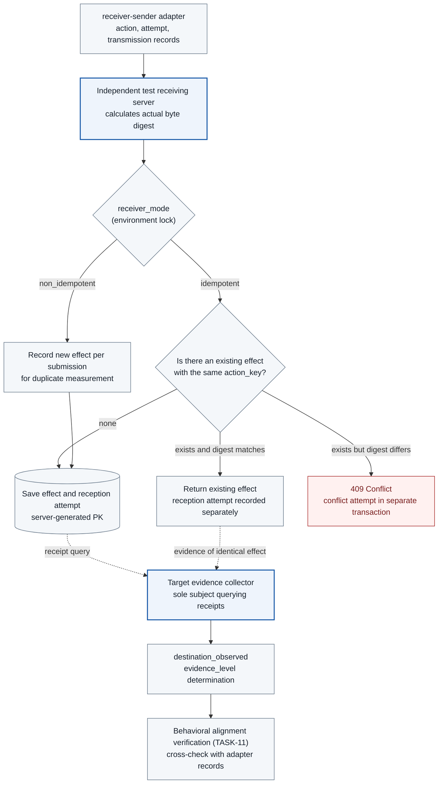

# TASK-08 · Target Result Evidence

> This document specifies the feature to be implemented. Configurations, check items, APIs, storage constraints, and failure handling are implementation contracts; implementation and deployment have not yet been performed. Values generated in the deployment environment are managed as installation inputs.

## Architecture at a Glance

> Target design · Implementation, deployment, and functional effect unverified. Solid lines indicate batch/processing/calls, dashed lines indicate reference/observation evidence, and text on arrows distinguishes meanings.



**How to read:** Compare what the adapter recorded as sent with what the server received from separate sources. HTTP ingest, reception attempts, and effect counts are distinguished individually. If provider audit or receipt is missing, effect verification is not marked as successful. Because deduplication in idempotent mode absorbs duplicates, duplicate effects are measured separately in non-idempotent mode.

| Item | Description |
| --- | --- |
| Plan | [Final Plan](../plan.md#task-08) |
| Development Prerequisites | [TASK-01](TASK-01-gke-platform.md) · [TASK-02](TASK-02-catalog-contracts.md) |
| Integration Dependencies (runtime) | WirePlan header and AdapterObservation of [TASK-05](TASK-05-service-adapters.md) receiver-sender adapter · [TASK-07](TASK-07-audit-store.md) audit API · [TASK-10](TASK-10-correlation-health.md) lease/hold API · [TASK-11](TASK-11-alignment-timeline.md) validator (consumer) · [TASK-13](TASK-13-regression-harness.md) mode-specific fixtures |
| Assigned Role | Target Evidence Engineer · Assignee/Target date TBD |
| Common Convention | [Shared Tech Spec](COMMON.md) |
| Baseline | Working tree after efe8dce (revised 2026-10-11) |

## 1. Goals and Scope

Distinguish between the record that the adapter sent and the evidence that the target actually received and processed it. The initial receiver independently computes the body digest and effect count. Kubernetes queries and model calls are indicated only up to the level of secured audits and responses, with an upper limit of `accepted` in accordance with the COMMON `evidence_level` definition.

Receipt queries are performed only by the evidence collector of this Task. The adapter does not query receipts, and does not republish adapter logs as receiver evidence.

## 2. Required Environment, Inputs, and Resources

The following environment and inputs are required:

- A team-owned TLS receiver in the agent-targets Namespace, a separate SA/DB schema and audit producer identity, and fake data fixtures are required. The receiver DB must not grant modification privileges to the adapter.
- The receiver's `receiver_mode` (`idempotent` or `non_idempotent`) is fixed to an environment lock per deployment unit. It cannot be changed via request headers or body.
- Because GKE Data Access audit logs are disabled by default ([GKE Audit Logging](https://docs.cloud.google.com/kubernetes-engine/docs/how-to/audit-logging)), whether to enable them is treated as an installation input if Kubernetes query evidence is to be used. Because enabling them increases costs, the target project and scope are recorded together.
- Access permissions for audit logs of the Gemini Enterprise Agent Platform (formerly Vertex AI, based on COMMON naming; hereinafter Agent Platform) are recorded in the installation results.
- KSA and the Pod label `app.kubernetes.io/name` have the same name (COMMON rule). The receiver is `receiver` (agent-targets), and the evidence collector is `evidence-collector` (agent-observe). Both Pods run Cloud SQL Auth Proxy as a native sidecar. Egress to the metadata server is allowed, and `roles/cloudsql.client` and `roles/cloudsql.instanceUser` are granted to each GSA. Both Pods connect as IAM DB users named after the GSA emails. `receiver_writer` and `evidence_collector` are non-login group roles, granted to each IAM DB user during the installation stage (TASK-16). Receipt API queries are performed by the receiver process under the `receipt_reader` role.
- The implementation language is Go. The receiver (`services/receiver/`) and evidence collector (`services/evidence-collector/`) are implemented with standard `net/http`. DB access uses `pgx` v5 and `sqlc`, and schemas are applied using `golang-migrate` with SQL files from the repository's shared `migrations/`. The receiver parses the body in two stages identical to TASK-07. First, it inspects duplicate keys, depth, and number ranges with `json.Decoder.Token()`, and then decodes with `DisallowUnknownFields` and `UseNumber`. The digest is calculated from the original bytes received prior to parsing.

## 3. Technical Implementation Design

1. The receiver directly calculates the length of received bytes, SHA-256 digest, client attempt ID, authenticated principal, and arrival time. It does not store the digest claimed by the client as a receipt. The receiver body is a payload serialized with JCS. WirePlan's `wire_body_digest` of the adapter is also the SHA-256 of the same body bytes, and does not include headers such as Host and Content-Length (TASK-05). Therefore, the value computed by the receiver can be directly compared with the adapter's `wire_body_digest`. The claim of a match is limited to "identical body bytes."
2. In idempotent mode, `action_key` (`Idempotency-Key`, server-generated action_id) and the request digest are treated as a unique relationship. The same key and same digest return the existing effect while recording all reception attempts. The same key with a different digest results in 409 `TARGET_KEY_BODY_CONFLICT`.
3. Ingest, start of processing, effect commit, and receipt storage are distinguished. Effect rows and reception attempts are bundled into a single transaction so that counts can be verified even after a restart. 409 conflict attempts are recorded in a separate transaction so that they do not disappear with a rollback.
4. The evidence collector cross-checks receipts, the adapter's AdapterObservation (`provider_request_id`, `k8s_audit_id`), and response metadata. If there is server latency, loss, or duplication, arrival latency and status are recorded. A late receipt adds a new revision to an existing unknown without overwriting past facts.
5. Kubernetes API response IDs/content digests and whether independent audit records were secured are distinguished. If audit logs cannot be secured, it remains at the `accepted` level and is not promoted to `effect_verified`. Storage of sensitive data from query responses is minimized.
### 3.1 Storing receiver Receipts and Effects

The `agent-targets` receiver uses a service identity and DB role distinct from the adapter. `POST /test/v1/submissions` accepts the following inputs:

- receiver-sender adapter authenticated with mTLS
- `Idempotency-Key` (action_id)
- `X-Agentarium-Attempt-Id`
- Actual body

The receiver independently computes the body digest and byte count, and does not store the digest sent by the caller as evidence as-is.

**receiver API key:** Submissions require the synthetic API key header `X-Agentarium-Receiver-Key` along with mTLS (#169). Receipt lookups use only mTLS and do not require a key.

- The key is 43 unpadded base64url characters from 32 random bytes. The broker binding (`receiver-api-key`) provides the current version of the same Secret Manager secret to the adapter as `header_format = raw` (TASK-05·06).
- The receiver reads active keys from `--api-key-dir` (required). There is one regular file per active version; the file name is the decimal version (`^[1-9][0-9]{0,9}$`), and the content is the raw key, allowing a single trailing newline. CSI entries starting with a dot are ignored, and symlinks pointing to regular files are followed. Any other name is a configuration error. There are 1–2 version files (2 only during rotation periods).
- It rereads every 30 seconds. If rereading fails, it maintains the last healthy set; if it fails at startup, it exits.
- The verification order is after the mTLS SAN check, and before body parsing and DB writes. If the header is missing, incorrectly formatted, or does not match an active key, it returns 401 `RECEIVER_KEY_INVALID` and does not record a `receiver_attempts` row.
- It compares against all active keys in constant time without early exit. Key values are not recorded in logs, audits, or responses; only the matched version is recorded.

```sql
CREATE SCHEMA receiver;  -- Owner: receiver_owner (NOLOGIN)
CREATE TABLE receiver.receiver_effects (
  effect_id uuid PRIMARY KEY DEFAULT gen_random_uuid(),
  action_key uuid,                     -- Idempotency-Key. Submissions without a key are null only in non_idempotent mode
  receiver_mode text NOT NULL CHECK (receiver_mode IN ('idempotent','non_idempotent')),
  wire_body_digest char(64) NOT NULL,  -- Computed by the server from received bytes
  content_digest_server char(64),      -- Computed with packages/canonical (Go, same package as gateway and adapter). Not independent evidence
  body_bytes integer NOT NULL CHECK (body_bytes >= 0),
  client_principal text NOT NULL,
  committed_at timestamptz NOT NULL DEFAULT statement_timestamp(),
  CHECK (receiver_mode = 'non_idempotent' OR action_key IS NOT NULL)
);
CREATE UNIQUE INDEX receiver_effects_idempotent_key
  ON receiver.receiver_effects (action_key) WHERE receiver_mode = 'idempotent';

CREATE TABLE receiver.receiver_attempts (
  receipt_attempt_id uuid PRIMARY KEY DEFAULT gen_random_uuid(),  -- Server-generated
  client_attempt_id uuid,              -- X-Agentarium-Attempt-Id. Not unique
  action_key uuid,
  client_principal text NOT NULL,
  received_at timestamptz NOT NULL DEFAULT statement_timestamp(),
  wire_body_digest char(64) NOT NULL,
  body_bytes integer NOT NULL,
  outcome text NOT NULL CHECK (outcome IN
    ('effect_created','duplicate_returned','key_body_conflict','key_missing_rejected')),
  effect_id uuid REFERENCES receiver.receiver_effects(effect_id)
);
CREATE INDEX receiver_attempts_key ON receiver.receiver_attempts (action_key, received_at);
CREATE INDEX receiver_attempts_digest ON receiver.receiver_attempts (client_principal, wire_body_digest, received_at);

REVOKE ALL ON ALL TABLES IN SCHEMA receiver FROM PUBLIC;
GRANT USAGE ON SCHEMA receiver TO receiver_writer, receipt_reader;
GRANT SELECT, INSERT ON receiver.receiver_effects, receiver.receiver_attempts TO receiver_writer;
GRANT SELECT ON receiver.receiver_effects, receiver.receiver_attempts TO receipt_reader;  -- receipt API lookup path
```

**Idempotent mode:** The receiver records the effect and the receipt attempt within a transaction that handles `action_key` unique conflicts.

- For the same key and same body, it returns the existing effect and does not increase effects.
- For the same key and different body, it returns 409 `TARGET_KEY_BODY_CONFLICT` and records a conflict attempt (`key_body_conflict`) in a separate transaction.
- Submissions without a key are rejected, and a `key_missing_rejected` attempt is recorded.
- Even in tests where the response is lost after the initial commit, an independent receipt lookup must show one effect.

**submission responses:**

| Situation | HTTP | body |
| --- | --- | --- |
| Record new effect | 201 | `{receipt_attempt_id, effect_id, action_key, wire_body_digest, body_bytes}` |
| Idempotent mode, same key and same body | 200 | Same fields of the existing effect and `duplicate: true` |
| Idempotent mode, same key and different body | 409 `TARGET_KEY_BODY_CONFLICT` | `{reason_codes, receipt_attempt_id}` |
| Idempotent mode, missing key | 422 `SCHEMA_INVALID` | `{reason_codes, receipt_attempt_id}` |
| body schema violation or duplicate key | 422 `SCHEMA_INVALID` | `{reason_codes, receipt_attempt_id}` |
| Non-idempotent mode | 201 | New `effect_id` per submission |

**Non-idempotent mode:** A new effect is recorded for each submission, and submissions without a key are also accepted and recorded. This mode is a measurement target to expose adapter retry and duplicate transmission defects without the receiver absorbing them. It is not used in production demonstrations.

`receipt_attempt_id` is generated by the server. Even if a client attempt ID is reused or retransmitted with the same ID, records are not lost. The effect count is calculated as the number of `receiver_effects` rows per `action_key`, which structurally is at most 1 in idempotent mode.

`GET /test/v1/receipts/{action_id}` can only be called by the TASK-08 evidence collector. `action_id` in the path has the same value as `action_key`. The result contains the target identity, route, `action_key`, `receiver_mode`, list of effects (effect_id, wire_body_digest, bytes, commit time), effect count, and list of receipt attempts (receipt_attempt_id, client_attempt_id, arrival time, outcome). Raw content is not returned. The receiver INSERT role and the collector SELECT role are separated.
### 3.2 Evidence Determination by Service

| Service | Collected Evidence | Scope That Can Be Confirmed |
| --- | --- | --- |
| In-house receiver | Independent receipt and effect DB | Compares target, `wire_body_digest`, and effect count to determine `effect_verified` or `effect_mismatch`. |
| Kubernetes query | UID/resourceVersion, route, and response byte count of the response received by the adapter, `k8s_audit_id` of AdapterObservation (response header `Audit-Id`), accessibility of Data Access audit logs | Confirms receipt of query response, with an upper limit of `accepted`. If audit logs are absent, records that evidence gap. |
| Agent Platform model call | `responseId`, status, response metadata, and token usage of the response, accessible audit logs | Confirms that the API accepted the request and responded, with an upper limit of `accepted`. Does not confirm data usage, deletion, or final business effect inside the model. |

**Kubernetes Audit Logs:** The GKE audit policy sends `get` and `list` requests to Data Access logs and records them at the Metadata level, so there is no request or response body ([GKE audit policy](https://docs.cloud.google.com/kubernetes-engine/docs/concepts/audit-policy)). Therefore, response contents are not verified via audit logs. The fact confirmed by audit logs is limited to "the adapter principal read that resource at that time." Whether the response header `Audit-Id` can be used as a link key connecting the attempt to the GKE audit log entry, and what the log recording delay is, are **Q0 verification items**. Prior to confirmation, audit logs are not linked at the attempt level and are used only as supporting evidence at the workload/principal level.

**Agent Platform Audit Logs:** Because there is no key to link to an attempt, they are used only as workload-level supporting evidence. Linking to attempts is done solely via `responseId` from the response (see [GenerateContentResponse](https://docs.cloud.google.com/java/docs/reference/google-cloud-vertexai/latest/com.google.cloud.vertexai.api.GenerateContentResponse)). Audit log entries are not attached to an attempt based solely on time proximity.

**Collector Inputs and Execution Triggers:** The collector reads the following sources. It does not read adapter logs or adapter APIs.

| Required Value | Read Location |
| --- | --- |
| Attempt progress fact | Read-only view `audit.collector_feed` provided by TASK-07 (tenant filter applied). Polls `preflight_passed`, `dispatch_started`, `response_received`, `attempt_uncertain`, and `attempt_failed` events with cursor `(received_at, event_id)` (1-second intervals) |
| Adapter's `wire_body_digest` | `preflight_passed` payload of the same action |
| Approved target (`canonical_target`·operation) | Read-only view `actions_target_view(action_id, tenant, operation_id, canonical_target)` provided by TASK-04 |
| Model `responseId`·k8s `Audit-Id` | `provider_request_id`·`k8s_audit_id` of the `response_received` payload |
| receiver fact | `GET /test/v1/receipts/{action_id}` |

Execution triggers are as follows:

- In a `receiver.submit` action, when any of `dispatch_started`, `response_received`, or `attempt_uncertain` is first received, the receipt query schedule is started. Even if there is only `dispatch_started` and the adapter fails to record any subsequent events, R5 is recorded once the observation deadline has passed (`unknown` condition in COMMON).
- For k8s/model actions, an `accepted` determination is recorded immediately upon receiving `response_received`.
- For `attempt_failed` (failure after claim but before the first byte), the receipt is queried once to confirm there is no effect, and `none` is recorded.
- The collector stores cursors and determinations in its own schema, and if the determination for the same action changes, it increments the revision by one and adds it as a new row.

```sql
CREATE SCHEMA evidence;  -- Owner: evidence_owner (NOLOGIN), writes by collector role
CREATE TABLE evidence.collector_cursors (
  feed text PRIMARY KEY,                    -- 'audit.collector_feed'
  last_received_at timestamptz NOT NULL,
  last_event_id uuid NOT NULL,
  updated_at timestamptz NOT NULL
);
CREATE TABLE evidence.destination_observations (
  action_id uuid NOT NULL,
  revision integer NOT NULL CHECK (revision >= 1),
  attempt_id uuid,
  tenant text NOT NULL,
  evidence_level text NOT NULL CHECK (evidence_level IN
    ('none','accepted','effect_verified','effect_mismatch','unknown')),
  rule_id text NOT NULL,                    -- Row ID from the determination table below
  receipt_digest char(64),                  -- JCS SHA-256 of queried receipt JSON
  effect_count integer,
  source_time timestamptz NOT NULL,         -- Timestamp when collector verified receipt (COMMON term)
  event_id uuid NOT NULL,                   -- Recorded destination_observed event
  PRIMARY KEY (action_id, revision)
);
CREATE TABLE evidence.receipt_polls (       -- Query schedule within deadline
  action_id uuid PRIMARY KEY,
  first_seen_at timestamptz NOT NULL,
  deadline_at timestamptz NOT NULL,
  next_poll_at timestamptz,
  polls integer NOT NULL DEFAULT 0
);
GRANT USAGE ON SCHEMA evidence TO evidence_collector, timeline_reader;
GRANT SELECT, INSERT, UPDATE ON evidence.collector_cursors, evidence.receipt_polls TO evidence_collector;
GRANT SELECT, INSERT ON evidence.destination_observations TO evidence_collector;
GRANT SELECT ON evidence.destination_observations TO timeline_reader;   -- TASK-11
```

**Collection Results and Determination:** For each determination revision, the collector records one `destination_observed` event via the TASK-07 audit API. R1 through R6 all record this event, and the payload follows [destination_observed payload](#destination_observed-payload) below. `evidence_level` uses the COMMON enum (`none`, `accepted`, `effect_verified`, `effect_mismatch`, `unknown`), and the determination rules are as follows:

| Condition | `evidence_level` |
| --- | --- |
| R1. 1 effect, server digest matches the adapter `wire_body_digest` across that effect and all received attempts in the receipt, and target matches approved target | `effect_verified` |
| R2. Any of: server digest differs from adapter `wire_body_digest` in at least one effect or received attempt; 2 or more effects; target mismatch. A receipt with both 0 effects and 0 received attempts is not R2 even if only the target configuration differs | `effect_mismatch` |
| R3. Received attempts exist in the receipt but 0 effects, and outcome is `key_body_conflict` or `key_missing_rejected` | `effect_mismatch`(violation of approved key·body contract) |
| R4. Confirmation of response receipt for k8s/model calls | `accepted` |
| R5. No receipt within deadline, 0 received attempts, or receipt API failure | `unknown` |
| R6. No attempt for the action or `attempt_failed`, and also no received attempt in receipt | `none` |

The determination order is R4 (operations that do not target receiver) → R5/R6 (no receipt, or both effects and received attempts are 0) → R2 → R1 → R3. Even if a normal effect already exists, such as when a retry with the same key received 409 with a different body, it is R2 if there is even a single received attempt with a different digest. This is to avoid covering up with R1 the fact that the adapter sent an altered body.

Receipt query failures (404, 503, authentication failure, invalid JSON) and format-contradictory receipts (such as when an `effect_created` attempt exists but there is no effect) are not classified as evidence and are treated as query errors. If a valid receipt is not obtained by the deadline, it is R5. Target comparison uses the value mapped from `actions_target_view.canonical_target` to the catalog `target_id` of the receipt, and this mapping is determined by the collector. R6 applies only when an `attempt_failed` event for the same action is confirmed in `audit.collector_feed`.
<a id="destination_observed-payload"></a>

**destination_observed payload:** The fields are `action_id, action_key?, rule_id, evidence_level, receipt_digest?, effect_count?, wire_body_digest?, bytes?, effects?, missing_reason?`. Optional fields are not omitted; they are set to null.

- `wire_body_digest` and `bytes` are the `wire_body_digest` and `body_bytes` of the receipt's effect when there is exactly one effect. Only values computed by the receiver are used; they are not filled with the digest from the adapter's `preflight_passed`, the adapter's response byte count, or 0. The digest of a receiving attempt is not copied into these two fields either.
- `effects` is a list of `{wire_body_digest, body_bytes}` that keeps the order of the receipt's `effects[]` (ascending by `committed_at`, `effect_id`). It has at most 64 entries, and when a receipt was obtained and there are 64 or fewer effects, its length equals `effect_count`. If there are 0 effects, it is an empty array. The first effect is not picked and placed in the two fields above, and no synthetic digest is built from multiple effects.
- `receipt_digest` is the JCS SHA-256 of the entire retrieved receipt JSON, and is the same value as `evidence.destination_observations.receipt_digest`. The effect list and all receiving attempts are referenced through this value.
- `action_key` is the value used in the receipt lookup path (the same as `action_id`), and is null only in R4, which is not a receiver target.
- `rule_id` is `R1` to `R6` from the decision table above, and `evidence_level` is the value from that row.
- `missing_reason` is required when `wire_body_digest` and `bytes` are null, and is null when both have values. The value is from the COMMON enum `destination_observed.missing_reason`.

| Situation | `rule_id` | `action_key` | `receipt_digest` | `effect_count` | `effects` | `wire_body_digest`, `bytes` | `missing_reason` |
| --- | --- | --- | --- | --- | --- | --- | --- |
| 1 effect | R1, R2 | value | value | 1 | 1 entry | that effect's values | null |
| 2 to 64 effects | R2 | value | value | n | n entries | null | `MULTIPLE_EFFECTS` |
| 65 or more effects | R2 | value | value | n | null | null | `EFFECT_LIST_LIMIT_EXCEEDED` |
| Receiving attempts exist but 0 effects | R2, R3 | value | value | 0 | `[]` | null | `NO_RECEIVER_EFFECT` |
| A receipt exists but 0 receiving attempts | R5, R6 | value | value | 0 | `[]` | null | `NO_RECEIVER_ATTEMPT` |
| No valid receipt by the deadline | R5 | value | null | null | null | null | `RECEIPT_UNAVAILABLE` |
| k8s and model calls | R4 | null | null | null | null | null | `NOT_RECEIVER_TARGET` |

In idempotent mode there is structurally at most one effect, so the 64-entry limit exists to expose defects in the non-idempotent measurement mode. If the limit is exceeded, the list is not truncated but set to null, and all effects are checked through `receipt_digest` and the receiver DB (TASK-13 measurement metrics).

**Follow-up migration for the audit store:** The registry row in the already merged `20261016132230_audit_store` checks `wire_body_digest`, `bytes`, and `effect_count` as non-null required fields, so it cannot accept the payload above as is. A new migration owned by TASK-07 applies the following without modifying the merged migration. The collector's `destination_observed` storage is wired up after this migration is merged.

- In `audit.event_types`, change the `required_payload_fields` of `destination_observed` to the non-null required fields `["action_id", "rule_id", "evidence_level"]`.
- Add a `destination_observed`-specific check to the `audit_append` path. All 10 keys above must be present, `rule_id` and `evidence_level` must be a pair from the decision table, and the null combination and `missing_reason` value must match the situation table above. `effects` is null or an array of length 64 or less, and its entries have only a 64-character lowercase hex `wire_body_digest` and a non-negative integer `body_bytes`. If `effect_count` is 1, the two scalars must equal `effects[0]`. A violation is `SCHEMA_INVALID`.
- Add to the existing tests acceptance cases for R2 (1, 2, and 65 effects), R3, R4, R5 (no receipt, 0 attempts), and R6 payloads, and rejection cases for null combination violations, substitution with 0, and lists exceeding the limit.

**Lookup schedule:** After a timeout, receipt lookups are performed immediately and then at intervals of 1, 2, 4, and 8 seconds, and the action's observation deadline is set to 30 seconds. If there is no evidence within that time, it is recorded as `unknown`. If evidence arrives after the deadline, a late-arriving evidence event is added, and the TASK-11 reducer updates the decision with a new revision. The absence of a receipt does not prove the absence of a transmission. A receipt API outage is also not grounds for changing a target effect to failure.

### 3.3 Duplicate effect measurement

"Zero duplicates" in idempotent mode is the result of dedupe absorbing duplicates, so it is not used as a metric. TASK-13 also runs the same fixtures in non-idempotent mode and reports the metrics below.

| Metric | Definition |
| --- | --- |
| Receiving attempts per action | Distribution of the number of `receiver_attempts` rows per `action_key` |
| Effects per action (non-idempotent mode) | Number of `receiver_effects` rows per `action_key`. Actions exceeding the approved `max_actions` are counted separately |
| Submissions without a key | Number of effects with `action_key IS NULL` in non-idempotent mode |
| Submissions with a different key | Number of cases where the same `client_principal` and the same `wire_body_digest` arrived with different `action_key` values within 60 seconds. This exposes cases where the same content was recreated as a new logical action |

<a id="4-api-data-and-connection-contract-ref"></a>

## 4. API, data, and connection contract

The body of receiver `POST /test/v1/submissions` follows a schema pinned in the catalog. `Idempotency-Key` and `X-Agentarium-Attempt-Id` are in the `safe_headers` of the TASK-05 WirePlan. The `Idempotency-Key` value is exactly the server-generated `action_id`. Retry attempts of the same action also send the same value, and the receiver stores this value as `action_key`. The `{action_id}` in the receipt lookup path is also the same value.

There is one receipt API, `GET /test/v1/receipts/{action_id}`, and its only caller is the TASK-08 evidence collector. The Receipt fields are `action_key, target_identity, route, receiver_mode, effects[] {effect_id, wire_body_digest, content_digest_server?, body_bytes, committed_at}, effect_count, receiver_attempts[] {receipt_attempt_id, client_attempt_id?, received_at, wire_body_digest, outcome}, target_version`. The TLS/mTLS origin is verified and attributed to an event of the target source.

The collection result is a `destination_observed` event with `evidence_level`, `evidence_refs`, and `source_time`. A timeout alone does not prove non-receipt or rejection.

**Lease reporting obligation:** The evidence collector (`component = destination-evidence`) reports its lease to `POST /internal/control-health/leases` every 5 seconds. The collector queries the receipt API with a fixed probe action key every 5 seconds. After 3 consecutive failures, it reports `observed_state = unhealthy` and requests a `probe_failed` hold for that target scope via `POST /internal/holds`. After 2 consecutive successes, it releases this hold automatically.

## 5. Security boundaries, failure handling, and operations

The receiver is deployed only as a test target. Its path and environment are pinned so that it is not mistaken for a production data transfer API. Adapter logs are not republished as receiver evidence. The trust limits are as follows.

- Compromise of the receiver or the DB admin is the upper bound of evidence trust.
- `content_digest_server` is computed with the same Go package `packages/canonical/` as the gateway and the adapters, so a common defect makes them all wrong together. Therefore the independent comparison uses `wire_body_digest`.

A receipt outage leads to `unknown` and a target scope hold. Exactly-once is not guaranteed for general remote APIs. We do not claim that dedupe rules verified only on the test receiver apply to all services.

## 6. Implementation files and work order

Implementation files are written at the paths below. There are currently no GCP implementation files, and if an implementation path changes, this spec and CI are updated together.

| Implementation path | Implementation responsibility |
| --- | --- |
| services/receiver/ (Go) | Independent receiving, effects, receipts, `receiver_mode`, strict JSON parsing |
| services/evidence-collector/ (Go) | Receipt and provider evidence collection, `destination_observed`, lease and hold requests |
| migrations/ (`golang-migrate` SQL) | `receiver_*` files: effects, receiving attempts, partial unique index |
| tests/evidence/ | Fixtures for late evidence, duplicates, timeouts, non-idempotent mode, and unavailable audit logs |

## 7. Verification Methods and Pass Criteria

| Test | Method and independent verification evidence | Pass criteria |
| --- | --- | --- |
| Key and digest consistency | Match the `Idempotency-Key` and WirePlan `wire_body_digest` sent by the adapter against the receiver records | `action_key = action_id`; on normal sends, receiver digest = `wire_body_digest` |
| Independent digest | Change the digest claimed by the adapter and match it against the bytes received by the receiver | Mismatch detected based on the server `wire_body_digest`, `effect_mismatch` |
| Idempotent dedupe | Repeated sends of the same action, and re-query after an interrupted response | Increases in received attempts are distinguished from the single effect |
| Non-idempotent duplicate measurement | Fixtures with adapter retries, missing keys, and resubmission with a new key in non-idempotent mode | Number of effects per action, number of submissions without a key, and number of submissions with a different key match the injected counts |
| receiver API key | No key, wrong key, version replacement (remove the previous version after 2 are active) | No key and wrong key get 401 `RECEIVER_KEY_INVALID` with 0 attempt rows; both versions are accepted during replacement; the removed version is rejected |
| Received attempt PK | Reuse of the same `X-Agentarium-Attempt-Id` | Both attempts are preserved with server-generated PKs |
| Conflict recording | Same key, different body | 409 `TARGET_KEY_BODY_CONFLICT`; the conflicting attempt remains in a separate transaction |
| Late evidence | Delayed receipt response after the effect commit | After unknown, an `effect_verified` revision is added and the original event is preserved |
| Insufficient evidence | Data Access audit logs disabled, provider audit logs not provided | Remains `accepted`/`unknown`; not shown as an effect success |
| `Audit-Id` linking (Q0) | In an environment with Data Access enabled, match the response header against audit log entries | Measure whether linking is possible and the recording delay. If not possible, keep it as workload-level supporting evidence |
| receipt query permission | Call the receipt API with the adapter SA | Rejected |
| submission responses | New effect, resend of the same body, different body, no key, schema violation | 201/200/409/422/422, with matching body fields |
| receipt present, zero effects | An action for which only a submission without a key or with a different body arrived | `effect_mismatch` according to R3 |
| Conflicting retry | In idempotent mode, a retry with the same key and a different body after a normal commit | R2 `effect_mismatch` even with a single effect |
| payload null combinations | Store `destination_observed` for R2 (1, 2, and 65 effects), R3, R4, R5 (no receipt, 0 attempts), and R6 cases | Stored according to the null combinations and `missing_reason` in the situation table; payloads filled with 0, adapter values, or the first effect are `SCHEMA_INVALID` |
| Collector cursor | Collector restart, re-query of the same event | Resumes after the cursor, 0 duplicate revisions of the same decision |
| receipt probe | Recovery after 3 consecutive receipt API failures | Target-scope `probe_failed` hold, automatically released after 2 consecutive successes. For each receipt probe, the collector reports the result to TASK-10 `POST /internal/control-health/probe-results` with `probe_kind = receipt` and scope `target`/target_id, and includes those result IDs in the release request |

Before running verification, pin the code, images, schemas, policy/catalog versions, target environment, and test denominators. The tests above were not run while writing this document. Actual execution records are stored according to the [common result recording contract](COMMON.md#result-recording-contract).

## 8. Deliverables and Implementation Results

### Deliverables to produce after implementation

- Test receiver (two modes), receipt schema, evidence collector, a report matching server effect counts against adapter attempts, non-idempotent mode duplicate metrics, and the Q0 result for `Audit-Id` linking

### Results confirmed so far

| Category | Current status |
| --- | --- |
| Tech Spec | Implementation specification written · only static link checks performed; rendering and functional verification not run |
| Implementation files | The corresponding GCP implementation paths have not been created as of now |
| Functional tests | Not run |
| GCP/GKE deployment | Not performed or checked in this work |
| Completion decision | Planned · not judged as functionally complete |

### When recording implementation results

- Record `implementation_commit`, image digests, `run_id`, the environment manifest, and safe references to the verification report and raw evidence.
- Record `expected / observed / passed / failed / unknown / not_run` and the denominator for each test. Unmeasured numbers are left as `null`.
- Record failed, unobserved, and undecided items, normal-work impact, and deployment/recovery results together, and change only the verified scope to complete.

## 9. Deployment Inputs and Change Conditions

The receiver's route, receipt schema, `receiver_mode`, and 30-second observation deadline are implemented according to chapter 3. Whether GKE Data Access audit logs are enabled and the actual audit log access permissions per provider are recorded in the installation results, and gaps are shown as the `accepted`/`unknown` scope.

If permissions, trust boundaries, supported behavior, or default failure handling change, the final plan and the related Tasks are revised together. The role is defined in the table above and the actual owner is undecided, so this is not to be interpreted as operational approval.

## 10. Technical References

- [PostgreSQL unique/ON CONFLICT](https://www.postgresql.org/docs/17/sql-insert.html)
- [PostgreSQL partial index](https://www.postgresql.org/docs/17/indexes-partial.html)
- [GKE audit logging](https://docs.cloud.google.com/kubernetes-engine/docs/how-to/audit-logging): Data Access logs disabled by default
- [GKE audit policy](https://docs.cloud.google.com/kubernetes-engine/docs/concepts/audit-policy): get/list are Data Access, at Metadata level (no body)
- [GenerateContentResponse reference](https://docs.cloud.google.com/java/docs/reference/google-cloud-vertexai/latest/com.google.cloud.vertexai.api.GenerateContentResponse): `responseId` field
- [Go encoding/json](https://pkg.go.dev/encoding/json): v1 accepts duplicate names, so a separate token check is required
- [pgx](https://github.com/jackc/pgx), [sqlc](https://github.com/sqlc-dev/sqlc), [golang-migrate](https://github.com/golang-migrate/migrate)
