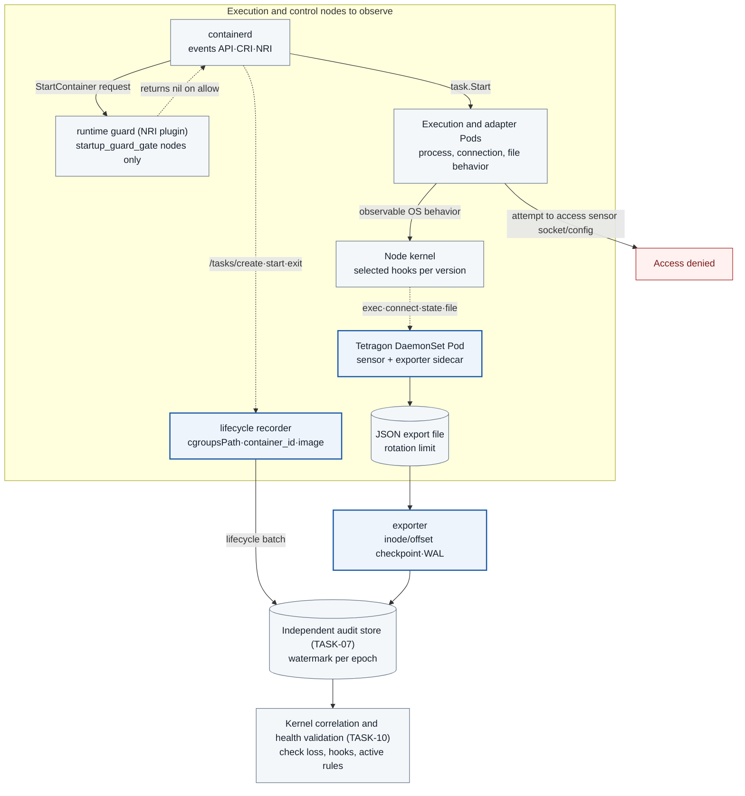

# TASK-09 · Node eBPF sensor

> This document is the specification of a feature to be implemented. The settings, check items, APIs, storage constraints, and failure handling are implementation contracts, and implementation and deployment have not been performed yet. Values generated in the deployment environment are managed as installation inputs.

## Structure at a glance

> Target design · implementation, deployment, and functional effect not verified. Solid lines are placement, processing, and calls; dotted lines are references and observation evidence; the text on each arrow distinguishes its meaning.



**How to read:** The sensor is placed on the node to be observed, not inside the execution Pod. Host kernel events and behavior inside a sandbox have different observation scopes, and it is not assumed that TCP hooks also observe UDP DNS. Hooks, loss, and runtime support are confirmed with the ground-truth probes of Q0. The start guarantee before first code execution is the independent gate `startup_guard_gate`, and the observation features below operate as MVP requirements even on nodes that do not pass the gate. The runtime guard is an NRI plugin, so it does not call the start directly; it only responds to containerd requests with allow (nil) or deny (error).

| Item | Content |
| --- | --- |
| Plan | [Final plan](../plan.md#task-09) |
| Development prerequisites | [TASK-01](TASK-01-gke-platform.md) · [TASK-07](TASK-07-audit-store.md) |
| Integration dependencies (runtime) | [TASK-07](TASK-07-audit-store.md) kernel/lifecycle batch reception, ack, and checkpoint query · [TASK-10](TASK-10-correlation-health.md) start coordinator, lease, hold API, and correlation consumption · [TASK-05](TASK-05-service-adapters.md) AdapterObservation · [TASK-13](TASK-13-regression-harness.md) load and short-lived Pod measurements. The TASK-01 Q0 harness runs with this Task's prototype sensor and exporter, and Q0 runs again after this Task is completed |
| Owner role | Runtime security engineer · owner/date not yet set |
| Common conventions | [Shared Tech Spec](COMMON.md) |
| Baseline | Working tree after efe8dce (revised 2026-10-11) |

## 1. Goals and scope

The following behaviors are collected on the node.

- Process execution and exit
- Attempts and establishment of selected TCP connections
- Access to protected file paths

This collection provides evidence from a source different from the calls the agent reports itself. However, it does not extend the claim to observing the entire system or every syscall.

The scope follows the [COMMON scope table](COMMON.md#scope-mvp-required-and-startup_guard_gate). Observation of long-running Pods, preparation of create-stage filters for short-lived Pods, lifecycle records, and ObservationGap are MVP requirements. Start permit consumption and the runtime guard are separated into `startup_guard_gate`, and a failure of this gate does not block the installation, testing, or completion decisions of other features.

## 2. Required environment, inputs, and resources

The following environment and inputs are required.

- **Node combination:** A GKE Standard/node OS/kernel/runtime combination that passed Q0 is required. The node image is pinned to `COS_CONTAINERD`, and the image version and kernel release are put into `deploy/gcp/environment.lock.json` (schema owned by TASK-16). This assumes the cluster decisions in the same lock (private nodes, IPv4 only, release channel REGULAR with a node pool maintenance exclusion, default machine type `e2-standard-4`). Because the COS root filesystem is read-only, whether the NRI configuration can be kept on the node is a Q0 verification item. Ubuntu node images can be used only after passing a separate Q0 profile.
- **Pinned versions:** A pinned Tetragon image and TracingPolicy schema are required.
- **Permissions:** A node DaemonSet permission exception is required (3.1).
- **Measurement targets:** Protected paths and the minimum collected fields are defined, and event load/loss is measured.
- **Startup taint:** The node pool has the startup taint `agentarium.io/observe-not-ready=true:NoSchedule`. The TASK-01 node-readiness controller removes this taint only from nodes for which it has confirmed the TASK-10 lease and the Q0 probe.

## 3. Technical implementation design

1. A Tetragon DaemonSet is installed on the execution and observed nodes. The sensor is not a sidecar of the execution Pod, and the exec SA cannot change the socket, config, or policy. Host mounts, privileged mode, and RBAC are limited to the required scope and a sensor-dedicated SA.
2. The `process_exec`/`process_exit`, `tcp_connect`, connection state transition, and protected path open hooks are verified per version.
   - The process, connect, and file rules are placed in TracingPolicyNamespaced of agent-exec and agent-adapters.
   - Connection state transitions can occur in softirq context and do not fit namespace (cgroup) filters. They are therefore placed separately in a cluster-scope TracingPolicy (3.2).
3. The node boot ID, PID/start time, container ID, netns inode, and the selected socket tuple are collected together. Tetragon events have no cgroup ID, so cgroup correlation is done with the lifecycle recorder's records. A plain PID is reused and is therefore not an event identity.
4. Internal gateway connections are also collected and classified, not only external IPs. Connection attempts (`tcp_connect`), connection establishment/failure (state transitions), and actual remote receipt are distinguished. Success or blocking is not asserted from NetworkPolicy drops and connect events alone.
5. Protected paths have two kinds of rows. One is an open that passed the permission check (`security_file_open`), and the other is the open syscall including rejected attempts (`sys_openat`, `sys_openat2`). It is not claimed that TCP hooks alone observe UDP DNS.
6. Sensor events are minimized and redacted and delivered to the audit store by an mTLS exporter. Full argv and file contents are excluded by default. The drop counter, loaded hooks, and policy digest are reported through the lease.
### 3.1 Sensor Deployment and Permissions

Tetragon is deployed as a DaemonSet in the `agent-sensors` Namespace, selecting both exec and control Linux nodes with a selector.

**toleration:** tolerations are maintained as an explicit list specifying each pool taint and the startup taint `agentarium.io/observe-not-ready=true:NoSchedule`. The sensor must tolerate the startup taint so that it can start up before the Q0 probe on new nodes and report its readiness status. Because the chart default toleration is a single `operator: Exists` that allows all taints, this default value is replaced with an explicit list ([Tetragon Helm chart values](https://github.com/cilium/tetragon/blob/main/docs/content/en/docs/reference/helm-chart.md)).

**namespace protection:** This namespace accommodates only privileged host sensors, and a separate Admission is established to inspect fixed KSAs, image digests, and approved chart values. Execution services cannot create or modify Pods, Secrets, or TracingPolicies in this Namespace.

**Implementation language and placement:** All node components newly implemented by this Task are Go. Tetragon is deployed as a fixed image.

| Component | Path | Placement |
| --- | --- | --- |
| exporter | `sensors/exporter/` | Sidecar of the Tetragon DaemonSet Pod. Uses the same host network, mounts the export file hostPath as read-only, and mounts the spool hostPath as read-write |
| runtime lifecycle recorder | `services/lifecycle-recorder/` | Separate DaemonSet in `agent-sensors` and does not use hostNetwork. The containerd socket is mounted only by the `containerd-proxy` container in the same Pod, and the recorder calls only the read methods permitted by that proxy (3.6) |
| Pod watcher | `services/lifecycle-recorder/` (different binary in the same module) | Deployment in `agent-observe` (replica 1, leader election). Uses client-go. Calls only the TASK-07 API without connecting to Cloud SQL |
| runtime guard | `sensors/runtime-guard/` | DaemonSet placed only on `guarded` nodes. External NRI plugin implemented with containerd NRI's `nri/pkg/stub`, handling `CreateContainerInterface`, `StartContainerInterface`, `PostStartContainerInterface`, and `StopContainerInterface` ([nri/pkg/stub](https://github.com/containerd/nri/blob/main/pkg/stub/stub.go)) |

**KSA and label:** The KSA and Pod label `app.kubernetes.io/name` share the same name (COMMON rule): `tetragon` (sensor/exporter sidecar), `lifecycle-recorder`, `pod-watcher`, `runtime-guard`. These components do not directly connect to Cloud SQL. Records are sent to the TASK-07 batch API, and leases are sent to the TASK-10 API.

**Permission recording:** Installation inputs are the kernel release, BTF path, Tetragon image/chart digest, CRD schema digest, and node image version from `deploy/gcp/environment.lock.json`. The following permissions are extracted from the Helm template and the DaemonSet manifests above and recorded in `sensor-permissions.json`.

- privilege and capabilities
- hostPID/hostNetwork
- `/sys/fs/bpf`, `/sys/kernel`, and `/proc` mounts
- containerd socket (`/run/containerd/containerd.sock`, lifecycle recorder) and NRI socket (`/var/run/nri/nri.sock`, runtime guard) mounts

Because containerd socket access grants privileges equivalent to node root, it is permitted only via the recorder-dedicated SA and an `agent-sensors` Admission exception, and within that Pod it is granted only to a single `containerd-proxy` container (3.6 containerd access boundary). On GKE nodes, the actual paths, permissions, and mount permissions of both sockets are **Q0 verification items**. Required permissions are verified via Q0 on actual nodes, and those permissions are not replicated in the security specifications of execution Pods. The export account is not granted permissions to read all secrets or deploy policies.

**collector ingress:** Tetragon must run on the host network for process visibility, and the chart default is also `hostNetwork: true`. The exporter in the same Pod also transmits using the node IP. Therefore, ingress for the TASK-07 batch API is restricted not by a Pod selector, but by the node CIDR `ipBlock` and mTLS SAN checks. The NetworkPolicy line is handled by TASK-06, and server-side mTLS checks are handled by TASK-07.

**Helm values to pin:**

- Set `tetragon.enableProcessNs = true`. Because the default is false, if not enabled, namespaces (including netns inodes) will not appear in exec and kprobe events.
- Pin JSON export-related values (`exportFilename`, `exportFileMaxSizeMB`, `exportFileMaxBackups`, `exportFilePerm = "600"`) in the lock.
- Maintain the default value `-1` (unlimited) for `exportRateLimit`. Any configuration that conceals essential events via rate limiting constitutes a gate failure.
- Pin `exportDenyList` to a single `{"health_check":true}`. Do not set namespace rules. Because `tcp_set_state` events in softirq context are attributed to the task running on the CPU at that moment—resulting in empty Pod information or appearing under other Pods such as kube-system or agent-sensors—any namespace rule drops some events. In Q0, when 30 stimulus sockets were correlated by node, sock_ptr, tuple, and time interval, the chart default (excluding namespaces `""`, `cilium`, and `kube-system`) preserved only 10 ESTABLISHED and 6 CLOSE events; excluding only `""` preserved 29 and 25; retaining only `health_check` preserved 30 and 30 (`20261014-task01-q0-min`, `20261015-task01-q0-min-2`). Events outside observation targets are filtered by the exporter using lifecycle records and tuples, and counted as `filtered_by_policy` (3.2). The export volume is a Q0 load measurement item.
- Rationale: [Tetragon Helm chart values](https://github.com/cilium/tetragon/blob/main/docs/content/en/docs/reference/helm-chart.md)

**Support scope for node configuration changes:** The GKE containerd custom configuration documentation permits only three items: `privateRegistryAccessConfig`, `registryHosts`, and `writableCgroups`. Enabling NRI or adding runtime handlers is not among these supported settings ([GKE containerd configuration](https://docs.cloud.google.com/kubernetes-engine/docs/how-to/customize-containerd-configuration)). Modifying node containerd configurations or runc via privileged DaemonSets falls outside the GKE support scope, and changes may disappear during node recreation, upgrades, or auto-repair. This Task does not require node configuration changes for sensor installation. Whether the GKE node image enables NRI, exposes the socket, and permits external plugin connections is a Q0 verification item like TASK-01, and is used only within the scope of `startup_guard_gate` in 3.4.
### 3.2 Events to Collect and Filters

| Observation Item | Implementation Method | Required Stored Fields · Support Determination |
| --- | --- | --- |
| Process start/exit | Default `process_exec` · `process_exit` events | exec_id · parent_exec_id · host PID/start time · container ID · Pod · netns inode · node boot ID |
| TCP connection attempt | `tcp_connect` kprobe (`sock` argument), namespaced policy | process · socket tuple · `sock_ptr` · hook timestamp. A return value of 0 only means ready to send SYN, not connection establishment |
| TCP connection establishment · failure | Keep only a single `tcp_set_state` kprobe (`sock`, `int`) as a cluster-scoped policy. Retain only `TCP_ESTABLISHED(1)` · `TCP_CLOSE(7)` via the `newstate` selector. If the kernel cannot attach kprobes, switch to the `sock:inet_sock_set_state` tracepoint. Do not use both hooks simultaneously | tuple of the `sock` argument, `sock_ptr`, `newstate`. The process and Pod fields of this event are not used because they may differ from the actual owner in softirq context. Connect with the connect event using the `sock_ptr`, tuple, and time window on the same node/boot |
| Connection reuse | Not supported | Subsequent attempts on a reused connection have no kernel connect events. MVP adapters use a new connection for each attempt and turn off keep-alive |
| Successful protected file open | `security_file_open` kprobe (`file` argument, return value) | Only opens that pass permission checks are visible. DAC denials (EACCES) and read-only filesystems (EROFS) fail before reaching this hook |
| Protected file open attempts (including denials) | `sys_openat` · `sys_openat2` entry · return (path string filter) | Path string passed by user and return errno. If a different string is used via relative paths, symlinks, or `..`, it falls outside the filter, so fixtures only use absolute paths |
| Event loss · hook status | Sensor metrics and ground-truth probes | Missing · drop · reload · hook load · sequence continuity |

**Policy Files:** Original policy files are placed in `sensors/tetragon/policies/`. The composition is as follows:

- `network.yaml`: connect, namespaced
- `tcp-state.yaml`: state transitions, cluster-scoped
- `file-access.yaml`: namespaced

Namespaced rules are rendered for each exec and adapters Namespace, and rendered manifests are applied by `deploy/gcp/sensors/`.

**softirq Attribution:** How state transition events are reported with what process information in softirq context, or whether they are dropped, is a **Q0 verification item**. How Tetragon reports these events could not be confirmed in documentation.

**Volume of State Transition Events:** The cluster-scoped state policy collects ESTABLISHED and CLOSE among all TCP state transitions on the node. The event volume is checked through Q0 load measurement. The exporter keeps only connections of the observation target netns using lifecycle records and tuples, and counts the rest as `filtered_by_policy`.

```yaml
apiVersion: cilium.io/v1alpha1
kind: TracingPolicyNamespaced
metadata:
  name: agentarium-tcp-connect
  namespace: agent-exec
spec:
  kprobes:
    - call: tcp_connect
      syscall: false
      args:
        - index: 0
          type: sock
---
apiVersion: cilium.io/v1alpha1
kind: TracingPolicy                # cluster-scoped: state transitions in softirq context do not match cgroup filters
metadata:
  name: agentarium-tcp-state
spec:
  kprobes:
    - call: tcp_set_state
      syscall: false
      args:
        - index: 0
          type: sock
        - index: 1
          type: int
      selectors:
        - matchArgs:
            - index: 1
              operator: Equal
              values: ["1", "7"]   # TCP_ESTABLISHED, TCP_CLOSE
```

```yaml
apiVersion: cilium.io/v1alpha1
kind: TracingPolicyNamespaced
metadata:
  name: agentarium-protected-file
  namespace: agent-exec
spec:
  kprobes:
    - call: security_file_open     # Only opens that pass permission checks are visible
      syscall: false
      return: true
      args:
        - index: 0
          type: file
      returnArg:
        index: 0
        type: int
      selectors:
        - matchArgs:
            - index: 0
              operator: Equal
              values: ["/work/protected-fixture"]
    - call: sys_openat             # Includes denied attempts, based on path string passed by user
      syscall: true
      return: true
      args:
        - index: 1
          type: string
        - index: 2
          type: int
      returnArg:
        index: 0
        type: int
      selectors:
        - matchArgs:
            - index: 1
              operator: Equal
              values: ["/work/protected-fixture"]
    - call: sys_openat2
      syscall: true
      return: true
      args:
        - index: 1
          type: string
      returnArg:
        index: 0
        type: int
      selectors:
        - matchArgs:
            - index: 1
              operator: Equal
              values: ["/work/protected-fixture"]
```

**Q0 Fixed Items:** The hook specification method follows the tracepoint `subsystem`/`event`, kprobe `syscall` field, and `return`/`returnArg` formats from the [Tetragon hook documentation](https://tetragon.io/docs/concepts/tracing-policy/hooks/). Check the following items in Q0 on the fixed CRD/kernel and record them in the rules and support table:

- Whether `tcp_set_state` can be attached
- Behavior of `int` argument selectors
- Argument extraction of alternative tracepoints
- Return code support for each hook

**Synthetic Files and Failure Handling:** Place only synthetic files in protected paths, and do not use actual sensitive files as test payloads. If exact symbols, BTF types, attach, or event results do not match, fail the gate and hold back execution. Do not automatically guess rule support and mark it as healthy. [Tetragon TracingPolicy](https://tetragon.io/docs/reference/tracing-policy/)

**Observation Targets and Support Scope:** The sensor observes agent-exec, agent-adapters, and workloads required for target evidence. Because the cluster is IPv4-only, IPv4 TCP is tested, and IPv6 observation is kept out of MVP scope. Furthermore, it is not claimed that UDP, HTTPS bodies, or model contents are visible via host eBPF. The mapping between container ID and Pod UID is saved by the lifecycle recorder, and the original UID is retained even after Pod deletion.

**Meaning of `KprobeSock.cookie`:** This value is the kernel `struct sock` pointer value (`event->sockaddr = (__u64)sk`, [Tetragon sock.h](https://github.com/cilium/tetragon/blob/main/bpf/process/types/sock.h)). It is not the userspace `SO_COOKIE`, and the same value may be reused once the socket is freed. Therefore, this value is not cross-checked against AdapterObservation. It is used only as an auxiliary key (`sock_ptr`) connecting connect and state transitions within the same node/boot, together with tuple and time intervals.

**`safe_attributes` Fields:** Only the following fields are saved per event_type. Fields outside the list are discarded.

| event_type | `safe_attributes` |
| --- | --- |
| `process_exec` | `binary` (raw text only for allowlisted paths, digest otherwise), `args_digest`, `uid`, `cwd_digest`, `in_init_tree` |
| `process_exit` | `exit_code`, `signal` |
| `tcp_connect` | `family`, `protocol` |
| `tcp_state` | `family`, `old_state?`, `new_state` |
| `file_open` | `path` (protected path allowlist only), `flags`, `return_code` |
| `openat` | `path` (protected path allowlist only), `flags`, `return_errno` |

tuple (`saddr, sport, daddr, dport`), `sock_ptr`, `tcp_new_state`, and `netns_inode` are placed in designated fields of KernelEvent rather than `safe_attributes`. `sock_ptr` is a 16-digit lowercase hex string (without `0x`) representing an unsigned pointer without loss. The observed `1` (ESTABLISHED) · `7` (CLOSE) are put into `tcp_new_state` of `tcp_state`. softirq process and Pod fields are left null, and `process_exec_id` is also not mandatory.
### 3.3 exporter Processing

The Tetragon → exporter path is fixed to JSON file export. The reason is that the gRPC stream does not resend the events that occur while the exporter is restarting.

- **checkpoint:** The exporter stores the inode and byte offset of the export file as a checkpoint, and on restart it reads from the offset in the same inode. Rotated files are found by inode in the backup list and read on from there.
- **Rotation loss:** Tetragon's rotation deletes old backups regardless of the reader's progress. The default is to rotate at 10MB and keep 5 backups. Therefore `exportFileMaxSizeMB × (exportFileMaxBackups + 1)` is pinned in the lock according to the measured peak event rate and the exporter outage time to be tolerated. If the inode of the checkpoint has already been deleted, that interval is recorded as an ObservationGap with `stage = kernel_sensor_export` and `reason = EXPORT_ROTATION_LOSS` (COMMON [enum definitions](COMMON.md#enum-definitions)), with the count recorded as `count_quality = unknown` and `recovery_state = unrecoverable`.

**Normalization and sequence assignment:**

1. The exporter normalizes the original event into a COMMON KernelEvent.
2. Filters at the exporter stage (such as state transitions not in an observed netns) are applied first. Filtered events do not receive a sequence and are counted only by the `filtered_by_policy` counter. If a sequence were assigned first and the event filtered afterwards, a hole would appear in the sequence and the watermark would stall.
3. The remaining events receive a `source_sequence` that increases from 1 per `source_epoch`. Then `sensor_id, exporter_instance_id, sensor_generation, boot_id, rule_hash, source_time, spooled_at` are attached.
4. `source_event_id` is generated as the UUIDv5 defined by TASK-07 (`NS_AGENTARIUM_KERNEL`, `"<sensor_id>/<source_epoch>/<source_sequence>"`). `record_digest` is the SHA-256 of the record's JCS excluding `record_digest` itself and the server-only `received_at`, and is computed with the shared Go package `packages/canonical/`.

**Time and keys:** `source_time` is the Tetragon event time. The Tetragon `docker` field (the first 15 characters of the container ID) is stored as `docker_id_prefix` and is an auxiliary key. The full container_id, cgroupsPath, and cgroup inode are linked to the lifecycle recorder records by container_id. Node/Pod metadata is enriched through the read-only Kubernetes API, and the enrichment source and cache version are recorded.

**batch:** A batch is set to at most 100 items or 1MiB, with a flush every 1 second. The request and response format follows [TASK-07 3.3](TASK-07-audit-store.md#33-kernellifecycle-receive-ack-and-loss-boundary).

**WAL and spool:** Before the send is acked, a WAL is written with owner-only permissions to the node's `/var/lib/agentarium/sensor-spool` hostPath.

- **Segment files:** Segment files are named `wal-<source_epoch>-<first_seq>.seg` and are at most 64MiB.
- **Record structure:** A record is `magic "AGW1"(4B) | length(u32, big-endian) | crc32c(u32) | payload`, and the payload is a JCS-serialized KernelEvent.
- **fsync and checkpoint:** On each flush (at most 1 second or 100 items), the exporter sends only after fsync, and then advances the export file checkpoint.
- **Segment deletion:** A segment is deleted only after every sequence in it has been acked at or below the TASK-07 watermark.
- **Partial record recovery:** During recovery, a trailing partial record whose length or crc does not match is truncated. If that record had already been assigned a sequence, it is reported as `sequence_range_abandoned`.

The capacity limit starts at 256MiB (based on the boot disk of the default machine type `e2-standard-4`) and is pinned in the lock using the measurements from 3.5. This mount is allowed only in the approved sensor Namespace. Records not yet acked are resent with the same `source_event_id`.

**Source identification and collection limits:** The event source ID consists of the `source_epoch` (boot and exporter instance), which distinguishes the producer's restart intervals, and the sequence. The difference between the number of exported events and the number captured in the kernel is stored separately as a metric. Unlimited collection of process argv/env/file contents is forbidden. gVisor guest kernel events are not within the default supported scope of this host sensor. A per-behavior `supported/unsupported/not_observed` table is left in the results.

**Dynamic observation for discovery:** The dynamic observation of TASK-02 call path discovery uses the same sensor trace read-only in the regression test project. AI analysis results do not change the sensor rules or the observation scope. Sensor rule changes go through an operator-written patch, human approval, and per-node confirmation of application.

### Observation Readiness Check for the Runtime Pod (required)

The exporter handles the COMMON node challenge. It uses the existing outbound health query/report path, and does not open an inbound port on the node or give the workload a management socket. It compares the nonce, container/cgroup, and latest generation of its own node/boot, and freshly confirms the actual hooks, rule hash, inclusion in the target filter, lifecycle mapping, and the ability to append/fsync the WAL. It reports the result durably through `POST /internal/control-health/pod-observation-results` and receives an ack. The result is not reused for another Pod or generation.

An unknown filter state or a pending namespace/label mapping counts as not ready. If an exec-pool policy without a namespace filter was selected, actual cgroup inclusion and the lifecycle/ingestion path are confirmed. A successful node probe does not replace identification and filter readiness for this Pod. This check is required for the MVP even without the NRI startup_guard_gate, and unsupported combinations hold the start of work. Observation of the first container program execution and complete losslessness are a separate scope.

### Independent Observation of the Session worker (required)

The [COMMON worker contract](COMMON.md#session-dedicated-worker-contract) is implemented independently of NRI. The exporter receives pending_worker_observation_challenges from the node-scope outbound health GET and reports worker results to POST /internal/control-health/worker-observation-results over management mTLS. The liveness and identity of the designated worker are also added to the Pod readiness challenge.

- The supervisor/worker hints are resolved uniquely by comparing the PID namespace inode of the actual container with the NSpid in `/proc/<host_pid>/status` and the start ticks in `/proc/<host_pid>/stat`. The container cgroup, node/boot, and full container ID are verified against lifecycle records. If proc access permissions or values are missing, or a PID has been reused, worker observation is not ready. The exporter mounts host `/proc` and `/sys/fs/cgroup` read-only and has no capabilities ([TASK-01 3.2.1](TASK-01-gke-platform.md)), so the PID namespace inode is compared using the Tetragon `process.ns.pid` (`enableProcessNs`) of the same exec rather than `/proc/<pid>/ns`.
- Reading host procfs is limited to enumerating PID directories and to `status`, `stat`, and `cgroup`. `environ`, `fd`, `mem`, `ns`, and `root` are not read, and if Tetragon `process.ns.pid` is absent, the state is not ready. The mount requires all of `readOnly: true`, `recursiveReadOnly: Enabled`, and `mountPropagation: None`. The host mount is not expanded until the ptrace, admission, and runtime verification conditions in [TASK-01 3.2.1](TASK-01-gke-platform.md#321-agent-sensors-exception-and-node-change-restrictions) are met.
- `boot_id` is read from the exporter's own `/proc/sys/kernel/random/boot_id`, not from `proc_root`, and is compared with the Node's `status.nodeInfo.bootID`. The host procfs settings do not change the node/boot identity path.
- The exporter finds the Tetragon exec_id/host PID/start_time and parent relationship of the final worker exec, and reports as evidence the source_event_id that was WAL-fsynced and then acked by the TASK-07 DB COMMIT. A marker stdout/argv nonce does not substitute for kernel exec evidence. If there is mapping/cache delay or a lost process_exec, the work is not passed. The sensor does not generate application session_ids automatically.
- During nonce processing, observation of alive, NoNewPrivs/Seccomp/UID/capability is kept distinct from the bootstrap ack. Proc observation records only the items that can actually be read, and items whose dumpable state or filter content cannot be confirmed are left as unknown. The trusted bootstrap controls report is application evidence and is not relabeled as independent kernel evidence.
- The host_pid/process_start of process_exec is preserved as normalized fields. The PID namespace/start ticks resolution evidence is stored in the node result and includes the observation time, generation, and rule hash. Sharing the same UID or worker cgroup is not used as a basis for session identification.
- Exit and parent relationship events and late metadata are also preserved under the existing loss/gap contract. Whether a specific process is alive and whether the node is ready are checked anew on every work check, with a maximum node response time of 3 seconds. The race in which the process exits right after the last check, and node loss, remain.

GKE host /proc access, PID resolution, metadata delay, the sensor filter, and the 15-second challenge/3-second result lifetime are Q0 not_run. Unsupported node/runtime combinations fail the default worker gate, and this is not skipped on the grounds of startup_guard_gate=unsupported.

### 3.4 Preparing sensors and filters before a short-lived Pod starts

Apply the [common startup contract](COMMON.md#short-lived-pod-start-lifecycle-and-loss-contract). For each node/runtime combination, record `startup_capture` as `guarded` or `unsupported`.

| `startup_capture` | Condition | Short-lived Pod handling |
| --- | --- | --- |
| `guarded` | A node that passed every Q0 item of `startup_guard_gate` | Use the 3.4.1 guard procedure to confirm that observation is ready before the first code runs |
| `unsupported` | Q0 failed or was not run | "Observable scope and gap reporting" mode. Prepare filters at the create stage (where possible), record the lifecycle, and emit an ObservationGap, without claiming observation before the first code runs. Only short-lived Pod profiles that require a guard have their deployment held |

**Metadata delay and filter races:** If Kubernetes API metadata arrives late, installation of namespace/label filters can also be late. The Tetragon documentation states that without an OCI runtime hook, policies are applied on a best-effort basis using information from the Kubernetes API server ([Tetragon K8s filtering](https://tetragon.io/docs/concepts/tracing-policy/k8s-filtering/)). Runtime Hooks provide an integration that prepares filter state before a container starts. On containerd, they are installed with an NRI plugin (`tetragon-nri-hook`) or a custom container spec, and they can be configured to either fail or succeed when the connection fails ([Tetragon Runtime Hooks](https://tetragon.io/docs/concepts/runtime-hooks/)). Both installation methods are outside the GKE-supported configuration in 3.1, so whether they can be installed and whether they persist after an upgrade are Q0 verification items.

**Candidate mitigation for filter races in unsupported mode:** Using the placement in which exec-pool is dedicated to agent-exec (TASK-01), place a cluster-scoped TracingPolicy without a namespace filter on this node pool. The exporter then filters by namespace using the lifecycle records. This approach removes the filter-installation delay race but increases event volume. Whether to adopt it is decided by the Q0 load measurement.

**Bootstrap exceptions and generation:** Bootstrap exceptions apply only to the approved list in COMMON. Pod readiness, API Admission, and a gateway permit alone do not guarantee observation of the first code. On a sensor/rule reload or a node reboot, change the generation and invalidate existing permits. A sensor failure right after consumption is still possible and is handled with a gap and a subsequent hold. Do not record that already running code was stopped automatically.

#### 3.4.1 Startup guard execution procedure

This section applies only to nodes whose `startup_guard_gate` is `guarded`. The runtime guard is an external NRI plugin. The plugin only responds to requests sent by containerd and does not invoke container start directly. The actual `task.Start` is called by containerd after the plugin responds.

**Facts confirmed on the NRI path and design outcomes:** The facts below were confirmed from containerd and NRI source code and documentation.

| Confirmed fact | Basis | Design outcome |
| --- | --- | --- |
| containerd CRI calls NRI `StartContainer` immediately before `task.Start`, and fails the start if an error is returned. If `task.Start` fails, it calls NRI `StopContainer`; if it succeeds, it sends `PostStartContainer` | [containerd container_start.go](https://github.com/containerd/containerd/blob/main/internal/cri/server/container_start.go) | The `StartContainer` response is the final enforcement point. nil means allow, error means deny. The start result is recorded from the `PostStartContainer` and `StopContainer` events and the CRI status |
| If a plugin error is an `isFatalError` (ttrpc `ErrClosed`, `ErrServerClosed`, `ErrProtocol`, `context.DeadlineExceeded`), NRI closes the plugin and returns `nil, nil`. In this case the start proceeds (fail-open). The default `plugin_request_timeout` is 2 seconds | [containerd/nri plugin.go](https://github.com/containerd/nri/blob/main/pkg/adaptation/plugin.go), [containerd NRI documentation](https://github.com/containerd/containerd/blob/main/docs/NRI.md) | The guard's internal deadline is set shorter than `plugin_request_timeout`. With the default 2-second setting, the starting value is 1.5 seconds. If the remaining time is insufficient, the guard returns a `STARTUP_GUARD_UNAVAILABLE` non-fatal error before the deadline. A guard crash or socket disconnect cannot block the start, so after-the-fact detection is required |
| `required_plugins` and the annotation key that tolerates missing plugins are in the default validator. In the source, they are checked within container adjustment validation (create stage) | [containerd NRI documentation](https://github.com/containerd/containerd/blob/main/docs/NRI.md), [NRI default validator](https://github.com/containerd/nri/blob/main/plugins/default-validator/default-validator.go) | The documentation does not state when the check occurs, so the actual timing on the pinned containerd version is a Q0 verification item, as in TASK-01. The path where the plugin closes between create and start is a mandatory Q0 failure injection item. Pod annotations related to required plugins (tolerate missing, etc.) are forbidden by Admission (TASK-01) |
| NRI adaptation holds a global lock while processing `StartContainer` and calls plugins in sequence | [containerd/nri adaptation.go](https://github.com/containerd/nri/blob/main/pkg/adaptation/adaptation.go) | Container starts on a node are serialized. Concurrent starts per node and p95 start latency (sample of at least 100) are Q0 metrics |

**Time limits:** Per COMMON, the start permit TTL (server DB clock, 10 seconds) is kept separate from the NRI path guard deadline (bridge monotonic clock, less than `plugin_request_timeout`). The DB round trips and journal fsync within `StartContainer` processing must all finish within the guard deadline. Q0 measures the Cloud SQL round-trip latency to confirm that this condition is met; if it is not met, the node is set to `unsupported`.

**Guard procedure:** The following is performed per NRI request.

| NRI request | Execution responsibility and success condition | Response and failure behavior |
| --- | --- | --- |
| `CreateContainer` | Checks the actual container/restart binding, runtime profile, and whether it is bootstrap. The binding includes `image_manifest_digest` and `image_id`. Confirms that the Tetragon filter is installed (how to read the OCI hook result of Tetragon Runtime Hooks or the policy filter state is a Q0 verification item), and obtains the lifecycle readiness record COMMIT and the TASK-10 permit issuance | On success, responds without adjustment. On failure, rejects creation with a non-fatal error (`STARTUP_GUARD_UNAVAILABLE`) |
| `StartContainer` | Takes the shared lock of the node-local RW lock and creates a sensor/guard generation snapshot. It then rechecks the loaded hooks/rule hash, filter, spool, and local hold, and consumes the permit exactly once. Next, it completes the `start_requested` DB/outbox COMMIT and the guard journal append/fsync, then rechecks the remaining deadline and generation | If everything passes, returns nil (allow) and releases the shared lock. If any check fails, returns error (deny) before the deadline. A lost ack or an `already_consumed` response is also denied |
| `PostStartContainer` | Notification that containerd has finished the start. Records the `runtime_start_returned` transition and compares it with CRI `ContainerStatus.started_at` | If the notification does not arrive, the reconciliation procedure in 3.5 applies |
| `StopContainer` (without PostStart) | The case where `task.Start` failed after allow | Records the `start_failed` transition |

**No retries:** The guard does not return allow (nil) twice for the same binding. If `PostStartContainer` or `StopContainer` does not arrive within 5 seconds after allow is returned, the state is `start_unknown`. The guard does not request the start again.

**Lock release timing and reload:** The plugin cannot observe `task.Start`, so the shared lock is released together with the `StartContainer` response. Instead, the guard maintains a list of containers that were "allowed but have no start result yet" (in-flight). The planned reload controller takes the exclusive lock and then waits until the in-flight list is empty or 5 seconds pass. After 5 seconds, it treats the remaining items as `start_unknown` and then changes the generation.

**Snapshot and identity:** The snapshot is bound to node/boot, generation, profile, binding, and check time/readiness result, and results of a previous container are not reused. The NRI socket is root-owned and owner-only, and the list of registered plugins other than the guard is fixed in Q0. The certificate of the node runtime bridge (this guard) is issued by `/internal/workload-certificates`. Issuance compares TokenReview → Pod `spec.nodeName` → Node `status.nodeInfo.bootID`, and the certificate is bound to node/boot. bootID has a trust limitation because it is a value self-reported by kubelet. No credential or socket mount is provided to workloads.

**Planned changes:** The planned change controller uses the exclusive lock and a generation fence. The order is as follows.

1. New starts are put on hold first.
2. In-flight starts are completed or treated as `start_unknown`.
3. sensor_generation/guard_generation is updated and old permits are revoked.
4. After the change, required hooks/filters/probes are confirmed and operation is restored.

Even if the lock owner crashes, old permits are not automatically reused, and the lock is not force-unlocked to start immediately. After the registry and local journal are reconciled, the node is prepared with a new generation.

**kubelet restarts and after-the-fact detection:** kubelet recreates a container that failed to start with a new container_id. Therefore, on `start_unknown`, a `start_unknown` hold is placed per Pod/workload (TASK-10), and observed fixture Jobs use `restartPolicy: Never` and `backoffLimit: 0`. A start without the guard via the NRI fail-open path is handled by after-the-fact detection. If exec is observed without a consumed permit, TASK-10 emits `start_guard_bypass_detected` and places a `bypass_detected` hold.

**Evidence that the first code did not run:** As its first action, the entrypoint of the fixture image sends a marker to an external marker server. The marker server is the Pod labeled `start-marker` in `agent-targets` (TCP 8443). Fixture Pods run only with the label and SA `start-fixture` from the TASK-01 profile and with an image digest registered in `fixtureImages` (TASK-06 allow table). "First code did not run" is determined only when all three pieces of evidence are considered together.

- the rejection record in the guard journal
- absence of CRI `StartedAt`
- absence of the marker

containerd history comes from the same runtime as the guard, so it is not an independent source, and absence of the marker must be distinguished from a network failure. If evidence is insufficient, the result is unknown, and this determination affects only `startup_guard_gate`. [COMMON first code not run determination](COMMON.md#first-code-non-execution-judgment)

**Linked facts and remaining race:** The following facts are linked but not merged into one fact.

- the consume/start intent in the independent DB
- the allow response and `PostStartContainer` in the local journal
- the WAL/DB ack of the sensor exec

A race remains in which the sensor terminates unexpectedly after the guard returns allow. The latency and gaps of last check → allow response → first exec → WAL fsync → DB ack are measured in TASK-13. This design enforces start conditions; it does not guarantee lossless capture or automatic interruption of the entire subsequent execution.

<a id="35-initial-durable-record--retransmission--loss-instrumentation-ref"></a>
### 3.5 Initial Durable Record · Retransmission · Loss Instrumentation

| Segment | Implementation contract | Guarantee limits · monitoring |
| --- | --- | --- |
| kernel → sensor | Collect required hook/filter states and version-specific lost metrics of ring buffer/internal queue | Unattached hooks, out-of-scope events, and buffer losses cannot be recovered via WAL. Zero drops is also not proof that all actions were observed |
| sensor → JSON export file | Tetragon file export, rotation limit lock | Segments deleted due to rotation during exporter downtime are `EXPORT_ROTATION_LOSS` gaps (count unknown) |
| export file → exporter WAL | After applying filters, assigns `source_epoch`/sequence, and appends/fsyncs with 3.3 framing. Does not transmit before fsync completes. The inode/offset checkpoint advances only after WAL fsync | Initial local durability boundary. Isolate partial records, record the cause, and report as `sequence_range_abandoned` |
| WAL → audit DB | At-least-once retransmission with original ID/epoch/sequence. Delivery complete only after DB COMMIT ack | Retransmits with the same ID because it may have been committed after a timeout. Batch ack and deduplication are TASK-07 contracts |
| Standalone DB → GCS | TASK-07 outbox · NDJSON batch · manifest chain | Distinguishes between simple receipt ack and durable storage confirmation |

**Spool storage location and capacity:** Place the spool outside the execution Pod's emptyDir. Use an approved node storage path that can be recovered after exporter restart or recreation. Fix the following values as required inputs in the environment lock:

- Path and disk capacity
- `spool_capacity_bytes` and queue size
- Measured peak rate
- Allowed export outage duration
- Export file rotation limit

Because it is node-local storage, durability is not guaranteed against node loss.

**Sensor anomalies and holds:** If any of the following conditions occur, the exporter immediately reports `unhealthy` via lease and requests a `sensor_degraded` hold for that node scope via `POST /internal/holds`. `sensor_degraded` is a transient failure reason and the owning component is `node-sensors`. This value is a value requested for addition to the COMMON `hold.reason` enum.

- Drop counter (ring buffer lost · listener overflow · export ratelimit drop) of required hooks (process · connect · state · file) increases by 1 or more within the last 60 seconds
- Spool 80% used
- fsync failure · disk full
- Consecutive ack stall (30 seconds)
- `EXPORT_ROTATION_LOSS` gap occurs

**Capture verification (lease `healthy` condition):** The exporter must freshly verify all of the following every 1 second to report the lease as `healthy`. If even one fails or cannot be verified, it is `unhealthy`.

1. **Load state (runtime):** Verify via policy metrics exported by Tetragon over loopback (`127.0.0.1:2112`). The `agentarium-*` set in the rows of `tetragon_tracingpolicy_kernel_memory_bytes{policy, policy_namespace}` must be exactly identical to the expected policies' (name, namespace) set, and `load_error`, `error`, and `disabled` of `tetragon_tracingpolicy_loaded` must all be 0. This metric is a value generated by Tetragon reading the actual loaded state via `ListTracingPolicies` (1.7.1 `pkg/metrics/policymetrics`). The Tetragon gRPC socket is not provided to the exporter. Because the same socket also provides TracingPolicy add, delete, and disable APIs, policy deployment privileges cannot be blocked even with a read-only mount (TASK-01 3.2.1).
2. **Declared policies:** The `rule_hash` recalculated using the `agentarium-*` TracingPolicy and TracingPolicyNamespaced objects in the Kubernetes API (chart RBAC get and list permissions) is identical to the `rule_hash` in the exporter configuration. If different, it is `unhealthy`, and the determination is TASK-10's `sensor_tampering`. This value proves the declared state, and the metric in item 1 proves that those policies were actually loaded and activated. Since Tetragon gRPC's `TracingPolicyStatus` lacks `kind` and `spec`, `rule_hash` is not generated directly from loaded policies. Limitation: Metrics only show the policy name and namespace. Therefore, if an entity with access to the Tetragon socket deletes a policy and inserts a different policy with the same name, it passes this check because the Kubernetes objects and metrics remain unchanged. This case is prevented and exposed via Admission limiting socket access permissions to the Tetragon container (TASK-01 3.2.1) and ground-truth probes. The `kind` above refers to the Kubernetes object's `kind` and is not inferred by the presence or absence of a namespace.
3. **Export configuration (exact set):** Match keys that affect export and filtering in the `tetragon-config` ConfigMap (read-only mount) against the exact set. `enable-process-ns = true`, `export-rate-limit = -1`, `export-denylist = {"health_check":true}`, `export-allowlist`, `export-filename`, `export-file-max-size-mb`, `export-file-max-backups`, `export-file-compress = false`, `export-file-perm = 600`, `field-filters = ""`, `redaction-filters = ""`, and `metrics-server = 127.0.0.1:2112` must match the values recorded in the exporter configuration by the renderer. Additionally, if there are keys whose names start with `export-` or contain `filter`, it is `unhealthy`. The export file path read by the exporter must match `export-filename`. Actual export operation is verified through the tailer's inode and offset checks and the metrics in item 1.
4. Satisfies the drop counter, spool, and ack conditions above (3.5).

Ground-truth probe results are not a lease condition, but rather an automatic hold release condition, and are reported separately via TASK-10 `probe-results`.

**Automatic release:** The exporter automatically releases the hold if the drop counter does not increase for two consecutive probe cycles (120 seconds) and the ground-truth probe passes twice consecutively. Suspected sensor configuration tampering (loaded hook/rule hash mismatch) is `sensor_tampering` and can only be released with operator approval (TASK-10).

**Loss handling principles:** Unacked segments are not deleted by rotation or TTL. If collection is impossible, do not drop silently; record a gap instead, and do not assume that backpressure can be applied to upstream kernel events.

**Epoch and retransmission:** `source_epoch` is a required field and distinguishes exporter instances and node boots. Encoding and source authentication follow [COMMON Kernel source authentication and epoch](COMMON.md#kernel-source-authentication-and-epoch). WAL replay preserves the original epoch/sequence, and new events start with a new epoch. The server returns consecutive ack watermarks per epoch and individual ack IDs. When an unrecoverable sequence range occurs, the exporter includes `sequence_range_abandoned` in the batch to send, and the server stores this as an ObservationGap and advances the watermark (TASK-07). Loss of ACK responses is handled via retransmission and deduplication. Upon restart, the last fsync/ack point and counter reset are recorded separately.

**Stage-by-stage instrumentation:** Sequences exist only for events that have passed the exporter filter. Aggregate the following values by stage:

- `received`, `filtered_by_policy`, `metadata_pending`, `normalization_failed`
- `spooled`, `db_acked`
- `export_rotation_loss`
- kernel/queue/export lost

**Denominator and metric mapping:** In consideration of merging hook entry/return and multiple events generated by a single action, compare only comparable denominators. Tetragon ring buffer lost, listener overflow, and export ratelimit drop are mapped by checking [supported metrics](https://tetragon.io/docs/reference/metrics/) in the pinned version. Configurations that hide required events via rate limits, aggregation, or filters are gate failures. In cases where measurement is not possible, counter resets, and failures occurring after the last event, loss_count=unknown. The fact that exporter sequences are continuous must not be interpreted as upstream lossless.

**Planned maintenance and forced loss:** Planned maintenance follows COMMON's cordon → hold → spool/ack verification → drain procedure. Because drain does not evict DaemonSet Pods, the sensor, exporter, and network policy log collector remain until immediately before the node is deleted to flush the spool and WAL. Spool/ack verification also includes checking the collector's final flush (TASK-10 3.7). If it does not complete within the initial drain limit of 60 seconds, or if the node is forcefully deleted, preserve the gap from the last external ack until recovery verification. Because GKE surge upgrades respect PDBs for at most 1 hour ([GKE node pool upgrade strategies](https://docs.cloud.google.com/kubernetes-engine/docs/concepts/node-pool-upgrade-strategies)), avoid unannounced recreation due to auto-upgrades or auto-repairs through TASK-01 configuration. Do not fill in unrecoverable content or exact counts by estimation.
### 3.6 lifecycle recorder and Pod watcher

According to COMMON, the production of lifecycle records is handled by this Task, reception and ack by TASK-07, and interval derivation, linking, and gap determination by TASK-10. The two sources are registered as separate authenticated sources. The event type of the record is `lifecycle_recorded` in the COMMON registry.

**Input source of the runtime lifecycle recorder (node):** Comparing the containerd events API and CRI `GetContainerEvents`, the containerd events API is chosen.

| Candidate | Verified details | Decision |
| --- | --- | --- |
| containerd events API | There are `/tasks/create` (`TaskCreate`: container_id, bundle, pid), `/tasks/start` (`TaskStart`: pid), `/tasks/exit` (`TaskExit`: exit_status, exited_at), and `/tasks/delete` events ([task.proto](https://github.com/containerd/containerd/blob/main/api/events/task.proto), [topic definition](https://github.com/containerd/containerd/blob/main/core/runtime/events.go)). `linux.cgroupsPath` is present in the OCI spec of the container record | Adopted. cgroupsPath can be obtained at create time |
| CRI `GetContainerEvents` | `ContainerEventResponse` provides container_id, event type, and `containers_statuses`, but there is no cgroups path field in `ContainerStatus` ([CRI api.proto](https://github.com/kubernetes/cri-api/blob/master/pkg/apis/runtime/v1/api.proto)) | Not used as an event source. Used only for supplemental lookups of `image_id`, `image_ref`, and `started_at` |

The recorder operates in the following order:

1. Subscribes to events in the containerd namespace `k8s.io` with the filter `topic~="/tasks/"`.
2. Upon receiving `TaskCreate`, reads the container record via the containerd Containers API to obtain `linux.cgroupsPath` from the OCI spec and CRI annotations (Pod UID, container name, sandbox ID, restart count).
3. Converts cgroupsPath to a cgroup v2 path and calls `stat` to obtain the cgroup inode. Supplements `image_id` and `image_ref` via CRI `ContainerStatus`.
4. Creates a create record with these values. `TaskStart`, `TaskExit`, and `TaskDelete` become start/exit/delete records.
5. For `image_manifest_digest`, reads the value verified by Admission from the Pod annotation. The comparison method with `image_id` (config digest) is a Q0 verification item.

The items to check in Q0 are as follows:

- CRI annotation key names
- Conversion rule from systemd cgroup driver's cgroupsPath (`slice:prefix:id`) → filesystem path
- GKE node containerd socket path and mount allowance

**containerd access boundary:** A process that holds the containerd socket directly can create and exec into containers, making it equivalent to node root. To prevent the recorder process from holding this privilege directly, the Pod is split into two containers.

| Container | Permissions | Mount | Responsibilities |
| --- | --- | --- | --- |
| `containerd-proxy` | root (uid 0, group 65532), no capabilities, read-only root filesystem | containerd socket hostPath, memory emptyDir inside the Pod (`/run/agentarium-containerd`) only. Does not mount ServiceAccount tokens, configuration, or trust bundles | Accepts only the allowed methods below from the unix socket in the emptyDir (`containerd.sock`, mode 0660, group 65532) and forwards them to the containerd socket. Does not use the network |
| `lifecycle-recorder` | uid and gid 65532 (non-root), no capabilities, read-only root filesystem | Same emptyDir, `/sys/fs/cgroup` (`readOnly: true`), spool hostPath, configuration and trust ConfigMaps, and two projected tokens placed only in this container (for kube-apiserver and `agentarium-identity`) | Reads events and container records via the proxy socket, and sends them to TASK-07, TASK-10, and the identity service over the Pod network |
| `spool-owner` (init) | root, capability `CHOWN` only | spool hostPath only | Changes the owner of the spool directory and files within it to 65532 and sets the directory to 0700 before the recorder starts |

After configuring UID 0, GID 65532, and no capabilities, `containerd-proxy` verifies the success of `PR_SET_DUMPABLE(0)` before using the socket. If it fails, it does not start, and subsequently does not change dumpable or perform `exec`. An exporter reading the host procfs must not be able to access the original containerd socket by following `/proc/<proxy_pid>/root`. This condition also applies to unprivileged processes with node management sockets, such as NRI `runtime-guard`. Before verifying the application and access denial, the host procfs mount for the exporter is not enabled.

The proxy forwards only the following four methods. Remaining methods and services are not sent upstream and are rejected with `PermissionDenied`. Targets of rejection include all of Containers' Create, Update, and Delete; the entire Tasks API (including Create, Start, Exec, Kill, and Delete); Events' Publish and Forward; CRI's `ExecSync`, `Exec`, `Attach`, `CreateContainer`, and `RemoveContainer`; the Namespaces API that changes namespaces; and gRPC reflection and health.

| method | Request conditions | Response returned by proxy |
| --- | --- | --- |
| `/containerd.services.events.v1.Events/Subscribe` | `containerd-namespace` metadata is `k8s.io`, exactly one filter of `topic~="/tasks/"` | server stream. Sends response headers first after opening the upstream subscription. Forwards only the four types of events: `TaskCreate`, `TaskStart`, `TaskExit`, and `TaskDelete`, retaining only `timestamp`, `namespace`, and `topic` of the envelope, and `container_id` and `id` of the event. Does not forward bundle paths, rootfs mounts, IO paths, pid, exit status, or other task events (additional exec, OOM, pause, etc.) |
| `/containerd.services.containers.v1.Containers/Get` | namespace `k8s.io` | Container `id`, the four CRI labels used by the mapping above, and only `linux.cgroupsPath` and two annotations (`io.kubernetes.container.restartCount`, `io.kubernetes.cri.container-type`) from the OCI spec. If the OCI spec is not JSON, returns only the ID and labels without the spec (that record becomes `runtime_metadata_partial`) |
| `/containerd.services.containers.v1.Containers/List` | namespace `k8s.io`, no filter | A list where each container is reduced in the same manner as Get |
| `/runtime.v1.RuntimeService/ContainerStatus` | `verbose = false` | Only `status.id` and `status.image_id` |

- The proxy does not pass metadata sent by the client to upstream, and creates upstream requests anew under the conditions above. The reason for trimming responses is that OCI specs and task events contain env, mount, command, and bundle paths of other Pod containers, so even if the recorder is compromised, it cannot read these values.
- **Subscription registration timing:** The gRPC client's `Subscribe` may return before containerd registers the subscription. Therefore, the proxy sends the response header only after the upstream `Subscribe` returns, and the recorder reads the list only after receiving that header. Nevertheless, a short window remains between when the upstream stream is opened and when containerd actually registers the subscription, because containerd does not separately notify of registration completion. Containers created and deleted immediately within this window might not even appear in gaps; its extent will be measured in Q0.
- The recorder does not use hostNetwork. Access to containerd and cgroup does not require a network, and placing it on the Pod network allows the TASK-06 NetworkPolicy (`lifecycle-recorder-allow`) to restrict recorder egress to `audit-writer`, `control-health`, `workload-identity` 8443, kube-dns, and kube-apiserver. Certificates are requested directly from the identity service like other non-executable services ([TASK-03 3.3](TASK-03-identity-approval.md)). The node/boot of the issuance record is determined by the Pod's `spec.nodeName` in the projected token, so it is independent of whether hostNetwork is used.
- **Pod permissions (inspected by Admission):** `hostPID`, `hostNetwork`, `hostIPC`, and `shareProcessNamespace` are all false. No container is `privileged`, and each explicitly specifies `allowPrivilegeEscalation: false`. Adding capabilities allows only `CHOWN` on the init container `spool-owner`. Containers other than `containerd-proxy` and `spool-owner` (including init and ephemeral containers) explicitly specify `runAsNonRoot: true`. `containerd-proxy` mounts only the containerd socket hostPath and emptyDir, and does not mount projected tokens, Secrets, or ConfigMaps. Without these conditions, even if the recorder does not mount the socket, it could reach `/proc/1/root/run/containerd/containerd.sock` via `hostPID` and `privileged`.
- The Pod's `automountServiceAccountToken` is `false`. Because the recorder's node epoch requires the Node's `metadata.uid` and `status.nodeInfo.bootID`, a ClusterRole allowing only `get` on its own Node is established, and the kube-apiserver token is injected only into the recorder container as a projected volume. `NODE_NAME` is the downward API `spec.nodeName`.
**Remaining trust boundary:** The `containerd-proxy` container is still equivalent to node root. If the proxy code or its image is compromised, the allowlist is meaningless. Therefore, the proxy is kept as a small binary (`services/lifecycle-recorder/cmd/containerd-proxy`) implementing only the above four methods, and its image digest is pinned in `agent-sensors.images`. Admission (TASK-01 3.2.1) verifies that in the `lifecycle-recorder` Pod, only standard containers named `containerd-proxy` mount the socket, that the container does not mount any hostPath outside the socket, and that other containers (including init and ephemeral) do not mount the socket. Because Admission cannot bind container names to image digests, it cannot prevent submitting another image from the allowed image list under the name `containerd-proxy`. This relies on the premise (TASK-01) that only the installer entity can create Pods in `agent-sensors`. The read results allowed by the proxy (node container IDs, Pod identification labels, cgroupsPath, image_id) are exposed if the recorder is compromised.

**Runtime record mapping (mapping_version 1):** The recorder creates LifecycleRecords according to the following rules.

| containerd input | `transition` | Notes |
| --- | --- | --- |
| `/tasks/create` (`TaskCreate`, init task of `container_id`) | `container_created` | Populates `cgroups_path`, `cgroup_inode`, full `container_id`, and `image_id` in this record |
| `/tasks/start` (`TaskStart`) | `container_started` | |
| `/tasks/exit` (`TaskExit`, only init processes where `id = container_id`) | `container_exited` | Does not record exits of exec processes |
| `/tasks/delete` (`TaskDelete`) | `container_deleted` | |
| Containers present in the Containers list at start or resubscription | `container_present` | Means that a record of the container exists in containerd. Does not distinguish whether it is running or has already exited but has not been deleted. Does not claim to have observed creation or start |

- If a container record lookup following a create, start, or exit event returns `NotFound` (e.g., when a container that failed creation is deleted immediately), the event cannot identify a Pod and is therefore not recorded. Instead, a `RUNTIME_RECORD_MISSING` gap covering a single interval of that event's timestamp (`start_at = end_at`) is sent, and execution continues. Other lookup errors are treated like subscription disconnections (resubscription and gap). A `NotFound` following `/tasks/delete` is ignored because there is nothing to record.
- The targets are containers whose Pod can be identified by CRI labels in the containerd namespace `k8s.io` (including sandboxes). `pod_uid`, `namespace`, `pod_name`, `container_name`, and `restart_instance` are obtained from CRI labels/annotations (`io.kubernetes.pod.uid`, `io.kubernetes.pod.namespace`, `io.kubernetes.pod.name`, `io.kubernetes.container.name`, `io.kubernetes.container.restartCount`), and these key names are Q0 verification items. Containers whose Pod cannot be identified are not recorded.
- `source_time` is the timestamp of the containerd event envelope. For `container_present`, it is null because the occurrence time is unknown. `node_uid` and `boot_id` are the recorder's node/boot (the same values as the epoch). `resource_version` is null. `evidence_refs` is an empty array.
- `cgroup_inode` is the value from calling `stat` on the read-only mounted `/sys/fs/cgroup` after converting cgroupsPath to a cgroup v2 path, and `image_id` is the CRI `ContainerStatus.image_id` from the same socket. `image_manifest_digest` is null because the recorder does not read Pod annotations (TASK-10 correlates this with watcher and Admission records). If any optional runtime field cannot be populated, `missing_reason = runtime_metadata_partial`, and which fields are missing can be identified by the fields that are null.
- The spool is the `/var/lib/agentarium/lifecycle-spool` hostPath (owner-only). Leases are sent every 5 seconds with `component = lifecycle-recorder` and node scope, without sending `details` (COMMON). It is `healthy` only when subscribed and transmission has not stopped for more than 30 seconds.

**Subscription disconnection:** The events subscription is designed under the assumption that it only receives events occurring after subscription. This behavior is reconfirmed via Q0 on the pinned version. When the recorder restarts, it re-reads the Containers list to reconcile the current state. Containers created or exited during the disconnection are not claimed to have been reconstructed; instead, that interval is sent as a `RUNTIME_RECORD_MISSING` gap to `POST /internal/control-health/observation-gaps`. The interval's `start_at` is the time when the last event was received in the previous subscription (for a restart, the value fsynced to the spool, or the start time of this process if no record exists), and `end_at` is the time when resubscription and list reconciliation completed. The recorder considers the `container_present` records from that list reconciliation complete only after receiving a gap ack.

- **Gap request:** `scope = node/<node_uid>`, `stage = lifecycle_capture`, `reason = RUNTIME_RECORD_MISSING`, where `node_uid` and `boot_id` are the recorder's current node/boot, and `source_epoch` is the current runtime epoch. The node UUID and boot SHA-256 inside the epoch must match `node_uid` and `SHA-256(boot_id)` (verified by TASK-10).
- **Gaps not acked before reboot:** If the `boot_id` of the gap fsynced to the spool differs from the current boot, the recorder does not send that request. This is because the old boot's certificate is revoked when the Pod is deleted, and sending a gap for an old boot with a new certificate is rejected by TASK-10 with 403. Instead, the first gap of the new boot covers that interval. The `start_at` of the new gap is the earlier value between the old gap's `start_at` and the last event time fsynced to the spool, while `node_uid`, `boot_id`, and `source_epoch` take current values. When the new gap is acked, the old request is deleted. If the old gap's `node_uid` differs from the current node (spool from a different node), the old request is discarded, and the gap starts from this process's start time. Requests for the same boot are resent with the same bytes as before.

**Pod watcher (control-pool):** Implemented with client-go.

- **LIST and WATCH:** The initial LIST per scope reads all pages, and WATCH continues from the snapshot resourceVersion. WATCH starts `tools/watch`'s `RetryWatcher` from the last committed resourceVersion.
- **410 handling:** `RetryWatcher` re-opens the watch from the same point on recoverable errors, but does not retry `410 Gone` and delivers it as an error event ([client-go retrywatcher.go](https://github.com/kubernetes/client-go/blob/master/tools/watch/retrywatcher.go)). Therefore, upon receiving this event, the watcher first performs a LIST again and sends a `WATCH_HISTORY_EXPIRED` gap covering up to the completion time of the LIST to `POST /internal/control-health/observation-gaps` ([TASK-10 watch history gap receipt](TASK-10-correlation-health.md#section-ref)). Only after receiving the gap ack does it commit the LIST cursor and open a new watcher.
- **Reason for not using informers:** Standard informers automatically perform a LIST again after `410`, potentially missing disconnections. Therefore, they are not used for history recording.
- **Cursor delivery and restart:** The resourceVersion of ADDED/MODIFIED/DELETED and bookmarks is sent via `cursor {scope, resource_version, expected_checkpoint_revision}` of the lifecycle batch. Only values returned by TASK-07 in the response's `checkpoint {scope, resource_version, checkpoint_revision}` are recognized as committed cursors. GET returns `{scope, resource_version, committed_at, checkpoint_revision}`; missing/out of range is 404 RESOURCE_NOT_FOUND, and expected for a non-existent checkpoint is 0. cursor and expected are fsynced to the same batch, included in the digest, and both are preserved during retries. If stale checkpoint=null, a new WATCH/LIST is started from the GET current cursor without attaching a new revision to the old cursor. For a WAL where the original cursor/expected cannot be recovered, only the original records are replayed without a cursor. Empty LIST/bookmark allow cursor-only batches and do not create fake lifecycle events. Follows [COMMON revision CAS](COMMON.md#lifecycle-checkpoint-revision-cas).
- **Record mapping (mapping_version 1):** Pods seen in the initial LIST have `transition = pod_snapshot`, and ADDED, MODIFIED, and DELETED from WATCH are `pod_added`, `pod_modified`, and `pod_deleted`, respectively. Records populate the Pod's `namespace`, `pod_name`, `pod_uid`, `resource_version`, and the installation input `cluster_uid`. `node_uid`, `boot_id`, and container fields are left empty if there is no verified resolver, leaving `missing_reason = "not_resolved_by_watcher"`. Because the occurrence time cannot be known, `source_time` is null, and `creationTimestamp` is not used. `evidence_refs` is an empty array. Pod spec, command, and env are not recorded.
- **Handling of resourceVersion:** resourceVersion is treated as an opaque value, and missed counts are not calculated from numerical differences. Intervals continued without `410 Gone` are treated as mutation events guaranteed by the API. Pods created and deleted during disconnections are not claimed to have been reconstructed ([Kubernetes API concepts](https://kubernetes.io/docs/reference/using-api/api-concepts/)).
Source registration, authentication, and epoch encoding follow [COMMON Lifecycle source](COMMON.md#lifecycle-source-authentication-and-epoch). The recorder uses the exact SAN of agent-sensors/lifecycle-recorder as its source_id, and the watcher uses the exact SAN of agent-observe/pod-watcher. The runtime epoch is node UUID 32hex + boot SHA-256 64hex + process instance UUID 32hex, and the watcher's is instance UUID 32hex + `_` + a durable restart counter. WAL replay preserves the original epoch/sequence/bytes. The runtime replays, with the current cert of the same node, an old boot that is already bound or an old boot proven with a retained prior-issued cert. An epoch without proof is not treated as a successful ack.

A top-level scope is required in every watcher batch and is included in the batch_digest and the fsynced WAL metadata. cursor.scope must match records.namespace for namespace-scoped records. Even after a node move, replay uses the original scope/epoch, and the boot of the watcher host is not substituted for the observed node/boot. An unknown scope is not filled from the current configuration. The watcher is not required to have a health bootstrap/current_boot.

An abandoned range is declared in a batch with the original source/epoch/from_seq/to_seq/reason/digest preserved. The sequence_range_abandoned/observation_gap_recorded business events for a verified declaration are recorded by the TASK-07 receiver, as its own audit source, atomically with the gap/outbox. This Task does not publish the same business event again. It follows the [COMMON receiver atomic audit](COMMON.md#receiver-atomic-audit-of-abandoned-ranges).

Both sources send LifecycleRecords with `source_epoch` and sequence to `POST /internal/lifecycle/events:batch`. `lifecycle_event_id` is created with the TASK-07 UUIDv5 rule. If one source has not reported termination, the time from the other source is not filled in as the actual process termination time.

<a id="4-api-data-and-linkage-contract-ref"></a>

## 4. API, data, and linkage contract

[KernelEvent](COMMON.md#audit-observation-and-health) is used as is. Its fields fall into three kinds.

- **Required source identification:** `source_event_id, sensor_id, source_epoch, source_sequence, exporter_instance_id, sensor_generation, node_uid, boot_id, source_time, spooled_at, event_type, rule_hash, coverage, metadata_status, normalization_version, record_digest`. `process_exec_id` is required for process-context events and may be null for `tcp_state`. For `tcp_state`, the top-level `tcp_new_state` is required.
- **Fields filled only when observable:** `process_start, container_id, docker_id_prefix, pod_uid, netns_inode, socket_tuple, lifecycle_record_id`. If not observed, null and the reason for omission are stored. The process and Pod fields of state-transition events are not trusted, so they are left null.
- **upstream_event_ref:** Holds a safe reference to the Tetragon source data. If there is no original product event ID, null and the reason are recorded.
- **`metadata_status` and `coverage`:** Only values from the COMMON [enum definitions](COMMON.md#enum-definitions) are used. Events whose attribution could not be confirmed are not discarded and are kept as `unresolved`. The identity fields that determine `coverage` are as follows.

| event_type | Fields required for `complete` |
| --- | --- |
| `process_exec`, `process_exit`, `file_open`, `openat` | `process_exec_id`, `process_start`, `host_pid`, `container_id`, `pod_uid`, `netns_inode` |
| `tcp_connect` | The fields above plus `socket_tuple`, `sock_ptr` |
| `tcp_state` | `socket_tuple`, `sock_ptr`, `tcp_new_state` |

- **`rule_hash`:** Computed over all applied TracingPolicies. Each policy is reduced to `{kind, namespace, name, spec}` (for a cluster-scoped policy `namespace` is the empty string, and `spec` is the value obtained by converting YAML to JSON and applying the structural defaults of the pinned Tetragon CRD), and the value is the lowercase hex JCS SHA-256 of the array sorted by `(kind, namespace, name)`. The renderer (`deploy/gcp/sensors/render.py`) computes it at installation and puts it into the exporter configuration, and the exporter recomputes the same value from the policy objects in the Kubernetes API (3.5 capture check 2). `kind` is the `kind` of the Kubernetes object. The Tetragon 1.7.1 CRD fills in defaults when a policy is stored. Examples are `maxData`, `resolve`, and `returnCopy` of arg and returnArg, `return` and `syscall` of kprobe, and `followChildren` of `matchBinaries`. Therefore, the renderer and the exporter apply the same list of defaults (`sensors/exporter/capture/crd_defaults.json`, generated from the CRD of the pinned release) before hashing. This yields the same value regardless of whether the value was written in the policy file or filled in by the API server. When the Tetragon version is upgraded, this list is regenerated from the new CRD.
- **TASK-07 and TASK-10 follow-up:** Currently, `metadata_status` and `coverage` in `audit.kernel_events` are `text` without a CHECK, and ingest only checks that they are not empty. Enforcing the enums above with ingest 422 and a CHECK migration is TASK-07 follow-up work (#92). Consumers must look at `metadata_status` and `coverage` together. A `tcp_state` that is `tuple_scoped` or `unresolved` does not prove the owning Pod even if all identity fields are present. TASK-10 does not ignore `unresolved` `tcp_connect` and `process_exec` events on observed nodes and uses them as the basis for a `lifecycle_capture`/`METADATA_UNRESOLVED` gap. Because such events have no `pod_uid`, they cannot directly create an `unregistered_connect_established` risk hold, so work that overlaps an open `METADATA_UNRESOLVED` gap on that node follows the not-ready decision of TASK-10 3.4.

No cgroup ID field is kept. cgroup linkage is done through the `cgroups_path` and `cgroup_inode` of the LifecycleRecord. The TASK-07 `kernel_events` table stores the tuple split into the columns `saddr, sport, daddr, dport`, `sock_ptr`, and `tcp_new_state`.

**batch API calls:** Receipt and ack for `POST /internal/kernel/events:batch` and `POST /internal/lifecycle/events:batch`, and `GET /internal/lifecycle/checkpoints`, are owned by TASK-07, and requests and responses follow TASK-07 3.3. The exporter, lifecycle recorder, and Pod watcher of this Task are producers and call only with mTLS using registered certificates. The call path of the hostNetwork exporter is restricted by the node CIDR and the mTLS SAN. The call paths of the lifecycle recorder and the Pod watcher, which are on the Pod network, are restricted by TASK-06's namespace/label NetworkPolicy and the mTLS SAN. StartPermit, LifecycleRecord, ObservationGap, and the API/ack follow COMMON.

**Lease reporting obligation:** Each of the following components reports a lease to `POST /internal/control-health/leases` every 5 seconds.

| Component | `component` | Reported values |
| --- | --- | --- |
| Sensor and exporter | `node-sensors` (per node) | `sensor_generation`, loaded hooks and rule hash, drop counter, `observed_state` |
| runtime lifecycle recorder | `lifecycle-recorder` | Subscription state, last event time, `observed_state` |
| runtime guard (`guarded` nodes) | `runtime-guard` | guard generation, number in flight, `observed_state` |

## 5. Security boundaries, failure handling, and operations

The sensor and the lifecycle recorder's `containerd-proxy` are trusted components with high host privileges. The recorder process itself can only perform the reads the proxy allows (3.6 containerd access boundary). If a node or kernel is compromised, event deletion or forgery and disabling of the sensor are possible, so the external receiver and the storage manifest are used as supplementary evidence. Host eBPF does not directly see all kernel behavior inside gVisor/microVMs.

Candidate false positives are the process/connect activity of normal SDK/runtime probes and allowed paths. The action kind, binary, route, and approval evidence are evaluated together, and this is not solved with a blanket process allow. Candidate false negatives are as follows.

- Unsupported hooks and event drops
- Short-lived processes
- UDP/guest boundaries
- Connection reuse
- Missed state transitions in softirq context
- Opens that escape the path filter through relative paths or symlinks
- Export rotation loss
- Disconnection of the containerd events subscription
- Containers started without a guard because of NRI fail-open

If a required hook is missing or the loss cap is exceeded, workload execution is held with the `sensor_degraded` hold of 3.5.

## 6. Implementation files and work order

Implementation files are written at the paths below. There are currently no GCP implementation files, and if an implementation path changes, this specification and CI are updated together.

| Implementation path | Implementation responsibility |
| --- | --- |
| deploy/gcp/sensors/ | DaemonSet, SA, host privilege exceptions, Helm value lock, applying the rendered policy manifests |
| sensors/tetragon/policies/ | Policy sources per observation scope (`network.yaml`, `tcp-state.yaml`, `file-access.yaml`) |
| sensors/exporter/ (Go) | JSON file checkpoint, filtering, sequence assignment, redaction, normalization, WAL framing, batching, lease, hold requests, node nonce responses (worker-observation-results, pod-observation-results) |
| sensors/netpol-collector/ (Go) | Node collector for network policy logs ([TASK-06 3.4](TASK-06-egress-credentials.md#34-network-policy-logging-configuration)). It reads the node file `/var/log/network/policy_action.log*` and sends it to TASK-10 `POST /internal/network-policy/records:batch` in the same way as the exporter (checkpoint, sequence assignment, WAL, deletion after ack). The batch format follows the [TASK-10 3.7 collector batch wire](TASK-10-correlation-health.md#37-network-policy-records-and-composite-decisions). It is a hostNetwork DaemonSet, KSA (`netpol-collector`), and WAL (`/var/lib/agentarium/netpol-spool`) separate from the exporter, and it reports the `netpol-collector` lease. On SIGTERM it reads and sends up to the end of the file, receives the ack, and then reports the final flush ([TASK-10 3.7](TASK-10-correlation-health.md#37-network-policy-records-and-composite-decisions)). It does not request holds. The file format, rotation limits, and required mounts are Q0 items |
| services/lifecycle-recorder/ (Go, client-go) | runtime lifecycle recorder (containerd events API, Containers API, CRI enrichment), Pod watcher (`RetryWatcher`, cursor, checkpoint resume) |
| sensors/runtime-guard/ (Go, `nri/pkg/stub`) | `startup_guard_gate`: the node runtime bridge in NRI plugin form. RW lock, in-flight list, generation fence, Create/Start/PostStart/Stop handling, journal/reconciliation |
| tests/kernel/probes/ | Independent ground-truth stimuli, support table, marker server (`agent-targets`, label `start-marker`) |

## 7. Verification method and pass conditions

| Test | Method and independent confirmation evidence | Pass condition |
| --- | --- | --- |
| Behavior observation | Compare exec/connect/protected file normal and failure probes with event IDs | Required event types confirmed, observation scope of results and attempts stated |
| Connection attempt and establishment | Normal connection, a destination where NetworkPolicy drops the SYN, asynchronous connect | Attempts, establishment, and failures are distinguished by `tcp_connect` and state transitions, and state events are linked to the connect by `sock_ptr` and tuple |
| softirq attribution (Q0) | Compare the process fields of state transition events with the actual owning Pod | Attribution results recorded in the support table, non-use of the process fields of state events confirmed |
| Denied open | DAC denial, write attempt on a read-only mount | The errno returned by `sys_openat`/`openat2` is observed, and non-observation by `security_file_open` matches the support table |
| Sensor control rejection | Access the sensor socket/config/policy with the exec SA | Rejected, normal sensor export maintained |
| New node readiness | Add a new node with the start taint | Only the sensor, exporter, and recorder run first, and observed Pods are not scheduled before the taint is removed |
| collector ingress | Submit a kernel batch from an address outside the node CIDR or with an unregistered SAN; submit a lifecycle batch from a Pod outside `agent-sensors/lifecycle-recorder` and `agent-observe/pod-watcher` or with an unregistered SAN | Rejected |
| containerd proxy boundary | Call allowed methods and Containers Create/Delete, Tasks Exec/Create, Events Publish, CRI ExecSync, and Namespaces through the proxy socket. Submit socket mounts on the recorder container, init, and ephemeral containers | Only allowed methods are forwarded and the rest are `PermissionDenied` with 0 upstream calls; socket mounts are rejected by Admission |
| lifecycle recorder input (Q0) | Container create, start, and exit, recorder restart | The create record contains cgroupsPath, cgroup inode, the full container_id, and image_id; the restart interval is `RUNTIME_RECORD_MISSING` |
| watcher 410 and resume | Long watcher outage in an environment with a short watch cache, watcher restart | `RetryWatcher` error event received, re-LIST after recording the gap, restart from the TASK-07 checkpoint |
| Sequence and filter | Burst mixed with events caught by the exporter filter | Filtered events have no sequence, 0 watermark stalls |
| Load/loss | Compare a burst of a fixed number of events with the source sequence/drop counter | Denominator, loss, and delay measured; `sensor_degraded` hold when drops increase |
| export rotation | Burst exceeding the rotation limit while the exporter is stopped | `EXPORT_ROTATION_LOSS` gap recorded, count unknown, hold |
| runtime boundary | Same stimulus on host/guest runtimes | Observation differences/unsupported items shown, unsupported environments do not pass the gate |
| Short execution and immediate deletion (unsupported mode) | Compare TASK-13's 100/500/1000ms fixtures with independent runner start/exit | Observation rate, 0 Pod UID mis-correlations, and gaps reported with a separate denominator |
| Short execution (guarded mode) | Run the same fixtures on `guarded` nodes | 0 missing expected required events, 0 Pod UID mis-correlations, actual lifetime and delay measured separately |
| NRI fail-open injection (`startup_guard_gate`) | Guard kill, socket disconnect, deadline exceeded, plugin close between create and start, submission of the tolerate annotation | The annotation is rejected by Admission; if a start was allowed, `start_guard_bypass_detected` and a hold occur; the judgment result is reflected in the gate |
| NRI response model (`startup_guard_gate`) | `task.Start` failure after allow, delayed or missing `PostStartContainer` | `start_failed` if only Stop arrives, `start_unknown` if there is no result within 5 seconds, 0 re-allows of the same binding |
| Pre-start readiness race (`startup_guard_gate`) | New node, sensor not installed, reload, mapping delay, old permit reuse | 0 first code executions of observed targets (based on the guard journal, CRI `StartedAt`, and marker), only bootstrap exceptions match the approved list |
| Concurrent starts (`startup_guard_gate`) | Concurrent start load per node | Number of concurrent starts and p95 start latency reported (100 or more samples) |
| WAL/ack recovery | Exporter re-creation, ack loss, disk saturation, partial WAL, receiver failure | fsynced events are resent and deduplicated, partial intervals are `sequence_range_abandoned`, gaps and holds confirmed |
| Node loss | Normal drain and forced termination run separately | Normal drain records preserved; forced loss is gap/unknown and not marked complete |

Before running verification, pin the code, images, schema, policy/catalog versions, target environment, and test denominators. The tests above were not run while writing this document. Actual run records are stored according to the [common result recording contract](COMMON.md#result-recording-contract).

## 8. Deliverables and implementation results

### Deliverables to leave after implementation

- Sensor deployment spec, pinned tracing policy, field/redaction contract, per-hook and per-runtime support table, loss/latency report

The additional required deliverables are as follows. They stay in the not_run state until actual tests are run.

- Basis for calculating the export rotation limit
- lifecycle recorder and Pod watcher records and Q0 input confirmation results
- WAL recovery/ack checkpoint
- Short Pod observation/mapping report (per mode)
- node-loss gap manifest
- `startup_guard_gate` judgment report: runtime hook installation/failure modes, NRI fail-open injection results, start permit consumption records, concurrent start metrics

### Currently confirmed results

| Category | Current status |
| --- | --- |
| Tech Spec | Implementation spec written · only static link checks performed, rendering and functional verification not run |
| Implementation files | As of now, the corresponding GCP implementation paths have not been created |
| Functional tests | Not run |
| GCP/GKE deployment | Not performed or confirmed in this work |
| Completion judgment | Planned · not judged as functionally complete |

### When recording implementation results

- Record `implementation_commit`, image digests, `run_id`, the environment manifest, and safe references to the verification report and original evidence.
- Record `expected / observed / passed / failed / unknown / not_run` and the denominator per test. Unmeasured numbers are left as `null`.
- Also record the `startup_capture` value per node/runtime combination.
- Record failed, unobserved, and undecided items, the impact on normal work, and deployment/recovery results together, and change only the verified scope to complete.

## 9. Deployment inputs and change conditions

Collected events and export rules are implemented according to chapter 3. The following values are stored in the Q0 results and the lock.

- Node image version, kernel/Tetragon patch, image digest
- Exact hook arguments, Helm values, rotation limit
- WAL segment size
- containerd and NRI socket paths

If a required stimulus is missing or loss is found, an execution hold and an unsupported result are recorded. Installation is split into TASK-16's 4a (sensor, exporter, lifecycle recorder, required) and 4b (runtime guard, `startup_guard_gate`). If 4b fails, deployment is held only for the short Pod profiles that need the guard.

If permissions, trust boundaries, supported operations, or default failure responses change, the final plan and related Tasks are revised together. The responsible roles are defined in the table above, and actual owners are undecided, so this must not be interpreted as operational approval.

## 10. Technical references

- [Tetragon tracing policy](https://tetragon.io/docs/reference/tracing-policy/)
- [Tetragon hook types](https://tetragon.io/docs/concepts/tracing-policy/hooks/): tracepoint `subsystem`/`event`, kprobe `syscall`, `return`/`returnArg`
- [Tetragon K8s filtering](https://tetragon.io/docs/concepts/tracing-policy/k8s-filtering/): applied best-effort without a runtime hook
- [Tetragon Runtime Hooks](https://tetragon.io/docs/concepts/runtime-hooks/): installation via NRI or a user-specified container spec, failure behavior configuration
- [Tetragon Helm chart values](https://github.com/cilium/tetragon/blob/main/docs/content/en/docs/reference/helm-chart.md): `enableProcessNs`, export file rotation, `exportRateLimit`, `exportDenyList`, `hostNetwork: true` default and required, default toleration `operator: Exists`
- [Tetragon gRPC API](https://tetragon.io/docs/reference/grpc-api/): Process `pid` is the host PID, `docker` is the first 15 characters of the container ID
- [Tetragon sock.h](https://github.com/cilium/tetragon/blob/main/bpf/process/types/sock.h): the `KprobeSock` cookie is a kernel pointer
- [Tetragon threat model](https://tetragon.io/docs/threat-model/)
- [Tetragon metrics](https://tetragon.io/docs/reference/metrics/): buffer/queue/export/cache loss. Metrics are locked per version
- [containerd NRI documentation](https://github.com/containerd/containerd/blob/main/docs/NRI.md), [containerd/nri plugin.go](https://github.com/containerd/nri/blob/main/pkg/adaptation/plugin.go), [containerd container_start.go](https://github.com/containerd/containerd/blob/main/internal/cri/server/container_start.go)
- [containerd nri/pkg/stub](https://github.com/containerd/nri/blob/main/pkg/stub/stub.go): Create/Start/PostStart/StopContainer interfaces
- [containerd events task.proto](https://github.com/containerd/containerd/blob/main/api/events/task.proto), [runtime event topics](https://github.com/containerd/containerd/blob/main/core/runtime/events.go)
- [CRI api.proto](https://github.com/kubernetes/cri-api/blob/master/pkg/apis/runtime/v1/api.proto): `ContainerEventResponse`, `ContainerStatus` (no cgroups path)
- [client-go RetryWatcher](https://github.com/kubernetes/client-go/blob/master/tools/watch/retrywatcher.go): `410 Gone` is not retried and is delivered as an error event
- [GKE containerd configuration](https://docs.cloud.google.com/kubernetes-engine/docs/how-to/customize-containerd-configuration)
- [GKE node pool upgrade strategies](https://docs.cloud.google.com/kubernetes-engine/docs/concepts/node-pool-upgrade-strategies)
- [Kubernetes API concepts](https://kubernetes.io/docs/reference/using-api/api-concepts/)
