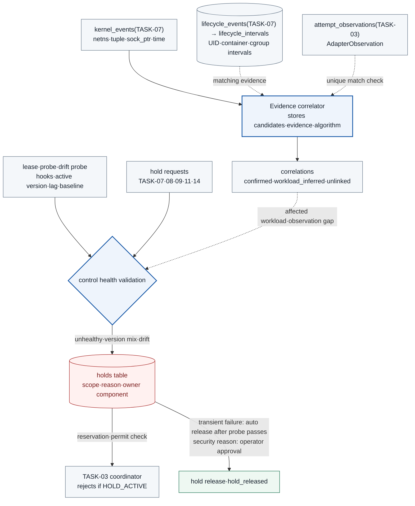

<a id="task-10--kernel-event-correlation-and-control-health-validation-ref"></a>

# TASK-10 · Kernel event correlation and control health validation

> This document is a specification of the features to implement. Settings, check items, APIs, storage constraints, and failure handling are implementation contracts, and implementation and deployment have not been performed yet. Values generated in the deployment environment are managed as installation inputs.

## Structure at a glance

> Target design · implementation, deployment, and functional effect not verified. Solid lines are placement, processing, and calls; dotted lines are references and observation evidence; the text on each arrow distinguishes its meaning.



**How to read:** A session is not confirmed merely because the PID, IP, and time are similar. Health checks use not only heartbeats but also required hooks, active versions, loss, ground-truth probes, and baseline drift. If the affected targets cannot be narrowed during a shared session, the whole workload is held. A hold caused by a transient failure is released automatically by the owning component after the probe passes, and a hold for a security reason is released only with operator approval.

| Item | Content |
| --- | --- |
| Plan | [Final plan](../plan.md#task-10) |
| Development prerequisites | [TASK-02](TASK-02-catalog-contracts.md) · [TASK-07](TASK-07-audit-store.md) · [TASK-09](TASK-09-node-sensor.md) |
| Integration dependencies (runtime) | [TASK-03](TASK-03-identity-approval.md) `attempt_observations` storage, coordinator hold lookup, activation probe dispatch, node certificate issuance · [TASK-05](TASK-05-service-adapters.md) AdapterObservation generation · [TASK-14](TASK-14-policy-release.md) active version lease and `policy_activation` hold · [TASK-11](TASK-11-alignment-timeline.md) hold requests · [TASK-01](TASK-01-gke-platform.md) baseline and node-readiness controller. The TASK-01 Q0 harness runs with this Task's prototype start coordinator and health validation, and Q0 is rerun after this Task is complete |
| Responsible role | Evidence correlation and control engineer · owner and due date not yet decided |
| Common conventions | [Shared Tech Spec](COMMON.md) |
| Baseline | Working tree after efe8dce (revised 2026-10-11) |

## 1. Goals and scope

Kernel events are correlated with workloads, actions, and attempts, but sessions without confirming evidence are not inferred. The health and active versions of sensors, policies, and adapters are checked, and subsequent executions in scopes where a required control is broken are held through the `holds` table. Multiple Tasks can send hold requests, but this Task is the one that decides whether to create a hold.

The division of roles is as follows.

- TASK-07 owns receiving and acking kernel and lifecycle batches.
- TASK-09 is responsible for producing lifecycle records.
- TASK-03 owns `attempt_observations`, the storage table for AdapterObservation.
- This Task consumes the stored records, derives time intervals, and decides correlations and gaps.

Start permits and start attempts are used only on nodes where `startup_guard_gate` is enabled. AI output cannot create confirmed correlations or release holds (COMMON AI one-way principle).

## 2. Required environment, inputs, and resources

The following inputs are needed.

- `audit.kernel_events`, `audit.lifecycle_events`, and `audit.audit_events` stored by TASK-07 (read role `correlation_reader`)
- `attempt_observations` stored by TASK-03 (AdapterObservation, SELECT permission for `correlation_reader`)
- ControlHealthLease per component
- active bundle manifest
- TASK-01 baseline (`baseline_digests`) and Q0 probes
- Records sent by the network policy log node collector (network policy logging and the collection path enabled by TASK-06 3.4)

Permission to read health is separated. Observed clock skew, cache retention, and join time windows are decided by measurement.

**Implementation language and libraries:** All components of this Task are implemented in Go. The correlator (`services/correlation/`), the health controller (`services/control-health/`), and the start coordinator (`services/start-coordinator/`) belong here.

- APIs are served with the standard `net/http`.
- DB access uses `pgx` v5 and `sqlc`, and the schema is applied with `golang-migrate` from SQL files in the repository's common `migrations/`.
- The current Kubernetes state (Node, Pod, Admission, RBAC, NetworkPolicy) is read through the client-go informer cache. Because the informer automatically re-LISTs after `410 Gone`, it is not used as historical evidence. For lifecycle history, only the records that the TASK-09 watcher stored in TASK-07 are used.
- Request bodies are parsed with the same Go strict JSON rules as TASK-07 (`DisallowUnknownFields` and `UseNumber` after the token check).
- The KSA and the Pod label `app.kubernetes.io/name` have the same name (COMMON rule): `control-health`, `correlation`, `start-coordinator`, `drift-probe`, `probe-runner`. Of these, `control-health`, `correlation`, `start-coordinator`, and `drift-probe`, which connect to the DB, follow the configuration of [TASK-06 Cloud SQL IAM](TASK-06-egress-credentials.md#33-secrets-and-wif-permissions-ref). No GSA annotation is put on the KSA, and the application ADC keeps the direct KSA principal. Only the Cloud SQL Auth Proxy native sidecar is configured with impersonation of the dedicated DB GSA, and the Proxy connects with that GSA's IAM DB login. The installer grants each login membership in the PostgreSQL application roles `control_health_writer`, `correlation_writer`, `start_coordinator`, and `drift_reporter`. The `drift-probe` login is given only `drift_reporter`, not `control_health_writer` or `audit_producer` as well. These application role names are not IAM DB login names. Metadata server egress, GSA IAM permissions, and Proxy options follow TASK-06.
- `control_health_writer` is a `NOLOGIN` role. At installation, this role is bootstrapped first, and then the identity migration that requires it and the remaining migrations are applied in version order. Creating IAM DB logins and granting application role membership is a separate installation step, and the runtime does not create roles ([contact service installation order](../../deploy/gcp/base/contact-services/README.md)).
- The environment lock is `deploy/gcp/environment.lock.json` (schema owned by TASK-16).

## 3. Technical implementation design

1. From `lifecycle_events`, derive the time intervals of Pod UIDs (`lifecycle_intervals`) from node boot + container_id and cgroup intervals. Intervals of terminated Pods, reused PIDs, and restarted containers are preserved. Past events are not correlated using only current IP/PID lookups.
2. Kernel connect and state transition events are compared with `attempt_observations` using the match conditions in 3.1. MVP adapters use a new connection for each sub-request (k8s logs has three sub-requests per attempt, the others have one), so connection reuse is outside the supported scope, and if reuse is observed, session confirmation is withheld.
3. A correlation is stored with the COMMON `confidence` (`confirmed`, `workload_inferred`, `unlinked`), and the evidence, number of candidates, algorithm version, and revision are recorded. confirmed is possible only when it uniquely matches exactly one AdapterObservation. With only Pod/time/IP, it is a workload inference.
4. Control health compares the following values. The declared desired value and the observed value reported by each component are stored separately.
   - The component's ControlHealthLease (heartbeat and active version ack combined)
   - loaded hook/policy digest
   - collector lag/drop/ack
   - Recent fixed probe and baseline drift probe results
5. Lease expiry, missing required hooks, version mixing, storage failure, and drift lead to a hold on the corresponding scope. If the causing session is unclear, new executions for the whole workload are held. The TASK-03 coordinator reads unreleased holds at reservation and at the final permit check.
6. Recovery is not done on heartbeat resumption alone. For transient failure reasons, the owning component releases the hold automatically after the probe passes, and for security reasons, the hold is released only with operator approval. Every release is left as an audit record. Automatic remote policy changes are left only to TASK-14's approved release flow.
7. Network policy logs are collected as a separate source and combined with kernel connection events to produce a derived decision (NetworkFinding) (3.7). This decision is supporting evidence and does not create holds.

### 3.1 Correlation join and confidence

`services/correlation/` builds indexes from node boot ID, container/Pod UID, process exec ID, netns inode, socket tuple, `sock_ptr`, and event interval. It does not join on Pod name or PID alone.

**Storage of AdapterObservation:** The [AdapterObservation](COMMON.md#actions-approvals-and-decisions) produced by the adapter transport recorder (TASK-05) is delivered to TASK-03 through `POST /internal/dispatch/attempts/{attempt_id}/outcome`, and TASK-03 stores it in the `attempt_observations` table. The columns and permissions this Task needs are listed below, and changes have been requested from TASK-03 and COMMON.

| Column | Type | Purpose |
| --- | --- | --- |
| `attempt_id`, `request_ordinal` | uuid (attempts FK), integer. PK `(attempt_id, request_ordinal)` | Link target. The unit of linking is one socket of a sub-request |
| `request_role` | text | Sub-request kind (`primary`, `pod_identity_before`, `pod_logs`, `pod_identity_after`). Not used in link conditions |
| `local_addr`, `local_port` | inet, integer | Source of the kernel tuple |
| `peer_addr`, `peer_port` | inet, integer | Destination comparison after normalization |
| `dialed_addr`, `peer_addr_kind` | inet, text (`service_vip`, `endpoint`, `external`) | Input for DNAT measurement. Both are NULL for rows that failed before a connection was attempted |
| `netns_inode` | bigint | Confirms the same network namespace |
| `pod_uid` | uuid | Matching against lifecycle intervals |
| `connect_started_at`, `send_started_at`, `send_finished_at`, `response_at` | timestamptz | Time window |
| `provider_request_id`, `k8s_audit_id`, `wire_body_digest` | text, text, char(64) | Evidence references (not used in link conditions) |
| `recorded_at` | timestamptz | Latency measurement |

- The required index is `(netns_inode, local_addr, local_port)`.
- The required permission is `GRANT SELECT ON attempt_observations TO correlation_reader`.
- The `dispatch_started` payload in the COMMON registry does not have `local_addr`, `local_port`, or `netns_inode`. Therefore the correlator reads this table instead of the audit events.

The adapter cannot know the Tetragon `process_exec_id` of its own process, so AdapterObservation has no exec ID. Tetragon's `exec_id` is a value produced by the sensor, and `pid` is a host PID namespace value ([Tetragon gRPC API](https://tetragon.io/docs/reference/grpc-api/)). The exec ID is attached from the matched kernel event side.

**Match conditions:** A kernel `tcp_connect` event `e` and an AdapterObservation `o` become a candidate if they satisfy all of the conditions below. `o` is one row of `attempt_observations`, and one `(attempt_id, request_ordinal)` corresponds to one socket. The correlator matches each of the three sub-requests of a k8s logs attempt separately. The 2-second time margin is the COMMON clock skew value.

| Condition | Rule |
| --- | --- |
| network namespace | `e.netns_inode = o.netns_inode` |
| Source | `(e.saddr, e.sport) = (o.local_addr, o.local_port)` |
| Destination | `normalize(e.daddr, e.dport) = normalize(o.peer_addr, o.peer_port)`. The normalization rule is the current `algorithm_version` in `tuple_normalization_rules` |
| Time window | `e.source_time ∈ [o.connect_started_at − 2s, o.send_started_at + 2s]` |
| Pod and boot | At time `e.source_time`, the `lifecycle_intervals` interval containing `e.container_id` has `pod_uid = o.pod_uid`, and that interval's `boot_id = e.boot_id` |
| Connection established | On the same node/boot, a `tcp_state` event (`new_state = ESTABLISHED`) with the same `sock_ptr` and tuple exists within `[e.source_time, o.send_started_at + 2s]` |

| confidence | Required condition | Decision |
| --- | --- | --- |
| `confirmed` | Exactly one `(e, o)` pair satisfies all of the conditions above, on each side | Links to the attempt and records the `request_ordinal` of `o` together with the `process_exec_id` of the kernel event |
| `workload_inferred` | A trusted Pod/container/node mapping exists, but the session/attempt cannot be identified. Cases where only the connection-established event is missing are also placed here, with `reason = state_event_missing` | Links only the workload and leaves the session/action confirmation fields null |
| `unlinked` | There is no candidate or there are several, and the cause cannot be narrowed down | Stores the number of candidates, the matching evidence, and the ambiguity |

**Tuple normalization:** For connections that go through a Service address, the tuples on the two sides can differ because of DNAT. The normalization rules are determined by measurement in Q0.

- With kube-proxy, the destination at kernel connect time is the ClusterIP, and the adapter's `peer_addr` can also be the ClusterIP.
- If Dataplane V2 uses socket-level load balancing that rewrites the destination to the backend address at connect time, both the kernel and the adapter may see the backend address. This behavior has not been confirmed.

Therefore Q0 runs both a connection through the ClusterIP and a direct Pod IP connection with the same adapter, and measures in both directions which address the kernel-side destination and the adapter-side `peer_addr` each see. The Service VIP↔endpoint normalization rule is then fixed in `tuple_normalization_rules` together with an `algorithm_version` based on those results. Destinations without a rule are not raised to confirmed.

**`KprobeSock.cookie`:** This value is a kernel pointer, so it is not matched against the userspace `SO_COOKIE` or AdapterObservation ([Tetragon sock.h](https://github.com/cilium/tetragon/blob/main/bpf/process/types/sock.h)). It is used only as an auxiliary key (`sock_ptr`) that links connect and state transitions within the same node/boot. The process and Pod fields of state transition events can be wrong in softirq context, so they are not used (TASK-09).

**exec Pod → gateway segment:** In the MVP, the gateway does not leave socket records equivalent to AdapterObservation. Therefore kernel connections in this segment are capped at `workload_inferred`. Direct bypass attempts also have no corresponding AdapterObservation, so they remain `workload_inferred` or `unlinked`.

**Time and hints:** Time is an auxiliary condition for finding candidates, not causal evidence. Concurrent sessions in the same shared process are not separated by time alone. A link is not raised to confirmed merely because there is a single candidate. A request ID injected by a probe is also treated only as a user-submitted hint unless the adapter transport recorder has a record of it. AI analysis results (TASK-02 discovery, TASK-12 proposals) do not create correlations or raise confidence.

### 3.2 Control health decision

`services/control-health/` stores the values below in the DB. The TASK-03 coordinator queries unreleased holds at reservation and at the final permit check. A hold is not an in-memory flag but a durable row of the `holds` table.

```yaml
health_contract:
  heartbeat_interval_seconds: 5
  lease_ttl_seconds: 15
  maximum_ingestion_lag_seconds: 10
  maximum_clock_skew_seconds: 2
  audit_export_limits_ref: "TASK-07 3.2"   # degraded, export_lag hold, and backlog limits per source class
  required_components:                      # COMMON ControlHealthLease.component values
    global: [audit-db, audit-export, gateway, coordinator, node-readiness]   # coordinator is a requested addition to the COMMON enum
    per_adapter_deployment: [adapter]
    per_node: [node-sensors, lifecycle-recorder]
    per_guarded_node: [runtime-guard]
    per_guarded_profile: [start-coordinator]  # required only for hardened active combinations. Not a dependency of the default work gate
    per_target: [destination-evidence]
  require_active_bundle_match: true
  require_loaded_hook_match: true
  require_q0_coverage: true
  kernel_probe_interval_seconds: 60
  kernel_probe_window_seconds: 10
  kernel_probe_judge_delay_seconds: 25
  sensor_drop_window_seconds: 60
  drift_probe_interval_seconds: 300
  transient_release: owner_auto_release_after_probe_pass
  security_release: operator_approval
```

**lease:** Components report a [ControlHealthLease](COMMON.md#audit-observation-and-health) with `POST /internal/control-health/leases`.

- This API unifies the source heartbeat and the active version ack into one, and the activation confirmation ack of TASK-14 also uses this API.
- The obligation to report leases lies with TASK-01/04/05/07/08/09/14. The network policy log node collector (TASK-06 3.4) also reports a lease with `component = netpol-collector` (3.7).
- The server looks up the caller's mTLS SAN in `component_principals` to determine the component and allowed scopes. If `component` or `scope` in the body differs from the registered values, it is 403.

**Active bundle ack:** The gateway and adapters report leases with a separate `source_id` per replica (Pod), with the following meaning.

- **Reported values:** `active_version` holds the `artifact_digest` of the bundle actually loaded and verified. `active_bundle_revision` holds the revision reported by OPA. If loading fails, the previous value is kept and `observed_state = degraded` is reported.
- **ack aggregation:** This Task reads the TASK-14 `desired_bundle` row and uses the Deployment's `status.replicas` (client-go informer) as the expected replica count. Only when the number of replicas among valid leases with `active_version = desired artifact_digest` equals the expected count is that workload reported as "ack complete".
- **Deciding party:** The 120-second ack timeout and the rollback decision are made by the TASK-14 releaser.

**Coordinator sweeper and health:** The sweeper of the TASK-03 coordinator cleans up the following two things.

- It changes permits that expired without being claimed to `released`.
- It changes attempts that have had no outcome for 60 seconds after claim to `unknown`.

This Task does not replace the sweeper and confirms only the following two things.

1. **Sweeper lease:** The sweeper reports a `component = coordinator` lease. This value is a requested addition to the COMMON component enum. If this lease expires, unknown transitions stop and attempts may appear to be still in progress, so a global `lease_expired` hold is placed.
2. **Handling of unknown transitions:** The `unknown` transitions made by the sweeper do not create holds directly. TASK-11 handles the alignment decision and the request for the corresponding session hold.

The required lease decision and the creation of expiry holds apply only to the required_components of the currently installed profile. The absence of start-coordinator/runtime-guard does not create a global hold in the unsupported default work profile. The same fail-closed conditions apply to the hardened active profile.

A plain heartbeat does not substitute for hooks being loaded or for successful event collection. When a lease expires, a `lease_expired` hold is placed on the lease scope. The scope depends on the component as follows.

- `node-sensors`, `lifecycle-recorder`, `runtime-guard`: node
- `destination-evidence`: target
- `adapter`: workload (the corresponding Deployment)
- Other components: global

**`netpol-collector` lease:** This component is not put into `required_components`. Network policy logs are auxiliary evidence, so work is not held because of a collector failure. The lease is reported by the node collector with node scope, and even if it expires or is `degraded`, no `lease_expired` hold is created and it is not included in `missing_components` or in the `state` computation of the query response. It is included as is in `leases[]` of the response. In `component_principals`, the SAN of the collector KSA, `spiffe://agentarium.internal/ns/agent-sensors/sa/netpol-collector`, is registered with `component = netpol-collector`, `allowed_scopes = {node}`, `allowed_hold_reasons = {}`, `releasable_hold_reasons = {}`. The collector has a different KSA from the kernel event exporter, so one `principal_san` corresponds to only one component. Because this SAN has no node information, the server finds the TASK-03 `issued_certificates` row by the serial of the caller certificate. The lease is accepted only when that row's `revoked_at` is empty and the lease's `scope_id` equals that row's `node_uid` (recorded at issuance from the Pod `spec.nodeName`, [TASK-03 3.3.2](TASK-03-identity-approval.md#332-certificate-bootstrap)); otherwise it is 403. When this lease expires, the health controller records a `source_health_changed` event and an ObservationGap with `stage = network_policy_log` (3.7). When the collector comes back up, it resumes reading from the node file, so a gap within the rotation limit ends up as a delay.

**Ground-truth probe:** The probe runner is placed as a long-running Pod per node in the `agent-exec` and `agent-adapters` namespaces.

- **Execution identity:** The label and SA are `probe-runner` of the TASK-01 profile, and only image digests registered in `probeImages` and `agent-adapters.images` of TASK-01 are used.
- **Target and interval:** The stimulus target is `probe-sink` in `agent-targets` (TASK-06 allow table). The probe runner runs the stimuli below every 60 seconds.
- **Why Jobs are not used:** Repeatedly creating short probe Jobs would itself become load and gaps on the start path, so they are not used.

| Probe kind | stimulus | Required kernel events |
| --- | --- | --- |
| process | Run the fixed binary `/probe/bin/marker` | `process_exec` and `process_exit` of the same container |
| tcp | Connect to `probe-sink:8443` and then close | `tcp_connect`, `tcp_state` (ESTABLISHED), `tcp_state` (CLOSE) of the same tuple |
| file | Read the allowed fixture, open a fixture without permission | `security_file_open` (return 0) and `openat` (return ≥ 0) of the allowed fixture, `openat` (return −13) of the denied fixture |

**Probe decision:**

- **Decision time:** For a stimulus time `t`, whether all events with `source_time ∈ [t − 2s, t + 10s]` are in `kernel_events` is decided at `t + 25s`. 25 seconds is the 10-second collection delay plus clock skew and a margin.
- **Result:** If even one is missing, it is `fail`. If the collection path itself is unavailable and no judgment can be made, it is `unknown`, and `unknown` is not counted as passing.
- **hold:** If a probe fails, a `probe_failed` hold is placed on the node scope. On sensor reload or node replacement, the probe is performed again immediately.

**Sensor anomaly (`sensor_degraded`):** The TASK-09 exporter requests a node-scope `sensor_degraded` hold in the following cases.

- The drop counter of a required hook increased by 1 or more within the last 60 seconds
- spool at 80%, fsync failure, ack stall
- Loss due to export rotation
`sensor_degraded` is a temporary failure reason, and its owning component is `node-sensors`. It is not yet in the COMMON `hold.reason` enum, and its addition has been requested. If the loaded hooks or rule hash differ from the expected values, tampering is possible, so this Task decides `sensor_tampering` (a security reason).

**Risk event hold (`risk_event`):** The risk event classification in the COMMON [timeline response schema](COMMON.md#timeline-response-schema) defines "the kinds of unlinked kernel events that request a workload hold". The decision rules, reasons, and owner of this hold are as follows. The decision is made by the deterministic evaluator of the correlator (`services/correlation/`), and AI output and NetworkFinding are not inputs.

| `reason_detail` | Decision conditions (all must hold) | Cases where no hold is created |
| --- | --- | --- |
| `unregistered_connect_established` | There is a `tcp_connect` from an observed Pod and a `tcp_state` (ESTABLISHED) with the same node/boot, `sock_ptr`, and tuple. The destination is outside that workload's allow table (TASK-06 3.1). The Correlation in 3.1 is not `confirmed` | Attempts without an established event (blocked or cause unknown), destinations inside the allow table |
| `protected_path_write` | The `flags` of a `file_open` or `openat` event on a protected path (TASK-09 `agentarium-protected-file`) include write access (`O_WRONLY`, `O_RDWR`). The attempt is counted regardless of the return value | Read-only opens, paths outside the protected path allowlist |
| `unexpected_child_exec` | There is a `process_exec` in an observed container, and the kernel evidence of that process's parent relationship does not lead back to the container's start process or the root exec of a registered session worker (3.5b). Example: an exec injected from outside the container | Execs in a lineage that leads from the start process or a registered worker. Cases where parent relationship events are missing so the lineage cannot be decided (only displayed and left in `limitations`) |

- **Common condition:** A hold is created only when the event's Pod is mapped to a single workload (`<namespace>/<ksa>`) by the same lifecycle mapping as in 3.1. If the workload cannot be identified, no hold is created and the event remains only as a timeline display and an `unlinked` Correlation. Even if there is a sensor ObservationGap on the same node and interval, events already observed are still decided.
- **Hold format:** `scope = workload`, `scope_id = <namespace>/<ksa>`, `reason = risk_event`; `reason_detail` is a value from the table above and is sent as `reason_detail` in the `POST /internal/holds` request body. Even when an existing hold is returned, the originally stored `reason_detail` is not changed. The requester is the correlator (the SAN of KSA `correlation`), registered in `component_principals` with `allowed_hold_reasons = {risk_event}`. The `kernel_event_id` used in the decision is put in `evidence_refs` of the `hold_requested` event.
- **Duplicates:** If the same workload already has an unreleased `risk_event` hold, no new hold is created (`holds_open_unique`). Subsequent risk events add evidence only through `hold_requested` events. `reason_detail` is the value of the event that first created the hold.
- **Classification and release:** This is a security reason. The owning component is this Task, and the hold is released only after an operator checks the evidence and approves. There is no automatic release.
- **Relationship with NetworkFinding:** The `unregistered_established` decision in 3.7 only shows the same incident as `unregistered_connect_established` together with the network policy records. Holds are created by the rules in this section, and a hold is not created or released because a NetworkFinding exists. The `blocked_attempt`, `unmatched_attempt`, and `unmatched_deny` decisions do not create holds.
- **Limits:** There is no process lineage baseline such as a list of allowed binaries. Therefore `unexpected_child_exec` catches only execs whose lineage is broken, and does not catch the execution of an unexpected binary within a normal lineage. Only one protected path, the synthetic file (`/work/protected-fixture`), is registered. Whether write access can be distinguished from the `flags` value depends on the `int` argument extraction result of TASK-09 Q0; until that is confirmed, every open attempt on a protected path is only displayed as a candidate for this reason, and no hold is created.

**Node readiness controller integration:** The TASK-01 node-readiness controller (`services/node-readiness/`, Go and client-go) is responsible for removing and resetting the startup taint `agentarium.io/observe-not-ready=true:NoSchedule`. This Task provides the basis for the decision. The controller handles only nodes whose protected label `node-restriction.kubernetes.io/agentarium-role` is `exec` or `control`. `system` nodes dedicated to GKE-managed components have no sensors or probes and do not report leases, so they are excluded from the targets ([TASK-01 3.5](TASK-01-gke-platform.md#35-node-lifecycle-and-the-observation-readiness-taint)).

- **Query target:** The controller queries `GET /internal/control-health?scope=node&scope_id=<node_uid>` for each node.
- **Taint removal conditions:** The taint is removed when all of the following conditions are met.
  - The `node-sensors` and `lifecycle-recorder` leases for that node/boot are valid.
  - For a `guarded` node, the `runtime-guard` lease is also valid.
  - All three probe kinds have passed twice in a row.
  - There is no unreleased hold in the node scope.
- **Taint reset:** When a lease expires or a node-scope hold appears, the controller attaches the taint again to block placement of new Pods. A taint does not evict Pods that are already running, so holding new executions remains the job of the hold.
- **The controller's own lease:** The controller reports a `component = node-readiness` lease. When this lease expires, the taint state cannot be trusted, so a global `lease_expired` hold is placed.
- **Drift check:** The baseline drift probe reports nodes whose taint disagrees with the conditions as `control_drift_detected`. The nodes checked are the same `exec` and `control` nodes as the controller's. For `system` nodes, the absence of a startup taint is treated as normal, and no `control_drift` hold is placed because of these nodes.

**Baseline drift probe:** Every 300 seconds, the KSA `drift-probe` (read-only) in `agent-observe` compares the following baselines with the `baseline_digests` pinned by TASK-01. The digests of the observed values are also computed with the TASK-01 rules. The rules are: sort resources; remove `resourceVersion`, `uid`, `creationTimestamp`, `managedFields`, `generation`, the `kubectl.kubernetes.io/last-applied-configuration` annotation, and `status`; then apply `packages/canonical/` JCS and SHA-256.

- `admission`: ValidatingAdmissionPolicy and its binding, constraint ConfigMap
- `exec_rbac`: RBAC bindings related to the execution area
- `network_policy`: NetworkPolicy (including the allow logging annotation) and the `NetworkLogging` object `default` (TASK-06 3.4)
- `node_pool_config`: node pool settings (taints, labels, auto-upgrade/repair settings)
- `sensor_policy`: all Tetragon `TracingPolicy` and `TracingPolicyNamespaced` objects, the `tetragon-config` ConfigMap in `agent-sensors`, and the Pod template of the Tetragon DaemonSet. The targets and digest rules follow the `sensor_policy` baseline in chapter 4 of TASK-01 as is

**`sensor_policy` expected value and policy activation:** `sensor_policy` is computed in two parts: the installation part and the release-managed part (`agentarium-tcp-connect` and `agentarium-protected-file` in `agent-exec`, which the TASK-14 releaser changes) (chapter 4 of TASK-01). An observation with `baseline_kind = sensor_policy` in `record_drift` carries a comparison value that combines the two parts. `expected_digest` is `SHA-256(JCS({"install": <lock sensor_policy>, "release": <release expected value below>}))`, and `observed_digest` is the same expression with the observed digests of the two parts. The other four kinds carry the lock value and the observed digest as they are.

- The expected value of the install part is the lock's `baseline_digests.sensor_policy`.
- The expected value of the release-managed part is TASK-14's active revision. The drift probe calls only the TASK-14-owned SECURITY DEFINER function `release.active_sensor_baseline()` to read `{epoch, activated_by_change_id, sensor_release_policies_digest}` of the current `active_policy`. This function returns at most one row, and returns no row if there is no activation record. If there is no row, the lock's `baseline_digests.sensor_release_policies` is used. `drift_reporter` is given only EXECUTE on this function and `release` schema USAGE, and no permissions on the `active_policy`, `desired_bundle`, or PolicyChange tables.
- The only value accepted as a match is the digest of a revision that was approved and whose epoch CAS was COMMITted. A state where only `desired_bundle` changed, a change that is only approved, an activation in progress before CAS, and a manual patch are all drift. The TASK-14 releaser applies the two objects after the CAS COMMIT, so if only the release-managed part mismatches, the drift probe re-reads the active revision and the two objects once more 30 seconds later within the same round and judges by that result. If the re-read result still differs, it is recorded as drift.
- **Known limitation:** If the releaser stops between the CAS COMMIT and applying the two objects, the 30-second re-read does not recover it. In that case, in addition to the existing `policy_activation` hold, a `control_drift` hold that only an operator can release is placed. Even if the releaser restarts and finishes applying, the `control_drift` hold already placed is released by an operator after checking the evidence.
- If the function call fails, `sensor_policy` for that round cannot be judged, and the consecutive-two-rounds rule above applies. In an environment where the releaser is not installed (before step 7, or with no TASK-14 activation as in the 7r configuration of the regression test project), the installer explicitly passes `--release-baseline=lock` to the drift probe, and only then is the function not called and the lock value used. The default is the function call (`db`).

On a mismatch, it emits a `control_drift_detected` event and places a `control_drift` hold on that scope. The drift probe account can only read these resources.

- **Baseline digest input:** The expected values are those the installer generated in `baseline_digests` of the environment lock; only for the release-managed part of `sensor_policy` does the value of the TASK-14 active revision take precedence, as described in "`sensor_policy` expected value and policy activation" below ([TASK-01 chapter 4](TASK-01-gke-platform.md#4-api-data-and-connection-contract-ref), [TASK-16 3.1](TASK-16-delivery-runbooks.md#31-installation-order-and-the-environment-lock)). The installer renders the lock values into the ConfigMap `drift-probe-baselines` (key `baseline_digests.json`) in `agent-observe`, and the drift probe mounts this ConfigMap as a read-only volume. The drift probe does not read this ConfigMap through the Kubernetes API, and so it is not given permission to query ConfigMaps. The file must contain the six keys of the five `baseline_kind`s and `sensor_release_policies` exactly once each, each as 64 lowercase hex characters. In this file, `sensor_policy` is the digest of the install part, and `sensor_release_policies` is the digest of the release-managed part at install time.
- **Shared normalization:** The installer and the runtime use the collection, projection, sorting, and digest functions of the same Go package `packages/baseline/`. This package implements the resource list and removed fields in TASK-01 chapter 4, and the computation uses the JCS and SHA-256 of `packages/canonical/`. Values computed with a different rule on only one side are not compared.
- **Unjudgeable state and readiness:** If the baseline file is missing, a kind is missing, or the format is wrong, the drift probe reports readiness as failed and does not start comparing. A collection failure for a kind that has an expected value is handled fail-closed. The observed current state is not adopted as the expected value or written back to the lock or ConfigMap.
  - **Target deleted:** A `NotFound` for a target object pinned by name, or a `404` for the target resource kind (CRD removal, etc.), is treated as an observation that the target does not exist, and the digest is computed. Since the installer built the expected value including this target, the result is a mismatch and is recorded as drift (`control_drift_detected` and a `control_drift` hold) in the same round.
  - **Read failure:** Errors that make it impossible to determine whether the target exists, such as `403`, `5xx`, timeout, or GKE API failure, make that round unjudgeable. If only one round fails, it is left only as a readiness failure and no hold is requested. If the same kind fails in two consecutive rounds (about 10 minutes with the 300-second cycle), it is recorded as an `observation = unjudgeable` observation, and this observation requests a `control_drift` hold just like a mismatch. When a round succeeds, the consecutive count resets to 0.
  - An unjudgeable state is never recorded as a match and is not replaced by the digest of an empty set.
- **Read scope:** Collection uses only the `get` and `list` of `drift-probe.yaml` in TASK-01 chapter 4. It uses client-go, but reads by re-running LIST and GET every 300 seconds and does not use informer WATCH. The name-restricted ConfigMap and DaemonSet `get` permissions are not widened to collection `list` and `watch`. The `client-go informer` principle above is not a justification for widening this probe's permissions.
- **DB reporting boundary:** The drift probe does not use the HTTP hold API; it calls only `health.record_drift(...)` with the DB application role `drift_reporter` (`NOLOGIN`). This role has only `health` schema USAGE and EXECUTE on this function, and has no table permissions, `audit_producer` membership, or hold release, lease, or node permissions. The function is a SECURITY DEFINER owned by `health_owner` with a fixed `search_path`, and it does the following in one transaction. If any step fails, everything is rolled back.
  1. It validates the arguments. `baseline_kind` must be one of the five values, and the scope allows only `global`/`*` (the five baselines are cluster-level controls). `observation` is `compared | unjudgeable`. For `compared`, both digests are 64 lowercase hex characters; for `unjudgeable`, `observed_digest` is `NULL` and it is always treated as a mismatch.
  2. It adds one observation row to `health.drift_observations`. On a match, `event_id = NULL` and no audit event arguments are accepted.
  3. On a mismatch, it accepts the `control_drift_detected`, `hold_requested`, and `execution_held` events built by the caller and validates their format. The event kind, `tenant = '*'`, `source_time`, and `safe_payload` must exactly match the function arguments. `control_drift_detected.safe_payload` is `{baseline_kind, expected_digest, observed_digest, observation, scope, scope_id, drift_observation_id}`, and for `unjudgeable` the string `"unjudgeable"` is put in `observed_digest` (COMMON required fields cannot be null). `hold_requested.safe_payload` is `{scope, scope_id, reason: control_drift, requester, evidence_refs: ["drift_observation:<drift_observation_id>"]}`, and `execution_held.safe_payload` is `{hold_id, scope, scope_id, reason: control_drift, owner_component}`. The events' `evidence_refs` is an empty array, and optional identifiers such as session and action are not included. `hold_requested.requester` and the hold's `requested_by` are the fixed SAN `spiffe://agentarium.internal/ns/agent-observe/sa/drift-probe`, and `owner_component` is `control-health`.
  4. It creates the `control_drift` hold under the unique unreleased condition `(scope, scope_id, reason)`. If it creates a new one, it records `control_drift_detected`, `hold_requested`, and `execution_held` with `audit.audit_append`. If the same hold is already open, it uses the existing hold ID, does not record `execution_held`, and records only `control_drift_detected` and `hold_requested`.
  5. The `source_id` of the three events is the drift probe's registered audit source. `audit_append` checks `session_user` against `audit.db_role_sources`, so the drift probe login cannot impersonate another source. The installer gives that source only `'*'` grants for the three event kinds. If the `append` result is not `created`, it is treated as a failure.
  6. The return value is `{drift_observation_id, event_id, hold_id, decision}`, where `decision` is `matched | created | existing`. `hold_id` and `decision` are also stored in the observation row.
  7. A caller that lost the response can call again with the same `drift_observation_id` and the same arguments. If a row with the same ID exists and its kind, scope, digests, `observation`, `source_time`, and `event_id` are all the same, the stored result is returned as is and no new hold or event is created. If any of them differ, the call is rejected as a conflict.

  The function does not release holds and does not read or modify lease, node, or probe rows. `control_drift` is released only by operator approval, per the existing security-reason rules. For the function to call `audit.audit_append`, the function owner `health_owner` must be a member of `audit_producer`; this membership is granted by a TASK-07-owned migration.

**Hold requests and decisions:** Other components request a hold with `POST /internal/holds`, which leaves a `hold_requested` event. The processing order is as follows.

1. The caller SAN is looked up in `component_principals`, and the server checks whether that caller is permitted the requested reason and scope. A `reason = operator_stop` request can be sent only by the console BFF (`agent-control/workload-identity`), and `operator_request {authenticated_actor, console_request_id, justification}` is required. `X-Agentarium-Console-Roles` must contain `operator`, and `operator_request.authenticated_actor` must equal `X-Agentarium-Console-Actor`. This header is trusted only when it comes over a connection with the identity service SAN. Identity, role, or actor verification failures are rejected with 403, and missing required body fields with 422. `operator_stop` allows only the `global`, `node`, `workload`, and `session` scopes, and `target` is rejected with 422 ([COMMON operator stop](COMMON.md#operator-stop)).
2. If an unreleased hold with the same scope, scope_id, and reason exists, the existing hold is returned.
3. When a new hold is created, an `execution_held` event is recorded in the same transaction.
4. After the `operator_stop` hold is stored, TASK-03 `POST /internal/sessions:revoke-scope {hold_id, scope, scope_id}` is called. Identity is responsible for finding and cancelling the active sessions in the scope, invalidating their tokens, and storing idempotency state; TASK-10 does not read `identity.sessions` directly. If the call fails, it is retried with the same hold_id and scope, and retries continue even when the existing hold is returned, as long as cancellation has not finished. Until completion, the hold is kept to block new actions and is not released. Unused approvals are cancelled with `revoke_reason = session_ended` per the session termination contract, and operator intervention is distinguished by the `operator_stop` hold and the `hold_requested` event. Pods are not deleted.

The author of `hold_requested` is control-health, which verified the request. It records the event with its own registered audit `source_id` and puts the caller SAN verified via mTLS in `requester`. The audit source and requester are not taken from the request body. The `evidence_refs` of an allowed request are preserved in the request audit record. The new hold, `hold_requested`, and `execution_held` are committed in one transaction before `created` is returned. If an existing unreleased hold exists, the same hold ID is returned, and `existing` is returned after the `hold_requested` of that request is committed. A request that fails authentication or authorization does not create a hold, and when audit storage fails, the hold is not stored on its own either. The requester does not create the same `hold_requested` separately. At install time, the control-health audit source is granted both event types. Console BFF and operator identity verification for `operator_stop` and the additional audit fields follow the COMMON [operator stop](COMMON.md#operator-stop) contract.

The `decision` in the response is one of the following three values.

- `created`
- `existing`
- `rejected`: If verification of the authenticated requester's component registration, reason/scope permission, or certificate node/boot binding fails, HTTP 403 and `{hold_id: null, decision: rejected, reason_codes: [HOLD_REQUEST_DENIED]}` are returned. 401 `AUTH_REQUIRED` for authentication failure, 422 `SCHEMA_INVALID` for input errors, and 503 for DB or required state lookup failures are not converted to this rejection code.

**Release authority:** For each reason, an owning component with release authority is defined. Release is done only via `POST /internal/holds/{hold_id}/release`, which leaves a `hold_released` event.

| Reason | Category | Owning component | Release condition |
| --- | --- | --- | --- |
| `export_lag`, `db_unavailable` | Transient failure | TASK-07 `audit-export`, `audit-db` | `export_lag` is released automatically after lag returns to normal and the `export` probe passes. `db_unavailable` is released by owner attestation after the audit API's DB write and read probes pass |
| `probe_failed` | Transient failure | `destination-evidence` for TASK-08 destination probes; `control-health`, which verified the result, for TASK-10 probes | Released automatically by the owning component when the same probe passes twice in a row |
| `lease_expired` | Transient failure | This Task | Released automatically after the lease resumes, the active version matches, and probes pass twice in a row |
| `start_unknown` | Transient failure | This Task (`start-coordinator`) | Released by owner attestation after the actual state is confirmed by the 3.5 reconciliation procedure |
| `sensor_degraded` | Transient failure (COMMON additional request) | TASK-09 `node-sensors` | Released automatically after the drop counter does not increase for 120 seconds and probes pass twice in a row |
| `control_drift`, `bypass_detected`, `sensor_tampering`, `alignment_mismatch`, `audit_integrity`, `risk_event` | Security | This Task (`alignment_mismatch` requested by TASK-11, `audit_integrity` requested by TASK-07 `audit-verifier`, `risk_event` requested by the correlator) | Released only after an operator reviews the scope and evidence and approves |
| `policy_activation` | Policy | TASK-14 `releaser` | Released by the TASK-14 activation flow |
| `operator_stop` | Operator | This Task (requested by the console BFF) | As with security reasons, released only after operator approval. Release does not restore cancelled sessions or approvals |

**Relayed reporter identity:** The probe runner in `agent-exec` reports via the gateway relay (`/v1/runtime/probe-reports`), and the probe runner in `agent-adapters` reports directly to control-health over mTLS (TASK-06 allow table). Direct connections are verified as now with the SAN and serial of the actual TLS leaf. For relayed reports, control-health uses `X-Agentarium-Peer-Identity` (SAN) and `X-Agentarium-Peer-Certificate-Serial` (serial) as the reporter identity only on connections whose TLS peer is the gateway SAN, and rejects with 403 if either is missing. These two headers are ignored on other connections. The server looks up the issuance record in `identity.issued_certificates` by that serial, and uses the record's `pod_uid`, `node_uid`, and `boot_id` for the decision only if the record's SAN equals the SAN in the header, the certificate has not been revoked or expired, and that workload's `registered_workloads` row is enabled. If any of these conditions is not met, the result is 403.

**Probe reports and hold ownership:** The probe runner reports only observation results via the designated probe-result path and does not call the hold creation or release APIs directly. The TASK-10 controller decides on a `probe_failed` hold based on verifying the caller and evidence, and requests and owns it under its own identity. The reporter's identity is not used as the hold requester, and the probe runner's IAM or NetworkPolicy permissions are not widened. Probe result verification and the two-consecutive-passes determination follow the existing probe/release rules, and this distinction does not permit automatic release that skips result verification.

**Release request format:** The release request body is `{justification, evidence_refs, probe_result_ids?, operator_approval?}`. The following rules apply depending on the reason category.

- **Automatic release:** Called with the owning component's SAN, and `probe_result_ids` is required. The server rechecks the corresponding probe results. `release_ref` is `auto:<component>:<probe_result_id>`.
- **Owner-attested release:** Used only for the three reasons released on evidence that is not recorded in probe-results. For `policy_activation`, TASK-14 `releaser` calls it after the activation probe action; for `start_unknown`, `start-coordinator` calls it after confirming the actual state through the 3.5 reconciliation; for `db_unavailable`, TASK-07 `audit-db` calls it after the audit API's DB write and read probes pass. It is called with the owning component's SAN, includes neither `probe_result_ids` nor `operator_approval`, and puts at least one piece of that evidence in `evidence_refs` (`action:<action_id>` for the activation probe, `start_attempt_transition:<transition_event_id>`, `audit_event:<event_id>` for the DB probe). The server checks that the caller is the hold owner and that the reason is in `releasable_hold_reasons`. Verification of the evidence is the responsibility of each owning flow (TASK-14 activation, 3.5 reconciliation, TASK-07 probe). `release_ref` is `attested:<component>:<first evidence_ref>`.
- **Security-reason release:** The console BFF calls it with a user authentication context. `operator_approval {authenticated_actor, approved_at, console_request_id}` is required. The authentication rules are the same as for `operator_stop` requests. The caller must be the identity service SAN, the `X-Agentarium-Console-Roles` of that connection must contain `operator`, and `X-Agentarium-Console-Actor` must equal `authenticated_actor`. `approved_at` must be within `[now − 300 seconds, now + 2 seconds]` based on server time. A `(authenticated_actor, console_request_id)` pair is used to release only one hold. Reusing it for another hold returns 409. `release_ref` is `operator:<authenticated_actor>:<console_request_id>`. Operator approval cannot release transient-failure reasons.
- **Recent pass:** For each probe type required for release, the most recent cited pass of that type must be within that type's maximum interval (62 seconds for `process`, `tcp`, `file`, and `export`; 7 seconds for `receipt`) of the time at which the server decides the release. A new pass of one type does not substitute for an old pass of another type. Release does not happen while a lease is expired or on passes recorded long ago, so a hold is not released merely because heartbeats resume.
- **Common:** `release_ref` is not taken from the request; the server generates it. The response is `{hold_id, released_at, release_ref}`, returned after `hold_released` is committed in the same transaction. The payload of `hold_released` also keeps the request's `justification`. If the same request is sent again for an already released hold and the `release_ref` the server would generate equals the stored value, the stored `{hold_id, released_at, release_ref}` is returned again with 200. Any other request for a released hold returns 409. There is no path that releases a hold only because heartbeats resume.
- **Node state recovery:** After a node-scope hold is released, if the node has no unreleased holds, its required node leases are valid, and the three answer probes have recently passed twice in a row, `node_boot_generation.state` is changed to `ready`. If an unreleased node hold exists, the state is `held`; otherwise it is `preparing`.
**probe result reporting:** `POST /internal/control-health/probe-results` accepts the COMMON wire as is, and for each `probe_kind` a single scope and reporting component are defined.

| probe_kind | Scope and required fields | Reporting component | Hold it serves as release evidence for |
| --- | --- | --- | --- |
| `process`, `tcp`, `file` | `node`/node_uid, boot_id required. namespace is the Namespace of the reporting probe runner's certificate (`agent-exec`, `agent-adapters`) | probe runner | node scope hold (all three kinds required) |
| `export` | `global`/`*` (no node_uid) or `node`/node_uid. boot_id is not included (the exporter cannot know the node's boot) | TASK-07 audit-exporter | `export_lag` of the same scope |
| `receipt` | `target`/target_id (no node_uid or boot_id) | TASK-08 evidence-collector (`destination-evidence`) | `probe_failed` of target scope |

`outcome` is stored with the same value in the storage column `result`. `judged_at` is the time stored by the server. `stimulus_at` stores the wire value only for answer probe passes (evidence recheck below) and is null otherwise. `missing_events` is left as an empty array. Because the reporter's namespace is not substituted for the observed namespace, namespace is kept only for node probes. `pass` requires non-empty evidence_refs. `export_lag` is released by a single "probe pass", as in the release authority table of 3.2. The server checks that the latest `export` pass of the same scope judged after the hold was created is cited and that the owning component's global lease is alive. For other transient failure reasons, "2 consecutive passes" as release evidence counts only passes of the same scope and kind that follow one another at an interval of at least the probe period minus a 2-second clock skew and at most the probe period plus that skew. Answer probes have a 60-second period, so the interval is 58 to 62 seconds; TASK-08 receipt probes have a 5-second period, so it is 3 to 7 seconds. Passes bunched together at shorter intervals are not counted as separate stimuli, and a `fail` or `unknown` between them breaks the sequence. All passes must have been judged after the hold was created.

**Answer probe evidence recheck:** Because the probe runner cannot know the `source_event_id` determined by the sensor, control-health finds the evidence itself. A `pass` for `process`, `tcp`, or `file` requires `stimulus_at`, the time the runner applied the stimulus. Because the runner judges and reports 25 seconds after the stimulus, the server checks that `stimulus_at` is within `[now − 40 seconds, now + 2 seconds]` and finds the evidence at the time of judgment in the following order.

1. Look up the `pod_uid` of the caller certificate (TASK-03 `issued_certificates`) in `correlation.lifecycle_intervals` to find the containers on the same node and boot that were open at `stimulus_at`. If the certificate has no `pod_uid` or no container is found, there is considered to be no evidence.
2. Read the rows in `[stimulus_at − 2 seconds, stimulus_at + 10 seconds]` with `audit.probe_evidence_events(node_uid uuid, boot_id text, container_ids text[], from_time timestamptz, to_time timestamptz)` provided by TASK-07. This function returns only `process_exec`, `process_exit`, `tcp_connect`, `file_open`, and `openat` of those containers, and `tcp_state` events on the same node and boot whose tuple is the same as a returned `tcp_connect`. The returned columns are only `(source_event_id, event_type, source_time, saddr, sport, daddr, dport, tcp_new_state, return_value)`, and `return_value` is `return_code` (file_open) or `return_errno` (openat) from `safe_attributes`. The time window is up to 30 seconds and up to 16 containers.
3. For each probe kind, all required events in the 3.2 probe table must be present. `process` requires `process_exec` and `process_exit`. `tcp` requires `tcp_connect`, `tcp_state` (1, ESTABLISHED), and `tcp_state` (7, CLOSE) all with the same tuple. `file` requires a `file_open` with return 0 (`security_file_open` in the table), an `openat` with return ≥ 0, and an `openat` with return −13 (`EACCES`).

If an `openat` has no return value, it does not satisfy the allowed-open requirement. A kernel event already used as evidence by another pass is not counted again, and each evidence row is recorded in `health.probe_evidence_uses(kernel_event_id PRIMARY KEY, probe_result_id)` so that one event supports only one pass. Therefore, reporting the same stimulus time window again does not produce a second pass. If anything does not match, the request is rejected with 409 and the result is not stored. On a pass, the found rows are stored in `evidence_refs` as `kernel_event:<source_event_id>`. The `evidence_refs` sent by the runner are kept alongside only as reference values. If the kernel batch has not yet been committed, the probe runner reports again with the same `stimulus_at`, so if retries are delayed, `judged_at` is pushed later than the stimulus. Therefore, the interval between consecutive answer probe passes (58 to 62 seconds) is measured as the difference between the `stimulus_at` values of the two passes. `stimulus_at` is bounded above by the server time window `[now − 40 seconds, now + 2 seconds]`, and kernel events that can be used only once support the stimulus at that time, so the reporter cannot fake the interval. Whether passes are consecutive (any `fail` or `unknown` in between) and the "recent pass" condition are judged by the server's `judged_at`. For `export` and `receipt`, which have no `stimulus_at`, the interval is measured by `judged_at`. This check is not performed for `fail`, `unknown`, `export`, or `receipt`.

**Scope determination:** The hold scope per reason is as follows.

- A DB storage failure holds all new dispatches (`db_unavailable`, global).
- A sensor gap on a specific node holds the workloads on that node. If the causing session is unclear, the entire shared workload is held.
- A target evidence failure holds actions on that target.
- For an alignment mismatch whose impact can be narrowed to a specific session, TASK-11 requests a session scope hold.

**Activation probe-only dispatch:** During a `policy_activation` hold, only activation probe actions registered by the TASK-14 releaser can receive a permit. The decision for this exception is made by the reservation transaction of the TASK-03 coordinator according to the COMMON [activation probe-only dispatch](COMMON.md#activation-probe-only-dispatch) rules. This Task guarantees only the rule that the probe is also blocked if a hold with another reason exists in the same scope.

**Recovery principles:** Recovery requires matching expected/observed hashes, backlog within limits, confirmation of the cause of loss, and 2 consecutive probe passes. Unobserved events are not considered normal, and the health check is not skipped on the strength of the permit TTL alone.

<a id="33-durable-record-of-the-podcontainer-lifecycle-ref"></a>

### 3.3 Durable record of the Pod/container lifecycle

Lifecycle records are produced by TASK-09's runtime lifecycle recorder and Pod watcher, and TASK-07 receives them through `POST /internal/lifecycle/events:batch` and COMMITs them to the `lifecycle_events` table. The event kind of these records is `lifecycle_recorded` in the COMMON registry. This Task reads the stored raw facts, derives `lifecycle_intervals`, and classifies gaps. It does not modify the raw facts.

- **Distinguishing the two sources:** The runtime source records create (cgroupsPath, cgroup inode, full container_id, image), start, and exit, and the watcher source records Pod creation, changes, and deletion. Node placement (`node_uid`, `boot_id`) is filled only when a verified resolver exists; the current mapping (version 1) leaves it empty and records `missing_reason = not_resolved_by_watcher` (TASK-09 3.6). These two are different sources. If one source has not reported termination, the other source's time is not used to fill in the actual process exit time.
- **cgroup correlation:** Tetragon events have no cgroup ID. Therefore the container_id of the kernel event is correlated by comparing it with the full container_id, `cgroups_path`, and `cgroup_inode` of the lifecycle record. The Tetragon `docker` field (first 15 characters, `docker_id_prefix`) is an auxiliary key.
- **netns correlation:** The interval's `netns_inode` is filled from the first `process_exec` event of the same container.
- **Start preparation record:** On nodes with `startup_guard_gate` enabled, the start permit is issued only after the pre-start preparation record has been COMMITted to TASK-07.

**Gap classification:** Intervals filled by runtime records and intervals that are still empty are separated and recorded as the following gaps. The values below are this Task's gap reasons placed in the ObservationGap `reason`, and they are separate from the `reason_codes` of API responses (the COMMON reason code dictionary). `stage` is `lifecycle_capture`. The source-of-truth list and allowed combinations of `stage`, `reason`, and `recovery_state` are in the COMMON [enum definitions](COMMON.md#enum-definitions).

- `WATCH_HISTORY_EXPIRED`: A disconnection interval in which the watcher received `410 Gone`. Intervals received continuously without a `410` are treated as change events guaranteed by the API ([Kubernetes API concepts](https://kubernetes.io/docs/reference/using-api/api-concepts/)).
- `RUNTIME_RECORD_MISSING`: An interval in which the lifecycle recorder's subscription to containerd events was disconnected
- `METADATA_UNRESOLVED`: An interval on an observed node containing `process_exec` or `tcp_connect` (COMMON KernelEvent enum) events that the exporter recorded with `metadata_status = unresolved`. Because these events have no `pod_uid` and cannot directly create a risk hold, they are not ignored but used as the basis for this gap, and work overlapping the gap follows the observation gap rules in 3.4 below

<a id="section-ref"></a>

**Watch history gap reception:** `WATCH_HISTORY_EXPIRED` is a gap to which no sequence was ever assigned, so it cannot be sent as `sequence_range_abandoned` in a TASK-07 batch. The pod-watcher sends this gap to `POST /internal/control-health/observation-gaps` (decision in [#109](https://github.com/Beaver-Dam-Community/Agentarium/issues/109)).

```json
{
  "scope": "namespace/agent-exec",
  "gap": {
    "gap_id": "<UUID chosen and fsynced by the producer>",
    "stage": "lifecycle_capture",
    "reason": "WATCH_HISTORY_EXPIRED",
    "source_epoch": "<watcher epoch: instance UUID 32hex _ restart counter>",
    "start_at": "<lower bound of the last committed checkpoint time>",
    "end_at": "<watcher time at which the new LIST after 410 finished>",
    "loss_count": null,
    "count_quality": "unknown",
    "recovery_state": "unrecoverable",
    "evidence_refs": []
  }
}
```

- **Runtime recorder:** The same path also receives `reason = RUNTIME_RECORD_MISSING` sent by `spiffe://agentarium.internal/ns/agent-sensors/sa/lifecycle-recorder` (TASK-09 3.6). "Authentication and scope" and "Field constraints" below are split by caller, and the remaining rules (interval check, idempotency, atomic recording) are the same for both callers. "Permissions" uses a different definer function per caller.
- **Authentication and scope (pod-watcher):** The caller must be exactly the mTLS SAN `spiffe://agentarium.internal/ns/agent-observe/sa/pod-watcher`. `scope` must be in the watcher scope allowlist of the installation input (`health.watcher_scopes`, filled by the installer, TASK-16 4a). Otherwise the response is 403. Identity fields in the body are not accepted, and the stored `source_id` is the caller SAN.
- **Authentication and scope (runtime recorder):** The caller must be exactly the mTLS SAN `spiffe://agentarium.internal/ns/agent-sensors/sa/lifecycle-recorder`. The correlator reads the issuance record in `identity.issued_certificates` by the caller certificate serial to obtain the node and boot. control-health already reads this table (`services/control-health/sql/queries.sql`), so no new permission is needed, and `identity.audit_source_certificate` is not used. `scope` must be `node/<node_uid of the issuance record>`, and the gap's `node_uid` and `boot_id` must equal the node and boot of the issuance record. If any differ, the response is 403. The recorder's `node/<uid>` scope is not checked against `health.watcher_scopes` (that allowlist is for the pod-watcher only). Gaps for an old boot are not accepted, and the recorder covers that interval with a gap for the new boot (TASK-09 3.6). Identity fields in the body are not accepted, and the stored `source_id` is the caller SAN.
- **Field constraints (runtime recorder):** Fixed to `stage = lifecycle_capture`, `reason = RUNTIME_RECORD_MISSING`, `loss_count = null`, `count_quality = unknown`, `recovery_state = unrecoverable`. `node_uid` and `boot_id` are required, and `sequence_range` and `range_digest` are not sent. `source_epoch` is in the runtime format (node UUID 32hex + boot SHA-256 64hex + instance UUID 32hex), and the node part must equal `node_uid` and the boot part must equal `SHA-256(boot_id)`. `start_at ≤ end_at` must hold. Unknown fields or other values are 422 `SCHEMA_INVALID`.
- **Field constraints (pod-watcher):** Only the existing ObservationGap fields are accepted. Fixed to `stage = lifecycle_capture`, `reason = WATCH_HISTORY_EXPIRED`, `loss_count = null`, `count_quality = unknown`, `recovery_state = unrecoverable`. `sequence_range`, `range_digest`, `node_uid`, and `boot_id` are not sent and are stored as NULL, because the watcher host's node/boot is not used as the observed node/boot. `start_at ≤ end_at` must hold. `affected_workloads` is computed by the correlator from the interval and scope and is not accepted in the body. For runtime gaps, `affected_workloads` is computed by node and time range rather than by boot so that workloads on a different boot are not missed. Unknown fields or other values are 422 `SCHEMA_INVALID`.
- **Interval:** `end_at` is not the time the 410 was received but the time at which the new LIST after the 410 finished, because transitions from the 410 until the relist finishes are also lost. `start_at` is the lower bound of the last committed checkpoint time (TASK-07 `committed_at` when resuming, the watcher time at which the cursor request was sent while running, or the producer start time if nothing was committed). Because the clocks of the two values may differ, if `start_at` is later than `end_at` the producer lowers `start_at` to `end_at` before sending. The server returns 422 if `start_at > end_at`, and the producer treats 422 as a permanent error and stops with the request left in the spool (operator confirmation).
- **Idempotency:** `gap_id` is the primary key. The producer fsyncs `gap_id` and the body to the spool before sending, and sends the same values unchanged on retry. The same `gap_id` with the same body returns the existing result (200, `result = existing`), and a different body returns 409 `EVENT_ID_CONFLICT`. The comparison uses the JCS SHA-256 of the body including `scope`, and for this a new TASK-10 migration adds `scope text` and `request_digest char(64)` columns to `health.observation_gaps` (both NOT NULL for rows created through this path, NULL for rows from other paths). When a retry arrives, it is compared with the stored `request_digest` to distinguish 200 from 409.
- **Atomic recording:** In one transaction, the correlator writes a `health.observation_gaps` row (`created_by = 'TASK-10'`) with the per-caller definer function below, and returns 201 only after COMMITting the `observation_gap_recorded` audit event (TASK-10 source, payload `gap_id, stage, reason, count_quality`, actor is the verified caller) and its outbox. If any of these fails, the whole transaction is rolled back and no success response is returned.
- **Permissions:** `control_health_writer` does not INSERT directly into `health.observation_gaps`; it writes through a SECURITY DEFINER function owned by `health_owner` that differs per caller (fixed search_path, PUBLIC EXECUTE revoked, EXECUTE only for `control_health_writer`). Both functions insert the server-determined values (`stage`, `source_id`, `loss_count`, `count_quality`, `recovery_state`, `created_by`) themselves, and if the same `gap_id` already exists, they return the stored `request_digest` and `created_at` without a new row.
  - pod-watcher: `health.record_watch_gap(gap_id, scope, source_epoch, start_at, end_at, evidence_refs, request_digest)`. The function inserts `reason = WATCH_HISTORY_EXPIRED` and a `source_id` equal to the pod-watcher SAN, and leaves `node_uid` and `boot_id` as NULL. It rejects if `scope` is not in `health.watcher_scopes`. `health.watcher_scopes(scope text PRIMARY KEY)` is filled by the installer, and the runtime roles have no permission on it.
  - runtime recorder: `health.record_runtime_gap(gap_id, node_uid, boot_id, source_epoch, start_at, end_at, evidence_refs, request_digest, source_id)`. The function inserts `reason = RUNTIME_RECORD_MISSING`, `scope` is composed as `node/<node_uid>`, and the correlator passes the verified recorder SAN as `source_id`. `watcher_scopes` is not checked. The correlator passes the node and boot after comparing them with the certificate issuance record.
  The only other thing required is one producer event grant `(observation_gap_recorded, '*')` for the audit event above. Because the control-health audit source ID differs per installation, this grant is registered not by a migration but in the same installation step as other source and event grants (installation requirement: `producer_event_grants(source_id, 'observation_gap_recorded', '*')` for the control-health audit source). The `scope`, `request_digest`, `node_uid`, and `boot_id` columns, `health.watcher_scopes`, and the two functions above are handled by a new TASK-10 migration. The pod-watcher and recorder are not given DB permissions.
- **Producer order:** When the watcher receives a 410, it first reads the new LIST to the end and sends those records (without committing the cursor), then sets the time the LIST finished as `end_at` and sends the gap. Only after receiving 201 or 200 does it commit the LIST snapshot cursor and open a new WATCH. The relist is not treated as successful before the gap ack. It does not create unassigned sequence intervals or reuse `sequence_range_abandoned`.
API watch is current and change evidence, not a complete history store. Kubernetes Events are not used as the sole ground truth for lifecycle.

**Interval keys and tombstones:** The time interval mapping is a derived table separate from the original facts. The minimum key is cluster_uid/pod_uid, node_uid/boot_id, container_id/restart_instance. Pod names, IPs, and PIDs are for lookup and are not unique keys. Deletion tombstones preserve the known termination and deletion facts, source, resourceVersion, and receive time. An unconfirmed termination is left as a null/unknown interval. After cache eviction or a correlator restart, the state is restored from the DB, and records of deleted Pods are not garbage-collected.

**Retention and late evidence:** Originals and tombstones are retained for an initial 30 days, the same as the related kernel originals. Pending events are re-evaluated for at least 10 minutes after termination. When late metadata arrives, `mapping_version` is incremented and a correlation revision is added. Evidence arriving after that can also be reprocessed from the retained originals. Existing unlinked facts are not erased or reassigned to current Pods. Tetragon's finite deleted-Pod/process cache does not replace the independent DB.

### 3.4 Start permits, health holds, and observation gaps

**Start permit issuance and consumption:** `services/start-coordinator/` and the node runtime bridge (TASK-09 runtime guard) implement the COMMON StartPermit issuance/consumption API. This path is used only on nodes where `startup_guard_gate` is `guarded`. Short-lived Pods on `unsupported` nodes are handled in the COMMON "observable range and gap reporting" mode, and this Task reports the lifecycle gaps and observation rate of those nodes as a separate denominator. At issuance and consumption, the following states are compared.

- node/boot and live sensor generation
- loaded hooks and rule hash
- Pod/container filter state, spool writable
- lifecycle readiness COMMIT

Allowance is not granted by checking only the periodic lease; the runtime's local current state is also checked right before start. Issuance or consumption failure, timeout, or an unknown ack rejects the first code start. A permit is consumed only once for the same execution instance, and a container restart requires a new permit. This DB transaction does not atomically cover kernel execution or sensor liveness.

**Guard bypass detection:** NRI is fail-open on plugin crash or timeout (COMMON [confirmed vendor facts](COMMON.md#confirmed-vendor-facts-and-their-consequences)). Therefore this Task handles after-the-fact detection. On a `guarded` node, if an exec of an observed container is observed without a consumed permit, a `start_guard_bypass_detected` event is emitted and a `bypass_detected` hold is placed on that workload. This hold is released only with operator approval.

**Immediate hold conditions:** If any of the following occurs, new starts and new dispatches for the affected workload are held immediately.

- source restart/reload
- increase in required drops, spool at 80%, fsync failure (`sensor_degraded`)
- unknown lifecycle watch restoration

The 15-second lease TTL is an additional failure detection boundary and does not replace the short-lived Pod start check. Readiness reports sent by the runtime bridge of a compromised node also have trust limits. Only bootstrap targets use the COMMON exception list, and agents cannot attach an opt-out label.

**Gap recording:** Gaps are stored in `health.observation_gaps` of 3.6 with the COMMON ObservationGap fields. The following values are recorded together.

- stage/reason (only `ObservationGap.stage` and `ObservationGap.reason` values from the COMMON [enum definitions](COMMON.md#enum-definitions)), node/boot/source_epoch
- affected interval and workload
- loss_count and `count_quality` (`exact`, `estimated`, `unknown`)
- last external ack, recovery evidence, `recovery_state`

`recovery_state` uses only the following four values. `open` means the gap is ongoing or whether it was recovered has not yet been decided. `backfilled` means the interval was fully reread from the remaining originals and stored. `partially_recovered` means only part of the interval was reread. `unrecoverable` means the originals are gone and cannot be reread. `backfilled` only indicates that rereading finished and is not proof of no loss, so the possibility of loss at stages before the source is recorded separately in `count_quality` and in the decision's `limitations`. A gap at the `network_policy_log` stage has `end_at` unless it is `open`. For other stages, `end_at` is null if the end time is unknown. Sequence ranges abandoned by the exporter (`SEQUENCE_RANGE_ABANDONED`), ranges deleted by rotation (`EXPORT_ROTATION_LOSS`), and node loss before ack (`NODE_LOST_BEFORE_ACK`) have no originals, so they are `unrecoverable` from creation.

`sequence_range_abandoned` ranges stored by TASK-07 have already come in as ObservationGaps, so only their affected scope is linked. Other gaps are recorded by this Task as `observation_gap_recorded`. For losses with no following sequence (such as a crash after the last event), a gap is created by comparing the lease, independent node state, and probes. If the exact amount of loss is unknown, it is not recorded as 0. When a required event is missing, the cause of `not_observed` is distinguished as policy exclusion, runtime not supported, transport loss, or session not linked.

**Planned maintenance and forced loss:** Planned maintenance follows the COMMON procedure of cordon → hold → spool/ack check → drain. The spool/ack check includes the final flush of the network policy log collector (3.7) along with the kernel event exporter's spool. If it does not finish within 60 seconds, the drain is not marked complete. Because drain does not evict DaemonSet Pods and GKE surge upgrades respect PDBs only for up to 1 hour ([GKE node pool upgrade strategies](https://docs.cloud.google.com/kubernetes-engine/docs/concepts/node-pool-upgrade-strategies)), forced node loss records the unconfirmed range after the last ack as `NODE_LOST_BEFORE_ACK`. A hold does not mean automatically killing running code, and a gap must be recordable even if preStop/finalizers do not run. Even if future executions are resumed after checking the recovery probe, versions, and storage path, past unrestored gaps are kept.

**Past gaps and current readiness:** An `unrecoverable` abandoned row is a state that preserves a past, unrestorable evidence gap, and the mere presence of that row does not permanently block future readiness. Therefore `NodeGaps` reading only `recovery_state = open` is the behavior that distinguishes this past state from ongoing gaps. Cases where the actual source has not yet recovered or the lease, probe, version, or storage path is not valid continue to be blocked by the existing readiness and hold conditions. Storing `unrecoverable` or receiving a new event alone does not automatically release a hold, and the existing probe/approval and release audit requirements are kept.

### 3.5 Startup state, identity, and retry implementation

This implements the server-side responsibilities of the [COMMON execution startup guarantee contract](COMMON.md#execution-start-guarantee-contract). This section applies only to nodes where `startup_guard_gate` is `guarded`. The node runtime bridge is the TASK-09 NRI plugin; it only responds to containerd requests with allow (nil) or deny (error) and does not call container start directly.

- **Bridge identity:** The node runtime bridge's certificate is issued by `/internal/workload-certificates` (TASK-03), bound to node/boot after matching TokenReview → Pod `spec.nodeName` → Node `status.nodeInfo.bootID`. This Task matches the node_uid/boot_id of the caller's mTLS identity against the registered values. bootID is a value self-reported by kubelet, so this is not remote attestation against node root compromise.
- **Binding verification:** Verifies the cluster/Pod/container/restart/profile of the Kubernetes placement registration and the trusted runtime record. For the image, both `image_manifest_digest` (the value checked by Admission) and `image_id` (the config digest exposed by CRI/OCI) are put into the binding. How the two values are matched is decided in Q0.
- **NodeFacts input:** When control-health receives the first `node-sensors` lease for a new node/boot, it re-reads the Node from the Kubernetes API. Kubernetes does not support a UID field selector, so it LISTs all Nodes, selects the Node whose UID equals the certificate's node UID, GETs it again by that name to confirm the UID is the same, and requires `status.nodeInfo.bootID` to equal the certificate's boot ID. The pool is determined by the Node label `cloud.google.com/gke-nodepool`, and exactly one row for that pool is selected from the mounted lock input `control-health-startup-capture`. Registration is rejected if there is no row or more than one, if the `node_runtime` of a `measured` row differs from the current `status.nodeInfo`, if the Node UID for the same name has changed, or if the boot ID differs. For a `measurement = not_measured` row, `node_runtime` is not matched, and it is stored as `startup_capture = unsupported`, `startup_capture_measurement = not_measured`. On seeing a mismatch, control-health does not downgrade to `not_measured` on its own ([TASK-16 3.1](TASK-16-delivery-runbooks.md#31-installation-order-and-the-environment-lock)). control-health does not hash the Node object to create a profile digest and does not use annotations or the lease body in this decision. The only Node read permissions are `get` and `list` on Node for `control-health` in TASK-06. The migration that adds this column fills existing `unsupported` rows with `not_measured`, and fails to apply if there is an existing `guarded` row whose measurement evidence cannot be confirmed.
- **Generation verification:** The source generation is matched against the current value of `node_boot_generation` and the local snapshot evidence. Caller, generation, and bootstrap exceptions are not determined from the agent's annotations or body.

| Fact/state | Storage condition | What this fact alone cannot tell |
| --- | --- | --- |
| prepared / issued | Original lifecycle preparation COMMIT (NRI `CreateContainer`), immutable binding, current health, profile, and expiry confirmed | Whether the actual user program ran |
| consumed | CAS of an unconsumed permit and the `start_permit_consumed` event/outbox stored in the same COMMIT (during NRI `StartContainer` handling) | containerd's `task.Start` call, the first exec, and lossless collection |
| start_requested | COMMIT of the intent of the same bridge that received a valid consumption result and of the `start_requested` event/outbox. The bridge returns allow (nil) only after this COMMIT | Whether `task.Start` was called or succeeded |
| runtime_start_returned | Stored evidence of the NRI `PostStartContainer` notification or CRI `ContainerStatus.started_at` | Sensor observation of the first exec and the external durable ack of the source data |
| start_observed / exit_observed | Original references of exec/exit or verified runtime history, with a matching execution binding. This Task confirms `start_observed` with sensor evidence | Unobserved intermediate behavior and per-session attribution |
| start_failed / start_unknown | Added confirmed failure evidence, or the cause of unknown execution status | Cancellation of past facts or new start permission |

start_observed/exit_observed are stored as facts separate from the request state, allowing out-of-order and duplicate arrival. Sensor exec observation, start claims in runtime history, and DB ack completion are distinguished together with their source/coverage. The operational timeline does not show consumed as "execution complete".

**Allowed transition table:** `POST /internal/runtime/start-attempts/{id}/transitions` and the consumption API allow only the transitions below. Any other transition returns 409. `runtime_start_returned` and `start_failed` are terminal states.

| Current | Next | Condition and evidence | Actor |
| --- | --- | --- | --- |
| (none) | `prepared` | Lifecycle preparation COMMIT, `prepare_event_id` | bridge (`CreateContainer`) |
| `prepared` | `issued` | Permit issued | start coordinator |
| `prepared`, `issued` | `start_failed` | Create rejected, permit expired (based on `statement_timestamp()`), binding mismatch | bridge or coordinator |
| `issued` | `consumed` | CAS of the unconsumed permit | Consumption API |
| `consumed` | `start_requested` | Intent COMMIT by the same bridge | bridge |
| `consumed` | `start_unknown` | Bridge crash or lost response before the intent COMMIT | coordinator reconciliation |
| `start_requested` | `runtime_start_returned` | `PostStartContainer` or CRI `started_at` | bridge |
| `start_requested` | `start_failed` | A journal record of rejection due to deadline or check failure before allow, or `StopContainer` without `PostStartContainer` | bridge |
| `start_requested` | `start_unknown` | No start result within 5 seconds after returning allow, or bridge crash | bridge or coordinator |
| `start_unknown` | `runtime_start_returned` | Start evidence such as CRI `started_at` or sensor exec observation | coordinator reconciliation |
| `start_unknown` | `start_failed` | Evidence for a first-code-not-executed decision (journal rejection, absence of `StartedAt`, absence of the marker) or an operator resolution | coordinator reconciliation, operator |

Every transition is recorded append-only in `start_attempt_transitions`, and in the same transaction `audit_append()` records the COMMON registry events (`start_permit_issued`, `start_permit_consumed`, `start_requested`, `runtime_start_returned`, `start_failed`, `start_unknown`).

**Consumption transaction:** The fixed order is as follows.

- **Lock order:** Follows the COMMON global order (`active_policy → holds → node_boot_generation → …`), and start tables are locked after `node_boot_generation`. Other transactions that create holds or update generations follow the same order, so they do not deadlock with each other.
- **timeout:** The row lock timeout is the COMMON default of 2 seconds. If exceeded, 503 `LOCK_TIMEOUT` is returned and the guard rejects the start.
- **Division of work:** Network RPCs are not performed inside a DB transaction. The node-local RW lock/fence and snapshot verification are performed by the TASK-09 guard.
- **Limitation:** The server also checks the snapshot's registered source, generation, and expiry, but cannot atomically bind sensor crashes that occur after the snapshot.

```text
BEGIN
  SELECT open holds matching (global, node, workload) FOR SHARE
  lock node_boot_generation -> start_attempt -> start_permit
  verify authenticated bridge, immutable binding/profile, current generation, no open hold
  verify lifecycle prepare COMMIT, registered local snapshot, expiry (statement_timestamp())
  if already consumed:
    same consume_key + digest -> return stored status after transaction (no new allow)
    other key/digest -> conflict
  CAS consumed_at: null -> DB time; enforce one consumption per binding
  insert start_attempt_transitions(issued -> consumed)
  SELECT audit_append(start_permit_consumed, outbox); update start_attempts.state
COMMIT
first successful consume response: start_allowed=true
repeat/status response: start_allowed=false (reconciliation only)
```

prepare_event_id/consume_key/transition_event_id are UUIDs generated and preserved in the trusted bridge journal, and workload input is not used. Retransmissions keep the original key/digest, and the same key with a different body returns 409. Lost responses of the issuance, consumption, and intent transition APIs are handled separately from the actual start result.

| Interruption point | Reconciliation and behavior on resume |
| --- | --- |
| Consumption response lost | The start is rejected. Even if the state is checked with the same key to investigate whether the COMMIT happened, no new allow is returned |
| Crash after consumed, before start_requested | The durable consumption history is preserved. Until the absence of an allow response is proven from the journal, it is `start_unknown` with a hold |
| start_requested COMMIT or journal fsync ack unknown | Allow is not returned. An intent that has already been recorded is not interpreted as execution |
| Bridge crash or no start result after returning allow | CRI state, `PostStartContainer` records, the guard journal, and sensor WAL/independent DB events are matched. If a short process has disappeared, a failed decision based only on its absence from the current query is forbidden |
| No start record confirmed at all | A `start_unknown` event and a `start_unknown` hold with Pod/workload scope are recorded. Re-allowing the same container instance and reissuing permits are forbidden |

**kubelet restart:** kubelet recreates a container that failed to start with a new container_id. Therefore `start_unknown` is held per Pod/workload, not per container, and observed fixture Jobs use `restartPolicy: Never` and `backoffLimit: 0`. A container created with a new container_id can start only with a new binding and a new permit.

**First-code-not-executed decision:** "First code not executed" is confirmed only when three pieces of evidence are considered together, according to the COMMON [first-code-not-executed decision](COMMON.md#first-code-non-execution-judgment). The evidence is the rejection record in the guard journal, the absence of CRI `StartedAt`, and the absence of the marker on the external marker server. containerd history comes from the same runtime as the guard, so it is not an independent source. If the evidence is insufficient, the result is unknown, and this decision affects only the `startup_guard_gate` result.

**Guard journal:** The guard journal is stored owner-only at the approved host path `/var/lib/agentarium/runtime-guard`, and mounting it into workloads is forbidden.

- Capacity, retention, checksum/partial-write handling, and recovery verification are fixed in the environment lock.
- It is managed with a file and access role separate from the sensor WAL, and records before and after the external COMMIT are distinguished.
- Even if the journal is lost with the node, the consumption/start intent in the independent DB remains.
- If the investigation confirms non-execution, or if the termination/disposal was approved by operations, the existing facts are preserved and preparation is redone with a **new container_id/restart_instance**.
- The consumption state is not reset to null, and the existing instance is not silently reused.

### 3.5a Work start readiness decision (required)

The [COMMON task start contract](COMMON.md#agent-work-startup-contract) is owned by `services/control-health/`. It is installed and tested independently of startup_guard_gate. The public path is the TASK-04 relay, and the exec Pod does not connect directly to the internal health/DB/node sockets.

- The internal work-readiness POST/GET allows only gateway-managed mTLS. It receives the verified caller/session context and work_run_id/runtime_process_epoch/checkpoint/worker_instance_id/worker_binding_id, and rechecks the claimed session and the Pod binding of the certificate SAN. Only the registered runtime role can make the request. Probe/fixture/service sessions do not receive normal work start permission.
- POST returns pending 202 + check ID, and GET returns only the caller's own result, reason, and remaining TTL. The current lifecycle determines node/boot/container/restart/cgroup and generates a nonce. node-sensors queries only the requests for its own node/boot through pending_work_readiness_challenges of the existing node-scope health GET. Pod deletion, container replacement, and node reconnection invalidate the challenge.
- `POST /internal/control-health/pod-observation-results` receives, over registered node-sensors managed mTLS, the nonce/check/container/cgroup/generation/rule hash/filter inclusion/WAL fsync status, worker binding/root exec/liveness evidence, and the report time, compares them with the caller's node/boot, and stores them durably. The runtime cannot call this API or issue node results itself. The maximum lifetime of a result actually reported by the node is also 3 seconds, and the final ready TTL does not exceed this deadline.
- No DB lock is held while waiting for the challenge. In the final transaction, the current lease/hold, required hooks/probes, collection lag/drop, generation, policy ack, the Pod/worker results, the observed SessionProcessBinding, and the session permissions/budget are rechecked, and work_readiness_passed and the outbox are COMMITted together. The related rows/times follow the COMMON lock order. Atomicity between remote state and local work execution is not included.
- `identity.work_readiness_session_view` is provided by TASK-03. It exposes only session_id/tenant/claimed_workload_identity/workload_id/state/expires_at/allowed_operation_ids/budget_available, and does not include raw tokens or approval secrets. control_health_writer can only SELECT and does not modify or consume the budget. The view is read in the same final transaction with the epoch fixed.
- health.work_readiness_checks below allows only the pending→ready/blocked/expired transitions. A recheck is a new check. An unknown binding is null and cannot be ready. Node nonce results are stored as immutable evidence and linked through refs. Confirmation, failure, and invalidation records are kept for at least the retention period of the original kernel and lifecycle records (initially 30 days).
- A node anomaly applies to all actual runtime Pods on that node, and an unknown Pod mapping/filter rejects readiness for that Pod. Session revocation/budget failure is distinguished from observation failure of a shared Pod. An identity mismatch is 403, and unknown/expired readiness or a lease/hold is 503 or a blocked reason. If the binding cannot be narrowed, it is escalated to a workload hold.

The standard heartbeat (5 seconds/TTL 15 seconds) alone does not confirm the readiness of the current Pod. The node challenge of each check and the final recheck are required. Races between a crash right after readiness, response delays, and local execution follow the limits in COMMON. A combination that cannot provide node answers fails the default work start test regardless of the NRI hardening gate.

### 3.5b Worker registration, independent observation, and session linkage (required)

The [COMMON session-dedicated worker contract](COMMON.md#session-dedicated-worker-contract) is implemented jointly by the health controller and the correlation service. The public APIs for registration, status GET, and close are the TASK-04 relay, and the internal `POST /internal/control-health/session-workers`, `GET /internal/control-health/session-workers/{id}`, and `POST /internal/control-health/session-workers/{id}:close` allow only gateway-managed mTLS. The verified caller/session context is used, not the body.

- POST records the worker_instance_id/runtime epoch, the actual supervisor/worker hints, the isolation profile digest, and the controls report. The server lifecycle determines the actual instance binding. A resubmission with the same worker ID and digest returns the same binding_id as the existing state. Different content is 409, and when two workers compete as pending/observed for one session, only one is registered. An ID that has already terminated or been invalidated is not returned to observed.
- Registration alone is not judged as observed. A 15-second nonce challenge is assigned only to the actual node/boot. TASK-09 uniquely resolves the local PID namespace/start ticks to a host PID and confirms the live approved supervisor/worker and the parent relationship. `POST /internal/control-health/worker-observation-results` verifies the registered node-sensors caller/node/boot/nonce, the actual container/generation, and a maximum node result lifetime of 3 seconds. Observation cannot be self-certified with hints, argv, or stdout markers alone.
- The stored kernel row for the worker's final exec is uniquely matched by host PID/process_start/container/node/boot and lineage, and the kernel DB COMMIT is confirmed. If refs are missing, there are multiple candidates, process_exit, PID reuse, or the final bootstrap controls are not applied, observed/ready is not issued. The node's proc controls observation and the supervisor controls ack are stored as separate evidence. The seccomp profile digest is grounded in trusted bootstrap deployment/reporting, and it is not claimed that the filter content has been verified from the kernel's Seccomp=2 value alone.
- The binding observed transition is in the same transaction as the `session_worker_observed` audit/outbox. Every ready check includes the exact worker_instance_id/root_exec_id/epoch/session/instance/generation of the current observed binding and fresh liveness evidence. close/invalidated and ready decision/query/new action validation lock the binding row in the COMMON order and revalidate. No lock is held while waiting for the node.
- A close request first closes new permissions. Node/kernel exit evidence and the supervisor reap report are each recorded, and an unknown actual termination is left as unknown. An observed exit or a change of sensor generation/instance invalidates the corresponding binding and ready check. A shared sensor/Pod anomaly blocks new work for all workers. If only a specific worker's termination/permission failure is confirmed, the corresponding session is blocked.
- The one-to-one assignment of source/node/boot/container/root exec is preserved as the original record. The actor session linkage is recorded separately in `correlation.kernel_session_attributions`. Only the root exec's events or a continuous parent lineage confirmed by kernel evidence is linked. Sessions are not guessed for missing/multiple-candidate parent relationships, shared supervisors/adapters, or softirq tcp_state. A closed binding can also be used for late events that still have time/lineage grounds. In a sensor generation invalidation interval, work is not allowed without a new exec/new binding.

**Distinction from action linkage:** A process session linkage does not create the existing correlations.confirmed. The unique-match contract of the adapter socket keeps 3.1. In the current design where the supervisor relays IPC, the kernel actor of exec Pod→gateway is the shared supervisor, and workload_inferred is the upper bound. Individual IPC requests/work logs are displayed separately as application evidence.
### 3.6 Storage schema

Tables owned by this Task are placed in the `health` and `correlation` schemas. The owner is `health_owner`, which cannot log in. Function and transition processing follows 3.2–3.5, and the DDL below serves as the implementation baseline.

```sql
CREATE SCHEMA health;
CREATE SCHEMA correlation;

CREATE TABLE health.session_process_bindings (
  worker_binding_id uuid PRIMARY KEY,
  worker_instance_id uuid NOT NULL UNIQUE,
  session_id uuid NOT NULL,
  workload_id text NOT NULL,
  caller_identity text NOT NULL,
  runtime_process_epoch uuid NOT NULL,
  supervisor_process_hint jsonb NOT NULL,
  worker_process_hint jsonb NOT NULL,
  isolation_profile_digest char(64) NOT NULL,
  controls_report_ref uuid NOT NULL,
  registration_digest char(64) NOT NULL,
  instance_binding jsonb,
  root_exec_id text,
  host_pid integer CHECK (host_pid > 0),
  process_start timestamptz,
  exec_event_ref uuid REFERENCES audit.kernel_events(source_event_id),
  node_evidence_ref uuid,
  sensor_generation bigint,
  state text NOT NULL CHECK (state IN ('pending','observed','closed','invalidated')),
  registered_at timestamptz NOT NULL,
  observed_at timestamptz,
  ended_at timestamptz,
  reason_codes text[] NOT NULL DEFAULT '{}',
  audit_event_ref uuid NOT NULL,
  UNIQUE (worker_binding_id, worker_instance_id, session_id, runtime_process_epoch),
  CHECK (state <> 'observed' OR (instance_binding IS NOT NULL AND root_exec_id IS NOT NULL
    AND host_pid IS NOT NULL AND process_start IS NOT NULL AND exec_event_ref IS NOT NULL
    AND node_evidence_ref IS NOT NULL AND sensor_generation IS NOT NULL AND observed_at IS NOT NULL)),
  CHECK (state NOT IN ('closed','invalidated') OR ended_at IS NOT NULL)
);
CREATE UNIQUE INDEX session_one_active_worker ON health.session_process_bindings(session_id)
  WHERE state IN ('pending','observed');
CREATE UNIQUE INDEX worker_root_exec_not_reassigned
  ON health.session_process_bindings((instance_binding->>'node_uid'),
    (instance_binding->>'boot_id'), (instance_binding->>'container_id'), root_exec_id)
  WHERE root_exec_id IS NOT NULL;
-- Only pending→observed/closed/invalidated or observed→closed/invalidated are permitted.
-- Node results/controls reports are stored as immutable evidence. Arbitrary root ID and ref changes are rejected.
CREATE TABLE correlation.kernel_session_attributions (
  kernel_event_id uuid NOT NULL REFERENCES audit.kernel_events(source_event_id),
  worker_binding_id uuid REFERENCES health.session_process_bindings(worker_binding_id),
  session_id uuid,
  status text NOT NULL CHECK (status IN ('linked','unlinked')),
  method text NOT NULL CHECK (method IN ('root_exec','process_lineage','none')),
  evidence_refs jsonb NOT NULL,
  algorithm_version text NOT NULL,
  revision integer NOT NULL CHECK (revision >= 1),
  reason text NOT NULL,
  PRIMARY KEY (kernel_event_id, algorithm_version, revision),
  CHECK (status <> 'linked' OR (worker_binding_id IS NOT NULL AND session_id IS NOT NULL
    AND method <> 'none' AND jsonb_array_length(evidence_refs) > 0))
);
-- The service verifies the binding.session_id match and the original kernel/node/lineage. The original kernel row is not modified.
CREATE VIEW correlation.session_worker_summary AS
  SELECT worker_binding_id, worker_instance_id, session_id, workload_id,
    runtime_process_epoch, root_exec_id, state, observed_at, ended_at,
    exec_event_ref, node_evidence_ref, reason_codes
  FROM health.session_process_bindings;
-- timeline reads only the public worker summary via this owner view and does not read raw process hints/controls.
CREATE TABLE health.work_readiness_checks (
  check_id uuid PRIMARY KEY,
  work_run_id uuid NOT NULL,
  checkpoint text NOT NULL CHECK (checkpoint IN ('start','resume','control_step')),
  session_id uuid NOT NULL,
  workload_id text NOT NULL,
  caller_identity text NOT NULL,
  runtime_process_epoch uuid NOT NULL,
  worker_instance_id uuid NOT NULL,
  worker_binding_id uuid NOT NULL,
  root_exec_id text,
  worker_evidence_refs jsonb NOT NULL DEFAULT '[]',
  FOREIGN KEY (worker_binding_id, worker_instance_id, session_id, runtime_process_epoch)
    REFERENCES health.session_process_bindings
      (worker_binding_id, worker_instance_id, session_id, runtime_process_epoch),
  instance_binding jsonb,
  sensor_generation bigint,
  rule_hash text,
  policy_epoch bigint,
  challenge_id uuid UNIQUE,
  challenge_evidence_refs jsonb NOT NULL DEFAULT '[]',
  state text NOT NULL CHECK (state IN ('pending','ready','blocked','expired')),
  reason_codes text[] NOT NULL DEFAULT '{}',
  created_at timestamptz NOT NULL,
  checked_at timestamptz,
  expires_at timestamptz,
  audit_event_ref uuid NOT NULL,
  CHECK (state <> 'ready' OR (instance_binding IS NOT NULL
    AND jsonb_typeof(instance_binding) = 'object'
    AND instance_binding ?& ARRAY['cluster_uid','pod_uid','node_uid','boot_id','container_id',
      'restart_instance','cgroup_inode','image_manifest_digest']
    AND sensor_generation IS NOT NULL AND root_exec_id IS NOT NULL
    AND jsonb_array_length(worker_evidence_refs) > 0
    AND rule_hash IS NOT NULL AND policy_epoch IS NOT NULL AND challenge_id IS NOT NULL
    AND jsonb_array_length(challenge_evidence_refs) > 0 AND checked_at IS NOT NULL
    AND expires_at IS NOT NULL AND expires_at > checked_at
    AND expires_at <= checked_at + interval '3 seconds'))
);
-- Include immutable evidence of nonce results, required binding keys, and transition CAS in the migration.
CREATE TABLE health.component_principals (   -- caller SAN → component/permissions
  principal_san text PRIMARY KEY,
  component text NOT NULL,                   -- COMMON ControlHealthLease.component
  allowed_scopes text[] NOT NULL,
  allowed_hold_reasons text[] NOT NULL,      -- Requestable reason
  releasable_hold_reasons text[] NOT NULL    -- Automatically releasable reason
);
CREATE TABLE health.control_health_leases (
  source_id text NOT NULL,
  component text NOT NULL,
  scope text NOT NULL CHECK (scope IN ('global','node','workload','target','session')),
  scope_id text NOT NULL,
  node_uid uuid,
  boot_id text,
  active_version text,
  active_bundle_revision text,
  sensor_generation bigint,
  observed_state text NOT NULL CHECK (observed_state IN ('healthy','degraded','unhealthy')),
  details jsonb NOT NULL DEFAULT '{}'::jsonb,   -- loaded hooks, rule hash, drop counter, etc.
  lease_until timestamptz NOT NULL,
  reported_at timestamptz NOT NULL,
  PRIMARY KEY (source_id, component)
);
CREATE INDEX control_health_leases_scope ON health.control_health_leases (scope, scope_id);

CREATE TABLE health.holds (
  hold_id uuid PRIMARY KEY,
  scope text NOT NULL CHECK (scope IN ('global','node','workload','target','session')),
  scope_id text NOT NULL,                    -- '*' for global
  reason text NOT NULL CHECK (reason IN (
    'export_lag','db_unavailable','probe_failed','lease_expired','start_unknown','sensor_degraded',
    'control_drift','bypass_detected','sensor_tampering','alignment_mismatch','audit_integrity','risk_event',
    'policy_activation')),                   -- audit_integrity is added via a new TASK-10 migration
  reason_detail text,                        -- Only when risk_event. COMMON `hold.reason_detail`
  owner_component text NOT NULL,
  requested_by text NOT NULL,                -- Requesting caller SAN
  created_at timestamptz NOT NULL DEFAULT statement_timestamp(),
  released_at timestamptz,
  release_ref text,
  CHECK ((released_at IS NULL) = (release_ref IS NULL)),
  CHECK ((reason = 'risk_event') = (reason_detail IS NOT NULL)),
  CHECK (reason_detail IS NULL OR reason_detail IN (
    'unregistered_connect_established','protected_path_write','unexpected_child_exec'))
);
CREATE UNIQUE INDEX holds_open_unique ON health.holds (scope, scope_id, reason) WHERE released_at IS NULL;
CREATE INDEX holds_open_scope ON health.holds (scope, scope_id) WHERE released_at IS NULL;

CREATE TABLE health.probe_results (
  probe_result_id uuid PRIMARY KEY,
  scope text NOT NULL CHECK (scope IN ('global','node','target')),
  scope_id text NOT NULL,
  node_uid uuid,                             -- Only node probe and node export probe
  boot_id text,
  namespace text,                            -- Namespace of the probe runner that executed node answer probe
  probe_kind text NOT NULL CHECK (probe_kind IN ('process','tcp','file','export','receipt')),
  stimulus_at timestamptz,                   -- null if absent from COMMON wire
  judged_at timestamptz NOT NULL,            -- Server storage timestamp
  result text NOT NULL CHECK (result IN ('pass','fail','unknown')),   -- Same value as wire outcome
  missing_events text[] NOT NULL DEFAULT '{}',
  evidence_refs jsonb NOT NULL DEFAULT '[]'::jsonb,
  CHECK (
    (probe_kind IN ('process','tcp','file') AND scope = 'node' AND node_uid IS NOT NULL
      AND scope_id = node_uid::text AND boot_id IS NOT NULL
      AND namespace IN ('agent-exec','agent-adapters')) OR
    (probe_kind = 'export' AND namespace IS NULL AND (
      (scope = 'global' AND scope_id = '*' AND node_uid IS NULL AND boot_id IS NULL) OR
      (scope = 'node' AND node_uid IS NOT NULL AND scope_id = node_uid::text AND boot_id IS NULL))) OR
    (probe_kind = 'receipt' AND scope = 'target' AND scope_id <> '' AND node_uid IS NULL
      AND boot_id IS NULL AND namespace IS NULL))
);
CREATE INDEX probe_results_recent ON health.probe_results (node_uid, probe_kind, judged_at DESC);
CREATE INDEX probe_results_scope ON health.probe_results (scope, scope_id, probe_kind, judged_at DESC);

CREATE TABLE health.drift_observations (
  drift_observation_id uuid PRIMARY KEY,
  baseline_kind text NOT NULL CHECK (baseline_kind IN ('admission','exec_rbac','network_policy','node_pool_config','sensor_policy')),
  scope text NOT NULL,
  scope_id text NOT NULL,
  expected_digest char(64) NOT NULL,
  observed_digest char(64),                  -- NULL if observation = unjudgeable
  observation text NOT NULL CHECK (observation IN ('compared','unjudgeable')),
  source_time timestamptz NOT NULL,          -- Timestamp observed by drift probe
  event_id uuid,                             -- control_drift_detected (on mismatch)
  hold_id uuid,                              -- Created hold or existing hold on mismatch
  decision text NOT NULL CHECK (decision IN ('matched','created','existing')),
  CHECK ((decision = 'matched') = (event_id IS NULL) AND (event_id IS NULL) = (hold_id IS NULL)),
  CHECK ((observation = 'compared') = (observed_digest IS NOT NULL)),
  CHECK (observation = 'compared' OR decision <> 'matched')
);

CREATE TABLE health.observation_gaps (       -- COMMON ObservationGap. TASK-07 functions also INSERT
  gap_id uuid PRIMARY KEY,
  stage text NOT NULL CHECK (stage IN ('kernel_sensor_export','lifecycle_capture','network_policy_log')),
  reason text NOT NULL,                      -- COMMON `ObservationGap.reason`. The CHECK below restricts allowed values per stage
  node_uid uuid,
  boot_id text,
  source_id text,
  source_epoch text,
  sequence_from bigint,
  sequence_to bigint,
  range_digest char(64),
  start_at timestamptz NOT NULL,
  end_at timestamptz,
  affected_workloads text[] NOT NULL DEFAULT '{}',
  loss_count bigint,
  count_quality text NOT NULL CHECK (count_quality IN ('exact','estimated','unknown')),
  evidence_refs jsonb NOT NULL DEFAULT '[]'::jsonb,
  recovery_state text NOT NULL CHECK (recovery_state IN
    ('open','backfilled','partially_recovered','unrecoverable')),
  created_by text NOT NULL,                  -- 'TASK-07' or 'TASK-10'
  created_at timestamptz NOT NULL DEFAULT statement_timestamp(),
  CHECK ((sequence_from IS NULL) = (sequence_to IS NULL)),
  CHECK (
    (stage = 'kernel_sensor_export' AND reason IN
      ('SEQUENCE_RANGE_ABANDONED','EXPORT_ROTATION_LOSS','NODE_LOST_BEFORE_ACK')) OR
    (stage = 'lifecycle_capture' AND reason IN
      ('SEQUENCE_RANGE_ABANDONED','WATCH_HISTORY_EXPIRED','RUNTIME_RECORD_MISSING',
       'METADATA_UNRESOLVED','NODE_LOST_BEFORE_ACK')) OR
    (stage = 'network_policy_log' AND reason IN
      ('SEQUENCE_RANGE_ABANDONED','NETPOL_COLLECTOR_STOPPED','NETPOL_FILE_ROTATION_LOSS',
       'NETPOL_NODE_LOG_DROPPED','NODE_LOST_BEFORE_ACK'))),
  CHECK (stage <> 'network_policy_log' OR recovery_state = 'open' OR end_at IS NOT NULL),
  CHECK (stage <> 'network_policy_log' OR source_id IS NOT NULL)   -- Prevents the unique index below from failing to distinguish NULLs
);
CREATE UNIQUE INDEX observation_gaps_open_netpol          -- Only one open gap per reason for collection gaps
  ON health.observation_gaps (stage, source_id, reason)
  WHERE stage = 'network_policy_log' AND recovery_state = 'open';
CREATE INDEX observation_gaps_node ON health.observation_gaps (node_uid, start_at);

CREATE TABLE health.node_boot_generation (
  node_uid uuid NOT NULL,
  boot_id text NOT NULL,
  sensor_generation bigint NOT NULL DEFAULT 1,
  guard_generation bigint NOT NULL DEFAULT 1,
  startup_capture text NOT NULL CHECK (startup_capture IN ('guarded','unsupported')),
  startup_capture_measurement text NOT NULL   -- No default. Must be specified by INSERT
    CHECK (startup_capture_measurement IN ('measured','not_measured')),
  state text NOT NULL CHECK (state IN ('preparing','ready','held','retired')),
  updated_at timestamptz NOT NULL,
  PRIMARY KEY (node_uid, boot_id),
  CHECK (startup_capture = 'unsupported' OR startup_capture_measurement = 'measured')
);

CREATE TABLE health.start_attempts (
  start_attempt_id uuid PRIMARY KEY,
  binding_digest char(64) NOT NULL UNIQUE,   -- One per execution instance
  binding jsonb NOT NULL,                    -- COMMON binding fields
  node_uid uuid NOT NULL,
  boot_id text NOT NULL,
  state text NOT NULL CHECK (state IN ('prepared','issued','consumed','start_requested',
    'runtime_start_returned','start_failed','start_unknown')),
  prepare_event_id uuid NOT NULL UNIQUE,
  consume_event_id uuid UNIQUE,
  start_requested_event_id uuid UNIQUE,
  runtime_result_event_id uuid,
  exec_event_ref text,
  exit_event_ref text,
  failure_reason text,
  evidence_refs jsonb NOT NULL DEFAULT '[]'::jsonb,
  created_at timestamptz NOT NULL,
  updated_at timestamptz NOT NULL,
  FOREIGN KEY (node_uid, boot_id) REFERENCES health.node_boot_generation(node_uid, boot_id)
);
CREATE TABLE health.start_permits (
  start_permit_id uuid PRIMARY KEY,
  start_attempt_id uuid NOT NULL UNIQUE REFERENCES health.start_attempts(start_attempt_id),
  binding_digest char(64) NOT NULL,
  bridge_identity text NOT NULL,
  sensor_generation bigint NOT NULL,
  guard_generation bigint NOT NULL,
  rule_hash char(64) NOT NULL,
  runtime_profile_digest char(64) NOT NULL,
  check_snapshot_id uuid NOT NULL,
  lifecycle_record_id uuid NOT NULL,
  issued_at timestamptz NOT NULL,
  expires_at timestamptz NOT NULL,
  consumed_at timestamptz,
  consume_key uuid UNIQUE,
  consume_digest char(64),
  CHECK ((consumed_at IS NULL) = (consume_key IS NULL))
);
CREATE TABLE health.start_attempt_transitions (   -- append-only
  transition_event_id uuid PRIMARY KEY,
  start_attempt_id uuid NOT NULL REFERENCES health.start_attempts(start_attempt_id),
  from_state text,
  to_state text NOT NULL,
  request_digest char(64) NOT NULL,
  evidence_refs jsonb NOT NULL DEFAULT '[]'::jsonb,
  recorded_by text NOT NULL,
  recorded_at timestamptz NOT NULL
);

CREATE TABLE correlation.lifecycle_intervals (
  interval_id uuid PRIMARY KEY,
  cluster_uid uuid NOT NULL,
  pod_uid uuid NOT NULL,
  node_uid uuid NOT NULL,
  boot_id text NOT NULL,
  container_id text NOT NULL,
  restart_instance integer,
  cgroup_inode bigint,
  netns_inode bigint,
  started_at timestamptz,
  ended_at timestamptz,
  end_quality text NOT NULL CHECK (end_quality IN ('observed','inferred_from_other_source','unknown','open')),
  mapping_version integer NOT NULL,
  source_event_ids uuid[] NOT NULL,          -- References audit.lifecycle_events
  UNIQUE (container_id, mapping_version)
);
CREATE INDEX lifecycle_intervals_container ON correlation.lifecycle_intervals (container_id, started_at);
CREATE INDEX lifecycle_intervals_cgroup ON correlation.lifecycle_intervals (node_uid, boot_id, cgroup_inode);

CREATE TABLE correlation.tuple_normalization_rules (   -- Q0 measurement results
  algorithm_version text NOT NULL,
  service_vip inet NOT NULL,
  service_port integer NOT NULL,
  endpoint_cidr cidr NOT NULL,
  endpoint_port integer NOT NULL,
  kernel_side text NOT NULL CHECK (kernel_side IN ('vip','endpoint')),
  adapter_side text NOT NULL CHECK (adapter_side IN ('vip','endpoint')),
  measured_run_id text NOT NULL,
  PRIMARY KEY (algorithm_version, service_vip, service_port, endpoint_cidr)
);

CREATE TABLE correlation.correlations (     -- COMMON Correlation. Only adds revision
  correlation_id uuid PRIMARY KEY,
  kernel_event_id uuid NOT NULL,             -- audit.kernel_events.source_event_id
  revision integer NOT NULL CHECK (revision >= 1),
  action_id uuid,
  attempt_id uuid,
  request_ordinal integer CHECK (request_ordinal >= 1),
  workload_id text,
  confidence text NOT NULL CHECK (confidence IN ('confirmed','workload_inferred','unlinked')),
  method text NOT NULL,
  evidence_refs jsonb NOT NULL,
  candidate_count integer NOT NULL CHECK (candidate_count >= 0),
  algorithm_version text NOT NULL,
  reason text NOT NULL,
  limitations text[] NOT NULL DEFAULT '{}',
  created_at timestamptz NOT NULL,
  UNIQUE (kernel_event_id, revision),
  CHECK (confidence <> 'confirmed' OR (attempt_id IS NOT NULL AND request_ordinal IS NOT NULL AND candidate_count = 1))
);
CREATE INDEX correlations_attempt ON correlation.correlations (attempt_id) WHERE attempt_id IS NOT NULL;

-- Limited current boot lookup of audit runtime source. Implementation and GRANT are owned by this Task.
-- health.audit_source_current_boot(node_uid uuid, certificate_boot_id text) RETURNS boolean
-- health_owner SECURITY DEFINER, fixed search_path and fully qualified names, PUBLIC EXECUTE revoked.
-- Only EXECUTE and schema USAGE are granted to audit_writer/audit_owner; base SELECT is not added.
REVOKE ALL ON ALL TABLES IN SCHEMA health, correlation FROM PUBLIC;
GRANT USAGE ON SCHEMA health TO control_health_writer, start_coordinator, coordinator_reader, health_reader;
GRANT USAGE ON SCHEMA correlation TO correlation_writer, timeline_reader;
GRANT USAGE ON SCHEMA health TO correlation_writer;
GRANT SELECT, INSERT, UPDATE ON health.control_health_leases, health.node_boot_generation TO control_health_writer;
GRANT SELECT, INSERT ON health.holds, health.probe_results TO control_health_writer;
GRANT SELECT ON health.drift_observations TO control_health_writer;   -- Writes only via health.record_drift
-- drift_reporter(NOLOGIN): Dedicated to drift-probe login. Only function EXECUTE without table permissions.
-- health.record_drift(drift_observation_id uuid, baseline_kind text, scope text, scope_id text,
--   expected_digest text, observed_digest text, observation text, source_time timestamptz, proposed_hold_id uuid,
--   drift_event jsonb, hold_requested_event jsonb, execution_held_event jsonb) RETURNS jsonb
-- health_owner SECURITY DEFINER, fixed search_path, PUBLIC EXECUTE revoked. Follows the DB reporting boundary in 3.2.
GRANT USAGE ON SCHEMA health TO drift_reporter;
-- EXECUTE on release.active_sensor_baseline() and release schema USAGE are granted to drift_reporter by the TASK-14 migration.
GRANT EXECUTE ON FUNCTION health.record_drift(uuid, text, text, text, text, text, text, timestamptz, uuid, jsonb, jsonb, jsonb) TO drift_reporter;
GRANT UPDATE (released_at, release_ref) ON health.holds TO control_health_writer;   -- Release only
GRANT SELECT ON health.observation_gaps TO control_health_writer;   -- gap rows are written only via definer functions (3.6 watch gap, 3.7 netpol)
-- Permissions to be granted via a new TASK-10 migration before TASK-07 ingest activation.
GRANT USAGE ON SCHEMA health TO audit_owner;
GRANT INSERT (gap_id, stage, reason, node_uid, boot_id, source_id, source_epoch,
  sequence_from, sequence_to, range_digest, start_at, end_at, affected_workloads,
  loss_count, count_quality, evidence_refs, recovery_state, created_by)
  ON health.observation_gaps TO audit_owner;
GRANT SELECT, INSERT, UPDATE ON health.work_readiness_checks, health.session_process_bindings TO control_health_writer;
GRANT SELECT ON health.session_process_bindings TO coordinator_reader, health_reader, correlation_writer;
GRANT SELECT, INSERT ON correlation.kernel_session_attributions TO correlation_writer;
GRANT SELECT ON correlation.kernel_session_attributions TO timeline_reader;
GRANT SELECT ON correlation.session_worker_summary TO timeline_reader;
GRANT SELECT ON correlation.lifecycle_intervals TO control_health_writer;
GRANT SELECT ON correlation.network_policy_watermarks TO control_health_writer;   -- Check collection gap start_at and final flush (3.7)
-- identity.work_readiness_session_view/active_policy SELECT is granted by the owning TASK-03/14 migration.
GRANT SELECT, INSERT, UPDATE ON health.start_attempts, health.start_permits TO start_coordinator;
GRANT SELECT, INSERT ON health.start_attempt_transitions TO start_coordinator;
GRANT SELECT ON health.node_boot_generation, health.holds TO start_coordinator;
GRANT SELECT ON health.holds, health.control_health_leases, health.node_boot_generation
  TO coordinator_reader;                     -- TASK-03 coordinator role
GRANT SELECT ON ALL TABLES IN SCHEMA health TO health_reader;
GRANT SELECT, INSERT ON correlation.lifecycle_intervals, correlation.correlations TO correlation_writer;
GRANT SELECT ON correlation.tuple_normalization_rules TO correlation_writer;
-- control_health_writer reads TASK-14 desired_bundle (SELECT permission is granted by TASK-14)
GRANT SELECT ON correlation.correlations, correlation.lifecycle_intervals TO timeline_reader;  -- TASK-11
-- correlation_writer is a member of correlation_reader and inherits TASK-07 audit.* read and TASK-03 attempt_observations read
```
The TASK-10 migration also implements the COMMON `health.lock_dispatch_holds(uuid, text, text, uuid, uuid)` and `health.lock_dispatch_node(uuid)`. The owner is `health_owner`, the execution mode is `SECURITY DEFINER`, the fixed `search_path` is `pg_catalog, health, pg_temp`, and table references use schema-qualified names. PUBLIC EXECUTE is revoked and EXECUTE is granted only to `coordinator_reader`. The query results, scope, and lock order follow COMMON, and the functions perform no DML. Separately from the coordinator's SELECT permission, these functions provide only restricted row locks, and UPDATE permission on `holds` and `node_boot_generation` is not added to the reader.

When a `holds` row is released, only `released_at` and `release_ref` change, and column-level UPDATE permissions prevent changes to other columns.

### 3.7 Network Policy Records and Composite Decisions

The GKE Dataplane V2 network policy logs enabled by TASK-06 3.4 are received through the node collector (the collection path in [TASK-06 3.4](TASK-06-egress-credentials.md#34-network-policy-logging-configuration)) and stored as a source separate from kernel observation. They are combined with kernel connection events to produce derived decisions that distinguish attempts, blocks, and established connections. The storage structure is the COMMON [NetworkPolicyRecord and NetworkFinding](COMMON.md#audit-observation-and-health), and the enums are in the COMMON [enum definitions](COMMON.md#enum-definitions). The basis for vendor behavior and the Q0 items are in [TASK-06 3.4](TASK-06-egress-credentials.md#34-network-policy-logging-configuration) and the COMMON [shared Q0 list](COMMON.md#common-q0-list).

The principles of this section are as follows.

- The originals (KernelEvent, NetworkPolicyRecord) are not modified. Decisions are only added as revisions in a separate derived table.
- The absence of a log is not used as evidence that no attempt occurred. Logs can be dropped at the limit of 500 per second per node, and deny records are grouped into 5-second intervals.
- Loss prevention takes priority over gap recording. Like the kernel event exporter, the node collector fsyncs to a local WAL before sending and does not delete before the ack. Even if the collector stops, the records remain in the node file, so within the rotation limit this is delay, not loss. An ObservationGap marks the interval that is delayed, and only intervals that can no longer be read are left as `unrecoverable`.
- `session_id` and `action_id` are not put into a NetworkFinding. It neither raises nor lowers the `confidence` of the Correlation in 3.1 and never produces `confirmed`.
- NetworkFindings do not create holds. Workload holds for risk events are created by the rule in 3.2 (`risk_event`), which decides from kernel events alone.
- AI output cannot create or change a NetworkFinding.

```yaml
network_policy_log:
  judge_delay_seconds: 60             # decide after waiting for delivery delay (Q0)
  match_window_seconds: 7             # 5-second grouping + 2 seconds of clock skew
  merge_window_seconds: 900           # time window for merging later records for the same target into one finding
  final_flush_grace_seconds: 120      # time to wait for node deletion detection at lease expiry after the final flush
  rule_version: "netfinding-rules-v1"
  algorithm_version: "netfinding-v1"
```

The values above are starting values. `judge_delay_seconds` and `match_window_seconds` are pinned after Q0 measures the delivery delay and the position of `timestamp` in grouped records.

**Collection and storage:** The node collector (TASK-06 3.4) sends the records in the node file to `POST /internal/network-policy/records:batch`, and `services/correlation/netpol/` (Go) receives and stores them. Cloud Logging is not read.

| Item | Rule |
| --- | --- |
| Ingestion | The collector attaches `source_epoch` and `source_sequence` to each record, and the server returns a per-epoch contiguous ack watermark. The method is the same as the kernel batch in TASK-07 3.3 (resend, deduplication, `sequence_range_abandoned` for unrecoverable intervals). Optional fields not in the kernel batch are `caught_up_at`, `final_flush`, and `rotation_loss` (gap table below). The format is defined by "Collector batch wire" below |
| Deduplication | Filtered by a unique `(node_uid, source_epoch, source_sequence)` |
| Normalization | Log fields are moved into NetworkPolicyRecord fields. Values are not changed. Optional fields absent from the log are left null, and if `count` is absent it is set to 1. Items that do not fit the schema are not stored, and their count is reported in the lease `details` |
| Source separation | The records are produced by the dataplane, and kernel events are produced by Tetragon. The collector is also a different container with a different WAL from the kernel event exporter, so it is independent of sensor or exporter failures. However, both are on the node, so they share node disk failures and node loss before the ack, and if the node is compromised these records also have trust limits |
| Scope | Both allow records and deny records are stored. Only records whose source is an `agent-exec` or `agent-adapters` Pod are used in decisions (the same as the observation targets of the TASK-09 sensor) |

**Collector batch wire:** The request and response of `POST /internal/network-policy/records:batch` follow the same rules as the kernel batch in TASK-07 3.3, with only the differences below.

```json
{
  "batch_id": "<uuid>",
  "source_epoch": "<node UUID 32hex><SHA-256(boot ID) 64hex><instance UUID 32hex>",
  "records": [ "<NetworkPolicyRecord, excluding received_at>" ],
  "sequence_range_abandoned": [
    {"from_seq": 12, "to_seq": 12, "reason": "record_rejected", "range_digest": "<sha256>"}
  ],
  "caught_up_at": "<collector node time or null>",
  "final_flush": {"through_sequence": 40, "caught_up_at": "<ts>"},
  "rotation_loss": {"detected_at": "<ts>", "after_sequence": 39},
  "batch_digest": "<sha256>"
}
```

- **Identity and node binding:** `source_id` is the `netpol-collector` SAN confirmed by mTLS. The collectors on all nodes use the same SAN, so the correlator does not determine the node from the values in the request alone. The TLS handler passes the leaf's serial and SAN to `identity.audit_source_certificate(certificate_serial, exact_san, requested_boot_hash)` ([Lifecycle source authentication and epoch](COMMON.md#lifecycle-source-authentication-and-epoch)) to obtain the `node_uid` and boot that the certificate is bound to. The batch is accepted only when the node UUID in `source_epoch` (offset 0, 32hex) equals that `node_uid` and the boot hash (offset 32, 64hex) equals the boot of the current certificate or the boot of a retained prior-issued certificate for the same node. If the certificate has no node/boot or they do not match, the result is 403 and nothing is stored. The epoch format is the same as for runtime sources. The `node_uid` and `source_epoch` of each record must also match the batch epoch, and `record_id` must equal `canonical.NetworkPolicyRecordID(cluster_uid, node_uid, source_epoch, source_sequence)`. The correlator rejects records whose `cluster_uid` differs from the installation input. Only EXECUTE on this identity function is added to the correlator DB role (TASK-10 migration), and no permission on the identity base tables is granted.
- **digest:** `batch_digest` is the JCS SHA-256 of the body excluding `batch_digest`. `range_digest` is computed with `stream = network_policy` (COMMON). Records do not have a separate `record_digest`, and if a record with different content arrives with the same `record_id`, the result is `EVENT_ID_CONFLICT`.
- **Optional fields:** `caught_up_at` is included only when the collector, after reading the last record of this batch, has caught up to the end of the file. `final_flush` is included only in the last batch after SIGTERM, and `through_sequence` is the last sequence the collector assigned in that epoch (the same applies to a batch sent without records). `rotation_loss` is included when the collector discovers that the checkpoint's file has been deleted and cannot be read on. `after_sequence` is the last sequence assigned up to the time of discovery, and the correlator uses this value to create a `NETPOL_FILE_ROTATION_LOSS` gap with `unrecoverable`. The `start_at` of that gap is the `source_time` of the last acked record on that node (or the time of the first lease of that epoch if there is none), and `end_at` is `detected_at`. A batch with `rotation_loss` does not include `caught_up_at`. The reason is that the deleted interval was not read, so it cannot be the basis for closing an open `NETPOL_COLLECTOR_STOPPED` gap as `backfilled`. All three fields can be sent without records.
- **Response:** The same `batch_id, accepted_ids, duplicate_ids, rejected, watermarks` as the kernel batch response, plus `final_flush_recorded` (boolean). `final_flush_recorded = true` means that the final flush row in `network_policy_watermarks` has been COMMITted, and the collector treats the final flush as complete only when it receives this value.
- **Lease source and details:** The `source_id` of the collector lease is `netpol-node/<node_uid>`, the same as the `source_id` of the gap above. The correlator confirms that the `node_uid` in this value equals the `node_uid` of the certificate. The `details` of the 5-second lease are `{source_epoch, file_offset, acked_through, caught_up_at?, schema_rejected_count}`. `acked_through` is the actual contiguous ack position in that epoch and never decreases. TASK-10 stores the client-sent `details` under `details.reported` so that they are not mixed with server metadata (`principal_san`, `certificate_serial`, `canonical_version`). `schema_rejected_count` is the cumulative number of schema error lines that did not receive a sequence, and it does not decrease while the spool is kept.

**Collector health and gaps:** The node collector reports a node-scoped `component = netpol-collector` lease every 5 seconds (3.2). All gaps below have `stage = network_policy_log` and are per-node, and `reason` and `recovery_state` use only values from the COMMON [enum definitions](COMMON.md#enum-definitions). `source_id` is `netpol-node/<node_uid>` and must be present (CHECK).

| Situation | Handling |
| --- | --- |
| Normal | `observed_state = healthy`. Populate `details` with the last-read file position and the ack watermark. Each time the collector catches up to the end of the file, it includes the node time at that moment in both `caught_up_at` of the batch and lease `details.caught_up_at`. |
| Collector stopped (lease expiration) | The health controller leaves a gap with `source_health_changed`, `reason = NETPOL_COLLECTOR_STOPPED`, and `recovery_state = open` (`observation_gap_recorded`). `start_at` is the `source_time` of the last acked record on that node (the maximum value for that node in `network_policy_watermarks.acked_source_time`). The reason for not using the server's ack time is so that records written to the node but not acked do not fall outside the gap, since decisions and `affected_workloads` compare intervals using record time. If there is no acked record yet, it is the time of the first lease of the collector on that node. The health controller reads `correlation.network_policy_watermarks` to determine this value. An expiration after a final flush was recorded in that epoch does not create a gap only if the node was deleted (see "Final flush before termination" and "Node deletion" below). Because a final flush only means that the collector terminated normally and does not mean that the node disappeared, if only the collector Pod is replaced and a new Pod fails to start, the node continues to write records. Therefore, if deletion of that node is not detected within `network_policy_log.final_flush_grace_seconds` after expiration, a gap is created, where `start_at` is `final_flush_caught_up_at` (it was read and sent up to that time). `loss_count` is null, and `count_quality = unknown`. This gap indicates a collection delay, not data loss. |
| A gap for the same reason is already open on the same node | Do not create a new gap. There is only one open gap per `(stage, source_id, reason)` (`observation_gaps_open_netpol`). |
| Recovery | When the collector starts up again, it resumes reading the file from the checkpoint and sends records. Once the paused interval has been fully sent, update the gap's `end_at` to the first `caught_up_at` (node time when it caught up to the end of the file) received in a batch after recovery, change `recovery_state` to `backfilled`, and populate `evidence_refs` with the sequence range of that interval (`evidence_gap_resolved`). Do not delete the gap row. `backfilled` only means that records remaining in the file were re-read; records dropped by the node are not here. |
| Interval deleted by rotation | If files were deleted due to exceeding the rotation limit while the collector was stopped, record that interval with `reason = NETPOL_FILE_ROTATION_LOSS` and `unrecoverable`. Close any open `NETPOL_COLLECTOR_STOPPED` gap as `partially_recovered` or `unrecoverable` depending on the range read. |
| Abandoned sequence interval | Record a `SEQUENCE_RANGE_ABANDONED` gap as `unrecoverable` using the same rules as kernel events (3.4). |
| Final flush before termination | Upon receiving SIGTERM, the collector reads to the end of the file, fsyncs to the WAL, sends everything, and includes `final_flush = {through_sequence, caught_up_at}` in the last batch. The connector records `final_flush_through` and `final_flush_caught_up_at` in `network_policy_watermarks` and acks only if it has COMMITTED up through that batch such that `acked_through` becomes greater than or equal to `through_sequence`. If an ack is not received within the termination grace period (`terminationGracePeriodSeconds`), the final flush is not recorded, in which case the collector stopped rules above are followed. |
| Node deletion | The connector detects node deletion via the Node informer (read permissions for `get`, `list`, and `watch` on `nodes` in the `correlation` KSA). If a final flush is recorded in that node's last epoch, do not create a new gap, and close any open `NETPOL_COLLECTOR_STOPPED` gap as `backfilled` (`end_at = final_flush_caught_up_at`). However, an open gap created after the final flush (a gap where `start_at` is `final_flush_caught_up_at`) might have missed records written by the node in the interim, so it is not closed as `backfilled`; instead, record a gap with `reason = NODE_LOST_BEFORE_ACK` and `unrecoverable`, and then close it as `unrecoverable` (`end_at` is as described below). If there is no final flush, records after the last acked record disappeared along with the node, so record a gap with `reason = NODE_LOST_BEFORE_ACK` and `unrecoverable` (`start_at` is the same as the collector stopped row, and `end_at` is the Node's `metadata.deletionTimestamp`, or the time deletion was detected if absent). Any open `NETPOL_COLLECTOR_STOPPED` gap covers the same interval, so close it as `unrecoverable`. Gaps for deleted nodes are not left as `open`. |
| Node log drops (exceeding 500 per second) | The name of the drop counter and the collection method are Q0 verification items. Once finalized, record a gap with `reason = NETPOL_NODE_LOG_DROPPED` as `unrecoverable` for each interval where drops were observed. Before finalization, it is not collected, and in the meantime, record `log_drop_unmeasured` in `limitations` of `unmatched_attempt` decisions. |

**`affected_workloads`:** Populate with workloads (`<namespace>/<ksa>`) in `agent-exec` and `agent-adapters` whose `lifecycle_intervals` overlap with the gap interval `[start_at, end_at)` on that node. When creating the gap, populate it with workloads known up to that point, and recalculate over the entire interval when closing. If targets increase due to late-arriving lifecycle records after closing, append them to the list and record the supporting evidence in `evidence_refs`. Workloads are never removed from the list.

In no case is a hold created. Decisions on that node overlapping with a gap where `recovery_state = open` have `outcome = unknown`, except when a deny record actually exists, and record `network_policy_log_gap` in `limitations`. When a gap is closed as `backfilled`, re-evaluate the decisions for that interval and add a revision (see "Merging and revisions" below). Decisions for intervals closed as `partially_recovered` or `unrecoverable` retain `unknown` and `network_policy_log_gap`. The `reason` values above are ObservationGap gap reasons as in 3.3, not API `reason_codes`.

**Segment classification:** `network_segment` and `boundary_crossing` are deterministically derived from the source role and destination classification. Inputs are address values from the environment lock (TASK-01 `network.pods_range`, `network.services_range`, `network.node_cidr`, control plane endpoint, Cloud SQL private IP, and `metadata` and `pga` from the TASK-06 infrastructure address table) and `src_endpoint` and `dest_endpoint` from the record. Do not fill by estimation, and record the rule table version in `rule_version`.

| Source Role | Condition |
| --- | --- |
| `exec` | The source Pod's Namespace is `agent-exec` |
| `control` | The source Pod's Namespace is one of `agent-control`, `agent-adapters`, `agent-observe`, or `agent-release` |
| Unclassifiable | Any other Namespace or unable to identify the source Pod |

For destinations, use the first matching row in the order below.

| Order | Destination Condition | `exec` Source | `control` Source | `boundary_crossing` |
| --- | --- | --- | --- | --- |
| 1 | `metadata` address | `exec_to_metadata` | `control_to_control` | `internal` |
| 2 | control plane endpoint | `exec_to_cluster_api` | `control_to_control` | `internal` |
| 3 | `pga` address | `exec_direct_external` | `control_to_google_api` | `external` |
| 4 | Destination Pod's Namespace is `agent-exec` | `exec_to_exec` | `unclassified` | `internal` |
| 5 | Destination Pod's Namespace is `agent-control`, `agent-adapters`, `agent-observe`, `agent-release`, or `agent-sensors` | `exec_to_control` | `control_to_control` | `internal` |
| 6 | Destination Pod's Namespace is `agent-targets` | `exec_to_internal_other` | `control_to_target` | `internal` |
| 7 | Cloud SQL private IP, Pod in `kube-system` | `exec_to_internal_other` | `control_to_control` | `internal` |
| 7a | The record has no destination Namespace, and the destination is a Service ClusterIP fixed in the environment lock (`gateway_cluster_ip`, `kube_dns`) | Treat that Service's Namespace as the destination Namespace and use the value from rows 4–7 (gateway is `exec_to_control`, kube-dns is `exec_to_internal_other`) | Same approach (`control_to_control`) | `internal` |
| 8 | An address inside `pods_range`, `services_range`, or `node_cidr` that does not match the above | `exec_to_internal_other` | `unclassified` | `internal` |
| 9 | An address not falling into any of the above ranges | `exec_direct_external` | `control_to_target` if within the catalog target's `allowed_cidrs`, otherwise `control_to_external` | `external` |
If the source role is unclassifiable, `network_segment = unclassified`, and even in this case, if the destination is determined by the table above, `boundary_crossing` takes that value. If the destination address is missing or cannot be resolved, `boundary_crossing = unknown`. `control_to_control` refers to a segment where a control zone Pod goes to another control zone Pod or to internal infrastructure used by the control zone (kube-apiserver, metadata, Cloud SQL, kube-dns). The destination Pod's Namespace is obtained only from the record's `dest_endpoint.namespace`, and in determinations with only kernel events, it may fall to row 8 or below. Which of ClusterIP or backend address remains in the log after Service address translation is a Q0 verification item. Even before measurement, Service ClusterIPs fixed in the lock are classified according to that Service's Namespace via row 7a, and the lock digest is recorded in `reason` as the basis for this determination. If the record has `dest_endpoint.namespace`, rows 4–7 apply first even for a ClusterIP destination. A ClusterIP destination that lacks a destination Namespace and is not in the lock cannot be specified to a Service, so it is classified as row 8 and `dnat_unmeasured` is recorded in `limitations`. Therefore, even for a control service's ClusterIP, in this case it may be displayed as `exec_to_internal_other` instead of `exec_to_control`.

**Match key:** A kernel `tcp_connect` event `e` and a NetworkPolicyRecord `r` are considered a match if they satisfy all of the following.

| Condition | Rule |
| --- | --- |
| Pod | Matching `(namespace, pod_name)` of `r.src_endpoint` against `audit.lifecycle_events` (`namespace, pod_name, pod_uid` of LifecycleRecord) at the time of `r.source_time` yields exactly one `pod_uid`, and that value matches `e`'s lifecycle segment `pod_uid`. If pods with the same name resolve to more than one at that point in time, it is not considered a match |
| Destination | `e.daddr = r.dest_ip` and `e.dport = r.dest_port` |
| protocol | `r.protocol = tcp` |
| Time | `e.source_time ∈ [r.source_time − match_window_seconds, r.source_time + match_window_seconds]` |

`netns_inode` and `sock_ptr` cannot be used because they are not present in the logs. The source port is not used because source ports can differ when deny records are batched. Therefore, a single record can match multiple kernel events within the interval, and unique matching at the granularity of individual attempts cannot be proven. This is the reason why `confirmed` is not provided. Whether `e.daddr` and `r.dest_ip` are recorded differently due to Service address translation is measured in Q0, and prior to measurement, `tuple_normalization_rules` of 3.1 are not applied to this comparison.

**Determination rules:** The targets are outbound connections from `agent-exec` and `agent-adapters` Pods. Determinations are made after `judge_delay_seconds` have passed from the event's or record's `source_time`. "Established" means, as in 3.1, that there is a `tcp_state`(ESTABLISHED) event with the same `sock_ptr` and tuple on the same node/boot.

| Rule | Kernel event | Network policy record | `kind` / `outcome` | Handling method |
| --- | --- | --- | --- | --- |
| 1 | There is a `tcp_connect` attempt and no establishment | There is a matching `deny` record | `blocked_attempt` / `blocked` | An attempt where blocking was confirmed from both sources. Displayed on the timeline, and an issue is created under the conditions below. A hold is not created |
| 2 | `tcp_connect` is established to a destination outside the allowlist (COMMON risk event "Established connect to unregistered destination") | If there is a matching `allow` record, attach its `policies[]` as evidence. The determination is the same even if absent | `unregistered_established` / `established` | Same incident as the existing risk event. The workload hold decision follows the risk event hold rule (`risk_event`) in 3.2 as is, and this determination does not add a hold. The allowed policy name serves as evidence showing which NetworkPolicy opened the path |
| 3 | No matching kernel event | There is a `deny` record | If `protocol = tcp`, `unmatched_deny` / `unknown`. If `protocol` is `udp` or `icmp`, `blocked_attempt` / `blocked` | Because tcp is a candidate for a sensor gap, if there is an ObservationGap for the same node/segment, record that `gap_id` in `limitations`. Since the sensor only has TCP hooks (TASK-09), it is normal for udp and icmp to have no kernel events; record the block based solely on the deny record and leave `no_kernel_hook_for_protocol` in `limitations` |
| 4 | There is a `tcp_connect` attempt, no establishment, and no matching AdapterObservation | There is no matching `deny` record | `unmatched_attempt` / `unknown` | May be due to missing logs, batched records, time skew, or address translation. Do not conclude as a violation or successful bypass. Record the corresponding reason (`network_policy_log_gap`, `log_drop_unmeasured`, `dnat_unmeasured`) in `limitations` |

- Connections that are established and have destinations within the allowlist (gateway 8443, outbound transmissions to registered targets of adapter) do not create a NetworkFinding. Correlation in 3.1 handles them.
- Because the reason the connection attempt failed is unknown in Rule 4, `outcome` is `unknown`. It may also be a normal attempt that failed because the target did not respond.
- `confidence` is `workload_inferred` if the source Pod was mapped to a workload (`<namespace>/<ksa>`) using the same lifecycle mapping as in 3.1, or `unlinked` otherwise. If `unlinked`, `workload_id` is null.
- `attempt_count` and `count_quality`: Determinations based on deny records use the sum of `count` from the records and set it to `estimated` (log drops possible). Determinations with only kernel events use the number of events, and set it to `exact` if there is no sensor ObservationGap on the same node/segment, or `estimated` if there is. If there is no basis for counting, they are null and `unknown`.
- In `kernel_event_ids[]` and `policy_record_ids[]`, include all source IDs used in the determination. For Rule 3, `kernel_event_ids` is an empty array; for Rule 4, `policy_record_ids` is an empty array.

**Merging and revisions:** Identity of a finding is determined solely by `merge_key` and time; `kind` is not an identity condition. `merge_key` is a deterministic string of source (`pod_uid`, or `src_ip` if absent), `dest_ip`, `dest_port`, and `protocol`. When new determination input (a kernel event or record) arrives, it is processed in the following order:

1. If `merge_key` matches and the input's `source_time` falls within the latest revision interval `[window_start − match_window_seconds, window_end + merge_window_seconds]` of a finding, it belongs to that finding. If there are two or more applicable findings, choose the one with the latest `window_end`.
2. If there is a finding it belongs to, re-evaluate the determination rules above using the full set of the finding's source ID list plus the input, and add the result as a new revision of the same `finding_id`. If `kind` remains unchanged after re-evaluation, only `window_end`, `attempt_count`, and the source ID list are updated. If `kind` changes (e.g., a `deny` record arrives after `unmatched_attempt` and becomes `blocked_attempt`), change the `kind` and `outcome` of the new revision and write the reason for the change in `reason`. In neither case is a new finding created.
3. If there is no finding it belongs to, create revision 1 with a new `finding_id`.

Previous revisions are not deleted or modified. If the input does not change the contents of the revision (source ID already included), a revision is not added. Every time a revision is added, record a `network_finding_recorded` event using `audit_append()` in the same transaction (same path as `kernel_correlation_checked`, tenant is `*`).

**Issue linking:** If the latest revision satisfies all of the following, call TASK-12 `POST /internal/issues`.
- `kind` is `blocked_attempt` or `unregistered_established`.
- `workload_id` is present (`confidence = workload_inferred`).

The request is `{source: "network_finding", subject_ref: finding_id, reason: kind, finding_id, evidence_ids: [finding_id]}`. TASK-12 handles it idempotently by the natural key `(source, subject_ref, reason)`, so there is only one issue even as revisions increase. Findings that could not identify a workload and `unmatched_*` findings do not create issues and remain only as timeline displays and gap links. An issue is only an input to policy improvement, and proposals are started by an operator (TASK-12 3.1). Even if the issue call fails, the NetworkFinding storage is not rolled back, and the call is retried in the next cycle.

**Storage schema:** The tables below are added to the `correlation` schema of 3.6. The owner and migration rules are the same as in 3.6.

```sql
CREATE TABLE correlation.network_policy_records (   -- COMMON NetworkPolicyRecord. INSERT only
  record_id uuid PRIMARY KEY,
  cluster_uid uuid NOT NULL,
  node_uid uuid NOT NULL,
  source_epoch text NOT NULL,                 -- distinguishes node collector instance/boot
  source_sequence bigint NOT NULL,
  node_name text NOT NULL,
  source_time timestamptz NOT NULL,           -- timestamp of the log entry
  received_at timestamptz NOT NULL DEFAULT statement_timestamp(),
  disposition text NOT NULL CHECK (disposition IN ('allow','deny')),
  direction text NOT NULL CHECK (direction IN ('ingress','egress')),
  protocol text NOT NULL CHECK (protocol IN ('tcp','udp','icmp')),
  src_ip inet NOT NULL,
  src_port integer,
  dest_ip inet NOT NULL,
  dest_port integer,
  src_endpoint jsonb,                         -- {namespace, pod_name, workload_name, workload_kind, instance}
  dest_endpoint jsonb,
  policies jsonb,                             -- [{name, namespace}], only for allow
  count integer NOT NULL CHECK (count >= 1),
  normalization_version text NOT NULL,
  UNIQUE (node_uid, source_epoch, source_sequence),
  CHECK (disposition = 'allow' OR policies IS NULL)
);
CREATE INDEX network_policy_records_match
  ON correlation.network_policy_records (dest_ip, dest_port, protocol, source_time);
CREATE INDEX network_policy_records_time ON correlation.network_policy_records (source_time);

CREATE TABLE correlation.network_policy_watermarks (   -- continuous ack position per node/epoch
  node_uid uuid NOT NULL,
  source_epoch text NOT NULL,
  acked_through bigint NOT NULL,
  acked_source_time timestamptz,             -- source_time of the acked_through record. basis for gap start_at
  last_ack_at timestamptz NOT NULL,
  final_flush_through bigint,                -- through_sequence of the accepted final flush
  final_flush_caught_up_at timestamptz,
  CHECK ((final_flush_through IS NULL) = (final_flush_caught_up_at IS NULL)),
  CHECK (final_flush_through IS NULL OR final_flush_through <= acked_through),
  PRIMARY KEY (node_uid, source_epoch)
);

CREATE TABLE correlation.network_findings (   -- COMMON NetworkFinding. append revisions only
  finding_id uuid NOT NULL,
  revision integer NOT NULL CHECK (revision >= 1),
  kind text NOT NULL CHECK (kind IN ('blocked_attempt','unregistered_established',
    'unmatched_attempt','unmatched_deny')),
  outcome text NOT NULL CHECK (outcome IN ('blocked','established','unknown')),
  network_segment text NOT NULL CHECK (network_segment IN ('exec_to_control','exec_to_exec',
    'exec_to_cluster_api','exec_to_metadata','exec_to_internal_other','exec_direct_external',
    'control_to_control','control_to_target','control_to_google_api','control_to_external',
    'unclassified')),
  boundary_crossing text NOT NULL CHECK (boundary_crossing IN ('internal','external','unknown')),
  workload_id text,
  pod_uid uuid,
  node_uid uuid,
  merge_key text NOT NULL,                    -- deterministic string of source, dest_ip, dest_port, protocol (identity key; kind is not included)
  kernel_event_ids uuid[] NOT NULL DEFAULT '{}',   -- audit.kernel_events.source_event_id
  policy_record_ids uuid[] NOT NULL DEFAULT '{}',  -- network_policy_records.record_id
  window_start timestamptz NOT NULL,
  window_end timestamptz NOT NULL,
  attempt_count bigint CHECK (attempt_count >= 0),
  count_quality text NOT NULL CHECK (count_quality IN ('exact','estimated','unknown')),
  confidence text NOT NULL CHECK (confidence IN ('workload_inferred','unlinked')),
  rule_version text NOT NULL,
  algorithm_version text NOT NULL,
  reason text NOT NULL,
  limitations text[] NOT NULL DEFAULT '{}',
  created_at timestamptz NOT NULL DEFAULT statement_timestamp(),
  PRIMARY KEY (finding_id, revision),
  CHECK (window_end >= window_start),
  CHECK ((confidence = 'workload_inferred') = (workload_id IS NOT NULL)),
  CHECK ((kind = 'blocked_attempt') = (outcome = 'blocked')),
  CHECK ((kind = 'unregistered_established') = (outcome = 'established')),
  CHECK (cardinality(kernel_event_ids) + cardinality(policy_record_ids) > 0)
);
CREATE INDEX network_findings_workload ON correlation.network_findings (workload_id, window_start)
  WHERE workload_id IS NOT NULL;
CREATE INDEX network_findings_merge ON correlation.network_findings (merge_key, window_end);

CREATE VIEW correlation.network_findings_latest AS   -- latest revision per finding
  SELECT DISTINCT ON (finding_id) *
  FROM correlation.network_findings
  ORDER BY finding_id, revision DESC;

GRANT SELECT, INSERT ON correlation.network_policy_records, correlation.network_findings TO correlation_writer;
GRANT SELECT, INSERT, UPDATE ON correlation.network_policy_watermarks TO correlation_writer;
GRANT SELECT ON correlation.network_findings_latest TO correlation_writer;
GRANT SELECT, INSERT ON health.observation_gaps TO correlation_writer;   -- stage = network_policy_log
GRANT UPDATE (end_at, recovery_state, evidence_refs, affected_workloads) ON health.observation_gaps TO correlation_writer;
GRANT SELECT ON correlation.network_findings, correlation.network_findings_latest TO timeline_reader;  -- TASK-11
-- network_policy_records is not granted to timeline_reader. The timeline reads only findings and references to original IDs.
```

No UPDATE or DELETE permission is granted on `network_policy_records` and `network_findings`. Retention is the same initial 30 days as the related kernel originals. The only columns the linker can change in a gap row are the recovery markers (`end_at`, `recovery_state`, `evidence_refs`) and `affected_workloads`.

**Time and impact of abandoned gaps:** Receiver atomic recording applies to both the lifecycle and kernel streams, and kernel authentication and the server metadata signature follow [COMMON Kernel source authentication and epoch](COMMON.md#kernel-source-authentication-and-epoch). Following the [COMMON receiver atomic audit](COMMON.md#receiver-atomic-audit-of-abandoned-ranges), TASK-07 atomically records the gap, the abandoned range, the two events, and the outbox using the column-limited INSERT permission granted by the new TASK-10 migration. audit_owner is a NOLOGIN function owner, and no membership is given to runtime logins. Direct health INSERT/SELECT/UPDATE by the writer is forbidden, and RETURNING/ON CONFLICT is not used in health INSERTs. created_at is the DB default. start_at is the time the declaration was first discovered/accepted and end_at is NULL; start_at is not the source_time at which the actual loss began. Correlation/health consumers do not assume that the period before the detection time is normal, and use the source/epoch/sequence range as evidence. An exact loss_count means only the number of allocated sequences. For a node/boot whose watcher target is unknown, the value is NULL, and affected_workloads=[] means the impact is not determined. External export of the null business sequence of these operational events remains for a separate shared spec/implementation.

**Current boot of lifecycle runtime and kernel sources:** `health.audit_source_current_boot(node_uid uuid, certificate_boot_id text)` returns true only for a match with the non-retired current node/boot, and a missing boot is false. Receiving observations is allowed in preparing/ready/held, but holds are not released. It is used only for the initial bootstrap of the lifecycle runtime and kernel source (tetragon) and for checking the current cert of historical WAL, and does not apply to the watcher. The node where the watcher runs and the node it observes are different. Historical epoch provenance and the restricted permissions follow [COMMON Lifecycle source](COMMON.md#lifecycle-source-authentication-and-epoch).

<a id="4-api-data-and-connection-contract-ref"></a>

## 4. API, data, and connection contract

The APIs this Task implements are the TASK-10 row of [COMMON internal API responsibilities](COMMON.md#internal-api-responsibilities).

- **`POST /internal/control-health/leases`:** The body is a ControlHealthLease. The response is `{lease_until, scope_state}`.
- **`POST /internal/holds`:** The body is `{scope, scope_id, reason, reason_detail?, evidence_refs, operator_request?}`. `reason_detail` is required only when `reason = risk_event`, and it uses only the values from the risk event table in 3.2; sending it with any other reason returns 422. `operator_request {authenticated_actor, console_request_id, justification}` is required when `reason = operator_stop`. The response is `{hold_id, decision: created|existing|rejected, reason_codes}`.
- **`POST /internal/holds/{hold_id}/release`:** The body and permissions follow the release request format in 3.2. The response is `{hold_id, released_at, release_ref}`.
- **`POST /internal/control-health/probe-results`:** The body is the COMMON wire format, and the combinations per `probe_kind` and the reporting component follow the probe result reporting table in 3.2. The response is 201 `{probe_result_id}`.
- **`GET /internal/holds?owner_component=<component>`:** This is the query an owning component uses to find its own holds again after it restarts or after the leader changes. The server looks up the caller mTLS SAN in `component_principals` and responds only when that row's `component` equals `owner_component` and its `releasable_hold_reasons` is not empty. If they differ, it returns 403 `HOLD_REQUEST_DENIED`; if the argument is missing, it returns 422 `SCHEMA_INVALID`. The response is `{holds: [{hold_id, scope, scope_id, reason, owner_component, created_at}]}` and contains only rows where `released_at IS NULL`, `owner_component` matches, and `reason` belongs to that row's `releasable_hold_reasons`. It does not include holds of other components or holds with security reasons. This query does not widen release permissions, and a release still requires the probe evidence in 3.2.
- **`GET /internal/control-health?scope=&scope_id=`:** The callers are the coordinator, gateway, releaser, verification service, node-readiness controller, and node-sensors and node runtime bridge (only for their own node/boot). The response has the format below.

```json
{
  "scope": "node", "scope_id": "<node_uid>", "evaluated_at": "<ts>",
  "state": "healthy | degraded | unhealthy",
  "leases": [{"component": "node-sensors", "source_id": "<id>", "observed_state": "healthy",
              "lease_until": "<ts>", "active_version": "<v>", "sensor_generation": 3}],
  "missing_components": [],
  "open_holds": [{"hold_id": "<uuid>", "scope": "node", "scope_id": "<node_uid>",
                  "reason": "probe_failed", "owner_component": "control-health", "created_at": "<ts>"}],
  "probes": [{"probe_kind": "tcp", "last_judged_at": "<ts>", "last_result": "pass",
              "consecutive_passes": 2}],
  "open_gaps": [{"gap_id": "<uuid>", "stage": "<stage>", "start_at": "<ts>"}],
  "bundle_ack": {"desired_artifact_digest": "<sha256>", "expected_replicas": 2, "acked_replicas": 2},
  "startup_capture": "guarded | unsupported | null",
  "pending_work_readiness_challenges": [],
  "pending_worker_observation_challenges": []
}
```

`pending_work_readiness_challenges` is returned only for a registered node-sensors query of its own node/boot, and each element is `{check_id, challenge_id, instance_binding, expected_sensor_generation, rule_hash, worker_binding_id, root_exec_id, deadline}`. For other callers it is an empty array. node-sensors reports to the result API only after a trusted local check.

`pending_worker_observation_challenges` is likewise exposed only to a registered node-sensors for its own node/boot. Each element is `{worker_binding_id, challenge_id, instance_binding, supervisor_process_hint, worker_process_hint, isolation_profile_digest, expected_sensor_generation, rule_hash, deadline}`. Registered witness results are reported to worker-observation-results, and the liveness/identity result of each checkpoint is reported to pod-observation-results together with the check/worker refs. After a nonce timeout, a new nonce may be assigned to the same pending binding, but past results are not reused. If the supervisor gives up waiting, it creates a new worker after reconciling close/termination, and it does not leave the old pending entry behind to bypass the concurrent worker limit.

`bundle_ack` is filled only for a `scope = workload` (gateway and adapter Deployment) query. `state` is `unhealthy` if there are `missing_components` or `open_holds`. If any lease is `degraded`, it is `degraded`; otherwise it is `healthy`. The `netpol-collector` lease is included in `leases[]` but excluded from `missing_components` and the `state` calculation (3.2).

- **start permit and attempt API:** The endpoints are `POST /internal/runtime/start-permits`, `POST /internal/runtime/start-permits/{id}/consume`, `GET /internal/runtime/start-attempts/{id}`, and `POST /internal/runtime/start-attempts/{id}/transitions`. Only the node runtime bridge on a node with `startup_guard_gate` active calls them, and transitions follow the allowed transition table in 3.5.

TASK-07 owns the receipt and ack of `POST /internal/kernel/events:batch` and `POST /internal/lifecycle/events:batch`, and this Task consumes the stored results.

NetworkFinding has no separate API. TASK-11 reads the views `correlation.network_findings_latest` and `correlation.network_findings` as `timeline_reader`, and this Task calls TASK-12 `POST /internal/issues` (`source = network_finding`) under the conditions in 3.7. A `network_finding_recorded` event is recorded for every NetworkFinding revision.

Correlation rows use the COMMON fields as they are, and a `kernel_correlation_checked` event is recorded at every judgment. Gaps store the COMMON ObservationGap fields. The source's claim (`source_time`) is kept separate from the collecting server's observation time (`received_at`).

The [common health defaults](COMMON.md#error-state-and-health-defaults) and the thresholds in 3.2 are applied in code and configuration. A threshold change is recorded as a policy change after measurement in the supported environment and regression testing.

## 5. Security boundaries, failure handling, and operations

A false positive is a case where a normal runtime connection is mistaken for a bypass, or a delayed event is bound to the current action. False negatives are drops, shared connections, metadata cache misses, guest boundaries, DNAT normalization failures, missing softirq state events, and NRI fail-open starts. Evaluation uses normal/attack/ambiguous fixtures and denominators, and ambiguous cases are not forced to confirmed.

Network policy logs are produced by the node's dataplane and arrive through the node collector, so they have delays, losses, and batching. Therefore NetworkFinding is used only as evidence that supplements a block fact, and the absence of a record is not used as evidence that no bypass occurred. A collector failure does not put work on hold. If the collector recovers within the file rotation limit, it resumes reading that interval and the judgment is updated; only intervals that cannot be read again remain as gaps and `unknown`. Logs that the node discarded beyond the limit cannot be recovered through any path.

The parts where health verification itself depends on source self-reporting are stated explicitly. Independent probes, collector acks, target evidence, and baseline drift probes run in parallel. When the verification service fails, the default is hold, and the control state is not arbitrarily reset to healthy. Holds are kept from spreading to unrelated workloads, but when the scope is unknown, the affected scope is stated explicitly. Automatic release after a transient failure requires a passing probe, and holds with security reasons are not released automatically.

## 6. Implementation files and work order

Implementation files are written at the paths below. No GCP implementation files exist yet, and if an implementation path changes, this specification and CI are updated with it.

| Implementation path | Implementation responsibility |
| --- | --- |
| services/correlation/ (Go) | lifecycle interval derivation, `attempt_observations` join, tuple normalization, confidence, candidate, late revision, risk event evaluation and `risk_event` hold requests (3.2) |
| services/correlation/netpol/ (Go) | node collector batch receipt, ack watermark, deduplication, NetworkPolicyRecord storage, creation/merging/recovery judgment of collection gaps, interval classification, 3.7 judgment rules and revision merging, `network_finding_recorded`, issue calls. The node collector itself lives on the TASK-09 `sensors/` side |
| services/control-health/ (Go, client-go informer) | lease receipt, component permissions, desired/observed comparison, hold decision/release, probe runner judgment, baseline drift probe, control-health query responses |
| packages/baseline/ (Go) | baseline collection scope, projection, sorting, digest. Shared by the installer (`tools/baseline-digests/`) and the drift probe |
| services/start-coordinator/ (Go) | `startup_guard_gate`: runtime identity/binding verification, single permit consumption, allowed transition table, state reconciliation, generation invalidation, bypass detection |
| migrations/ (`golang-migrate` SQL) | `health_*` and `correlation_*` files: tables, indexes, views, and permissions from 3.6 and 3.7 |
| tests/correlation/ | PID/Pod/parallel/delay/DNAT, hold release, drift, transition table fixtures; network judgment rules, log collection interruption, late record fixtures |

## 7. Verification Methods and Pass Criteria

| Test | Method and Independent Verification Evidence | Pass Criteria |
| --- | --- | --- |
| PID/Pod reuse | Reuse of the same PID/IP and late event replay | 0 confirmed misconnections to other sessions, unknown preserved |
| Shared management process | Parallel connections where supervisor relays IPC between A/B workers of a single Pod | `workload_inferred`/`unlinked` if there is no unique match with AdapterObservation |
| confirmed conditions | Fixtures where netns, source, destination, time window, Pod/boot, and connection establishment are mismatched one by one | 0 confirmed if even one is mismatched, `state_event_missing` if only the establishment event is missing |
| DNAT normalization (Q0) | Execute ClusterIP-routed and direct Pod IP connections from the same adapter, measure addresses on both kernel and adapter sides | Measure and fix normalization rules, 0 confirmed for destinations without rules |
| health failure | Inject sensor kill, missing hook, epoch mismatch, export lag, and drop increase | Hold for the corresponding reason within the designated TTL (including `sensor_degraded`), subsequent risky requests do not arrive at receiver |
| Operator suspension | Identity other than console BFF, missing `operator_request`, missing `operator` role, actor mismatch between body and header, request with `target` scope. Submitting new action after normal workload suspension, requesting the same hold again after session cancellation failure, release without operator approval | Invalid requests result in 403, 422, 403, 403, 422 respectively. After normal suspension, new actions are not scheduled, sessions within scope become `revoked`, unused approvals become `session_ended`, Pods remain unchanged. Cancellation retry uses the same hold_id and scope and maintains the hold before completion; release without approval is rejected |
| probe evaluation | Missing mandatory events one by one, collection pipeline interruption | Missing results in `fail`, collection interruption results in `unknown`, neither counted as pass |
| Automatic release and operator release | Inject transient failures (export delay, DB restart, transient probe failure) and security reasons (drift, bypass) respectively | Transient failures are automatically released by the owning component after passing probes and recorded as `hold_released`; security reasons maintain hold prior to operator approval |
| Release and lease authorization | Release by caller other than the owning component, lease for component/scope differing from registration | 403 |
| Active bundle ack | Some replicas reporting different artifact_digest, replica count changing | ack completes only when all expected replicas report the same digest |
| sweeper lease | Coordinator sweeper stopped | global `lease_expired` hold, automatically released after sweeper recovery |
| Node readiness integration | New node lease unreported, probe failure, node hold, node-readiness lease expiration | Maintain or reset taint, global hold upon controller lease expiration |
| lock timeout | Row lock exceeding 2 seconds in consuming transaction | 503 `LOCK_TIMEOUT`, start rejected |
| session scope | TASK-11 requests alignment mismatch for one session | Only that session placed on hold, other sessions of the same workload proceed |
| activation probe | Regular action and registered probe action during `policy_activation` hold | Permit only probe; if hold for other reasons exists, probe is also rejected |
| NodeFacts freshness | Replacement of UID for Node of same name, boot ID change, pool row missing/duplicate, `node_runtime` mismatch (upgrade/replacement), Q0 `not_run`/`incomplete`/missing rows | The former four cases reject registration of new boot (`not_measured` rows do not compare `node_runtime`). Unmeasured rows are stored as `unsupported`/`not_measured` and do not block judgment of other features |
| Baseline drift | Admission binding deletion, RoleBinding addition, NetworkPolicy change, node pool taint removal, TracingPolicy change, tetragon-config or Tetragon Pod template change | `control_drift_detected`, `control_drift` hold |
| Drift reporting permissions | Call `health.record_drift` with non-superuser login having only `drift_reporter`, direct INSERT/UPDATE on holds, drift_observations, leases with same login, hold release, direct call to `audit_append`, passing events with different scope/reason/requester, injecting audit append failure | Only function call succeeds. Direct write, release, and direct append result in permission errors. Malformed events and append failures cause observation, hold, and event all to roll back |
| Baseline input missing / collection failure | Missing `baseline_digests.json`, missing kind, format error / deletion of fixed-name object, removal of target CRD / 1st occurrence and 2 consecutive occurrences of API 403/5xx | Baseline file issues cause readiness failure only. Deletion of target causes drift and hold in the same round. 1st read failure causes readiness failure without hold; 2 consecutive occurrences cause `unjudgeable` observation and hold. No match recorded, observed value is not adopted as expected value |
| Immediate deletion and recreation | Deletion of short Job followed by recreation with same name, container restart, late events | Original Pod UID intervals preserved, 0 misconnections, late correlation revision recorded |
| Watcher disconnection | Reconnection, 410 Gone, creation/deletion during disconnection, cache eviction | Checkpoint recovery, 410 interval is `WATCH_HISTORY_EXPIRED` gap, original tombstones preserved |
| Transition table (`startup_guard_gate`) | All permitted transitions and representative illegal transitions (e.g., `runtime_start_returned → start_unknown`) | COMMIT permitted transitions only, 409 for illegal transitions |
| Start permit contention (`startup_guard_gate`) | Old generation, different container, duplicate consumption, lost DB ack | Reject first code execution (COMMON evaluation basis), valid new permit starts normally |
| Guard bypass detection (`startup_guard_gate`) | Container started without permit due to guard kill | `start_guard_bypass_detected` and `bypass_detected` hold |
| Start state recovery (`startup_guard_gate`) | Bridge crash before/after consumption/intent COMMIT or permission, retransmission of same key, kubelet recreation | 0 repermissions, separation of actual start evidence/unknown, existing consumption history maintained, Pod/workload hold |
| Start identity (`startup_guard_gate`) | Bridge from different node/boot, body binding tampering, self-asserted generation | 403/409, 0 start permissions, registered state not modified arbitrarily |
| Node/last event loss | Node crash without subsequent sequence, normal drain | Maintain gap/loss_count unknown, normal drain verified via independent ack |
| Network evaluation rule 1 | Inject `deny` record matching kernel connect attempt (no establishment) | `blocked_attempt`/`blocked`, record original IDs on both sides, 0 holds |
| Network evaluation rule 2 | Inject `allow` record matching connect establishment to destination outside allowlist, and inject case with no record, respectively | Both result in `unregistered_established`/`established`, the former including `policies[]` evidence. Holds are limited to `risk_event` (`unregistered_connect_established`) created by the risk event rules of 3.2, and 0 holds created by NetworkFinding |
| Network evaluation rule 3 | Inject tcp `deny` record and udp 53 `deny` record respectively without kernel events | tcp results in `unmatched_deny`/`unknown` and gap reference; udp results in `blocked_attempt`/`blocked` and `no_kernel_hook_for_protocol` |
| Network evaluation rule 4 | Kernel connect attempt only, with no record, establishment, or AdapterObservation | `unmatched_attempt`/`unknown`, 0 violations/holds/issues |
| Interpretation of log absence | Evaluation query for intervals with no records at all | 0 findings judged as "no attempt" or "blocked". 0 `blocked` created solely from absence of records |
| Log collection interruption and recovery | Stop the collector process on one node, attempt prohibited connections during that time, and bring it back up | During interruption: `netpol-collector` lease for that node expires, 1 gap with `stage = network_policy_log` and `recovery_state = open`, 0 holds, new dispatch normal, kernel attempts in that interval result in `unmatched_attempt`/`unknown` and `network_policy_log_gap`. After recovery: `deny` records during interruption are resumed reading from file and saved, gap becomes `backfilled`, `start_at` is `source_time` of the last acked record before interruption, `end_at` is the first `caught_up_at` after recovery, sequence range in `evidence_refs`, `blocked_attempt` revision on the same `finding_id`. Records written right before interruption but not acked are also within the gap interval |
| Normal node deletion | Attempt prohibited connection, immediately drain and delete node via planned maintenance procedure | Final flush recorded in `network_policy_watermarks`, preceding `deny` record saved, 0 `network_policy_log` gaps for that node (closed as `backfilled` if there was an open gap). 0 `open` gaps after deletion |
| Collector-only termination (node retained) | Leave the node as is, delete the collector DaemonSet to gracefully terminate the Pod, and then attempt prohibited connections. Subsequently, redeploying the collector versus deleting the node without redeploying | Final flush recorded. Once `network_policy_log.final_flush_grace_seconds` elapses after lease expiration, 1 `NETPOL_COLLECTOR_STOPPED` / `open` gap (`start_at = final_flush_caught_up_at`), evaluations for that interval are `unknown` and `network_policy_log_gap`. When redeployed, closed as `backfilled`. If node is deleted without redeployment, `NODE_LOST_BEFORE_ACK` / `unrecoverable` gap remains and open gaps are closed as `unrecoverable` (0 `backfilled`) |
| Forceful node deletion | Forcibly delete node VM while blocking collector acks | No final flush recorded, 1 `NODE_LOST_BEFORE_ACK` / `unrecoverable` gap, open `NETPOL_COLLECTOR_STOPPED` gap is closed as `unrecoverable`, evaluations for that interval remain `unknown`. 0 `open` gaps after deletion |
| Collector lease identity | Reporting lease for another node's `scope_id` using collector certificate, reporting `component = netpol-collector` using kernel event exporter certificate, reporting using certificate with `revoked_at` recorded due to Pod deletion | 403 for all |
| Gap erased by rotation | Collection interruption longer than limit on a test node configured with a small rotation limit | Unread interval remains as `NETPOL_FILE_ROTATION_LOSS` / `unrecoverable`, and open gap is closed as `partially_recovered` or `unrecoverable`. Evaluations for that interval remain `unknown`. 0 gaps closed as `backfilled` |
| Gap impact scope | Workloads executed and workloads not executed during collection gap interval, late-arriving lifecycle records after closing gap | `affected_workloads` matches `agent-exec` and `agent-adapters` workloads overlapping the interval; late records are added to the list with evidence in `evidence_refs`. 0 items omitted from the list |
| Gap value constraints | `stage` / `recovery_state` not in COMMON enum, disallowed `(stage, reason)` combinations, INSERT of `backfilled` without `end_at` and row without `source_id` at `network_policy_log` stage, INSERT of second open gap for same `(stage, source_id, reason)` | All rejected by CHECK or unique index |
| Late record | Matching `deny` record arrives after `unmatched_attempt` evaluation | Even if `kind` changes to `blocked_attempt`, revision is added to the same `finding_id` (0 new findings), previous revision preserved, 2 `network_finding_recorded` events |
| Collection duplication and restart | Retransmission of same batch, collector restart, lost ack response | 0 duplicates in `network_policy_records`, resume from checkpoint |
| Prohibition of promotion to confirmed | All network evaluation fixtures | 0 `confirmed` in `network_findings` (CHECK rejected), 0 rows in `correlations` where `confidence` changed due to NetworkFinding, no `session_id` or `action_id` in finding |
| Segment classification | Combination of source role and each destination row (including 7a); in records without destination Namespace, gateway ClusterIP in lock vs ClusterIP not in lock; ClusterIP records with destination Namespace; unclassifiable inputs | `network_segment` and `boundary_crossing` identical to table. Gateway ClusterIP is `exec_to_control`; ClusterIP with neither Namespace nor lock has row 8 values and `dnat_unmeasured`; records with Namespace have rows 4–7 values; unclassifiable inputs are `unclassified` / `unknown` |
| issue linking | Workload-identified `blocked_attempt`, non-workload-identified `blocked_attempt`, `unmatched_attempt`, 3 revisions of the same finding | 1 issue only for the first (`source = network_finding`), 0 for the rest, 1 issue even when revisions increase |
| Risk event hold | Inject workload-identified unregistered destination connect establishment, write open to protected path, and broken-lineage exec, respectively. For contrast, inject blocked connect attempt, read-only open, registered worker lineage exec, and non-workload-identified establishment event | Only the former three cases result in workload scope `risk_event` hold and corresponding `reason_detail`, with `kernel_event_id` in `hold_requested`. Second event for the same workload adds 0 holds. Contrast inputs result in 0 holds. Cannot be released without operator approval; `risk_event` requests from principals other than the connector return 403 |
| Network log Q0 | Measure node file format and rotation limit, delivery latency, batch `timestamp` position, destination address after Service address translation, hostNetwork / node source recording status, drop pattern when exceeding 500 events per second | Record measured values and fix `judge_delay_seconds`, `match_window_seconds`, and classification row 8 handling. Retain corresponding `limitations` prior to measurement |
Before running verification, pin the code, image, schema, and policy/catalog versions, the target environment, and the test denominators. The tests above were not run while this document was written. Actual run records are stored according to the [common result recording contract](COMMON.md#result-recording-contract).

## 8. Deliverables and implementation results

### Deliverables to produce after implementation

- Linker and confidence schema, tuple normalization rules (Q0), lease and hold API, per-reason release records, control support table, statistics on mislinks/unlinked/delays and a report on impact on normal work, drift probe baseline comparison results, transition table test results, the network policy log collector, the decision rule table, and Q0 measurements (delivery delay, address representation, loss pattern)

### Currently confirmed results

| Category | Current state |
| --- | --- |
| Tech Spec | Implementation specification written · only static link checks performed, rendering and functional verification not run |
| Implementation files | The relevant GCP implementation paths have not been created as of now |
| Functional tests | Not run |
| GCP/GKE deployment | Not performed or confirmed in this work |
| Completion decision | Planned · not judged functionally complete |

### When recording implementation results

- Record `implementation_commit`, image digests, `run_id`, the environment manifest, and safe references to verification reports and source evidence.
- Record `expected / observed / passed / failed / unknown / not_run` and the denominator per test. Numbers that were not measured are left as `null`.
- The mislink rate is computed as number of mislinks / number of confirmed links, and link recall as number of correct confirmed links / number of ground-truth relations (the same definitions as TASK-13).
- Record failed, unobserved, and undetermined items, impact on normal work, and deployment/recovery results together, and change only the verified scope to complete.

## 9. Deployment inputs and change conditions

Confidence, matching conditions, tuple normalization rules, lease TTL, probe time windows, hold scope, and release rules are implemented according to chapter 3. If the decision wait, matching time window, merge time, or segment classification rules of 3.7 change, `rule_version` or `algorithm_version` is incremented. The hot correlation cache for terminated Pods/processes is kept for 24 hours. Lifecycle source data, tombstones, start states, and execution evidence in the independent DB follow the initial 30-day retention of COMMON/TASK-07. Durable history is not deleted even when the hot cache expires. There is no automatic release of security-reason holds, and automatic release of transient-failure holds is conditional on a probe pass.

If permissions, trust boundaries, supported behaviors, or default failure responses change, revise the final plan and the related Tasks together. The responsible roles are defined in the table above, and the actual owners are not yet determined, so this must not be interpreted as operational approval.

## 10. Technical basis

- [Tetragon event collection](https://tetragon.io/docs/reference/tracing-policy/)
- [Tetragon gRPC API](https://tetragon.io/docs/reference/grpc-api/): `exec_id` is generated by the sensor, `pid` is the host PID
- [Tetragon sock.h](https://github.com/cilium/tetragon/blob/main/bpf/process/types/sock.h): the `KprobeSock` cookie is a kernel pointer
- [containerd container_start.go](https://github.com/containerd/containerd/blob/main/internal/cri/server/container_start.go): NRI StartContainer → task.Start → PostStartContainer, StopContainer on failure
- [Kubernetes API concepts](https://kubernetes.io/docs/reference/using-api/api-concepts/): watch resumption and `410 Gone`
- [Kubernetes service account token](https://kubernetes.io/docs/reference/access-authn-authz/service-accounts-admin/): kube-apiserver does not verify the node claim of a Pod-bound token
- [GKE node pool upgrade strategies](https://docs.cloud.google.com/kubernetes-engine/docs/concepts/node-pool-upgrade-strategies)
- [GKE network policy logging](https://docs.cloud.google.com/kubernetes-engine/docs/how-to/network-policy-logging): fields of `policy-action` logs, 5-second aggregation of denied connections, limit of 500 records per second per node (documentation checked 2026-10-12)
- [OTel queue/ack limitations](https://opentelemetry.io/docs/collector/resiliency/)
- [pgx](https://github.com/jackc/pgx), [sqlc](https://github.com/sqlc-dev/sqlc), [golang-migrate](https://github.com/golang-migrate/migrate)
- [client-go shared informer](https://github.com/kubernetes/client-go/blob/master/tools/cache/shared_informer.go): observing watch errors with `SetWatchErrorHandler`
