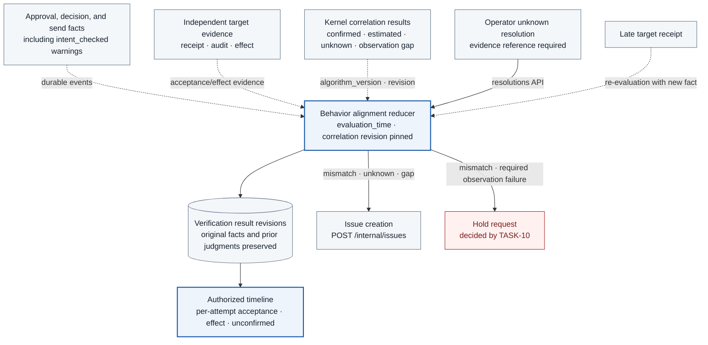

# TASK-11 · Behavior alignment verification and timeline

> This document is the specification of the features to be implemented. Settings, check items, APIs, storage constraints, and failure handling are the implementation contract, and implementation and deployment have not been performed yet. Values generated in the deployment environment are managed as installation inputs.

## Structure at a glance

> Target design · implementation, deployment, and functional effect unverified. Solid lines are placement, processing, and calls; dotted lines are references and observation evidence; the text on each arrow distinguishes its meaning.

**How to read:** The screen does not turn API acceptance into effect success, and when late evidence arrives it adds a new revision. The verifier does not modify operational policy directly and does not place holds directly either. It only requests holds from TASK-10, and policy improvement is passed to TASK-12 through issues. It does not create session correlations without evidence or automatic retries.

| Item | Content |
| --- | --- |
| Plan | [Final plan](../plan.md#task-11) |
| Development prerequisites | [TASK-05](TASK-05-service-adapters.md) · [TASK-07](TASK-07-audit-store.md) · [TASK-08](TASK-08-destination-evidence.md) · [TASK-10](TASK-10-correlation-health.md) |
| Integration dependencies (runtime) | [TASK-10](TASK-10-correlation-health.md) hold API · [TASK-12](TASK-12-policy-proposals.md) issue API · [TASK-04](TASK-04-policy-gateway.md) intent check events |
| Responsible role | Verification/product engineer · owner/due date undecided |
| Common rules | [Shared Tech Spec](COMMON.md) |
| Basis | Working tree after efe8dce (revised 2026-10-11) |

## 1. Goals and scope

Show whether the scope the user approved matches the actual sends, receipts, and effects. The timeline shows the facts, attempts, evidence sources, and omissions at each stage, and distinguishes API acceptance, actual effect, and unknown observation. It does not claim to verify free-form intent outside the structured contract fields. AI warnings from approval intent comparison (intent check) are informational and do not change the alignment judgment.

This Task also implements the sanitized evidence query API `/internal/evidence/*`. This API is the target of the `evidence.*` operations in the TASK-02 catalog, and the TASK-05 evidence-reader adapter calls it.

## 2. Required environment, inputs, and resources

The components of this Task (`services/timeline/`, `packages/alignment/`) are implemented with Python 3.12, FastAPI, and Pydantic v2, and access the DB with psycopg 3. This Task owns and writes directly to the `alignment_results` (result revisions) and `mismatches` tables. Tables of other Tasks are read only: with the `timeline_reader` role it SELECTs `evidence.destination_observations` (TASK-08), `correlation.correlations`, `correlation.lifecycle_intervals`, `correlation.kernel_session_attributions`, `correlation.network_findings`, the view `correlation.network_findings_latest` (TASK-10), and others. Audit events are recorded with TASK-07 `audit_append()`, and holds and issues are requested through the owning services' APIs. Python components do not compute action_digest or contract digests directly; they compare the digests stored by the Go gateway as-is. The timeline UI is `apps/console/timeline/` (TypeScript/React).

Required: the approval contract, decision, WirePlan, AdapterObservation, AuditEvent, Receipt, Correlation, actor/tenant query permissions, and an event store that can be reconstructed. The COMMON event registry must define the expected events per state so that the reducer can judge omissions. Prepare fixed fixtures for the state reducer and mismatch classification.

## 3. Technical implementation design

1. Build per-action facts from the appended events and compute the derived state with an independent reducer. It handles delayed, duplicated, and reordered events, and does not overwrite multiple facts with a single last status.
2. The prior contract comparison function is enforced on the adapter send path and is re-evaluated in the verification service with the same schema/version. Actor, session, target, environment, disclosure, content, budget, and epoch are each compared.
3. Attempts and receipt/provider evidence are shown separately under the action. A timeout is shown as unknown and an HTTP success as accepted, and effect_verified is shown only when there is sufficient independent target effect evidence. Evidence mismatch and insufficient evidence are expressed as separate reasons.
4. Kernel evidence is shown together with confidence and observation gaps. Worker observation/durable linkage of the SessionProcessBinding and work readiness/runner start are shown as separate stages. The session actor is shown with KernelSessionAttribution.linked/unlinked and root_exec_id/worker refs, and the action/attempt execution linkage is shown separately with the existing Correlation.confidence. A worker's linked is not turned into action confirmed or effect success. Shared supervisor/adapter events and lineage loss are not guessed as session events. Events without a confirmed session are placed in the workload timeline and are not shown as execution evidence of that session.
5. When a mismatch in a confirmed session is confirmed, a hold with `scope=session`, `reason=alignment_mismatch` is requested through TASK-10's `POST /internal/holds`. Kernel behavior with unknown attribution is shown only as a workload item in the timeline, and TASK-10 makes the workload hold decision according to the COMMON risk event classification. TASK-10 handles hold decisions and releases, and the verifier does not create new allows.

Worker ID, root exec, and observation/termination state are shown from the SELECT summary of TASK-10 `correlation.session_worker_summary`. Raw process hints/controls are not exposed in the UI, and all queries keep the existing tenant/session/workload permission checks.

Network judgments (NetworkFinding in [TASK-10 3.7](TASK-10-correlation-health.md#37-network-policy-records-and-composite-decisions)) are shown as workload items in the timeline (3.2). They are not asserted to be violations of a specific session or action and do not change the `alignment` value.
6. When a mismatch, unknown, or observation_gap is confirmed, an issue is created through TASK-12's `POST /internal/issues` (`source` is `mismatch`, `unknown`, or `gap`, respectively). An issue is only an input to policy improvement, and proposals are started by the operator.
7. Replaying with the same event set (`received_at ≤ evaluation_time`), the same `reducer_version`, and the same correlation `algorithm_version` and revision set must produce the same projection. Each time a computation finishes, an `alignment_checked` event is added to the audit. When a late receipt arrives, a result revision is added, and the original events and prior judgments are preserved.
### 3.1 Action alignment validation reducer

`packages/alignment/reducer.py` builds the current decision projection without deleting or modifying original events. The comparison baseline is the approval revision's operation, target, environment/tenant, disclosure, content digest/bytes, max_actions, and `policy_epoch`. Actual values come from the adapter wire plan, transport peer/TLS, independent receipts, and kernel evidence with a stated confidence.

The reducer inputs are fixed to the following four. The same inputs produce the same output.

| Input | Content |
| --- | --- |
| `event_set` | The set of event_ids, with each digest, among events linked to the action where `received_at ≤ evaluation_time` |
| `evaluation_time` | The reference time of the decision. Whether a confirmation deadline has passed is judged only with this value, and the current time is not read directly. |
| `correlation_revisions` | The set of `algorithm_version` and revision IDs of the Correlations used |
| `reducer_version` | Version of the comparison rules and enums |

The result revision stores all four values above, and they are returned as the `reducer` object of the COMMON timeline schema. Periodic re-evaluation creates a new revision with a new `evaluation_time` and does not overwrite the previous revision.

The `execution_state` and `alignment` values use the COMMON enums unchanged. `alignment` is one of `aligned | mismatch | unknown | insufficient_evidence | observation_gap`.

| Collected fact | execution_state | alignment decision |
| --- | --- | --- |
| gateway deny or pending approval, with no attempt | denied / approval_pending | Distinguishes the range confirmed to have no execution from the range not observed. If a target call record appears, it is mismatch. |
| Contract comparison failure right before sending | preflight_rejected | Confirms the send was blocked. If there is no evidence of non-arrival at the target, it is insufficient_evidence. |
| planned stored, no send evidence, crash/timeout | unknown | unknown. Agreement between the approved scope and the actual action is not confirmed. |
| send and a 2xx response | accepted | Confirms only target acceptance. Until effect evidence arrives, it is insufficient_evidence. |
| The receipt's target, content, bytes, and effect count match the approval | effect_verified | aligned under the independent_receipt strategy. |
| destination/content/disclosure differing from the approval, or duplicate effects | effect_mismatch | mismatch; the mismatch reason and independent evidence are recorded. |
| An ObservationGap of a required source overlaps the interval | Existing state kept | observation_gap. The gap is not covered up as normal. |
| A kernel action that could not be correlated | Separate unmatched event | Not asserted as a violation by a specific session; shown as a workload item. The workload hold is decided by TASK-10 using the COMMON risk event classification. |
| A NetworkFinding for the same workload | Existing state kept | Not a reducer input. Shown only as a workload item without changing `alignment`, `evidence_level`, or `comparison`. |

A late receipt can resolve an existing unknown, but the past unknown event is preserved. Conflicting independent evidence is not covered up as normal and is left as an incident. API errors and target effect mismatches are not shown as the same state.

### 3.2 Timeline API and display contract

`GET /v1/actions/{action_id}/timeline` checks the tenant and owner of the authenticated actor. The operational read role is also limited to the approved tenant scope. Action IDs of a different tenant are handled with 404 so that their existence is not revealed. The cursor is ordered by `(received_at, event_id)` and returns at most 100 items at a time. Original secrets, Authorization, and raw prompts in safe_payload are not returned.

The response schema follows the single [COMMON timeline response schema](COMMON.md#timeline-response-schema) unchanged, and this document does not define fields separately. Points to consider during implementation are as follows.

- `verdict`, `execution_state`, `alignment`, and `evidence_level` are different axes, so they are filled as separate fields.
- `authorization` is filled with one of `approval_id` or `standing_rule_id`, and `intent_check_status`.
- `reducer` is filled with the `reducer_version`, `evaluation_time`, and correlation `algorithm_version`/revision set from 3.1.
- Each item of `facts`, `attempts`, and `evidence` has both `source_time` and `received_at`.
- NetworkFindings are placed in `evidence[]` with `type = network_finding`. The targets are findings that have the same `workload_id` as this action's `workload_id` and whose `[window_start, window_end]` overlaps the interval from the action's first event to `evaluation_time`. For each finding, only the largest revision with `created_at ≤ evaluation_time` is used, so the same `evaluation_time` gives the same response. `evidence_id = finding_id`, `confidence` is the finding's value (`workload_inferred`), `session_id` is null, and `ref` is `network_finding:<finding_id>:<revision>`. Findings without a `workload_id` are not placed in the action timeline.

The UI shows the order approval → decision → planned → dispatch → response → receipt → alignment, while keeping both the source time and received_at. verdict, execution_state, alignment, evidence_level, and health are shown as separate fields. Decision facts are shown together with the GatewayDecision's `matched_rule_ids`, so that the operator can see which rule was the basis for allow, approval required, or deny. Inferred relations expose confidence, candidate_count, and limitations together. The `evidence_level` ceiling for model calls (Gemini Enterprise Agent Platform, formerly Vertex AI; hereafter Agent Platform) is `accepted`, so receiver-level effect_verified is not shown. If there is an `intent_checked` event, the warning and the items the user confirmed are shown, but this warning does not change the alignment value.

A NetworkFinding item shows, in the workload item area, `kind`, `outcome`, `network_segment`, `boundary_crossing`, `attempt_count` with `count_quality`, `window_start`–`window_end`, revision, and `limitations` together. The display text uses `outcome` as is. `unknown` is not shown as "blocked" or "violation", and an interval with no records is not shown as "no attempt". Because it may be an attempt by another session using the same workload, it is not labeled "this session's action". Read permission is the same as for existing workload items.

### 3.3 Unknown resolution and hold/issue linkage

The operator resolves an unknown with `POST /v1/actions/{action_id}/resolutions`. The request fields, per the COMMON API contract, are `attempt_id`, `resolution` (one of `no_effect`, `effect_confirmed`, `mismatch`), and `evidence_refs` (required). The request is rejected if there are no evidence references or if the caller does not have the role `operator`. In one transaction, the server stores the resolution row, calls the DB function `resolve_unknown_attempt(attempt_id, resolution_id)` provided by TASK-03 to transition the attempt from `unknown → resolved`, and records an `unknown_resolved` event (`action_id, attempt_id, resolution, evidence_refs, resolved_by_actor`) with `audit_append()`. If any of the three fails, everything is rolled back. After COMMIT, a new `alignment_results` revision is created. The original unknown fact is not erased. Only after this transition does the coordinator allow a new attempt under the same reservation. This API does not execute a resend. If `resolution = mismatch`, the hold request below is also sent.

Mismatch decisions and issues are linked to the corresponding decision as evidence. The decision has `matched_rule_ids`, the direct basis of the decision, and `evaluated_rule_ids`, all check rules evaluated for that operation, and TASK-12 identifies the defective rule using `evaluated_rule_ids` and the COMMON mapping table.

A hold request sends `scope, scope_id, reason, evidence_refs` to TASK-10's `POST /internal/holds`, and control-health records the fact of the request as a `hold_requested` event under its own audit source. TASK-11 does not publish the same event separately. The only hold this Task sends is for a single mismatch of a confirmed session, with `scope=session` and `reason=alignment_mismatch`. This reason is a security reason, so it is released only with operator approval. Decision and release follow TASK-10's hold model. To avoid duplicate requests on the same evidence, `(scope_id, reason, mismatch_id)` is used as the idempotency key. The evidence digest is not put in the key so that Python does not compute digests.

Issue creation sends `source(mismatch | unknown | gap)`, `subject_ref` (action_id or gap_id), `reason` (mismatch reason, unknown reason, gap stage), and `evidence_ids` to TASK-12's `POST /internal/issues`. TASK-12 handles idempotency with the natural key `(source, subject_ref, reason)` and puts the evidence IDs into `issue_evidence`. Issues with `source=intent_divergence` created by an intent check are created by TASK-04, and this Task only links and shows them in the timeline.

### 3.4 Sanitized evidence lookup API

`services/timeline/` implements the sanitized APIs that the `evidence.*` operations in the TASK-02 catalog point to. The only caller is the TASK-05 evidence-reader adapter. The adapter passes the `issue_id` and tenant of the service session confirmed by the gateway as the request context, and this API returns results only if the requested ID is in TASK-12 `issue_evidence(issue_id, kind, ref_id)`. Otherwise it is handled with 404 without revealing existence.

| Path | Returned content | Restrictions |
| --- | --- | --- |
| `GET /internal/evidence/actions/{action_id}` | Approval and action digests, the decision result with `matched_rule_ids` and `decision_input_digest`, attempt and target results, kernel correlation level, authorized evidence references, unknown reasons | Response 64KiB; excludes actor identifiers, original text, and secrets |
| `GET /internal/evidence/bundles/{bundle_id}` | Base bundle digest, allowed policy data, catalog contract | Only registered base/candidate |
| `GET /internal/evidence/regressions/{run_id}` | Candidate digest, per-case results, denominators, normal impact, missing evidence | Holdout cases are returned only as aggregates (TASK-13 3.2). |

External text in the response is marked as data, and fields are separated so that the model does not interpret it as instructions. If the response size is exceeded, it is not silently truncated; the list of omitted fields is returned together.

## 4. API, Data, and Connection contract

| API | caller | Owner |
| --- | --- | --- |
| `GET /v1/actions/{action_id}/timeline` | Owner, operations query role | TASK-11 |
| `POST /v1/actions/{action_id}/resolutions` | Operator | TASK-11 |
| `GET /internal/evidence/*` | TASK-05 evidence-reader | TASK-11 |
| `POST /internal/holds` | TASK-11 only makes requests | TASK-10 |
| `POST /internal/issues` | TASK-11 verifier, TASK-04 intent checker, TASK-10 correlation (`source = network_finding`) | TASK-12 |
| SELECT on views `correlation.network_findings_latest`, `correlation.network_findings` | TASK-11 `timeline_reader` | TASK-10 |

User and tenant scope is applied from the DB query stage onward.

A `mismatches` row stores `mismatch_id, action_id, attempt_id?, reason, compared_fields, expected_digest/value_redacted, observed_digest/value_redacted, evidence_refs, severity, affected_scope, reducer_version, evaluation_time`. The values of `reason` and `severity`, the timeline item (facts, attempts, evidence, revisions) schema, and the risk event classification follow the COMMON source-of-truth enums. `alignment_results` is keyed by `(action_id, revision)` and stores the derived fields of the COMMON timeline schema and the four reducer input values from 3.1. Secrets and sensitive full text are not exposed by default, even to authorized users.

States and transitions follow the enums in the [Shared Spec](COMMON.md). approval_pending, denied, preflight_rejected, attempt_planned, dispatched, accepted, effect_verified, effect_mismatch, failed, and unknown are shown together with the facts. For time, the producer's observation time and the collector's receipt time are distinguished.

## 5. Security Boundaries, Failure Handling, and Operations

The verifier itself is not an operational policy writer and does not write holds directly. The screen does not perform execution retries automatically. Log strings are not executed as HTML or commands; they are shown as escaped text. Per-object permission verification is also applied to audit queries and exports. The resolutions API cannot change state without evidence references.

A false positive is a case where a legitimate retry or a late receipt is mistaken for a duplicate effect. A false negative is a case where there is no receiver evidence, the adapter forges evidence, or normalization is wrong. Verification uses fixed ground-truth fixtures and independent receipts. The absence of events is not described as success or as the absence of bypass.

## 6. Implementation Files and Work Order

Implementation files are written in the paths below. There are currently no GCP implementation files, and if implementation paths change, this specification and CI are updated together.

| Implementation path | Implementation responsibility |
| --- | --- |
| packages/alignment/ | contract comparison and state reducer (`reducer.py`) |
| services/timeline/ | Authorized queries, rebuild, resolutions, `/internal/evidence/*`, writes to `alignment_results` and `mismatches` |
| migrations/ | DDL for `alignment_results` and `mismatches` (`golang-migrate` SQL files, the part owned by this Task) |
| apps/console/timeline/ | Display of facts, attempts, evidence, gaps, and intent warnings, and display of NetworkFindings for workload items |
| tests/alignment/ | Fixtures for ground truth, late, duplicate, mismatch, and replay determinism |

## 7. Verification Methods and Pass Criteria

| Test | Method and independent verification evidence | Pass criteria |
| --- | --- | --- |
| Preventing false completion | HTTP 200 but no receipt, timeout, empty kernel feed | Shown as accepted/unknown/gap, not effect_verified |
| contract mismatch | Target/body/disclosure variants and independent receipt fixtures | Per-field mismatch and evidence shown, session hold requested and issue created |
| Reconstruction | Replay duplicates, reordering, and late receipts with the same four inputs | Same facts and derived state, previous revisions preserved |
| Fixed evaluation time | Replay the same event set with different `evaluation_time` values | Only the deadline decision differs, and each result is reproducible from its own inputs |
| Resolving unknown | Injected requests without evidence, requests not from `operator`, normal requests, and `resolve_unknown_attempt` failures | The first two kinds of requests are rejected; a normal request produces attempt `resolved` and the `unknown_resolved` event in one transaction; an injected failure rolls everything back |
| Query permission | Query and export of action IDs belonging to other users/tenants | 404 or 403 with no information leakage |
| Evidence API scope | Query of IDs from other issues/tenants and holdout cases | Rejected; holdout returns only aggregate values |
| NetworkFinding display | Compare `blocked_attempt` and `unmatched_attempt` findings of the same workload with findings of another workload, and the reducer results for actions with and without findings | Only findings of the same workload are shown in `evidence[]` with `type = network_finding` and `session_id = null`; `alignment`, `evidence_level`, and `comparison` are unchanged; `unknown` is not shown as a violation |
| NetworkFinding replay | Replay with an earlier `evaluation_time` after finding revisions have increased | Only the latest revision as of that time is shown, and the same input yields the same response |

Before running verification, pin the code, images, schemas, policy/catalog versions, target environment, and test denominators. The tests below were not run while writing this document. Actual execution records are stored according to the [common result recording contract](COMMON.md#result-recording-contract).

## 8. Deliverables and Implementation Results

### Deliverables to produce after implementation

- Comparison library, reducer and timeline API/screen, state transition table, trust and gap display per evidence, resolutions API, sanitized evidence API, and tests for mismatch, hold requests, and issue creation.

### Results confirmed so far

| Category | Current status |
| --- | --- |
| Tech Spec | Implementation specification written · only static link checks performed; rendering and functional verification not run |
| Implementation files | The corresponding GCP implementation paths have not been created as of now |
| Functional tests | Not run |
| GCP/GKE deployment | Not performed or checked in this work |
| Completion decision | Planned · not judged as functionally complete |

### When recording implementation results

- Record `implementation_commit`, image digests, `run_id`, the environment manifest, and safe references to the verification report and raw evidence.
- Record `expected / observed / passed / failed / unknown / not_run` and the denominator for each test. Unmeasured numbers are left as `null`.
- Record failed, unobserved, and undecided items, normal-work impact, and deployment/recovery results together, and change only the verified scope to complete.

## 9. Deployment Inputs and Change Conditions

The state reducer, confidence display, and owner query restrictions are implemented according to chapter 3. The timeline UI is implemented in React/TypeScript, and sensitive raw evidence is not exposed in the general UI.

If permissions, trust boundaries, supported behavior, or default failure handling change, the final plan and the related Tasks are revised together. The role is defined in the table above and the actual owner has not yet been decided, so this table is not to be interpreted as operational approval.

## 10. Technical References

- [OTel Collector configuration](https://opentelemetry.io/docs/collector/configuration/)
- [Gemini Enterprise Agent Platform release notes](https://docs.cloud.google.com/gemini-enterprise-agent-platform/release-notes): source for the name change stating that Vertex AI was included in Gemini Enterprise Agent Platform
