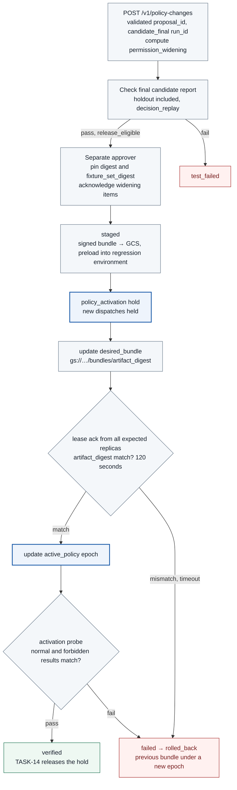

# TASK-14 · Approved Policy Deployment, Revalidation, and Rollback

> This document is the specification of the features to be implemented. The settings, check items, APIs, storage constraints, and failure handling are the implementation contract, and implementation and deployment have not yet been performed. Values generated in the deployment environment are managed as installation inputs.

## Structure at a Glance

> Target design · implementation, deployment, and functional effect not verified. Solid lines are placement, processing, and calls; dashed lines are references and observation evidence; the text on each arrow distinguishes the meaning.



**How to read:** A successful download is distinguished from actual activation, and during activation new dispatches are held by the `policy_activation` hold. A restore also releases the hold only after revalidation, and target effects that have already occurred cannot be undone by a policy rollback. Unapproved changes and hash tampering after approval are rejected before deployment starts.

| Item | Content |
| --- | --- |
| Plan | [Final plan](../plan.md#task-14) |
| Development prerequisites | [TASK-10](TASK-10-correlation-health.md) · [TASK-13](TASK-13-regression-harness.md) |
| Integration dependencies (runtime) | [TASK-03](TASK-03-identity-approval.md) service sessions and activation probe registration · [TASK-04](TASK-04-policy-gateway.md) embedded OPA decisions and `decision_inputs` · [TASK-12](TASK-12-policy-proposals.md) validated proposals · [TASK-01](TASK-01-gke-platform.md) regression test environment. TASK-12↔13↔14 are runtime integration dependencies. |
| Owner role | Policy release engineer · owner and due date undecided |
| Common conventions | [Shared Tech Spec](COMMON.md) |
| Baseline | Working tree after efe8dce (revised 2026-10-11) |

## 1. Goals and Scope

Human approval of a verified change is bound to the exact hashes of the bundle, report, and fixture set, and the active state of the actual components is confirmed. One improvement and the restoration of the previously approved bundle are verified in the MVP. This Task also owns the policy change API (`POST /v1/policy-changes`, `GET /v1/policy-changes/{change_id}`) and the approval UI (`apps/console/policy-changes`).

In this document, "limited deployment" is not a canary deployment. It is a method in which a deployment identity with restricted permissions applies the bundle only to registered targets, holds new dispatches during activation, and then switches the epoch atomically. Therefore every policy change has an operational impact: during the activation time (lease ack upper bound of 120 seconds + probe time), all new dispatches are rejected with `HOLD_ACTIVE`. A phased rollout that applies the change to only part of the traffic first is not in the MVP scope.

## 2. Required Environment, Inputs, and Resources

The releaser `services/releaser/`, the bundle builder `packages/bundles/`, and the permission widening check `packages/policydiff/` are implemented in Go. DB access uses `pgx` v5 + `sqlc`, and migrations use `golang-migrate` (`migrations/`). The approval UI `apps/console/policy-changes/` is TypeScript/React.

The following are required: a validated PolicyProposal, the report of the final regression run including the holdout (`run_kind = candidate_final`), the approving user's identity and role, a signed bundle store (GCS) and signing key, a restricted release SA, `active_policy`, TASK-10's `holds` and `control_health_leases`, and TASK-03's service session and activation probe registration APIs. A previous bundle that can be rolled back to and its schema compatibility are secured in advance. The same releaser procedure is also deployed in the regression test project built with the TASK-01 module.

## 3. Technical Implementation Design

1. Policy changes follow the COMMON policy change state transitions: `proposed → tested | test_failed → approved | approval_expired → staged → activating → verified | failed`, and `rolled_back` from `failed` or `verified`. An approval is bound to the base, candidate, report, and component digests, `fixture_set_digest`, and the allowed scope; if anything is tampered with after approval, a new test and a new approval are required.
2. The restricted release SA applies only pre-approved policy data and Namespaced tracing policies. Arbitrary manifests, ClusterRoles, and node permission expansions are not deployed through this API.
3. The releaser signs the bundle and uploads it to `gs://<bucket>/bundles/<artifact_digest>.tar.gz`, and announces which bundle to load through a single `desired_bundle` row (3.2). The gateway and adapters read this row and load the same bundle, and the adapter constraints are also read from this bundle. Adapter constraints are not deployed through ConfigMaps.
4. The activation order is fixed: create the `policy_activation` hold → update `desired_bundle` → leases of all expected replicas report the loaded `artifact_digest` → epoch CAS (with `revoke_approvals_for_policy_change` in the same transaction) → activation probe → release the hold or roll back. `desired_bundle` is not changed before the hold is created, so there is no interval in which decisions change during loading.
5. After the actual active version is confirmed with the activation probe and small normal and forbidden checks, the hold is released. In-flight requests from the old epoch are tracked separately by start time and result, and remote effects cannot be rolled back.
6. On failure, the previously approved bundle whose health can be confirmed is restored in the same order under a new monotonic epoch. The policy epoch is never rewound. Existing approvals are handled according to the COMMON "policy change and approval invalidation" table.

<a id="31-approval-content-and-state-machine-ref"></a>

### 3.1 Approval content and state machine

An operator creates a change by putting a validated `proposal_id` and the `run_id` of a `run_kind = candidate_final` run into `POST /v1/policy-changes`. The server stores `state = proposed` and `created_by_actor = the authenticated operator`. A `run_id` of another run_kind is rejected. While processing this request, the releaser computes `permission_widening` with `packages/policydiff/`, stores it in the PolicyChange, and records a `permission_widening_checked` event (3.5).

The production approver checks the changed policy data, adapter constraints, and sensor artifacts, the `permission_widening` items, the report's `decision_replay.changed` (requests whose decision changed, rule ID differences, and evidence of normal impact), the base, candidate, and test report digests, `fixture_set_digest`, the report's `governance_summary` and `governance_map_digest` (results per check item in COMMON [appendix C](COMMON.md#appendix-c-governance-checklist)), and the affected services, disclosure scope, expiry, and rollback target. `governance_summary` is reference information for the approver. It does not change whether approval is possible and is not used in computing `release_eligible`. The approval screen shows check items with no row as "not tested in this run" and does not show them as passed. Both values are in the report and fixed by `report_digest`, so they are not stored separately in the PolicyChange. `POST /v1/policy-changes/{change_id}/approve` stores the digest of all these values as `approval_digest` and the approver as `approved_by_actor`. The approver must have the role `approver` and must differ from both the PolicyProposal's `initiated_by_actor` and the PolicyChange's `created_by_actor`. Only the role `release_operator` can request activation and rollback. The role enum (`operator | approver | release_operator | viewer`) follows COMMON. The approval TTL is 30 minutes, and if `.../activate` does not start before `approval_expires_at`, the state becomes `approval_expired`.

| Current state | Next state | Required conditions | Failure handling |
| --- | --- | --- | --- |
| (proposal `validated`) | `proposed` | Operator `POST /v1/policy-changes` | Not created if input validation fails |
| `proposed` | `tested` / `test_failed` | The input `candidate_final` report is `pass` and `release_eligible`. The candidate digest matches the change, the report's `required_fixture_ids ⊆ fixture_ids`, and `required_set_digest` equals the current value in `fixture_registry` | Left as `test_failed`, waiting for a new proposal |
| `tested` | `approved` / `approval_expired` | 3.1 actor separation, exact diff, per-item acknowledge if `widened = true` (`PERMISSION_WIDENING_ACK_REQUIRED`) | `approval_expired` if not approved within 30 minutes. To re-approve, create a new change |
| `approved` | `staged` | Upload the signed bundle to GCS, load it first into the regression test environment with the same releaser procedure (signed separately with the `regression-v1` key), and confirm the lease ack | On failure, stays in `approved` and the production environment is not touched |
| `staged` | `activating` | From hold creation to the epoch CAS in the step-4 order of chapter 3 | `failed` if the lease ack timeout of 120 seconds is exceeded |
| `activating` | `verified` / `failed` | Release the hold when the activation probe passes | `failed` if the probe fails or cannot be confirmed |
| `failed` or `verified` | `rolled_back` | `.../rollback`, previously approved artifact, schema compatibility. In the same order, change `desired_bundle` to the previous bundle, then a new epoch CAS (expected digest is the currently active candidate) + probe | On failure, the hold and incident are kept |

Each state change records an audit event with a name from the COMMON event registry: `policy_change_approved`, `policy_deployed`, `policy_activation_verified`, `policy_reverified`, `policy_rolled_back`.

### 3.2 Bundle deployment, signing, and component acknowledgement

**Two digests.** `candidate_digest` is the bundle content digest. It is the canonical digest over the list of bundle files excluding the signature file (`.signatures.json`) and the SHA-256 of each file, and TASK-13 regression testing and approval are bound to this value. `artifact_digest` is the SHA-256 of the whole tarball including the signature file, and is used for the GCS object name and the lease ack. Even with the same `candidate_digest`, signing with the production key and with the regression key gives different `artifact_digest`s. The PolicyChange stores both values, and before loading, the releaser unpacks the tarball, recomputes `candidate_digest`, and checks that it matches.

**Signing.** The signing algorithm is ES256. The production signing key is a Cloud KMS `EC_SIGN_P256_SHA256` key (keyID `prod-v1`), and the releaser's `packages/bundles/` wraps KMS as a Go `crypto.Signer` to produce the OPA bundle signature format (a JWT in `.signatures.json`, with the `files` list in the payload). `v1/keys` in the OPA source supports ES256 as a bundle verification algorithm ([keys.go](https://github.com/open-policy-agent/opa/blob/main/v1/keys/keys.go), source checked). Cloud KMS EC signatures are returned DER-encoded ([KMS EC signature verification example](https://docs.cloud.google.com/kms/docs/samples/kms-verify-asymmetric-signature-ec)), so they must be converted into the fixed-length `R || S` format (32 bytes each) that JWS ES256 requires. This conversion and passing OPA verification are checked in Q0. The verification public keys are distributed in the ConfigMap `agentarium-bundle-keys`, and the production gateway and adapters trust only `prod-v1`. The regression project uses a separate key, `regression-v1`.

**desired_bundle.** The releaser writes `desired_bundle(bundle_id, artifact_digest, object_uri, set_by_change_id, set_at)`, one row per environment. `object_uri` is `gs://<bucket>/bundles/<artifact_digest>.tar.gz`. The gateway and adapters read this row every 2 seconds, and when the value changes they fetch the object, verify the `artifact_digest` and signature, and load it. If verification fails, they keep running with the existing bundle and do not report the new digest. The gateway's loading is done by the shared package `packages/policyloader/` (TASK-04), which verifies the signature with the `v1/bundle` reader and atomically swaps the prepared query and `Manifest.Revision` ([TASK-04 3.1](TASK-04-policy-gateway.md#31-authentication-recording-rules-embedded-opa-loading)). The `github.com/open-policy-agent/opa/v1/rego` package only evaluates and has no bundle management features ([OPA integration](https://www.openpolicyagent.org/docs/integration)), so this polling and swapping is implemented by project code.

**Epoch CAS.** `active_policy` has no hold field. The activation hold is a `reason = policy_activation`, `scope = global` hold row created with TASK-10 `POST /internal/holds`, and only TASK-14 releases it. After all lease acks are collected, the coordinator locks `active_policy` `FOR UPDATE` and runs the CAS below. If it exceeds the lock timeout (2 seconds), the result is 503 `LOCK_TIMEOUT`. The change, events, outbox, and approval invalidation are handled in the same transaction.

```sql
SELECT 1 FROM holds
 WHERE reason = 'policy_activation' AND released_at IS NULL
   AND scope = 'global' AND hold_id = :activation_hold_id
FOR SHARE;

UPDATE active_policy
SET epoch = epoch + 1,
    bundle_id = :candidate_bundle_id,
    bundle_digest = :candidate_digest,
    catalog_digest = :candidate_catalog_digest,
    artifact_digest = :artifact_digest,
    expected_opa_revision = :candidate_opa_revision
WHERE scope_id = :scope_id
  AND epoch = :expected_epoch
  AND bundle_digest = :expected_current_digest   -- activation: approved base, rollback: currently active candidate
RETURNING epoch;

-- same transaction: if the patch narrows disclosure scope, revoke unused approvals as policy_changed (approval_revoked event)
SELECT revoke_approvals_for_policy_change(:new_epoch, :patch_kind, :allowed_fields);
```

`candidate_bundle_id` and `candidate_catalog_digest` are the values of the same candidate bundle verified above. Rollback also uses both values of the bundle being restored. Because the epoch, bundle, and catalog are updated in the same CAS, the coordinator never combines a new epoch with the previous catalog.

**Component ack.** Acks are received as COMMON ControlHealthLeases: each component reports the loaded `artifact_digest` in `active_version`, and the gateway also reports `Manifest.Revision` in `active_bundle_revision`. The expected replica list is obtained from the target Deployment's `status.replicas` and its Pod list. All replicas must report the same `artifact_digest`, and if a scale or restart happens during activation, acks from the new Pods are also required. Acks older than the lease TTL of 15 seconds are checked again. The ack timeout is 120 seconds. A mere download does not create an active ack. The releaser makes this judgment from `bundle_ack {desired_artifact_digest, expected_replicas, acked_replicas}` in the response of TASK-10 `GET /internal/control-health?scope=workload&scope_id=<Deployment>`, and for this the TASK-10 `control_health_writer` role is given SELECT on `desired_bundle`. If the revision used for a decision differs from the expected value, the gateway rejects with `POLICY_VERSION_MISMATCH` (TASK-04). For sensor rule changes, application is confirmed with the `sensor_generation` of the per-node TASK-09 lease.

### 3.3 activation probe and hold release

During a `policy_activation` hold, only activation probe actions registered by the TASK-14 releaser can receive a permit. The probe uses the dedicated standing rule `probe.activation.v1` so that it is judged without user approval. The conditions of this rule are fixed: only `change_id`-scoped service sessions, the target is the fixed target `receiver-probe` in the probe namespace, the public fields are `[summary]`, and at most 4 runs per change. The TASK-12 validator rejects any patch that changes this rule. The path follows the COMMON "activation probe dedicated dispatch".

1. The releaser obtains a `change_id`-scoped service session (`activation_probe` profile, TTL 10 minutes) from TASK-03 `POST /internal/service-sessions` and submits the probe action to `POST /v1/actions`.
2. The releaser registers `(change_id, action_id, target_epoch, expires_at)` with `POST /internal/dispatch/activation-probes` (TASK-03). TASK-03 records an `activation_probe_registered` event.
3. The TASK-04 gateway judges the probe with the new active bundle and records `decision_basis = activation_probe` and `activation_probe_id` in the decision. The ordinary deny rules also apply to the probe as they are.
4. The TASK-03 coordinator lets only the probe through in the hold branch of the reservation transaction. If there is any hold other than `policy_activation`, the probe is also rejected.

The probe consists of 1 normal request (summary only) and 1 forbidden request (including email) to `receiver-probe`. The normal request expects a confirmed receiver effect, and the forbidden request expects `DISCLOSURE_SCOPE_DENIED` and 0 dispatches; the required audit evidence is reconciled as well. The result is recorded as a `policy_reverified` event. If the probe passes, TASK-14 releases the `policy_activation` hold with `POST /internal/holds/{hold_id}/release`. Ordinary users are not given a hold bypass flag.

Worker restart path: the releaser is an idempotent state machine per change ID. On restart, it rereads `desired_bundle`, `active_policy`, open holds, and leases to determine the current stage. If the change is `activating` and the epoch CAS has already been applied, it resumes from the probe; if not, it resumes from the lease check. If it cannot determine the stage, it moves the change to `failed` while keeping the hold.

### 3.4 Deployment permissions and rollback

The release KSA is granted only get, update, and patch on the existing Namespaced TracingPolicy objects, with their names fixed in `resourceNames`. The policy bundle is deployed not as a Kubernetes resource but as a GCS object and a `desired_bundle` row. Because Kubernetes RBAC cannot restrict create requests by resource name ([RBAC](https://kubernetes.io/docs/reference/access-authn-authz/rbac/#referring-to-resources)), the release role is not given create, and the initial platform installer performs the creation. ClusterRole, Node, Secret, Deployment image, and Namespace security labels are outside the scope of this policy deployment API. Only the releaser can write to the GCS bundle store, and the gateway and adapter can only read it. Likewise, only the releaser writes `desired_bundle`, and the gateway and adapter only read it.

Rollback also follows the same order as step 4 in chapter 3: it changes `desired_bundle` to the previous bundle, confirms the lease ack, and activates it with a **new epoch**. Because a PolicyBundle has no epoch, the same immutable bundle can be reactivated with a different epoch. The read/write schema compatibility of migrations is checked, and if the previous artifact cannot read the current DB, rollback is aborted. After a restart, the worker re-queries the stage and the actual component state and continues processing. After a release timeout, not all requests are automatically allowed. Effects that have already occurred at an external receiver or model are not undone by a policy rollback.

**TracingPolicy and drift expectations.** The `agentarium-tcp-connect` and `agentarium-protected-file` TracingPolicyNamespaced objects in `agent-exec`, managed by the releaser, are the comparison targets of `sensor_policy` in the TASK-10 drift probe. So that only an activated, approved revision counts as a match, the following applies.

- **Approval target:** The releaser renders the two objects from the candidate bundle's `sensor_rules` and computes `sensor_release_policies_digest` with `ReleasePoliciesDigest` in `packages/baseline/`. This function accepts only the two TracingPolicyNamespaced objects `agentarium-protected-file` and `agentarium-tcp-connect` in `agent-exec`, and it returns an error if either is missing, another object is mixed in, or the Namespace or name differs. The computed digest is stored in the PolicyChange and included in the component digests bound by `approval_digest`. Whether the digest of the rendered values equals the digest of the live objects after application (whether CRD defaults are applied) is checked in Q0 of the regression test project. The difference in form of empty annotations and labels maps is also left as a SPEC-QUESTION and checked in the same Q0. Normalization removes the annotations map only when it becomes empty after deleting the last-applied annotation, so if the rendered manifest has `annotations: {}` or `labels: {}`, the empty map remains in the rendered digest. In contrast, the empty map can be dropped from the live object returned by the API server, so the two digests can differ.
- **Active record:** `active_policy` has `sensor_release_policies_digest char(64) NOT NULL`, and the epoch CAS `UPDATE` updates it together with the value of the approved change. Rollback uses the value stored in the change of the bundle being restored. The active record of the initial bundle (no PolicyChange) holds the lock `baseline_digests.sensor_release_policies`.
- **Application order:** The releaser updates the two objects after COMMITting the epoch CAS. It then GETs the two objects and checks that the digest computed by the same rules equals the value in the active record. Only if they are equal does it release the `policy_activation` hold. If they differ, the releaser retries the application with the same approved values in the `activating` state. If they still do not match, it moves the change to the existing state `failed` while keeping the hold. At this point `active_policy` already points to the new epoch and is not reverted. Recovery is the existing `failed → rolled_back` transition, that is, a rollback that performs a new epoch CAS with the previous bundle. In the meantime, the drift probe reports the difference between live and the active record as drift. The two objects are not changed before the CAS. On the restart path, if the epoch CAS has already been applied for an `activating` change, the releaser compares the active record with the live digest again and continues from the application step.
- **Query function:** This Task owns `release.active_sensor_baseline() RETURNS TABLE(epoch bigint, change_id uuid, sensor_release_policies_digest char(64))`. It is created as SECURITY DEFINER of the owner, with a fixed `search_path` and PUBLIC EXECUTE revoked, and it returns only these three values from the single `active_policy` row of the current environment. EXECUTE and `release` schema USAGE are granted only to TASK-10 `drift_reporter`. The TASK-14 migration containing this grant must have a higher version than the TASK-10 migration that creates `drift_reporter` (`*_health_drift_reporter`), and it fails if the role does not exist.

This item was added for the TASK-10 drift probe contract (#137), and it requires confirmation from the owner of this Task.

### 3.5 Permission widening check (permission_widening)

`packages/policydiff/` (Go) compares the values before and after applying each typed data patch and lists the widening items. The result format is `permission_widening {widened: bool, items[] {path, added_values, removed_values}}`.

**Source of truth for comparison rules:** The "comparison rules per kind" table in COMMON [Permission widening check](COMMON.md#permission-widening-check-permission_widening) is the source of truth for which changes go into `items`, and this package implements that table as is. Set values (public fields, operations, routes) are compared by whether the new set is a subset of the previous set. Non-set values use type-specific rules: numeric limits and budgets by whether the value grows or the upper-bound key disappears, data class by whether the `data_class` rank rises, and `allowed_cidrs` by CIDR containment rather than string comparison. For changes where containment cannot be determined (`target_pattern`, and a standing rule's `session_kind` and `profile`), the change itself goes into `items`. Disabling, deleting, or changing the selector of `sensor_rules` is a weakening of controls rather than a permission widening, but it goes into `items` so that it goes through the same per-item acknowledge procedure, and the approval screen marks it separately as "control weakening". This document does not restate the table.

| Point | Behavior |
| --- | --- |
| Preview | `POST /internal/policy-diff:check` (owned by this Task). The callers are the TASK-12 proposal service and the console. The input is a base bundle and a patch. It builds an unsigned candidate bundle with `packages/bundles/`, stores it keyed by digest, and returns `candidate_digest` and `permission_widening`. The `permission_widening` result is not stored |
| Change creation | When processing `POST /v1/policy-changes`, the releaser runs the same check again, stores it in the PolicyChange, and records a `permission_widening_checked` event. It does not trust the preview result as is |
| Approval | If `widened = true`, the approval screen highlights the widening items, and the approver must acknowledge each item. If any is missing, the request is rejected with `PERMISSION_WIDENING_ACK_REQUIRED` |

For example, changing `receiver.allowed_disclosure_fields` from `["summary"]` to `["summary", "email"]` yields `items = [{path: "receiver.allowed_disclosure_fields", added_values: ["email"], removed_values: []}]` and `widened = true`. The demo's narrowing change yields `widened = false`.

This check goes only as far as comparing the data values changed by a typed patch using the COMMON rules per kind. It does not cover how actual judgments change due to Rego code changes, interactions among multiple rules, or input conditions such as the data class of a request. Formal analysis tools (e.g., Cedar SymCC) are not used, and changes in judgment results are covered by TASK-13 `decision_replay`.

<a id="4-api-data-and-linkage-contract-ref"></a>

## 4. API, data, and linkage contract

| API | caller | Description |
| --- | --- | --- |
| `POST /v1/policy-changes` | Operator (console) | `proposal_id` (validated), `run_id` (`candidate_final`) → `change_id`, `state = proposed`, `permission_widening` |
| `POST /internal/policy-diff:check` | TASK-12 proposal service, console | base bundle, patch → preview of `candidate_digest` and `permission_widening` |
| `GET /v1/policy-changes/{change_id}` | Operator, approver | diff, `permission_widening`, report (including `decision_replay`), approval, active epoch, component ack, rollback evidence |
| `POST /v1/policy-changes/{change_id}/approve` | Role `approver`, an actor different from `initiated_by_actor` and `created_by_actor` | base, candidate, report, and component digests, `fixture_set_digest`, acknowledgment of widened items, scope, expiry, nonce → `approval_digest` |
| `POST /v1/policy-changes/{change_id}/activate`, `/rollback` | Role `release_operator` | expected epoch → hold_id, stage, desired/observed epoch, probe status |

PolicyBundle follows the structure in the [Shared Spec](COMMON.md#common-data-structures) (`bundle_id, artifact_digest, schema_versions, policy_revision, catalog_digest, adapter_constraints_digest, sensor_rules_digest, standing_rules_digest, rollback_compatibility, test_report_digest`) and does not include the epoch. The epoch is kept only in `active_policy` and activation records. PolicyChange stores the COMMON fields (`change_id, proposal_id, base_bundle_digest, candidate_bundle_digest, run_id, report_digest, fixture_set_digest, state, approval_digest?, approved_by_actor?, approval_expires_at?, target_epoch?, activation_refs, rollback_ref?`) plus `created_by_actor`, `candidate_artifact_digest`, and `permission_widening`. `desired_bundle` is one row per environment and is written only by the releaser. `activation_refs` holds the hold_id, component lease acks, and activation probe references.

The worker is an idempotent state machine per change ID and queries the observed state again after a restart. It detects drift between DB markers and actual resources and does not skip ahead to a success stage.

## 5. Security boundaries, failure handling, and operations

Deployments without approval, past the deadline, with a different hash or scope, or missing the required fixture set are rejected. The proposal and model SAs are not writers of this API. The release writer also does not read actual service credentials.

If the health check fails, new execution is held. If the rollback fails or the previous bundle is also unhealthy, the hold is kept and the specific cause is shown to the operator. The allowed scope is not widened for automatic recovery. Target effects that have already occurred require compensating work separate from policy restoration.

## 6. Implementation files and work order

Implementation files are written at the paths below. There are currently no GCP implementation files, and if an implementation path changes, this specification and CI are updated together.

| Implementation path | Implementation responsibility |
| --- | --- |
| services/releaser/ | (Go) Policy change API, approval hash, state machine, resume, limit application, lease ack check, probe, rollback, `/internal/policy-diff:check` |
| apps/console/policy-changes/ | (TypeScript/React) Screens for change creation, diff, acknowledgment of widened items, replay results, tests, approval, activation, and rollback |
| packages/bundles/ | (Go) Immutable artifacts, candidate digest, OPA bundle signing, compatibility |
| packages/policydiff/ | (Go) Permission widening check for typed patches |
| deploy/gcp/release/ | Minimum deployment permissions, GCS bundle store permissions |
| tests/release/ | Fixtures for no approval, mixed versions, interruption, restoration, and probe-only dispatch |

## 7. Verification methods and pass criteria

| Test | Method and independent confirmation basis | Pass criteria |
| --- | --- | --- |
| Approval binding | Apply without approval, with a different candidate/report hash, and with a report where `required_fixture_ids ⊄ fixture_ids` | Rejected, active epoch unchanged |
| Approver separation and expiry | Approval by the same actor as `initiated_by_actor` or `created_by_actor`, approval without the `approver` role, 30 minutes elapsed | Rejected, `approval_expired` |
| Activation order | Attempt to change `desired_bundle` before the hold is created, missing lease ack before the epoch CAS | Rejected or waits, 0 order violations |
| Signing key separation | Set a bundle signed with `regression-v1` as the production `desired_bundle` | Production gateway and adapters reject it, `failed` due to lease ack mismatch |
| Digest correspondence | Sign the same `candidate_digest` with two keys | Only `artifact_digest` differs, and the recomputed `candidate_digest` is the same |
| Mixed versions | Delayed lease ack from one adapter or sensor, wrong digest, signature verification failure | Hold kept, no new sends before confirmation, `failed` |
| Probe-only dispatch | During a `policy_activation` hold, a normal action and a `probe.activation.v1` probe action, and the 5th probe per change | Normal action `HOLD_ACTIVE`, only the probe gets a permit without user approval, the 5th is rejected |
| Applying an improvement | Compare baseline and candidate on the same defect fixture, plus normal controls | Actual activation confirmed, improved blocking of prohibited actions, normal work maintained |
| Permission widening | Create a change with a patch that adds disclosure fields, approve without acknowledgment | `widened = true` stored, rejected with `PERMISSION_WIDENING_ACK_REQUIRED` |
| Per-kind comparison rules | For each row of the COMMON table, apply one widening change and one narrowing change: increase and decrease of limits and budgets, deletion of a cap key, raising and lowering the rank of `max_data_class` and `data_profile`, replacing `allowed_cidrs` with a wider prefix and a narrower prefix, changing `target_pattern`, adding and deleting a new standing rule, disabling `sensor_rules` | Only widening changes and changes where "the change itself is subject to confirmation" are in `items` with `widened = true`, and narrowing changes have `widened = false`. For CIDRs, if the containment relation is the same despite different notation, it is not widening. `sensor_rules` items are distinguished by the `/sensor_rules/` path |
| Check item display | Create a change and view the approval screen with a `candidate_final` report whose `governance_summary` has failed rows and missing items | The screen shows per-item counts and `governance_map_digest`, missing items are shown as "not tested", and these values alone neither block nor permit approval |
| run kind | Create a change with a `regression` run_id | Rejected |
| Approval invalidation | Unused approvals that include email after activating a narrowed disclosure scope | `revoked(policy_changed)` within the activation transaction, `approval_revoked` event |
| rollback and resume | Worker interruption, probe failure, restoration of the previous bundle | Restart state matches, epoch increments, recovery after probe, evidence stored |

Before running verification, pin the code, image, schema, and policy/catalog versions, the target environment, and the test denominators. The tests below were not run while this document was written. Actual run records are stored according to the [common result recording contract](COMMON.md#result-recording-contract).

## 8. Deliverables and implementation results

### Deliverables to produce after implementation

- Policy change API, approval UI, release worker, bundle signing and approval contract, component lease ack manifest, activation probe records, results of one improvement, failure restoration, and interruption resumption.

### Currently confirmed results

| Category | Current state |
| --- | --- |
| Tech Spec | Implementation specification written · only static link checks performed, rendering and functional verification not run |
| Implementation files | The relevant GCP implementation paths have not been created as of now |
| Functional tests | Not run |
| GCP/GKE deployment | Not performed or confirmed in this work |
| Completion decision | Planned · not judged functionally complete |

### When recording implementation results

- Record `implementation_commit`, image digests, `run_id`, the environment manifest, and safe references to verification reports and source evidence.
- Record `expected / observed / passed / failed / unknown / not_run` and the denominator per test. Numbers that were not measured are left as `null`.
- Record failed, unobserved, and undetermined items, impact on normal work, and deployment/recovery results together, and change only the verified scope to complete.

## 9. Deployment inputs and change conditions

The approval TTL, state machine, epoch, lease ack, probe, and rollback procedures are implemented according to chapter 3. The bundle signing key is a Cloud KMS `EC_SIGN_P256_SHA256` key (production `prod-v1`, regression `regression-v1`), and only the releaser's signing identity has the `cloudkms.signer` permission. The public verification key is distributed through the ConfigMap `agentarium-bundle-keys`, and the keyID is pinned in the `packages/policyloader/` configuration of the gateway and adapters. If signature verification fails, activation is blocked. For key rotation, the new key ID is first added to the ConfigMap, verification is repeated while both keys are trusted, and then the signing key is switched.

If permissions, trust boundaries, supported behaviors, or default failure responses change, revise the final plan and the related Tasks together. The responsible roles are defined in the table above, and the actual owners have not yet been determined, so this table must not be interpreted as operational approval.

## 10. Technical basis

- [OPA bundle management](https://www.openpolicyagent.org/docs/management-bundles): signed bundle format (`.signatures.json`, `keys` and `signing` configuration), the existing bundle is kept when verification fails (documentation checked)
- [OPA integration](https://www.openpolicyagent.org/docs/integration): distinction between `v1/rego` (evaluation only, no management features) and `v1/sdk` (downloads bundles via configuration) when embedded in Go (documentation checked). This project does not use `v1/sdk`
- [PostgreSQL explicit locking](https://www.postgresql.org/docs/17/explicit-locking.html)
- [Kubernetes RBAC](https://kubernetes.io/docs/reference/access-authn-authz/rbac/#referring-to-resources): create cannot be restricted with `resourceNames`
- [OPA `v1/keys` source](https://github.com/open-policy-agent/opa/blob/main/v1/keys/keys.go): ES256 is included among the algorithms supported for bundle verification (source checked)
- [Cloud KMS EC signature verification example](https://docs.cloud.google.com/kms/docs/samples/kms-verify-asymmetric-signature-ec): KMS EC signatures are returned DER-encoded (documentation checked)
