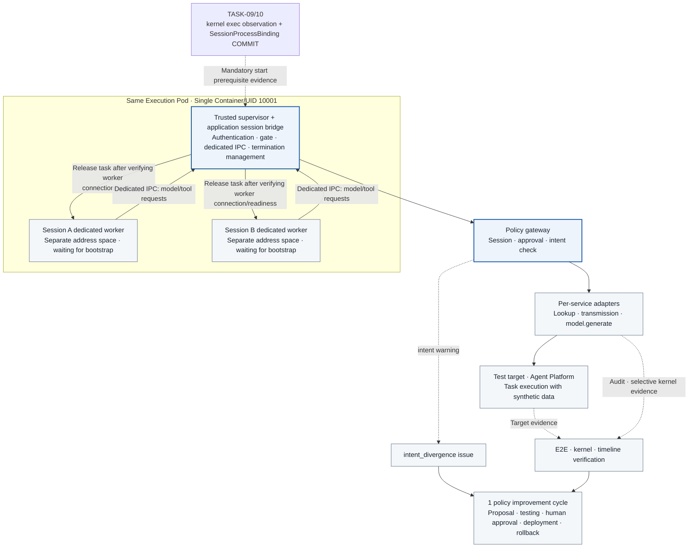

# TASK-15 · Agent Runtime and Integration Verification

> This document is the specification of features to be implemented. Configuration, inspection items, APIs, storage constraints, and failure handling are implementation contracts; implementation and deployment have not yet been performed. Values generated in the deployment environment are managed as installation inputs.

## Architecture at a Glance

> Target design · implementation, deployment, and functional effects unverified. Solid lines represent placement, processing, and invocation; dashed lines represent reference and observational evidence; meanings are distinguished by text on the arrows.

**How to read:** A dedicated process is used per session, while the Pod/container is shared. A single session is never assigned concurrently to multiple workers, nor is a worker reused for another session. The agent's model calls also route through the gateway's `model.generate` and model adapters; unsupported external communication is not connected via a direct internet fallback. Results from deterministic tests and real agent tests are recorded separately. The application session bridge in this document is a distinct component from the node runtime bridge in the node startup path.

| Item | Details |
| --- | --- |
| Plan | [Final Plan](../plan.md#task-15) |
| Development Prerequisites | [TASK-03](TASK-03-identity-approval.md) · [TASK-06](TASK-06-egress-credentials.md) · [TASK-11](TASK-11-alignment-timeline.md) · [TASK-14](TASK-14-policy-release.md) |
| Integration Dependencies (runtime) | All of TASK-01 through 14. In particular, [TASK-04](TASK-04-policy-gateway.md) intent check and `:reevaluate`, [TASK-05](TASK-05-service-adapters.md) `agent` model profile, and the [TASK-12](TASK-12-policy-proposals.md) · [TASK-13](TASK-13-regression-harness.md) policy improvement flow |
| Assigned Role | Runtime/Integration Engineer · Assignee/Target Date TBD |
| Common Conventions | [Shared Tech Spec](COMMON.md) |
| Baseline | Working tree after efe8dce (revised 2026-10-11) |

## 1. Goals and Scope

Connect lookup → summarization → approval → transmission → evidence verification and 1 policy improvement cycle using a real agent built with Google ADK (Python). Maintain the requirement to run multiple logical sessions within a single Pod, and verify that the end-to-end flow operates without direct egress. The integration runner `tools/integration_runner/` is also owned by this Task (TASK-16 only references it).

## 2. Required Environment, Inputs, and Resources

The ADK runtime, application session bridge (`runtime/adk/`), and integration runner (`tools/integration_runner/`) are implemented in Python 3.12. Python components do not calculate action_digest and submit only ClientAction; if a digest is needed, the value returned by the gateway API is used. The gateway, coordinator, and adapters are Go components, and this Task only calls their APIs.

The readiness of TASK-01 through 14, pinned manifests, ADK and google-genai version locks, the `agent` profile of the model adapter, synthetic data, and a test receiver are required. Hidden network paths in the ADK and its dependent libraries—such as direct model API calls, update checks, telemetry, and package downloads—are investigated in advance through the TASK-02 discovery procedure and TASK-06 blocking tests.

## 3. Technical Implementation Design

1. The application session bridge submits typed actions to the gateway. The agent's model calls must also go through the gateway `model.generate` and model adapters, and unsupported runtime features are marked as blocked. No direct internet fallback is provided.
2. The runtime receives sessions created by users in the console via a pull model. Sessions A and B are executed in a single Pod to verify separation of approvals, budgets, and API records, and process address space separation and mandatory bootstrap controls are reported distinct from the file-sharing limitations of sharing the same UID.
3. First, verify the end-to-end flow, receipts, and holds with a deterministic client, and then repeat the same tasks with the ADK agent. Distinguish model output variance from platform control failures.
4. Summarize read results along with sources, and after the user approves the display contract rendered by the server, transmit only public fields to the designated receiver. If the body or recipient is modified after approval, it is rejected during preflight.
5. Inject team-owned malicious documents and log fixtures into agent inputs to induce prohibited actions. Success criteria are evaluated based on gateway, adapter, receiver, and kernel evidence rather than model utterances.
6. Connect sensor/DB failure → hold → probe recovery, late evidence/unknown, and intent warning → issue → proposal → testing → human approval → deployment → re-verification → rollback using a single run manifest and multiple action IDs.
### 3.1 ADK runtime and session handling

The agent tools wrap only three functions: `submit_action`, `poll_action`, and `request_approval(action_id)`. Raw HTTP, provider SDKs, and the shell are not exposed in the tool list. The proxy variables in the runtime environment are only a convenience setting, and the enforcement boundary is the TASK-06 NetworkPolicy.

The agent's model calls are sent to the gateway through ADK's custom model extension point. In the ADK Python source, `BaseLlm` is structured so that the abstract method `generate_content_async(llm_request, stream=False)` yields `LlmResponse` asynchronously, and `supported_models()` returns the model name regular expressions to be used in `LLMRegistry` ([base_llm.py](https://github.com/google/adk-python/blob/main/src/google/adk/models/base_llm.py)). `LlmAgent.model` accepts a string or a `BaseLlm` instance ([llm_agent.py](https://github.com/google/adk-python/blob/main/src/google/adk/agents/llm_agent.py)). This project creates `GatewayLlm`, which inherits from `BaseLlm`, converts `LlmRequest` into a `model.generate` ClientAction and submits it, and returns the `poll_action` result as an `LlmResponse`. This extension point was confirmed in the source (`BaseLlm.generate_content_async` is an abstract method, `LlmAgent.model` is `Union[str, BaseLlm]`). The same interface is rechecked in the pinned version. Whether function calling and thought signature handling work as-is on this path is a Q0 verification item. Preserving thought signatures is the responsibility of the Go model adapter. `GatewayLlm` and the exec Pod do not receive signatures; the adapter preserves them per conversation and puts them back at their original positions in the next request. The key that identifies the conversation is defined by TASK-05's `agent` profile.

**`GatewayLlm` conversion rules.** In the ADK source, `LlmRequest` has `contents: list[types.Content]`, `config: types.GenerateContentConfig` (including the system instruction and tools), and `tools_dict`, and `LlmResponse` has `content`, `finish_reason`, `usage_metadata`, and `error_code`/`error_message` ([llm_request.py](https://github.com/google/adk-python/blob/main/src/google/adk/models/llm_request.py), [llm_response.py](https://github.com/google/adk-python/blob/main/src/google/adk/models/llm_response.py), checked in the main branch source). `GatewayLlm` converts these into the COMMON `model.generate` arguments schema as follows.

| ADK side | `model.generate` arguments | Rule |
| --- | --- | --- |
| `config.system_instruction` | `source = system` part of `messages[]` | Only server-registered templates are allowed. System text changed by the agent is rejected |
| text parts with `role = user` in `contents` | `source = user` part of `messages[]` | What the user entered in the console and the agent's summary of it |
| `function_response` parts holding the results of ADK tools (`submit_action`, etc.) | `source = tool_result` part of `messages[]`, with value `{"ref": "action_result", "action_id": "..."}` | The result body is not sent again; only a reference is sent. The model adapter retrieves the sanitized result from `action_results` |
| previous `role = model` parts in `contents` | `kind=model_turn` and the stored `turn_index` ref | The original text is not sent. The adapter puts the raw parts of the same scope at the ref position |
| function declarations in `config.tools` | `tool_declarations` | Must match the declaration digests of the three registered tools |
| `functionCall` parts of the response | `function_call` part of `LlmResponse.content` | ADK runs the tool, and that tool goes through the gateway again with `submit_action` |

`conversation_id` and the ADK session ID are both equal to the server's user session ID, and the supervisor compares them with the server's session token context. The worker's `GatewayLlm` sends model.generate requests over its own dedicated IPC, and the supervisor performs the actual gateway HTTP request. The worker does not receive the raw token and cannot change routing by submitting another session's conversation_id.

The supervisor is the source of truth for approval and result wait timeouts. The supervisor applies a bounded action deadline that includes approval waiting, result queries, and the readiness/retry budget, and passes a longer IPC deadline when releasing the worker. The worker image's independent timeout must not end before the approval wait. On termination, timeout, or unconfirmed result, the turn ends as a failure, and an action whose final stored `action_results` has not been confirmed is not turned into a `tool_result`. This decision is recorded in #282.

**Response handling.** `model.generate` is also an ordinary action, so it is handled according to the gateway response as follows.

| Response | `GatewayLlm` behavior |
| --- | --- |
| 202 `allow` | Receives the result with `poll_action` and converts it into an `LlmResponse` |
| 202 `approval_required` (including when intent check escalated it on the standing rule path) | The worker's current turn waits for the response on the dedicated IPC. The trusted supervisor polls while waiting for user approval, and after a fresh resume check has the same action decided again with `:reevaluate`, then returns the final result to the worker. The worker does not call the approval API or create a new action |
| 503 (`HOLD_ACTIVE`, `CONTROL_HEALTH_UNAVAILABLE`) | The supervisor stops the current run, and the user resumes after the server recovers. It is not resubmitted automatically. Only the readiness expiry code is retried, according to 3.2, up to 3 times at 1-, 2-, and 4-second intervals with a fresh check and the same `client_request_key` |
| 403, 422, `MODEL_OUTPUT_TRUNCATED` | Puts the reason code in `LlmResponse.error_code` and `error_message` and ends the turn as a failure |

Direct Agent Platform (Gemini Enterprise Agent Platform, formerly Vertex AI) calls, telemetry, and automatic retries in ADK and google-genai are disabled. The configuration method is checked in the pinned version and recorded in the environment lock, and even if the configuration is missing, NetworkPolicy blocks direct egress from the exec Pod. If a direct call is attempted, it must show up as a connection failure and in sensor observation.

The `model.generate` profile for the agent (`agent`) is defined by TASK-05 and has request/output limits, per-message-part source labels (`user`, `tool_result`, `system`), and session-scoped standing rules. The data class inherits the high-water mark of `workload_data_state`. Pod logs read by the agent are labeled as `tool_result`, so the gateway can judge the disclosure scope per source without interpreting free text.

The session flow is as follows.

1. The user creates a session from the console with `POST /v1/sessions`, specifying the target `workload_id` and `task_statement`, and the server issues a one-time `claim_code` (TTL 60 seconds).
2. The runtime polls `GET /v1/runtime/assignments` with workload mTLS to receive the assignment.
3. The runtime receives a session token bound to the workload identity with `POST /v1/sessions/{session_id}:claim` (mTLS + `claim_code`). This is not permission to start work. All ingress to the exec Pod remains blocked.
4. After the node and the Pod are ready according to the COMMON contract, the trusted supervisor/application session bridge puts the worker into the bootstrap waiting state and confirms independent kernel exec observation, the SessionProcessBinding COMMIT, session permissions, and budget. The session runner is not called before a valid WorkReadinessCheck and confirmation of the audit COMMIT.
5. A new check is performed at the start of each work item/turn, on resume after an approval wait, and before each model/tool call, and the check ID is attached to the gateway header. Readiness failures are not bypassed by creating new actions, calling APIs directly, or consuming the work queue.

In one Pod, the trusted supervisor runs a fresh-exec worker per session, with one ADK runner per worker. The supervisor receives model/tool requests over a dedicated IPC pinned to the session and sends them to the gateway. The requester is not changed by the session_id in the worker input. For each new action, a random UUID `client_request_key` is generated, and the same key is kept when the same call is sent again. The server checks the binding so that another session's token cannot be used through the normal API. This is not described as isolation that also prevents credential theft from shared processes, files, or memory.

The MVP runtime image does not provide arbitrary shell commands as a user tool. Supervisor/worker IPC is limited to bootstrap and typed model/tool requests, and user payloads are not delivered before the readiness check. The platform Q0 process, file, and network stimuli are run in a separately approved probe Job. A per-session scratch path `/work/<session_id>` is used and cleaned up on termination, but this path separation is not treated as a security boundary between adversarial sessions. The session token is kept only in the supervisor as an in-memory value with a short TTL and is not recorded in model prompts, stdout, or common logs.

### Required work start gate

The [COMMON work start contract](COMMON.md#agent-work-startup-contract) is the source of truth for the execution order, APIs, freshness, and limits. The trusted initialization of the fixed `/app/bin/agent-runtime` and the Python ADK bridge do not call user work code before readiness. Fixed worker bootstrap execution is separated from user work start, and user data, the ADK runner, and queue consumption are not released before worker observation/session linkage. Only gateway communication for authentication, assignment, and readiness checks is allowed first. It is not described as blocking runner execution by the readiness probe alone.

The bridge creates a new `runtime_process_epoch` at each start and closes the local gate. If pending, assigned sessions wait, and when ready, only that work is started. Sensor/filter/WAL/DB anomalies in a shared Pod hold both A and B, and A's revocation or budget exhaustion rejects only A. Result expiry, binding/generation/policy changes, and Pod/process restarts require a recheck. The last ready state is not saved to a file and restored after a restart.

`agent_work_*` is recorded through the gateway with `POST /v1/runtime/work-events`. For the intent to start new work, the runner is called after receiving the `agent_work_start_requested` audit ack, and the actual call is reported as `agent_work_started`. An unknown ack means waiting without having started, not an unknown start, and a crash or unknown response after the actual runner call is not re-run automatically. Readiness pass, runner reports, kernel logs, and target receipts are each different evidence. Immediate forced termination of local CPU code that is already running is not guaranteed; it is held at the next control point.
### Session-dedicated worker implementation (required)

The source of truth is the [COMMON session-dedicated worker contract](COMMON.md#session-dedicated-worker-contract). It is currently an adopted design, and code/functional verification is planned/not_run.

- The supervisor manages certificates/session tokens, assignment/claim, the gateway client, readiness, and work state. The worker holds only its own conversation and tool results, and requests model calls and typed actions over a dedicated IPC. Other sessions' tokens and context are not passed, and session_id and worker_id in the IPC body are not grounds for permission.
- A fresh `Popen` exec is used with the Python executable/worker bootstrap path pinned in the approved image. The command and environment are not built from user input; shell=False, close_fds=True, and pass_fds allows only the worker's own dedicated IPC. stdout/stderr are also collected through per-worker pipes, and the supervisor attaches the binding and filters sensitive content. Python's `start_new_session=True` is OS process group management, not agent session authentication or isolation. Using preexec_fn in a multithreaded parent is forbidden.
- After the final exec, the worker applies the isolation settings below, sends a bootstrap ack, and then waits without a user payload. The supervisor registers the actual child handle, start ticks/namespace, and worker_instance_id. worker_binding_id is issued by the server, and work is not released until the host PID/starttime uniquely resolved by the node and the kernel exec row are COMMITted and become observed.
- Creating a waiting worker is an allowed trusted initialization. On registration/observation failure, runner calls, model/tool actions, user queue consumption, and work markers must be 0. After the supervisor receives the audit ack for the work start intent, it sends a go message only to the same living worker, and reports the worker's actual runner entry ack as agent_work_started. Unknown delivery/start results are not re-executed.
- A session can process multiple turns in the same dedicated worker, but a new WorkReadinessCheck is required for each turn/resume/model/tool step. On worker exit/new exec, session revocation, or a sensor generation/Pod binding change, the gate is closed and the old binding/check is not used. A worker restart has a new worker_instance_id and a new root_exec_id, and re-running a work_run is subject to separate state reconciliation.
- The dedicated IPC uses an already connected pipe/socketpair and does not pass other sessions' endpoints/FDs. Because SO_PEERCRED on a socketpair may be the credentials at creation time, it is not used as the sole evidence for authenticating the child PID. The trusted supervisor's Popen handle/IPC assignment and the node witness are the basis. A supervisor restart does not adopt orphan workers; it terminates/reaps/checks liveness and then starts with a new epoch. A process group termination request is not evidence of actual termination, and descendants/exit/unknown are also recorded.
- The default resource limit of CPU 2/memory 2Gi applies to the whole container. The dedicated process does not automatically create per-session cgroups. The max_concurrent_workers installation input is required, and deployment is rejected if it is not set. The initial Q0 measures with two workers A/B, and the allowed concurrency, memory/RSS and OOM impact, and termination deadline are fixed in the environment lock. CAP_SYS_ADMIN and writable cgroup mounts are not added.

### Session isolation scope and hardening options

The default profile is `process_baseline`, which implements dedicated processes and the required settings below. Because sharing of files/IPC/identity mounts under the same UID remains, it is not labeled as a strong isolation profile against adversarial arbitrary code.

| Category | Settings and rules to apply | Verification and claims achieved |
| --- | --- | --- |
| Required: Pod least privilege | UID 10001, runAsNonRoot, allowPrivilegeEscalation=false, drop ALL, RuntimeDefault, read-only rootfs, existing volume restrictions kept | TASK-01 Admission negative tests. UID/container constraints are not silently relaxed because of the worker |
| Required: separate address space | Fresh exec per session, no worker reuse, bootstrap wait before the user payload | Different exec_id/address space, no A/B context mixing. A separate address space does not imply blocking file access |
| Required: memory inspection restriction | PR_SET_DUMPABLE=0 and RLIMIT_CORE=0 in the supervisor and in the worker after the final exec. no_new_privs and an additional seccomp filter before worker threads/ADK start | ptrace, process_vm_readv/writev, kcmp, and pidfd_getfd are denied, and calls that clear the 0 via PR_SET_DUMPABLE are denied. Items already blocked by the default RuntimeDefault are also confirmed to be actually denied. On setup failure, work is blocked |
| Required: bootstrap persistence | The worker's additional filter blocks execve/execveat and also blocks UID/GID changes and paths creating new user/mount/PID namespaces. The syscall architecture/ABI is also pinned. New threads are created after application so they inherit the filter | Arbitrary exec during execution does not bypass dumpable reset/identity changes. If it breaks normal ADK/tool/model operation, it is a profile failure to fix and retest; a fallback that removes the filter is forbidden |
| Required: inheritance and credentials | Minimal env, close FDs other than the dedicated IPC, no passing of other sessions' context/tokens, raw tokens/mTLS keys kept in the supervisor | Tests attempting to access other sessions'/supervisor data through env/argv/logs, shared cache/shared memory, inherited FDs, /proc/PID/mem, and /proc/PID/fd. The risk of directly reading the identity mount under the same UID is handled in a separate file profile |
| Required: file hygiene | /work/<session_id>/<worker_instance_id>, umask 077, directories 0700/files 0600, TMPDIR/cache also on its own path, cleanup after the termination check | 0700 between processes with the same UID is not a blocking boundary. cwd setting, read-only rootfs, and folder separation are not labeled as session file isolation |
| Hardening candidate: Landlock file restriction | In the worker bootstrap, before threads/user payload, allow only its own scratch RW + required code/libraries RO. Exclude other sessions' scratch, identity/projected token, and common secret paths, and clean up inherited FDs in advance | Requires tests of GKE kernel/LSM enablement, ABI, RuntimeDefault compatibility, link/rename/truncate, pre-opened FDs, /proc, and shared tmp/IPC bypass. Currently not_run. If the required permissions are not supported, that file profile is unsupported and work is blocked; an unrestricted fallback is forbidden |
| Hardening candidate: different UID/GID | Per-session UID/GID + permission, group, and volume design | Currently, the unprivileged UID 10001 parent cannot switch to an arbitrary UID. A SETUID/SETGID launcher conflicts with the current drop ALL/Restricted. Requires a separately approved design and tests after reviewing a separate container/external worker/Admission change |
| Hardening candidate: container/sandbox | Per-session PID namespace, mount/volume, credential, and IPC boundaries | Requires an Admission change for the current single runtime container. Kernel/Pod network sharing, and gVisor host eBPF visibility, support, and cost must also be re-verified |

seccomp is not a pathname-based file isolation mechanism. We do not claim that PR_SET_DUMPABLE=0 alone blocks all IPC, signal, shared file, and kernel attacks. Problems such as a same-UID worker sending signals to a sibling or reading shared volume/identity paths are left as not strongly defended in the default profile. Raw shell/native code and adversarial sessions from other trust principals are outside the current MVP support. If hardening such as Landlock is needed, per-profile fixtures are required, and it is not recorded as enabled/verified before verification.

**Unverified list:** syscall/filter installation on the GKE node image/kernel and CPU architecture, ADK threads/native library compatibility, dumpable persistence after exec, host/local PID/start ticks interpretation and node witness permissions, Tetragon final exec metadata/parent relationship/filters, WAL→DB ack delay and the 3-second readiness lifetime, child/orphan worker termination and PID reuse, the exposure scope of same-UID files/credentials, Landlock ABI/bypass, concurrent worker RSS/OOM. The installation lock keeps the expected profile digest and the actual test results separate.

Basis: [Python subprocess](https://docs.python.org/3.12/library/subprocess.html), [Linux Yama](https://docs.kernel.org/admin-guide/LSM/Yama.html), [seccomp filter](https://docs.kernel.org/userspace-api/seccomp_filter.html), [Landlock](https://docs.kernel.org/userspace-api/landlock.html), [Pod Security Standards](https://kubernetes.io/docs/concepts/security/pod-security-standards/). Vendor support descriptions are not a substitute for the project's own measurements.

### 3.2 API connection states and E2E order

| runtime response | Next action |
| --- | --- |
| 202 `approval_required` | Request approval from the user with `request_approval(action_id)`. The user views the server-rendered contract and intent warnings through the console's `GET /v1/approvals/pending` and `GET /v1/actions/{action_id}/approval-contract`, and approves with `POST /v1/approvals`. After that, the runtime passes the resume readiness check again, attaches the work-readiness headers, and receives a new decision with `POST /v1/actions/{action_id}:reevaluate`. |
| 202 `allow` + action_id | Query `GET /v1/actions/{action_id}` and `/result` with `poll_action`, and do not show success immediately. |
| 403 deny / 422 schema | Show `reason_codes`, and do not perform automatic retries with modified content. |
| 409 `CLIENT_KEY_BODY_CONFLICT` | Distinguish the existing action from the new request and handle it as a caller error. |
| 409 `POLICY_EPOCH_STALE` | Request `:reevaluate` once with the same action_id. |
| 503 `HOLD_ACTIVE`, `CONTROL_HEALTH_UNAVAILABLE` | Stop execution, and let the user resume the request after the server recovers. |
| timeout, unknown | Query the timeline and receipt of the existing action, and do not automatically resend it as a new logical action. |

`request_approval` accepts only the action_id and does not accept a summary written by the agent. In the pending approval state, the agent cannot create an approval by itself.

The integration test is fixed to the following order.

1. Assign two actors/sessions to the same runtime Pod. Confirm their different approvals on the screen and in the DB.
2. Submit session A's reader query, receiver send, and model disclosure request to the gateway. Model calls use only synthetic data.
3. Confirm that session B is rejected when it uses A's action or approval ID or changes the target or body.
4. Match the adapter transport recorder's AdapterObservation, the audit outbox, the receiver receipt, the kernel correlation, and the timeline by action and attempt ID.
5. Inject a sensor outage, a DB failure, and a mixed policy epoch, and confirm that new dispatches are held.
6. Run the policy improvement demonstration in 3.4 from start to finish.

The completion gate is not passed by UI responses alone. The permit, audit commit, actual peer, destination receipt, effect, and correlation confidence are each confirmed. The `evidence_level` ceiling for model responses is `accepted`, and they are not confirmed at the same level as a receiver with an independent effect receipt. Blocking of direct egress is reported as "zero unregistered destinations within the observation window", and observation gaps and loss counts are reported together as separate denominators. No universal claim is made that every network call went through a registered path.

### 3.3 Integration of short Pods and the startup contract

The COMMON work-start gate is mandatory in the MVP for every runtime Pod/session. The startup_guard_gate below is a separate hardening before the container's first program, and the work gate cannot be skipped when it is unsupported.

Starts and restarts of execution Pods and adapters, as well as separately approved probe Jobs, follow the COMMON lifecycle contract. `startup_guard_gate` is an independent gate. Only on node/runtime combinations that passed Q0 with `startup_capture = guarded` does the node runtime bridge enforce the check before the first container code. On `unsupported` combinations, short Pods are run in "observable scope and gap reporting" mode (filter readiness at the create stage, lifecycle recording, ObservationGap) and are included in the report. Even if this gate fails, the other integration tests and the completion decision of this Task are not blocked; only deployment of short Pod profiles that need the guard is held.

Multiple sessions in one Pod are maintained, and the Pod UID is not used as the session ID. Existing dispatch holds (503) and container start rejections are recorded separately. The application session bridge waiting in its own entrypoint does not replace the node runtime bridge's check. The workload image and SA are not given the start coordinator credential, the management socket, the journal, or permission to modify the guard. On `guarded` combinations, the actual handler and profile digest of every observed container and the Q0 omission-defense results are matched in the integration manifest.

consumed and start_requested are shown in the UI and logs as readiness/intent facts, and the actual start is shown together with exec and runtime evidence whose source is stated. Because kubelet recreates a container that failed to start with a new container_id, binding checks alone cannot prevent automatic re-execution. Therefore, when `start_unknown` occurs, TASK-10 places a `start_unknown` hold per Pod/workload. Observed fixture Jobs use `restartPolicy: Never` and `backoffLimit: 0`. Fatal NRI plugin errors are fail-open, so for containers started while the guard is dead, it is confirmed that they surface as `start_guard_bypass_detected` and a `bypass_detected` hold rather than as a rejection. Planned reloads and the `startup-guard-missing` fixture are tested on the actual deployment profile, and the number of allow (nil) returns and of containerd `task.Start` calls are reported as independent evidence.

The TASK-13 short Pod suite is repeated on the actual deployment profile, and after Pod deletion, the timeline, raw kernel data, lifecycle tombstones, and late joins are queried from independent storage. Gaps from sensor reload, watch disconnection, spool/ack recovery, normal drain, and forced node loss are demonstrated. Audit completeness is not judged from completion statements or Pod Succeeded alone. The denominator is not reduced by excluding init containers, sidecars, or restarts of observed targets.

### 3.4 Policy improvement demonstration flow

The demonstration uses a flaw planted in advance (the baseline allows a synthetic email field), and this is stated in the presentation and report.

1. The user creates a session in the console and writes "send only the summary" in `task_statement`.
2. A deterministic demo client queries Pod logs and submits a receiver send action with a fixed payload that includes the email field. The display contract includes the `email` field. This step must not be left to the LLM's choice so that it is reproducible. A demonstration that runs the same work with an ADK agent is a separate optional demonstration, and if the agent does not include email, it is normal that no warning appears.
3. The TASK-04 intent check runs before the approval screen is rendered and shows a `field_extra` warning. The user must acknowledge the finding before approving, and an `intent_divergence` issue is created. If the intent check fails, it is shown as `not_run`, and the deterministic decision is kept as is.
4. The operator calls `POST /internal/proposals` with this issue. Gemini queries the evidence and points to `disclosure.receiver.v1` in `evaluated_rule_ids`, and the builder produces the `receiver.allowed_disclosure_fields = ["summary"]` patch (TASK-12).
5. TASK-13 produces per-case 2×2 results for baseline and candidate in iterative improvement runs. The operator requests a `candidate_final` run including the holdout with `:finalize`, and registers the change by calling `POST /v1/policy-changes` with that `run_id`. After that, an approver who is different from the operator who started the proposal and the operator who created the change approves it (TASK-12, TASK-14).
6. TASK-14 updates `desired_bundle` under a `policy_activation` hold, and after the lease ack and epoch CAS, confirms with the `probe.activation.v1` activation probe. After this, the same request including email must end with `DISCLOSURE_SCOPE_DENIED`, and the summary request must end with normal receipt.
7. Run a rollback and confirm that the previous bundle is restored with a new epoch.

At every step, the number of cases in which AI output created an allow must be 0 (`ai_created_allow_count = 0`).

## 4. API, Data, and Connection contract

| Interface | Content |
| --- | --- |
| `register_session_worker(session_context, spawn_record, controls_report)` | Only the supervisor, via gateway POST/GET. Work must not be released before observed/COMMIT is confirmed |
| `check_work_readiness(session_context, work_run_id, checkpoint, worker_binding_id)` | POST creates pending → GET returns the caller's own result. On readiness failure/unknown, runner, model, tool, and queue consumption are held |
| `report_work_event(session_context, AuditEvent)` | POST /v1/runtime/work-events. The start intent ack is separated from the report of the actual runner call |
| `submit_action(session_context, ClientAction)` | `POST /v1/actions`. The response is 202 with action_id, decision_id, verdict, and reason_codes |
| `poll_action(action_id)` | Returns the execution_state from `GET /v1/actions/{action_id}` together with the ActionResult from `GET /v1/actions/{action_id}/result` |
| `request_approval(action_id)` | Notifies the user that approval is pending, and calls `:reevaluate` after approval. Does not accept a summary written by the agent |

The server-issued action and session and the caller context are verified on every request.

The integration scenario manifest contains the runtime, ADK, model, prompt, and fixture digests, the Pod UID, the logical session ID, work_run_id, check_id, runtime_process_epoch, worker_instance_id, worker_binding_id, root_exec_id, worker exec/node evidence, isolation profile/test status, instance_binding, readiness evidence/expiry/block time, the active epoch, action and attempt IDs, destination receipt references, kernel confidence and gaps, `startup_capture`, the intent check ID, and issue, proposal, change, and run IDs. Sensitive content of the raw prompts and outputs is not disclosed.

`tools/integration_runner/` takes a manifest, executes the order above, and stores the results in the run directory of the [common result recording contract](COMMON.md#result-recording-contract). The CLI is fixed as `python -m tools.integration_runner --manifest <manifest-path>`. It runs only when the cluster UID, fixtures, and artifact hashes in the manifest match the current environment. This runner has not been implemented yet.

Features that the runtime does not support are marked `blocked/unsupported` and are not compensated for with a network bypass.

## 5. Security Boundaries, Failure Handling, and Operations

As long as arbitrary code in the same Pod can read another session's token or files, strong session isolation is not guaranteed. Success of the API session mapping tests is not described as success of code isolation. The runtime's own secrets and individual users' tokens are not injected into execution Pods.

A false positive is a case where a hidden call of a normal runtime is blocked and work is interrupted; a false negative is communication outside the bridge or incorrect context propagation. These are checked with actual connection records and normal comparison fixtures, and unsupported calls are stated explicitly. Variability of model output is reported together with the number of repetitions, the denominator, and the 95% interval.

## 6. Implementation files and work order

Implementation files are written at the paths below. There are currently no GCP implementation files, and if an implementation path changes, this specification and CI are updated together.

| Implementation path | Implementation responsibility |
| --- | --- |
| runtime/adk/ | (Python) supervisor, worker_bootstrap, isolation/, dedicated IPC, worker registry client, work start gate, WorkReadinessCheck client, work event reporter, application session bridge, ADK tool wrappers, `GatewayLlm`, table of supported runtimes, models, and external calls, ADK disable settings |
| tests/integration/scenarios/ | Read, send, shared session, intent warning, and policy improvement flows |
| tools/integration_runner/ | (Python) manifest, evidence collection, timeline for the video |

## 7. Verification methods and pass criteria

| Test | Method / independent confirmation basis | Pass criteria |
| --- | --- | --- |
| Two sessions | Run approvals, budgets, and body modifications for A and B in the same Pod | No mixing of API permissions; internal execution isolation marked as not guaranteed |
| Dedicated worker (required) | Fresh exec A/B, delay/loss of final exec/kernel DB ack, node witness, and binding COMMIT | 0 duplicate workers for the same session and 0 reuse across sessions, 0 user work before observed |
| Memory bootstrap (required) | ptrace/process_vm, /proc mem/fd, inherited env/FD, dumpable release, additional exec, filter installation failure | Access/bypass of the tested targets rejected, normal ADK succeeds. A hygiene failure or unsupported case fails the default work gate |
| File profile distinction | Compare scratch access with the same UID, inject Landlock unsupported, pre-open/link/rename/truncate | State explicitly that baseline file blocking is not guaranteed; the hardened profile must not be enabled/verified if the negative tests fail |
| Work start (required) | Assign two runners with the node normal/Pod mapping pending, filter not ready, WAL/DB unavailable | 0 work markers/runner calls/queue consumption, with the decision and durable grounds. Zero execution of the trusted initialization itself is not required |
| Start, resume, restart | Independent permissions for A/B, A budget exhausted, generation change, container/process restart, resume after waiting for approval | A-only failures do not propagate to B. A Pod observation failure holds new work for both A and B. 0 reuse of past ready |
| Session assignment | claim_code reuse and expiry, a claim from another workload | Rejected with `CLAIM_CODE_INVALID` |
| Real work | Compare read → approval → send with a deterministic client and an ADK agent | Normal receipt, policy, and audit linkage, evidence for each stage |
| ADK model path | Use `GatewayLlm`, attempt a direct Agent Platform call | Every model call exists in the `model.generate` audit; the direct connection fails and is observed |
| Bypass and failure | Direct calls, malicious input, sensor/DB failures, recovery | Forbidden sends, holds, and recovery confirmed with independent grounds |
| `GatewayLlm` conversion | Inject tool result references, previous model turns, escalated `approval_required`, and 503 | 0 resends of the result body, resume of the same turn after supervisor approval and re-decision while waiting on IPC, 0 automatic resubmissions on HOLD_ACTIVE/CONTROL_HEALTH_UNAVAILABLE, only readiness expiry retried with the same key up to 3 times, 0 tool_result references to unconfirmed results |
| Full improvement | Run the 3.4 flow | Linkage of intent warning, issue, change ID, active version, revalidation, and restoration evidence, `ai_created_allow_count = 0` |

Before running verification, the code, image, schema, and policy/catalog versions, the target environment, and the test denominators are pinned. The tests below were not run while writing this document. Actual run records are stored according to the [common result recording contract](COMMON.md#result-recording-contract).

## 8. Deliverables and implementation results

### Deliverables to leave after implementation

- Application session bridge, ADK wrappers, and support table, integration report for the deterministic and ADK agents, shared session limits, the full timeline and demo record of one policy improvement, `tools/integration_runner/`.

### Currently confirmed results

| Category | Current status |
| --- | --- |
| Tech Spec | Implementation specification written · only static link checks performed, rendering and functional verification not run |
| Implementation files | As of now, the corresponding GCP implementation paths have not been created |
| Functional tests | Not run |
| GCP/GKE deployment | Not performed or confirmed in this work |
| Completion decision | Planned · not judged functionally complete |

### When recording implementation results

- Record `implementation_commit`, image digests, `run_id`, the environment manifest, and safe references to the verification report and original evidence.
- Record `expected / observed / passed / failed / unknown / not_run` and the denominator for each test. Numbers that were not measured are left as `null`.
- Record failed, unobserved, and undetermined items, impact on normal work, and deployment/recovery results together, and change only the verified scope to complete.

## 9. Deployment inputs and change conditions

ADK tool wrappers, session binding, tool scope, and the E2E gate are implemented according to chapter 3. ADK, google-genai, and model patch versions are pinned in the dependency lock. New tools, services, and network paths change the catalog, policy, adapter, and fixture specifications together.

If permissions, trust boundaries, supported operations, or default failure handling change, the final plan and the related Tasks are revised together. The owner roles are defined in the table above, and the actual owners have not been decided yet, so this table is not to be interpreted as operational approval.

## 10. Technical basis

- [ADK `BaseLlm` source](https://github.com/google/adk-python/blob/main/src/google/adk/models/base_llm.py): abstract method `generate_content_async`, `supported_models` (main branch source confirmed)
- [ADK `LlmAgent` source](https://github.com/google/adk-python/blob/main/src/google/adk/agents/llm_agent.py): `model: Union[str, BaseLlm]` (main branch source confirmed)
- [ADK models](https://adk.dev/agents/models/): passing a wrapper class as the model
- [GKE WIF](https://docs.cloud.google.com/kubernetes-engine/docs/how-to/workload-identity)
- [GKE NetworkPolicy](https://docs.cloud.google.com/kubernetes-engine/docs/how-to/network-policy)
- [containerd/nri plugin.go](https://github.com/containerd/nri/blob/main/pkg/adaptation/plugin.go): fail-open behavior on fatal plugin errors (source confirmed in COMMON)
