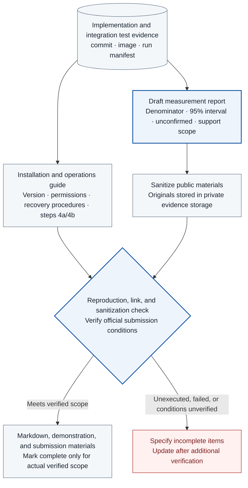

# TASK-16 · Installation Guide · Measurement Report · Submission

> This document is a specification of features to be implemented. Configuration, inspection items, APIs, storage constraints, and failure handling are implementation contracts; implementation and deployment have not yet been performed. Values generated in the deployment environment are managed as installation inputs.

## Architecture at a Glance

> Target design · implementation, deployment, and functional effects unverified. Solid lines represent placement, processing, and invocations; dashed lines represent reference and observation evidence, with meanings distinguished by text on the arrows.



**How to read:** Report distinctly by distinguishing plans, code existence, static checks, and GKE functional tests. While authoring this document, no new claims are made regarding the success of actual deployments or tests, or official schedules, and making private repositories public or deleting resources is not performed automatically.

| Item | Content |
| --- | --- |
| Plan | [Final Plan](../plan.md#task-16) |
| Development Prerequisite | [TASK-15](TASK-15-runtime-integration.md) |
| Integration Dependency (runtime) | Execution results of TASK-01~15 and `tools/integration_runner/` (owned by TASK-15) |
| Assigned Role | Documentation/Operations Engineer · Assignee/Target date TBD |
| Common Convention | [Shared Tech Spec](COMMON.md) |
| Baseline | Working tree after efe8dce (revised 2026-10-11) |

## 1. Goals and Scope

Organize implementation, testing, and deployment facts into reproducible documentation and measurement reports. Distinguish between plans and actual completions, and demonstrate and submit using materials from which sensitive data has been removed. Use Markdown as the document source.

## 2. Required Environment, Inputs, and Resources

Reconfirmation is required for integration manifests, reports, and artifact digests, installable pinned images and versions, team GCP projects (two: one for operations and one for regression testing), cluster UIDs, permissions and cost owners, as well as official competition rules and submission links. The 10/18 schedule stated in the current plan will not be distributed as a confirmed schedule until officially verified.

## 3. Technical Implementation Design

1. Write procedures for bootstrap, installation, operations, failures, recovery, secret rotation, and policy rollback in `docs/runbooks/`. Commands must use explicit project, location, and context, and use verification of the current cluster UID as a gate. Installation inputs are read from the environment lock and rejected if any are missing.
2. Describe initial installation in the order of Terraform plan review → minimum foundation → Q0 → controls and observability → integration testing. Specify prerequisites and the operational approval authority for irreversible retention locks, permission exceptions, data deletion, and production rollouts. No commands are executed during the task of authoring this document.
3. Record the source commit, image, cluster, runtime, bundle, catalog, `fixture_set_digest`, and case denominator in the implementation result report. Distinguish between candidate, confirmed, unknown, and not_run, as well as static, mock, and GKE functional tests.
4. Keep original evidence in a private repository, leaving only redacted refs and hashes in the public report. Inspect secrets, user data, internal hosts, account IDs, full log texts, and video screens. Do not claim that hashes constitute anonymization.
5. Automatically check the consistency of Markdown links, anchors, Task coverage, and canonical COMMON names. If CI is added, start only docs checks in the repository root `.github/workflows/`, and do not automatically enable cloud deployment or credential injection.
6. If submission videos or PDFs are required, derive them from verified reports and link them to the actual demonstration version. Present costs, resource inventories, and cleanup procedures following retention; however, resource deletion is not performed in this task.
### 3.1 Installation Order and the environment lock

The installer first confirms the project, cluster, and test Namespace, and then generates `deploy/gcp/environment.lock.json`. This Task owns the schema of this file, and COMMON and the other Tasks refer to it by the key names below. There is one file per environment (`prod`, `regression`).

```json
{
  "schema_version": 1,
  "environment": "prod",
  "project": {"id": "<project-id>", "number": "<project-number>", "location": "<region>"},
  "cluster": {
    "uid": "<cluster-uid>", "kubernetes_minor": "<1.xx>",
    "release_channel": "REGULAR", "datapath_provider": "ADVANCED_DATAPATH",
    "private_nodes": true, "ip_family": "IPV4",
    "node_pools": [{"name": "exec-pool", "image_type": "COS_CONTAINERD", "node_image_version": "<version>",
                    "machine_type": "e2-standard-4", "auto_repair": false,
                    "maintenance_exclusion": {"scope": "NO_MINOR_OR_NODE_UPGRADES", "end_time": "<ts>"},
                    "taint": "agentarium.io/observe-not-ready=true:NoSchedule"}],
    "containerd_version": "<version>", "containerd_socket": "/run/containerd/containerd.sock",
    "nri_socket": "<path>", "kernel": "<version>"
  },
  "images": {"<component>": "<image_manifest_digest>"},
  "dependency_locks": {"go_sum": "<sha256>", "python_lock": "<sha256>", "npm_lock": "<sha256>"},
  "artifacts": {"catalog_digest": "<sha256>", "active_bundle_artifact_digest": "<sha256>"},
  "network": {"gateway_cluster_ip": "<ip>", "gateway_tls_name": "<name>", "ca_fingerprint": "<sha256>"},
  "storage": {"evidence_bucket": "<name>", "bundle_bucket": "<name>", "decision_input_exports_bucket": "<name>",
              "summary_bucket": "<name>", "regression_requests_bucket": "<name>", "regression_reports_bucket": "<name>",
              "discovery_bucket": "<name>",
              "cloudsql_instance": "<connection-name>"},
  "keys": {"bundle_signing_key": "projects/.../cryptoKeys/<key>", "bundle_key_id": "prod-v1",
           "manifest_signing_key": "projects/.../cryptoKeys/<key>"},
  "model": {"model_id": "<id>", "model_region": "<region-or-global>", "api_version": "<v>",
            "profiles": {"agent": {}, "policy_proposal": {}, "intent_check": {}, "discovery": {}},
            "tools": {"agent": [], "policy_proposal": [], "intent_check": [], "discovery": []}},
  "adk": {"adk_version": "<v>", "google_genai_version": "<v>", "disabled_features": []},
  "work_readiness": {"challenge_timeout_seconds": 15, "maximum_result_age_seconds": 3},
  "session_workers": {
    "mode": "dedicated_process", "uid": 10001,
    "worker_command_digest": "<sha256>", "isolation_profile": "process_baseline",
    "isolation_profile_digest": "<sha256>", "max_concurrent_workers": "<measured-positive-integer>",
    "termination_deadline_seconds": "<measured-positive-integer>",
    "process_baseline_verification": "not_run", "worker_pid_mapping_verification": "not_run",
    "file_isolation_profile": "none", "file_isolation_verification": "not_run",
    "landlock_abi": null
  },
  "startup_capture": [{"node_pool": "exec-pool", "runtime_profile_digest": "<sha256>", "value": "guarded",
                       "measurement": "measured", "q0_run_id": "<run-id>",
                       "node_runtime": {"os_image": "<nodeInfo.osImage>", "kernel_version": "<nodeInfo.kernelVersion>",
                                        "container_runtime_version": "<nodeInfo.containerRuntimeVersion>",
                                        "kubelet_version": "<nodeInfo.kubeletVersion>"}},
                      {"node_pool": "control-pool", "runtime_profile_digest": null, "value": "unsupported",
                       "measurement": "not_measured", "q0_run_id": null, "node_runtime": null}],
  "baseline_digests": {"admission": "<sha256>", "exec_rbac": "<sha256>", "network_policy": "<sha256>",
                       "node_pool_config": "<sha256>", "sensor_policy": "<sha256>", "sensor_release_policies": "<sha256>"}
}
```

**`startup_capture` selection rules:** For each node pool, the installer records only the one runtime profile currently in effect. If the same `node_pool` appears twice, the lock is invalid, and both the installer and control-health reject it rather than picking the first row. The fields are as follows.

- `measurement`, `value`, `q0_run_id`: If the final `startup_guard_gate` judgment of the Q0 report (`run_id`) is `guarded` or an explicit `unsupported`, then `measurement = measured`, `value` is that judgment, and `q0_run_id` is the run ID of that report. If the judgment is `not_run` or `incomplete`, or there is no report, record `measurement = not_measured` and `value = unsupported`. In that case `q0_run_id` is the ID of the incomplete run, or `null` if there is no report. A row with `not_measured` and `value = guarded`, and a row with `measured` and no `q0_run_id`, are invalid.
- `runtime_profile_digest`: In a `measured` row, the digest in the outputs of that Q0 run (TASK-01 3.4.1) is copied as is, and it must be 64 lowercase hex characters. In a `not_measured` row, the value is copied only if the incomplete run left this output; if it did not, or there is no report, the value is `null`. The installer and control-health do not compute this value from other data to fill it in.
- `node_runtime`: In a `measured` row, these are the `osImage`, `kernelVersion`, `containerRuntimeVersion`, and `kubeletVersion` values of the Node `status.nodeInfo` measured by that Q0 run, and they are required. In a `not_measured` row with no measured Node, the value must be `null`.

**Rules applied to the current node:** A `not_measured` row does not compare `node_runtime`, and registers new boots in that pool as `unsupported` and `not_measured`. This row is an `unsupported` that holds only the short Pod profiles that need the guard, and it does not block installation or completion judgments of other features (row 4b). A `measured` row is used only when all four values of the current Node equal `node_runtime`. If even one differs, the node is treated as one whose profile changed through node replacement or upgrade, and registration of the new boot is rejected. This comparison only compares values; health does not hash the Node object to generate a new `runtime_profile_digest`. For a pool whose registration was rejected, Q0 is run again according to the node replacement and upgrade revalidation rules below to regenerate the `measured` row. If Q0 cannot be run again right away, the installer changes that row to `not_measured` (`node_runtime = null`) and re-renders the lock and the ConfigMap; the pool is then registered with only the short Pod profiles held. control-health does not lower the row to `not_measured` on its own when it sees a mismatch. The exec and control pools block automatic node upgrades with the TASK-01 maintenance exclusion, so this rejection happens after a planned replacement or upgrade, or after forced maintenance. The rendered ConfigMap `agent-observe/control-health-startup-capture` (key `startup_capture.json`, whose value is this array) is the only input to control-health.

`baseline_digests` is generated with `tools/baseline-digests/` after all installation steps in which the installer creates or changes the target objects are finished (after step 7 in the operations project, after step 7r in the regression test project), and the drift probe starts comparing only after that. All six keys, the five kinds plus `sensor_release_policies` (the digest of the release-managed TracingPolicies at installation time), must be present, and each value is 64 lowercase hex characters. The computation scope and normalization are defined in [chapter 4 of TASK-01](TASK-01-gke-platform.md#4-api-data-and-connection-contract-ref), and the rendered ConfigMap `agent-observe/drift-probe-baselines` is the drift probe's input for the lock expected values. Only for the release-managed TracingPolicies does the value of the TASK-14 active revision take precedence. If even one value cannot be computed, lock generation fails, and the value is not filled with an empty value or a runtime observation.

Every key is required, and unknown keys, empty strings, floating image tags, and mismatches with current API support cause installation failure. For items whose values are not decided yet (`profiles.<profile>.generation_config.temperature`, `profiles.<profile>.max_output_tokens`, etc.), installation proceeds only after they are decided in Q0. Secret values are not stored in the lock. The defaults are node image `COS_CONTAINERD`, private nodes, release channel `REGULAR` with a node pool maintenance exclusion, IPv4 only, and machine type `e2-standard-4`; to change them, change them in the lock and rerun Q0. Whether the NRI configuration persists on the read-only rootfs of COS is a Q0 item.

The installation guide writes the order below as execution steps. If the gate of a previous step fails, the next step is not run. However, 4b is an independent hardening gate before the container's first program, so its failure does not block step 5 and later. The node/Pod readiness checks and the per-session work startup gate in steps 5–6 are required, and if they fail, deployment and completion judgment of the affected work are held.

| Step | Installation/check content | gate |
| --- | --- | --- |
| 1 | Team-owned production GCP project, VPC, GKE Standard (Dataplane V2), three node pools (exec, control, system, TASK-01 3.5), and a regression test project with the TASK-01 module rendered as `env = regression` | Actual cluster UID, protection labels, cost settings, and separate WIF pools for the two projects |
| 2 | Install Namespaces, PSS, VAP/Binding/parameters, quotas, and RBAC | CEL typeChecking and allowed/forbidden Pod tests |
| 3 | Cloud SQL schema and roles (`golang-migrate`), creation of an IAM DB user of the corresponding GSA for each KSA that uses Cloud SQL (`roles/cloudsql.client`, `roles/cloudsql.instanceUser`, TASK-06 IAM table), least privilege for Secret Manager, GCS buckets: evidence bucket (unlocked 30-day retention, lifecycle deletion at `age >= 31`), summary bucket (90 days), bundle bucket, `decision-input-exports` bucket, `regression-requests` and `regression-reports` buckets (30-day retention, soft delete), discovery snapshot bucket (no retention or automatic deletion, TASK-02), Cloud KMS `EC_SIGN_P256_SHA256` keys (bundle `prod-v1`, evidence manifest), export-only custom role | Writes other than `audit_append()` are rejected, DB transactions, WIF access, the regression decision-replay SA has only `roles/storage.objectViewer` on `decision-input-exports`, the `discovery-snapshot` KSA succeeds at create, get, and list of discovery bucket objects while rewriting the same name and delete are rejected, the `discovery` KSA succeeds only at reads, and other KSAs are denied access to the discovery bucket |
| 4a | Install the approved bootstrap list (required, all Go): sensor DaemonSet and exporter sidecar (`sensors/exporter/`), lifecycle recorder DaemonSet (TASK-09 `services/lifecycle-recorder/`; the hostPath mount of the containerd socket `/run/containerd/containerd.sock` is an `agent-sensors` Admission exception), Pod watcher Deployment (`agent-observe`; the watch scope installed by the installer is put into `health.watcher_scopes`), audit writer and outbox exporter (`services/audit/`), receiver (`services/receiver/`, `services/evidence-collector/`) | Q0 process/TCP/file observation, collection ack, receipt. If they fail, deployment of observation targets does not proceed |
| 4b | Install the runtime guard (`sensors/runtime-guard/`, a Go NRI plugin based on containerd `nri/pkg/stub`, NRI socket mount) and the start coordinator (`startup_guard_gate`) | Q0 guard missing, plugin closed, and timeout injection, plus the judgment that the first code did not run. If they fail, record the combination as `startup_capture = unsupported` in the lock (not run or incomplete is `measurement = not_measured`) and hold deployment only for short-lived Pod profiles that require a guard. Step 5 and later continue |
| 5 | Install the required control-health service, work-readiness API, node challenge, gateway relay, and audit path. Go components: gateway (`services/gateway/`, embedded OPA, no sidecar), coordinator, four adapters (`services/adapters/*`), credential broker, identity, the verification public key ConfigMap `agentarium-bundle-keys` (only `prod-v1` in production), the catalog and the first bundle and `desired_bundle`. Python intent checker (`services/intent_check/`) | Active `artifact_digest`, leases, blocked direct egress |
| 6 | Install the Python ADK supervisor/dedicated workers (`runtime/adk/`), the Python timeline (`services/timeline/`), and the TypeScript console (`apps/console/`) | The order of exec observation/session binding COMMIT → work start for two dedicated workers, required bootstrap negative tests, normal ADK, and session E2E. Installation cannot be completed if the core worker gate fails |
| 7 | Production project: Python proposal service (`services/proposer/`), Go releaser (`services/releaser/`) | Deployment without approval is rejected, permission-widening acknowledge, and correct-answer tests for activate and rollback |
| 7r | App stack of the regression test project: the same Cloud SQL and buckets as step 3 (separate project), the regression signing key `regression-v1` and an `agentarium-bundle-keys` that trusts only that key, the 4a observation components, the step 5 Go components, a test IdP and the synthetic approver `regression-approver` (an issuer different from production), receiver non-idempotent mode setting, the regression harness (`tools/regression/`), decision replay (`tools/decision-replay/`), the releaser regression loading mode, and the regression runner SA bindings to the production project's `regression-dispatcher` and the two relay buckets | Confirm the regression project's cluster UID, that one test request is recorded in the order `regression-requests` → runner → `regression-reports` → dispatcher, that a `regression-v1` bundle is rejected by the production gateway, and that the synthetic approver fails authentication at the production gateway |
| 8 | Generate the measurement report, runbooks, and submission README | Check against the submission contract below and the evidence links |

Regression runs are split into shards per fixture class (`policy`, `fault`, `kernel`, `intent`, `startup`), with one Job per shard, and the timeout for the whole run is 60 minutes (TASK-13 3.2). The installation guide writes the Job name per shard, the concurrency, and the node capacity based on the machine type in the lock.

The initial bootstrap of the sensors is performed by the platform installer, and those host permission changes are not delegated to the ordinary release KSA. This installation has not been performed yet, so no apply logs or functional results are produced.

### 3.2 Implementation repository and CI completion gate

The root CI runs `contracts → policy unit → adapter transport → DB integration → document lint`. Go components run `go vet`, `go test`, a check that the `sqlc` generated output matches, and a `golang-migrate` migration apply test; Python components run pytest; and the console runs the TypeScript build and tests. The normalization test vectors (`vectors.json`) are owned by Go `packages/canonical/` and are checked only in Go tests. Kubernetes and GCP tests use a dedicated environment and per-environment permissions, and cloud secrets are not passed to the PR document check job. Workflows are implemented in the root `.github/workflows/`, and actual CI runs are checked. A new CI records the workflow file, job permissions, and actual run URL in the deliverables.

The document checker checks relative links and anchors, Task IDs and prerequisite work, Mermaid parsing, and YAML/JSON syntax. It also checks whether old names in the COMMON ID and terminology dictionary (`PreparedRequest`, `test_run_id`, `policy_version`, etc.) remain in Task documents. If `tests/regression/governance_ids.json` (created by TASK-13 during implementation) exists, it also checks that the ID sets of the two tables in COMMON [appendix C](COMMON.md#appendix-c-governance-checklist) equal the ID set in this file, and that the fixtures in the TASK-13 link table match the fixtures in the "Evidence" column of appendix C. For manifests, a dry-run against the corresponding API server and Admission negative tests are separate gates. A successful YAML parse of the documents is not presented as a successful application of actual policies. Test paths and commands are set up so that, when implementation files are added, CI checks whether they actually exist and their run status.

### 3.3 Report and Operations Guide Mandatory Items

The run report follows the COMMON result recording contract and includes the following:

- expected·observed·unknown·not_run, denominator and iteration counts, Wilson or Clopper-Pearson 95% intervals for all ratios
- Normal success and prohibition effects, case-by-case 2×2 outcomes and count of cases where outcomes changed, comparison with a control group with controls disabled
- event loss·correlation confidence (misconnection rate·connection recall), dispatch latency·audit lag. p95 only when the sample size is 100 or more; if insufficient, "insufficient sample"
- hold duration·rollback outcome, approval count, model token·call count·call latency
- Respective values of the `release_eligible` invariants (including `ai_created_allow_count = 0`)
- intent check metrics (mismatch detection count / injection count, match case alert count, approvals increased by promotion, `not_run` count) and discovery metrics (candidate count, reproduction ratio, static undetected count, promotion count, unresolved count)

Record actual evidence references and code·image·policy·environment hashes per fixture. When claiming functional success, link a run containing independent target evidence. Numerical targets remain null until finalized, and target attainment is not evaluated in the report.

The operational runbook specifies, for each of `audit DB failure`, `outbox backlog`, `sensor hook/sequence gap`, `mixed epoch`, `receipt failure`, `approval revocation`, `secret rotation`, `bundle signing key rotation`, and `rollback failure`, the detection query, the scope of the hold to request immediately and the COMMON `hold.reason`, the remediation procedure, the re-verification probe, and the releasing entity. Temporary failure reasons (`export_lag`, `db_unavailable`, `probe_failed`, `lease_expired`) are automatically released by the owning component after passing probes, and security reasons (`control_drift`, `bypass_detected`, `sensor_tampering`, `alignment_mismatch`, `risk_event`) are released only with operator approval. The `risk event hold` runbook describes the procedure for querying events of the workload using the `reason_detail` of the `risk_event` hold and the `kernel_event_id` of `hold_requested`, checking NetworkFinding and ObservationGap in the same interval, and then determining whether to release the hold. The `network policy log collection gap` runbook describes the node and reason for an open `network_policy_log` gap, the remaining margin until the node file rotation limit, and the procedure for verifying `backfilled` after restarting the collector, and does not request a hold for this gap. During an outage, do not recover by extending approval TTLs or expanding permission scopes. For `secret rotation`, a new version is added first. The identity claim key and receiver API key created by Terraform are added via a Terraform version resource, and the OIDC client secret and other broker credential secrets are added directly to Secret Manager by an operator. Next is the sequence of updating the version of TASK-06 `credential_bindings`, verifying successful adapter calls and rejection of the previous version, and then disabling the previous version. For `bundle signing key rotation`, first add the new keyID to `agentarium-bundle-keys` so that both keys are trusted together, then replace the releaser signing key, and remove the previous keyID once the next activation succeeds.

In evidence manifests uploaded to Git, include access-controlled evidence IDs·hashes·custodians instead of raw object URIs. Raw prompts, tokens, personal data, and cloud secrets are segregated into private repositories. Documents lacking an `implementation_commit` and references to actual CI and runs are not marked as feature complete.

### Dedicated Worker Installation, Verification, and Recovery

Pin worker command/image·profile digest, UID, syscall ABI/filter, max_concurrent_workers, termination deadline, GKE kernel/containerd/Tetragon versions, and node PID resolve method/evidence to the lock. Measurement placeholders in examples are rendered only after being finalized as actual positive integers, and not_run is not considered a pass. Record test statuses of process_baseline, worker mapping gate, and file-isolation profile individually. For Landlock, do not determine support solely by the ABI number; link actual restriction outcomes.

The installation order is worker bootstrap preparation → TASK-07 kernel host PID/exec storage → TASK-09 worker witness → TASK-10 registry/binding/attribution·readiness → TASK-04 relay → TASK-15 two worker gates. Do not unblock user workloads before verifying node readiness and worker final exec/independent survival·binding COMMIT. Lack of NRI hardening support is not a reason to skip this mandatory test.

| Worker Failure | Action / Recovery Evidence |
| --- | --- |
| bootstrap filter/dumpable failure·normal ADK unavailable | Do not start workloads on the worker. Unblocking prohibited before modifying default profile / re-verifying negative + normal fixtures |
| exec metadata/DB ack·binding result unknown | Wait; query identical worker ID / perform idempotent reporting to cross-check original kernel/COMMIT. Prohibit automatic execution of ready·workloads |
| PID/start ticks/namespace mismatch·multiple mapping | Block with WORKER_BINDING_MISMATCH, investigate original proc/node/container evidence. Do not link by guessing worker ID/time |
| worker/supervisor crash·node/sensor generation replacement | Close old bindings/checks, cross-check workload status, and verify orphan worker terminate/reap/exit. Re-verify readiness with new epoch/worker/root/binding. Do not retransmit already executed work/actions |
| File hardening unsupported / negative test failure | Block workloads on hardened profile, record support outcome as not_run/unsupported/fail. Explicitly state whether default profile is used and lack of file guarantees separately; do not bypass via permission relaxation |

Reporting includes timestamps/evidence for worker observation/connection·ready·start intent ack·actual runner marker; registration/startup latency·omissions·misconnections·PID reuse·generation races; and RSS/OOM·concurrency count. kernel actor session linked and action/attempt confirmed are calculated using separate denominators. Mapping/termination tombstones are not deleted prior to the initial 30 days of the kernel original.
### Operating procedure for short-lived Pod observation

For combinations with `startup_capture = guarded`, the installation lock additionally records TASK-01's actual runtime handler and profile, hook stage and namespace, guard binary and config digest, sensor and guard generation, NRI `plugin_request_timeout` and guard deadline (initial value 1.5 seconds), bootstrap allowlist, and guard journal path, capacity, and retention. After a GKE node replacement or upgrade, the same enforcement and missing-component defenses are re-verified while the startup taint `agentarium.io/observe-not-ready=true:NoSchedule` is reapplied, and the taint is not removed until they pass. If a node configuration change has disappeared, the combination is changed to `unsupported`. A handler is not assumed to exist merely because an example name appears in the installation documentation.

| Startup failure | Immediate action and recovery evidence |
| --- | --- |
| Missing guard, plugin, or socket; profile mismatch | Hold new starts and dispatch for the node and workload; inspect the actual handler and OCI spec. Do not release until the Q0 that rejects starts in the missing state passes again |
| Start proceeded because of guard crash or timeout (NRI fail-open) | Confirm `start_guard_bypass_detected` and the `bypass_detected` hold; release only with operator approval |
| Lost consume ack; node runtime bridge crash after consumed | Query the state with the original binding and key; investigate runtime, journal, exec, and exit history. Do not revert consumed to unconsumed or return an allow again for the same binding |
| Result unknown after start_requested | `start_unknown` state and a Pod/workload-level `start_unknown` hold; reconcile independent runtime, WAL, and DB evidence. Do not judge it failed only because the terminated Pod no longer exists |
| Planned reload or guard upgrade | Hold new starts; complete and reconcile in-progress paths with a node-local RW lock; change generation and discard old permits; reload and probe; operational recovery approval |
| Unplanned sensor or node loss after the final check | Reconcile the last external ack against the actual execution interval and record an ObservationGap and unknown. Do not claim that processes that were running terminated automatically |

If a new run is needed, terminate and discard the existing instance based on investigation results and operational action, and prepare a new container_id and restart_instance. The recovery approval and the original failure and unknown records are preserved. Even during emergency recovery, disabling the runtime guard, widening bootstrap exceptions, or extending the TTL is not used as a workaround.

**Manual node replacement and maintenance exclusion renewal.** TASK-01 disables auto-repair for exec-pool and blocks automatic node upgrades with a node pool maintenance exclusion. As a trade-off, failed nodes are not replaced automatically, so the runbook contains the following procedure.

1. If a node is `NotReady` or its sensor lease expires, confirm the TASK-10 hold (node scope) and record the affected workloads. Record in the operations report the cost of reduced exec capacity while the failed node is left in place.
2. Clean up in the order cordon → hold → spool/ack check → drain. If the node does not respond and the ack cannot be confirmed, record everything after the last ack as an unrecoverable gap.
3. The operator deletes the node from the node pool and receives a new node. The new node carries the startup taint, and `services/node-readiness/` removes the taint only after confirming the Q0 probe and the sensor lease.
4. The replacement record (old node and boot ID, new node and boot ID, gap reference, approver) is kept in the audit log.

Maintenance exclusions are managed on the following premises ([GKE maintenance windows and exclusions](https://docs.cloud.google.com/kubernetes-engine/docs/concepts/maintenance-windows-and-exclusions), documentation checked). A node pool exclusion can be used only on Standard clusters enrolled in a release channel, there is one per node pool, it starts immediately, and it blocks only node version upgrades. Its end time follows the end of support of the cluster version. A cluster-scoped "No upgrades" exclusion cannot exceed 90 days, at most 3 are allowed in a rolling 92-day window, and at least 48 hours of maintenance availability must be left. An exclusion does not block Compute Engine host maintenance, most automatic control plane repairs, critical security patches enforced by GKE, manual upgrades, or new node pools created with a higher version.

Therefore the runbook contains a procedure to (1) periodically query the end-of-support date and the exclusion end time, (2) upgrade directly through planned maintenance before the end (cordon → hold → spool/ack check → drain → upgrade → Q0 re-verification → taint removal), and (3) re-check that the exclusion still applies after the upgrade. If a node changes without notice because of host maintenance or an enforced security patch, the gap and Q0 re-verification are handled in the same way as the manual replacement procedure above.

The runbook for combinations with `startup_capture = unsupported` operates in the "observable scope and gap reporting" mode. It describes create-stage filter preparation, lifecycle recording, and the ObservationGap check procedure, and it does not state that observation before the first code execution is guaranteed.

Add `start permit rejected / ack unknown`, `runtime hook/NRI unsupported`, `lifecycle watch 410 Gone`, `metadata pending / cache eviction`, `spool 80% / disk full`, `normal node drain incomplete`, and `forced node loss before ack` to the runbook. Each item describes the procedures for checking the affected node, boot, and workload, holding new starts and dispatch, preserving the WAL and external acks, resynchronizing watchers, resuming after probes and operational approval, and keeping past gaps. Planned maintenance is performed in the order cordon → hold → spool/ack check → drain. Because drain does not evict DaemonSet Pods and GKE surge upgrades respect PDBs for at most 1 hour, forced node loss is handled as an unrecoverable gap after the last ack (`observation_gap_recorded`). The startup gate of observed targets is not switched to fail-open to recover from an incident. The sensor and recorder bootstrap exception list and permissions are audited separately.

The submission report includes the runtime hook installation profile and `startup_capture` per combination, the target and measured lifetimes of short Pods, the event observation rate, Pod attribution rate, and session linkage rate, post-deletion queries, exporter replay, and node-loss gaps. The result of the startup guarantee gate is reported as a separate judgment from the MVP judgment. The report distinguishes zero loss on normal fixtures from the unrecoverable limits under forced failures, and figures that were not run are left as null or not_run.

**Citation rules for governance checklist items:** When submission materials (report, Pitch Deck, video subtitles) cite evidence from COMMON appendix C, article numbers are written only for items whose "source comparison" column is `대조함`. For `미대조` items, only the name of the standard (e.g., EU AI Act) is written, without article numbers or detailed figures such as deadlines. Every place that cites appendix C also carries over its caveat that it "is not a compliance judgment", and the result for each checklist item uses only the values in `governance_summary` of an actually executed report. If a pre-submission check finds remaining article number citations for `미대조` items, they are recorded as unmet items.

### Work start gate installation and recovery (required)

After 4a, step 5 installs the TASK-10 readiness API/node challenge and the TASK-04 relay, and the required order of the step 6 ADK bridge is verified with the TASK-13 core fixture. A Pod that fails readiness can only perform trusted initialization or wait. This is not skipped even when startup_capture is unsupported. start-coordinator/runtime-guard is required only in the hardened active profile.

The runbook includes new node/Pod scale-out, Pod/container/bridge restart, mapping pending / filter unknown, challenge timeout, WAL/DB ack unknown, session budget/discard, generation/policy change, and shared A/B hold. After recovery, work resumes only after reconciling the new check against the actual work state. The work gate is not switched to fail-open, and past ready states are not restored. Initialization execution, work start guarantee, and container start hardening are each judged separately.

<a id="4-api-data-and-connection-contract-ref"></a>

## 4. API, data, and connection contract

delivery manifest: `source_commit, image_digests, run_ids, reports, supported_environment, startup_capture_by_profile, excluded_scope, known_limits, public_refs, redaction_review, official_deadline_verified_at`.

Integrated runs invoke `tools/integration_runner/`, owned by TASK-15, with `python -m tools.integration_runner --manifest <manifest-path>`. This Task does not implement the runner, and it uses the resulting run directory as input to the report and runbook.

The result section of each Task is updated with the same run artifact, and the planned and verified states in the document index are aligned with the scope of the evidence. The root README links to the plan, architecture, spec index, runbook, and measurement results. The model product is written as "Gemini Enterprise Agent Platform (formerly Vertex AI)" at its first appearance and as "Agent Platform" thereafter ([release notes](https://docs.cloud.google.com/gemini-enterprise-agent-platform/release-notes)).

## 5. Security boundaries, failure handling, and operations

Whether public links work is checked, but the current private repository is not switched to public without a user request. Whether the official publication conditions are met is left as a separate decision.

If a credential is exposed in documents or videos, redaction alone does not resolve it; if the exposure is real, the rotation procedure is followed. Example cleanup is written so that it checks scope, evidence to preserve, and recoverability. An identification gate is added to prevent incidents where commands run against the wrong project or context.

## 6. Implementation files and work order

Implementation files are written at the paths below. No GCP implementation files exist yet, and if an implementation path changes, this specification and CI are updated with it.

| Implementation path | Implementation responsibility |
| --- | --- |
| docs/runbooks/ | installation, operations, failure, and recovery guides |
| docs/reports/ | measured results, denominators, 95% intervals, limits |
| tools/docs-check/ | Markdown, task, and artifact link checks and source-of-truth name checks |
| docs/delivery/ | submission manifest and video/PDF derivation evidence |

## 7. Verification methods and pass criteria

| Test | Method and independent confirmation basis | Pass criteria |
| --- | --- | --- |
| Document completeness | Automatic checks of the 16 Tasks, specs, dependencies, relative links, and source-of-truth names | No unreferenced Tasks, broken links, dependence on HTML originals, or former names |
| Reproducibility | The owner of a separate test environment installs and tests with a pinned manifest | Results, differences, and required permissions are recorded, and items not run are not_run |
| 4b separation | Proceed with installation on a `startup_capture = unsupported` combination | Steps 5 to 8 proceed, and only short Pod profiles that need the guard are held |
| lock verification | A lock containing empty values, unknown keys, or floating tags | Installation fails |
| Regression separation | After installing 7r in the regression project, submit a `regression-v1` bundle and a synthetic approver token to the production gateway | Both rejected |
| Sensitive information | Review redaction in documents, artifacts, and video screens | No disclosure of secrets or real user data |
| Submission conditions | Check the official rules, deadline, and public links | The check time, source, and unmet items are stated |
| Check item citations | Extract citations of Appendix C evidence from submission materials and compare them with the "Source text comparison" column, and compare the IDs in the Appendix C table with `governance_ids.json` | 0 citations of article numbers for `미대조` items, a qualifying phrase with every citation, matching ID sets |

Before running verification, pin the code, image, schema, and policy/catalog versions, the target environment, and the test denominators. The tests below were not run while this document was written. Actual run records are stored according to the [common result recording contract](COMMON.md#result-recording-contract).

## 8. Deliverables and implementation results

### Deliverables to produce after implementation

- Markdown installation and operations guide, measurement report, artifact/redaction/supported environment manifest, demo video and required submissions, verification links.

### Currently confirmed results

| Category | Current state |
| --- | --- |
| Tech Spec | Implementation specification written · only static link checks performed, rendering and functional verification not run |
| Implementation files | The relevant GCP implementation paths have not been created as of now |
| Functional tests | Not run |
| GCP/GKE deployment | Not performed or confirmed in this work |
| Completion decision | Planned · not judged functionally complete |

### When recording implementation results

- Record `implementation_commit`, image digests, `run_id`, the environment manifest, and safe references to verification reports and source evidence.
- Record `expected / observed / passed / failed / unknown / not_run` and the denominator per test. Numbers that were not measured are left as `null`.
- Record failed, unobserved, and undetermined items, impact on normal work, and deployment/recovery results together, and change only the verified scope to complete.

## 9. Deployment inputs and change conditions

The installation order, lock, CI, reports, and runbooks are implemented according to chapter 3. The actual project, costs, operations owners, and deployment inputs are registered before installation. Runtime and spec results are updated with the implementation commit and actual runs.

If permissions, trust boundaries, supported behaviors, or default failure responses change, revise the final plan and the related Tasks together. The responsible roles are defined in the table above, and the actual owners have not yet been determined, so this table must not be interpreted as operational approval.

## 10. Technical basis

- [GCS retention operational decisions](https://docs.cloud.google.com/storage/docs/bucket-lock)
- [GKE containerd configuration](https://docs.cloud.google.com/kubernetes-engine/docs/how-to/customize-containerd-configuration): three supported items (documentation checked). Installing NRI or a runtime handler is outside the supported settings
- [GKE node pool upgrade strategies](https://docs.cloud.google.com/kubernetes-engine/docs/concepts/node-pool-upgrade-strategies): the limit on PDB respect during surge upgrades (documentation checked in COMMON)
- [GKE maintenance windows and exclusions](https://docs.cloud.google.com/kubernetes-engine/docs/concepts/maintenance-windows-and-exclusions): exclusion scope, duration, and count limits, and the operations it cannot prevent (documentation checked)
- [GKE node auto-repair](https://docs.cloud.google.com/kubernetes-engine/docs/how-to/node-auto-repair): auto-repair behavior (cited in TASK-01)

### Node boot disk lock inputs

Each of TASK-01's `node_pools.exec`, `node_pools.control`, and `node_pools.system` can have `disk_size_gb` and `disk_type`. The new installation example specifies 50/50/30GB and `pd-balanced`. `disk_size_gb` is an integer of 10 or more, and `disk_type` is `pd-balanced` or `pd-standard`; an existing lock without these two keys keeps the 100GB `pd-balanced` behavior. The disk settings of the actual node inventory are also recorded in the installation results. The quota review includes the actual number of zones and upgrade surge, and the WAL and source log caps of TASK-09 and TASK-10 and the OS/image/log headroom are checked separately. Copying the example or passing Terraform validate is not capacity verification or actual deployment verification.

### Model profile installation

The required fields of `model.profiles` and `model.tools`, the renderer outputs, digest matching, and the Q0 failure conditions are defined by the [COMMON model integration contract](COMMON.md#appendix-b-modelgenerate-integration-contract). The empty objects/arrays above are schema placeholders, not executable defaults. Installation cannot be done by filling in only the model ID.
